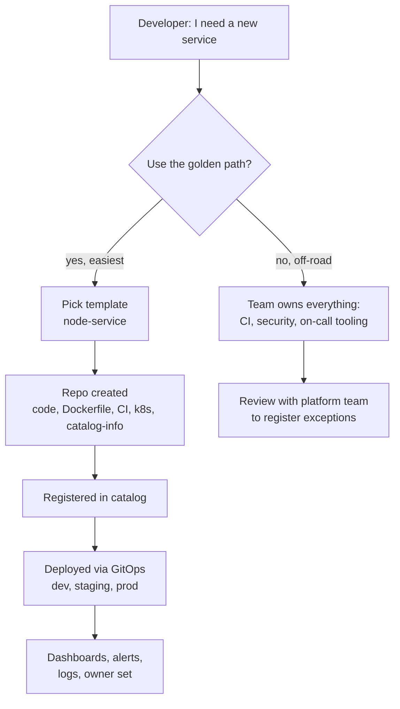
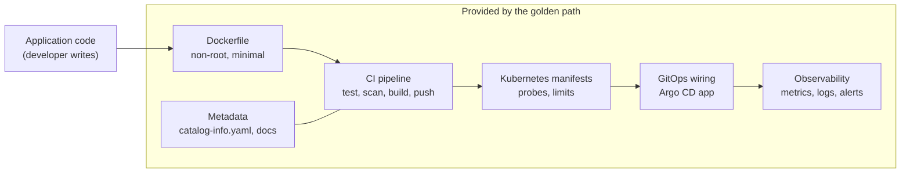

# L18.4 — Golden Paths

> **Level 18: Platform Engineering** · Topic 4 of 10 · ⏱ ~4 hours · Difficulty: Intermediate

## 1. What it is

A **golden path** is an opinionated, well-supported, **self-service route** to accomplish a common task - most often "create a new service and get it to production" -
in which the platform team has already made the boring decisions (language runtime, CI pipeline, container base image, Kubernetes manifests, logging, alerts, security
scanning). A developer who follows the path gets a working, compliant, observable service in minutes, and does not need to know *why* each choice was made to be safe.

The idea is usually credited to Spotify, which describes "golden paths" as the supported way to build and ship software. Netflix uses the phrase **"paved road"** for the same
concept. The key principle in both: **a path, not a cage**. Teams *can* leave it, but staying on it is so much easier that most choose to.

## 2. Why it matters in DevOps

- **Speed:** days of setup become a form submission and a few minutes of automation.
- **Safety by default:** security scanning, resource limits, health probes and non-root containers come built in ([Non-root Containers](../level-04-docker/11-non-root-containers.md)).
- **Operability:** every service logs, exposes metrics and has an owner in the same way, so on-call engineers can debug an unfamiliar service quickly.
- **Maintenance leverage:** upgrade the path (a base image, a CI step) once and hundreds of services benefit - *if* services stay connected to the path.
- **The failure modes:** a path that is too rigid gets bypassed; one that is too loose provides no value; one that is mandated before it is good breeds hostility.

## 3. Real-world system example

**Spotify's Backstage Software Templates** are the open-source embodiment of golden paths: a template creates a repository from a skeleton, wires CI,
registers the service in the catalog and links docs, so every new service starts the same way. **Netflix's "paved road"** is a publicly discussed philosophy: they provide a set of well-integrated
tools and defaults and explicitly allow teams to deviate if they accept the extra operational burden. In the Kubernetes world, **Helm charts**, **Argo CD ApplicationSets** and
**Crossplane compositions** are common building blocks behind a path. The *Team Topologies* book frames this as the platform team providing a "self-service, easy to consume" service to stream-aligned teams.
(Details of any company's internal path change over time; rely on their published articles and talks.)

## 4. Diagram



What a path contains (the layers a developer does not have to build):



## 5. How it works

### Paved road versus mandate

| | Paved road (golden path) | Mandate |
|---|---|---|
| Adoption driver | value: it is faster and safer | policy: you must |
| Deviation | allowed, with accepted responsibility | blocked or requires exception |
| Feedback | teams tell you where it hurts, you improve it | teams hide workarounds |
| Best when | the platform is young and needs to earn trust | a hard compliance requirement exists (for example, scanning images) |

A healthy pattern: **paved road for choices, mandate only for non-negotiables** (security baselines, mandatory ownership metadata), and enforce those via guardrails that are the
same for everyone ([Policy as Code](07-policy-as-code.md)).

### What goes into a template

1. **Skeleton repo:** app starter, `Dockerfile`, tests, `README`.
2. **CI/CD:** a *thin* workflow that calls a shared, versioned workflow owned by the platform team (so improvements propagate).
3. **Deployment config:** Kubernetes manifests or Helm values plus the Argo CD `Application` or an entry in an `ApplicationSet` ([Application Synchronization](../level-17-gitops/05-application-synchronization.md)).
4. **Observability:** a metrics endpoint, structured logging, a default dashboard and alerts ([Structured Logging](../level-10-observability/05-structured-logging.md)).
5. **Metadata:** `catalog-info.yaml` with owner, lifecycle and a **label recording which path version it was created from** (enables adoption tracking).
6. **Docs:** a "getting started" page and runbook stub.

### Template drift and keeping services current

A template is a *copy*; once copied, services drift. Mitigations:

- **Put logic in shared, versioned components** (reusable workflows, Helm library charts, base images) that services reference rather than copy.
- **Automated update PRs** (Renovate or Dependabot) when the shared component or path version changes.
- **Version the path** (`node-service-v1`, `v2`) and track who is on which version.

### Measuring adoption

| Metric | Meaning | Where it comes from |
|---|---|---|
| % of services created from a current path | reach | catalog labels |
| Time to first production deploy for a new service | the path's promise | repo creation to first deploy timestamps |
| Template usage per month | demand | portal/scaffolder logs |
| Deviation rate and reasons | where the path is wrong | exception log, survey |
| Developer satisfaction (CSAT or NPS) | perceived value | quarterly survey |
| Lead time, change failure rate (DORA) | outcome improvement | CI/CD data |

Adoption is a **leading indicator**; DORA metrics and incident rates are outcomes. Watch both, and treat "nobody uses it" as feedback about the path, not about the users.

## 6. Step-by-step guide

**Prerequisites:** `bash`, `python3` with PyYAML. Optional: a Backstage instance from [Developer Portals](02-developer-portals.md). Cost: none. We reuse the template idea from
[Internal Developer Platforms](01-internal-developer-platforms.md) and add versioning and adoption measurement.

1. **Make the template record its path version.** In the template's `catalog-info.yaml`, add a label:
   ```yaml
   apiVersion: backstage.io/v1alpha1
   kind: Component
   metadata:
     name: __NAME__
     labels:
       platform.example.com/golden-path: node-service-v2
   spec:
     type: service
     lifecycle: experimental
     owner: __OWNER__
   ```
   Every scaffolded service now carries its provenance.

2. **Simulate a fleet of services at different adoption levels.**
   ```bash
   mkdir -p repos/{shop-api,orders-worker,legacy-billing,shop-web,pricing}
   mk() { cat > repos/$1/catalog-info.yaml <<EOF
   apiVersion: backstage.io/v1alpha1
   kind: Component
   metadata:
     name: $1
   $2
   spec:
     type: service
     lifecycle: production
     owner: team-shop
   EOF
   }
   mk shop-api "  labels:
       platform.example.com/golden-path: node-service-v2"
   ```
   Repeat `mk` for the others: `orders-worker` on `node-service-v1`, `legacy-billing` with an empty second argument (no label),
   and `shop-web` and `pricing` on `node-service-v2`. Check one with `cat repos/shop-api/catalog-info.yaml`.
   (Alternatively, create the five files by hand; the point is the label values.)

3. **Write the adoption report.**
   ```bash
   cat > adoption.py <<'EOF'
   #!/usr/bin/env python3
   """Report golden path adoption from catalog-info.yaml files under repos/*/."""
   import collections, glob, yaml

   LABEL = "platform.example.com/golden-path"
   CURRENT = "node-service-v2"
   counts, laggards = collections.Counter(), []
   for path in sorted(glob.glob("repos/*/catalog-info.yaml")):
       doc = yaml.safe_load(open(path))
       name = doc["metadata"]["name"]
       path_used = doc["metadata"].get("labels", {}).get(LABEL, "none")
       counts[path_used] += 1
       if path_used != CURRENT:
           laggards.append((name, path_used))

   total = sum(counts.values())
   print(f"services: {total}")
   for k, v in counts.most_common():
       print(f"  {k:<16} {v:>2}  {100*v/total:5.1f}%")
   print(f"on current golden path ({CURRENT}): {100*counts[CURRENT]/total:.0f}%")
   print("to migrate:", ", ".join(f"{n} ({p})" for n, p in laggards) or "nobody")
   EOF
   python3 adoption.py
   ```
   Expected (verified for the five-service setup above):
   ```text
   services: 5
     node-service-v2   3   60.0%
     none              1   20.0%
     node-service-v1   1   20.0%
   on current golden path (node-service-v2): 60%
   to migrate: legacy-billing (none), orders-worker (node-service-v1)
   ```
   This is the same query a catalog or scorecard tool would run ([Service Catalogs](05-service-catalogs.md)).

4. **Express the path as a Backstage software template** (illustrative; Backstage's template syntax evolves, so check the current docs and see [Backstage](08-backstage.md)):
   ```yaml
   apiVersion: scaffolder.backstage.io/v1beta3
   kind: Template
   metadata:
     name: node-service
     title: Node.js service (golden path v2)
     description: Creates a repo with CI, Kubernetes manifests, GitOps wiring and catalog registration
     tags: [nodejs, recommended]
   spec:
     owner: group:platform-team
     type: service
     parameters:
       - title: Service details
         required: [name, owner]
         properties:
           name:
             title: Name
             type: string
             pattern: '^[a-z][a-z0-9-]{2,30}$'
           owner:
             title: Owner
             type: string
             ui:field: OwnerPicker
             ui:options:
               catalogFilter:
                 kind: Group
     steps:
       - id: fetch
         name: Fetch skeleton
         action: fetch:template
         input:
           url: ./skeleton
           values:
             name: ${{ parameters.name }}
             owner: ${{ parameters.owner }}
       - id: publish
         name: Create repository
         action: publish:github
         input:
           repoUrl: github.com?owner=example&repo=${{ parameters.name }}
           description: Service ${{ parameters.name }}
       - id: register
         name: Register in catalog
         action: catalog:register
         input:
           repoContentsUrl: ${{ steps['publish'].output.repoContentsUrl }}
           catalogInfoPath: /catalog-info.yaml
   ```

5. **Define "done" for the path** (the contract you promise): write a short list of what every service gets on day one (CI green, image scanned, deployed to dev, dashboard, owner
   set, docs stub) and time a fresh scaffold against it. That timing is your headline metric.

6. **Plan an upgrade.** Create `node-service-v3` in your head (or a copy of the template with an added `HEALTHCHECK`) and decide how the 3 services on v2 will move: a bot PR per
   repo, a deadline, and an owner for stragglers. Update `CURRENT` in `adoption.py` and watch the percentage fall to 0% - the adoption chart always resets on a new version, which is why migration tooling matters.

## 7. Real-world scenario

*Illustrative scenario.* A platform team announces: "all new services must use the golden path from 1 March." Teams comply on paper but copy an old repo and rename it; the catalog shows
"golden path adoption: 95%" because the label was copied too. A review of the metric against time-to-first-deploy and incident data shows the numbers do not match. The team switches
approach: they make the path genuinely faster (scaffold to production in 20 minutes), add a real provenance check (the CI shared workflow version in use, not just a label), and talk to the
three teams still off-road. Two of them have valid needs (GPU workloads) that become a second path (`ml-service`). **Lesson:** measure outcomes and real usage, not just labels, and let
feedback from off-road teams shape new paths.

## 8. Common mistakes and best practices

**Don't**

- Mandate a path before it is better than the alternative.
- Copy logic into every service when it can live in a shared, versioned component.
- Build one path to rule them all; "web service", "batch job" and "data pipeline" have different needs.
- Judge success only by a label count.
- Forget day-2: upgrades, deprecations and migration help are part of the product.

**Do**

- Start with the most common journey and make it excellent.
- Version paths and keep a changelog and deprecation policy.
- Give opt-outs a clear process and learn from them.
- Make security and compliance defaults non-optional but invisible.
- Review adoption and satisfaction every quarter and retire paths nobody uses.

## 9. Tasks

- [ ] **T1 — Add provenance to a template** *(≈20 min, beginner)*
  - **Goal:** every scaffolded service records its path version.
  - **Steps:**
    1. Add the `golden-path` label to your template's `catalog-info.yaml` (step 1).
    2. Scaffold a service and check the label.
  - **Done when:** `grep golden-path out/<service>/catalog-info.yaml` shows `node-service-v2`.

- [ ] **T2 — Measure adoption** *(≈30 min, beginner)*
  - **Goal:** produce an adoption report.
  - **Steps:**
    1. Create the five sample repos and `adoption.py` (steps 2-3).
    2. Run it and note the percentages.
  - **Done when:** your output matches the expected report, and you can explain why `legacy-billing` is flagged.

- [ ] **T3 — Extend the report** *(≈45 min, intermediate)*
  - **Goal:** make the metric more useful.
  - **Steps:**
    1. Group adoption by `spec.owner` and print the team with the lowest adoption.
    2. Add a `--json` flag that outputs the data for a dashboard.
  - **Done when:** the script prints per-team percentages and valid JSON with `--json` (check with `python3 -m json.tool`).

- [ ] **T4 — Make the path deliver value (shared workflow)** *(≈60 min, intermediate)*
  - **Goal:** put logic in a shared component rather than the template.
  - **Steps:**
    1. Create a repo with a reusable GitHub Actions workflow (`on: workflow_call`) that runs tests and a Trivy scan ([Container Image Scanning](../level-11-security-devsecops/09-container-image-scanning.md)).
    2. Change the template's `ci.yaml` to `uses: <owner>/<repo>/.github/workflows/node-service.yaml@v1`.
    3. Add a scan step to the shared workflow only, and observe a service pick it up without changing its own files.
  - **Done when:** a scaffolded service runs the new scan step after you changed only the shared repo.

- [ ] **T5 — Break it: the copy-paste cheat** *(≈45 min, advanced)*
  - **Goal:** see why labels alone are weak.
  - **Steps:**
    1. Copy `legacy-billing` and add the v2 label by hand without adopting anything else.
    2. Extend `adoption.py` to also check that `.github/workflows/ci.yaml` references the shared workflow and report "label but not real" cases.
  - **Done when:** the report distinguishes real adopters from label-only ones.

- [ ] **T6 — Prove it: design a path** *(≈45 min, advanced)*
  - **Goal:** specify a second golden path.
  - **Steps:**
    1. Without notes, write a one-page spec for a "scheduled batch job" path: what the developer provides, what the platform provides, success metrics, and the off-road policy.
    2. Explain how you would persuade a skeptical team to try it.
  - **Done when:** a teammate can tell what the path gives them, what it costs them, and how you will know it worked.

## 10. Self-check questions

1. What is the difference between a golden path and a mandate?
2. Why does a template alone not keep services up to date?
3. Name four metrics for golden path success.
4. Why version golden paths?
5. What should happen when a team goes off-road?

<details>
<summary>Answers</summary>

1. A golden path wins by being the easiest, best-supported route and allows deviation; a mandate forces compliance regardless of value.
2. A template is copied once and then drifts; keep logic in shared versioned components and use automated update PRs.
3. For example: % of services on the current path, time to first production deploy, deviation rate and reasons, developer satisfaction, DORA metrics.
4. So improvements can ship without breaking existing services, adoption can be tracked per version and old versions can be deprecated.
5. They accept responsibility for the extra operational burden, register the exception, and the platform team learns why - the feedback may become a new path.
</details>

## 11. Further reading

- Spotify Engineering blog and Backstage documentation - "Golden Path" and Software Templates.
- Netflix Technology Blog - talks and posts on the "paved road".
- *Team Topologies* by Skelton and Pais - platform as a self-service product.
- CNCF Platforms White Paper - "Measuring your platform".
- See also: [Internal Developer Platforms](01-internal-developer-platforms.md) and [Service Catalogs](05-service-catalogs.md).

<!-- nav -->
---
← Previous: [Self-service Infrastructure](03-self-service-infrastructure.md) · [Level 18 index](README.md) · Next: [Service Catalogs](05-service-catalogs.md) →
