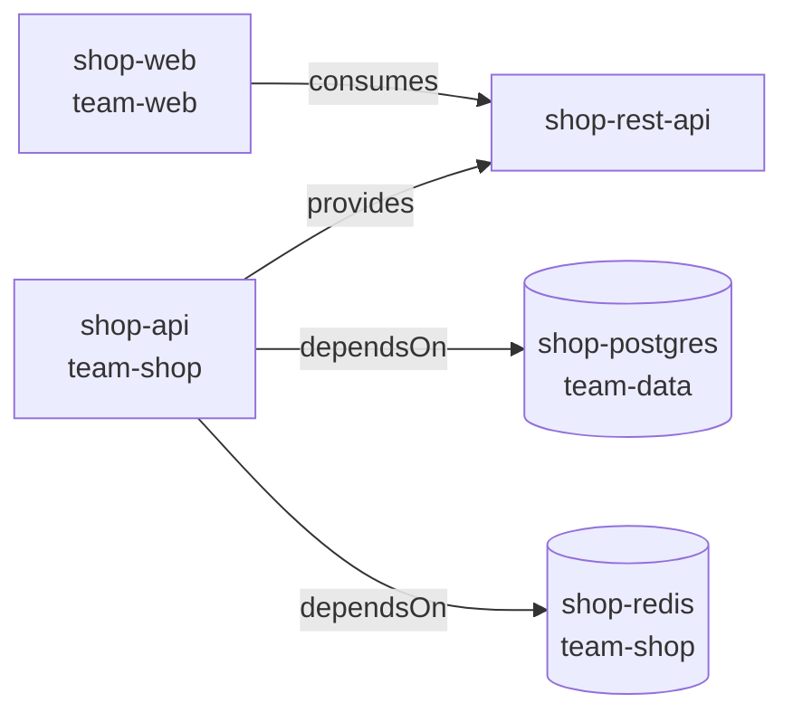

# L18.5 — Service Catalogs

> **Level 18: Platform Engineering** · Topic 5 of 10 · ⏱ ~4 hours · Difficulty: Intermediate

## 1. What it is

A **service catalog** is a registry of the software your organisation runs - services, websites, libraries, APIs, databases, queues - together with **metadata** about each:
who owns it, what lifecycle stage it is in, what it depends on, where its code, docs, dashboards and runbooks are. It is the "source of truth about our software" that the
[developer portal](02-developer-portals.md) displays and that automation can query.

In Backstage (the most widely used open-source catalog) the metadata lives **as code next to the service**, in a file called **`catalog-info.yaml`** at the repo root. A
catalog ingests those files, builds a graph of entities and relationships, and exposes it through a UI and API. Because the data lives in Git, it is versioned, reviewed and
owned by the team that knows it best.

## 2. Why it matters in DevOps

- **Ownership during incidents:** the first question at 3 a.m. is "who owns this service and how do I reach them?" A catalog answers in seconds; an outdated spreadsheet costs an hour.
- **Blast radius and impact analysis:** a **dependency graph** shows what breaks if a database goes down or an API changes.
- **Standards at scale:** **scorecards** measure each service against production-readiness criteria (runbook? on-call? tests? SLO?) and make gaps visible without nagging.
- **Compliance and cost:** auditors ask who owns what; FinOps allocates cost by owner ([FinOps](../level-20-cost-optimization/01-finops.md)); security wants to find every service using a vulnerable library.
- **Automation:** CI, alerting and Argo CD can read owner and tier from the catalog instead of hard-coding it.

## 3. Real-world system example

**Backstage's Software Catalog** is documented with a formal model: entity **kinds** such as `Component`, `API`, `Resource`, `System`, `Domain`, `Group`
and `User`, described in `catalog-info.yaml` with `apiVersion: backstage.io/v1alpha1`. Relations such as `ownedBy`, `dependsOn`, `providesApi`/`consumesApi` and
`partOf` are derived from fields like `spec.owner`, `spec.dependsOn`, `spec.providesApis` and `spec.system`. The catalog was created at Spotify to answer "what do we
own and who owns it?" at scale. Commercial portals (Port, Cortex, OpsLevel and others) provide catalogs and **scorecards** or "maturity" checks as core features, often
ingesting the same `catalog-info.yaml` format or integrating with cloud and CI APIs. For the data model's details, see the official Backstage documentation, since it evolves.

## 4. Diagram

```mermaid
flowchart LR
    subgraph REPOS["Git repositories"]
        r1["shop-api<br/>catalog-info.yaml"]
        r2["shop-web<br/>catalog-info.yaml"]
        r3["platform-infra<br/>catalog-info.yaml<br/>(databases)"]
    end
    ing["Catalog ingestion<br/>discovery and refresh"]
    graph["Catalog graph<br/>entities and relations"]
    ui["Portal UI<br/>search, owner pages,<br/>dependency graph"]
    sc["Scorecards<br/>production readiness"]
    api["Catalog API<br/>used by CI, alerts, bots"]
    r1 --> ing
    r2 --> ing
    r3 --> ing
    ing --> graph
    graph --> ui
    graph --> sc
    graph --> api
```

An example dependency graph for the running `shop` system:



## 5. How it works

### Entity kinds (Backstage model)

| Kind | Represents | Example |
|---|---|---|
| `Component` | a piece of software (`type: service`, `website`, `library`) | `shop-api` |
| `API` | an interface a component exposes (OpenAPI, gRPC, AsyncAPI) | `shop-rest-api` |
| `Resource` | infrastructure a component needs | `shop-postgres`, an S3 bucket |
| `System` | a group of components and resources that make a product | `shop` |
| `Domain` | a group of systems in a business area | `commerce` |
| `Group` / `User` | teams and people (owners) | `team-shop` |

### Anatomy of `catalog-info.yaml`

```yaml
apiVersion: backstage.io/v1alpha1
kind: Component
metadata:
  name: shop-api
  description: Node.js API for the shop
  annotations:
    github.com/project-slug: example/shop-api
    backstage.io/techdocs-ref: dir:.
  links:
    - url: https://example.com/runbooks/shop-api
      title: Runbook
  tags: [nodejs, tier-1]
spec:
  type: service
  lifecycle: production        # experimental | production | deprecated
  owner: team-shop             # a Group entity: the single accountable team
  system: shop
  providesApis:
    - shop-rest-api
  dependsOn:
    - resource:shop-postgres
    - resource:shop-redis
```

Key fields: `metadata.name` (unique), `spec.owner` (**mandatory in practice**), `spec.lifecycle`, `spec.system` (grouping), `dependsOn` (graph edges) and `annotations`
(machine-readable hooks: the repo, docs location, Kubernetes label selector, on-call schedule identifier and so on, depending on installed plugins).

### Ownership metadata - the rules that make it useful

1. **One owning team per entity**, a team (not a person) with a contact channel and an on-call rotation.
2. **Required in CI:** a repo without a valid `catalog-info.yaml` fails the pipeline.
3. **Reorg-proof:** owners reference `Group` entities, so renaming a team is one change.
4. **Lifecycle honesty:** mark `experimental` and `deprecated` accurately so people know what to rely on.

### Getting data into the catalog

| Method | Notes |
|---|---|
| Static `locations` in config | fine for a handful of repos |
| **Auto-discovery** of `catalog-info.yaml` across a GitHub org | scalable; the usual choice |
| Software template registers new services | new services appear automatically ([Golden Paths](04-golden-paths.md)) |
| Entity providers/importers | pull from cloud accounts, Kubernetes, CMDBs, Terraform state |

### Dependency graphs

Edges come from `dependsOn`, `consumesApis`/`providesApis` and `partOf`. Manually declared edges can drift from reality, so mature setups also **derive** edges from
runtime data (service mesh, tracing - see [Distributed Tracing](../level-10-observability/08-distributed-tracing.md) - or Kubernetes) and use the catalog as the human-curated layer on top.

### Scorecards

A scorecard evaluates each entity against rules and reports pass/fail and a level (bronze/silver/gold, or "production ready").

| Check | Why |
|---|---|
| Has an owner and an on-call route | someone gets paged |
| Has a runbook link | responders know what to do |
| Has docs (TechDocs) | knowledge outlives people |
| Has an SLO and dashboard | reliability is measured ([SLOs](../level-14-sre/02-slos.md)) |
| CI passes, image scanned, no critical vulnerabilities | security baseline |
| Uses a supported golden path version | maintainability |

Scorecards work best as **visibility plus gentle pressure** (team dashboards, quarterly goals), not as gates that block deploys on day one.

## 6. Step-by-step guide

**Prerequisites:** `python3` with PyYAML. Optional: your Backstage instance from [Developer Portals](02-developer-portals.md) to ingest the same files. Cost: none.

1. **Write the catalog for the `shop` system.** Create `catalog/shop.yaml` containing several entities separated by `---`:
   ```yaml
   apiVersion: backstage.io/v1alpha1
   kind: System
   metadata:
     name: shop
     description: The online shop
   spec:
     owner: team-shop
   ---
   apiVersion: backstage.io/v1alpha1
   kind: Component
   metadata:
     name: shop-api
     description: Node.js API for the shop
     annotations:
       github.com/project-slug: example/shop-api
       backstage.io/techdocs-ref: dir:.
     links:
       - url: https://example.com/runbooks/shop-api
         title: Runbook
   spec:
     type: service
     lifecycle: production
     owner: team-shop
     system: shop
     providesApis:
       - shop-rest-api
     dependsOn:
       - resource:shop-postgres
       - resource:shop-redis
   ---
   apiVersion: backstage.io/v1alpha1
   kind: API
   metadata:
     name: shop-rest-api
   spec:
     type: openapi
     lifecycle: production
     owner: team-shop
     system: shop
     definition: |
       openapi: 3.0.0
       info: {title: shop-api, version: "1.0"}
       paths: {}
   ---
   apiVersion: backstage.io/v1alpha1
   kind: Resource
   metadata:
     name: shop-postgres
   spec:
     type: database
     owner: team-data
     system: shop
   ---
   apiVersion: backstage.io/v1alpha1
   kind: Resource
   metadata:
     name: shop-redis
   spec:
     type: cache
     owner: team-shop
     system: shop
   ---
   apiVersion: backstage.io/v1alpha1
   kind: Component
   metadata:
     name: shop-web
     description: Storefront
     annotations:
       github.com/project-slug: example/shop-web
   spec:
     type: website
     lifecycle: production
     owner: team-web
     system: shop
     consumesApis:
       - shop-rest-api
   ```
   In real life each component's entry lives in its own repo; one file is simpler for practice.

2. **Generate the dependency graph and scorecard.**
   ```bash
   cat > catalog_report.py <<'EOF'
   #!/usr/bin/env python3
   """Read catalog/*.yaml; print a Mermaid dependency graph and a scorecard."""
   import glob, yaml

   entities = []
   for path in sorted(glob.glob("catalog/*.yaml")):
       entities += [d for d in yaml.safe_load_all(open(path)) if d]

   def ref(e): return f"{e['kind'].lower()}:{e['metadata']['name']}"
   by_ref = {ref(e): e for e in entities}

   print("```mermaid\nflowchart LR")
   for e in entities:
       name = e["metadata"]["name"]
       node = name.replace("-", "_")
       for dep in e["spec"].get("dependsOn", []):
           print(f"    {node} -->|dependsOn| {dep.split(':')[1].replace('-', '_')}")
       for api in e["spec"].get("consumesApis", []):
           print(f"    {node} -->|consumes| {api.replace('-', '_')}")
   print("```\n")

   CHECKS = {
       "has owner":       lambda e: bool(e["spec"].get("owner")),
       "has description": lambda e: bool(e["metadata"].get("description")),
       "has repo link":   lambda e: "github.com/project-slug" in e["metadata"].get("annotations", {}),
       "has runbook":     lambda e: any("runbook" in l.get("title", "").lower() for l in e["metadata"].get("links", [])),
       "has docs":        lambda e: "backstage.io/techdocs-ref" in e["metadata"].get("annotations", {}),
   }
   print(f"{'component':<12}", *[f"{c:<16}" for c in CHECKS], "score", sep=" ")
   for e in entities:
       if e["kind"] != "Component": continue
       res = [fn(e) for fn in CHECKS.values()]
       print(f"{e['metadata']['name']:<12}", *[f"{'PASS' if r else 'FAIL':<16}" for r in res], f"{sum(res)}/{len(res)}", sep=" ")

   # broken references
   for e in entities:
       for dep in e["spec"].get("dependsOn", []):
           if dep not in by_ref:
               print("BROKEN dependsOn:", ref(e), "->", dep)
   EOF
   python3 catalog_report.py
   ```
   Expected output (verified):
   ````text
   ```mermaid
   flowchart LR
       shop_api -->|dependsOn| shop_postgres
       shop_api -->|dependsOn| shop_redis
       shop_web -->|consumes| shop_rest_api
   ```

   component    has owner        has description  has repo link    has runbook      has docs         score
   shop-api     PASS             PASS             PASS             PASS             PASS             5/5
   shop-web     PASS             PASS             PASS             FAIL             FAIL             3/5
   ````
   (The first block is Mermaid text you can paste into any Mermaid renderer or a GitHub Markdown file; GitHub renders it.)

3. **Break a reference on purpose.** Change `resource:shop-postgres` to `resource:shop-postgress` and re-run. The script prints `BROKEN dependsOn: component:shop-api -> resource:shop-postgress`.
   Real catalogs flag unresolved relations in the UI; you should also fail CI on them.

4. **Add one more rule to the scorecard** - for example "component with `lifecycle: production` must have a `tier-*` tag". Add the tag to `shop-api` only and confirm the table changes.

5. **Ingest it into Backstage (optional).** In your local Backstage `app-config.yaml`:
   ```yaml
   catalog:
     locations:
       - type: file
         target: ../../catalog/shop.yaml
         rules:
           - allow: [Component, API, Resource, System]
   ```
   Restart and open **Catalog**; click `shop-api` and open the **Dependencies** tab / system diagram. Group entities (`team-shop`, `team-web`, `team-data`) must also be registered for owner links to resolve.
   Paths and plugin tabs depend on version; see the Backstage "Software Catalog" docs.

6. **Add an ownership check to CI** so every repo must carry a valid file:
   ```bash
   python3 - <<'EOF'
   import sys, yaml
   docs = [d for d in yaml.safe_load_all(open("catalog-info.yaml")) if d]
   problems = []
   for d in docs:
       if not d.get("spec", {}).get("owner"):
           problems.append(f"{d['metadata']['name']}: missing spec.owner")
       if d["kind"] == "Component" and d["spec"].get("lifecycle") not in {"experimental", "production", "deprecated"}:
           problems.append(f"{d['metadata']['name']}: bad lifecycle")
   print("\n".join(problems) or "catalog-info.yaml OK")
   sys.exit(1 if problems else 0)
   EOF
   ```

## 7. Real-world scenario

*Illustrative scenario.* At 02:10 an alert fires: `shop-redis` latency is high. The on-call engineer does not recognise the cache. They search the catalog, find `shop-redis`, see
`owner: team-shop`, a dependency view showing `shop-api` and `orders-worker` depend on it, and a runbook link. They page the right team and warn the owners of the two dependants
in one message. Without the catalog, they would have spent 40 minutes asking in chat. In the post-incident review the team notices that `orders-worker` was missing from the graph because
its `dependsOn` was never declared; they add a scorecard check "declares its dependencies" and derive edges from tracing as a cross-check. **Lesson:** a catalog pays off in minutes saved during
incidents, and only if the data is complete and fresh.

## 8. Common mistakes and best practices

**Don't**

- Maintain the catalog by hand in a wiki or spreadsheet.
- Assign ownership to individuals or to teams that no longer exist.
- Let scorecards become a punishment; metrics that block everyone get gamed or ignored.
- Model every library and script on day one; start with production services and their datastores.
- Trust hand-declared dependency edges as complete.

**Do**

- Keep `catalog-info.yaml` in each repo and auto-discover it.
- Require `owner`, `lifecycle` and `system` in CI, and validate references.
- Link owners to on-call, chat channels and runbooks.
- Start scorecards with 4-6 checks that matter during incidents, then grow.
- Cross-check declared dependencies with runtime data.

## 9. Tasks

- [ ] **T1 — Write a catalog entry** *(≈30 min, beginner)*
  - **Goal:** describe `shop-api` as a Component.
  - **Steps:**
    1. Create `catalog-info.yaml` with name, description, type, lifecycle, owner and a GitHub annotation.
    2. Validate that it parses (`python3 -c "import yaml; print(list(yaml.safe_load_all(open('catalog-info.yaml'))))"`).
  - **Done when:** the file parses and contains an owner and lifecycle.

- [ ] **T2 — Model the system** *(≈45 min, beginner)*
  - **Goal:** add Resources, an API and a System.
  - **Steps:**
    1. Create the entities from step 1, then add an `orders-worker` component that depends on `shop-redis` and `shop-postgres`.
    2. Run `catalog_report.py` and read the graph.
  - **Done when:** the Mermaid graph shows `orders_worker` with two `dependsOn` edges.

- [ ] **T3 — Extend the scorecard** *(≈45 min, intermediate)*
  - **Goal:** add two more checks and a letter grade.
  - **Steps:**
    1. Add checks for "has `tier-*` tag" and "has SLO link" (an annotation or link titled SLO).
    2. Print a grade (5/5 gold, 3-4 silver, otherwise bronze).
  - **Done when:** `shop-web` is bronze or silver and `shop-api` gold, with the reasons visible.

- [ ] **T4 — Break it: catch a broken reference** *(≈30 min, intermediate)*
  - **Goal:** make CI catch bad metadata.
  - **Steps:**
    1. Misspell a dependency and an owner.
    2. Extend the script to also report unknown owners (not in a `Group` list) and exit non-zero.
    3. Wire it into a GitHub Actions job on pull requests.
  - **Done when:** the PR check fails with both errors listed, and passes after you fix them.

- [ ] **T5 — Ingest into Backstage and use it in an incident drill** *(≈90 min, advanced)*
  - **Goal:** see the catalog help answer "who owns this?".
  - **Steps:**
    1. Register your YAML as a file location in a local Backstage instance (and add Group entities for the teams).
    2. Pretend `shop-redis` is failing: use only the portal to find the owner, dependants and runbook, and time yourself.
  - **Done when:** you identified owner, two dependants and the runbook link in under two minutes, and wrote down what was missing.

- [ ] **T6 — Prove it: design the metadata standard** *(≈45 min, advanced)*
  - **Goal:** specify what every service must declare.
  - **Steps:**
    1. Without notes, write a one-page "catalog-info.yaml standard": required fields, naming, lifecycle values, annotation conventions, and the five scorecard checks.
    2. Explain how you will keep the catalog fresh and how you will roll the standard out to 100 existing repos.
  - **Done when:** a teammate can add a correct entry for a new service from your page alone, and your rollout plan names the automation (discovery, CI check, bot PRs).

## 10. Self-check questions

1. What does `spec.owner` refer to, and why must it be a team?
2. Which fields create dependency edges in the Backstage catalog?
3. What is a scorecard and why not use it as a hard deploy gate at first?
4. Why store `catalog-info.yaml` in each repository?
5. How can you detect missing or stale dependency edges?

<details>
<summary>Answers</summary>

1. A `Group` entity (team) that is accountable for the component; teams are stable and have on-call, while individuals leave or change roles.
2. `dependsOn`, `providesApis`/`consumesApis` and `system` (partOf) relations.
3. A scorecard checks entities against production-readiness rules; hard gates before the data is accurate create friction and gaming, so start as visibility.
4. The owning team keeps it current in the same PR as the change, it is versioned and reviewed, and discovery scales across the organisation.
5. Compare declared edges against runtime data (traces, mesh metrics, Kubernetes) and fail CI on unresolved references.
</details>

## 11. Further reading

- Backstage documentation - "Software Catalog": descriptor format, system model, well-known annotations and relations.
- CNCF Platforms White Paper - catalogs and metadata as platform capabilities.
- Vendor documentation for Port, Cortex or OpsLevel on scorecards and maturity models.
- *Team Topologies* by Skelton and Pais - ownership and team APIs.
- See also: [Golden Paths](04-golden-paths.md) and [Backstage](08-backstage.md).

<!-- nav -->
---
← Previous: [Golden Paths](04-golden-paths.md) · [Level 18 index](README.md) · Next: [Infrastructure Templates](06-infrastructure-templates.md) →
