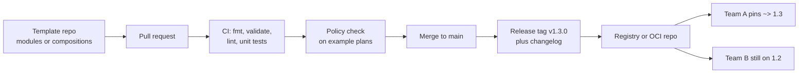
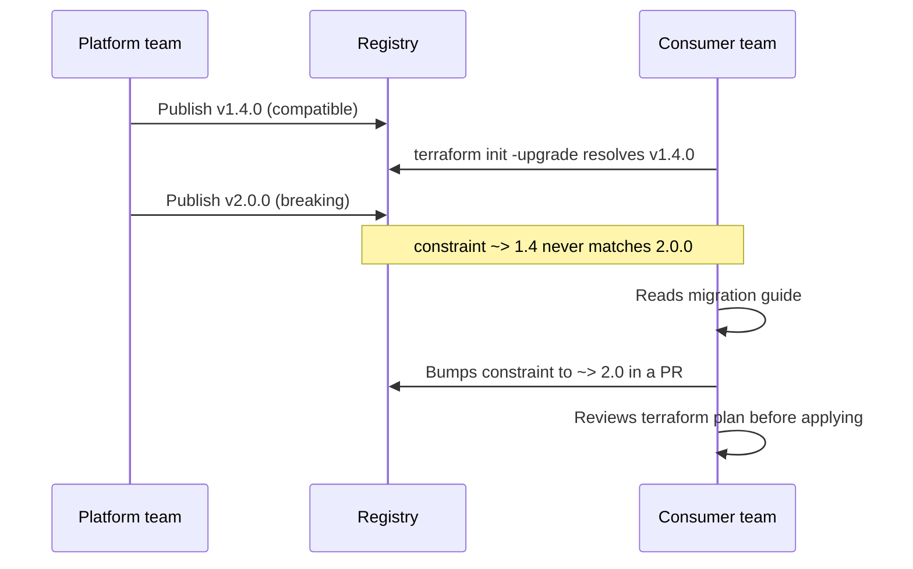

# L18.6 — Infrastructure Templates

> **Level 18: Platform Engineering** · Topic 6 of 10 · ⏱ ~4 hours · Difficulty: Intermediate

## 1. What it is

An **infrastructure template** is a reusable, parameterised, versioned definition of "a thing the platform knows how
to build": a database, a queue, a namespace with quotas, a whole service environment. Instead of every team copying
200 lines of Terraform from the last team that did it, they call the template with five inputs and get a result that
already contains the organisation's defaults for naming, tagging, encryption, backups and networking.

Templates come in several shapes, and a platform usually uses more than one: **Terraform/OpenTofu modules**,
**Crossplane Compositions** (see [Crossplane](09-crossplane.md)), **Helm charts** (see
[Charts](../level-09-helm/01-charts.md)), and **scaffolding templates** that generate a repository (cookiecutter,
Backstage software templates, see [Backstage](08-backstage.md)). They all share three problems that this topic is
about: how to make them *reusable* without making them unusable, how to *version* them so a fix does not break
every consumer at once, and how to *test* them so a change to the template is not first discovered in production.

## 2. Why it matters in DevOps

- **Consistency is the product.** If twenty teams each hand-roll an RDS instance, you get twenty slightly different
  backup windows, tag schemes and security groups. A template turns the policy into the default.
- **Fixes propagate.** When a vulnerability or a cost problem is found in the standard database setup, you change one
  template and roll it out, instead of auditing every repository.
- **Unversioned templates are outages waiting to happen.** A module consumed from `main` means any merge can change
  every consuming team's next `terraform apply` -- often a forced replacement of a stateful resource.
- **Untested templates ship bugs at platform scale.** One typo in a shared module breaks every team at once.
- **Cost and compliance.** Required tags (`owner`, `cost-center`) baked into a template are what make cost allocation
  work later (see [FinOps](../level-20-cost-optimization/01-finops.md)).

See also: [Modules](../level-07-terraform-iac/03-modules.md) for module basics and
[Self-service Infrastructure](03-self-service-infrastructure.md) for how templates get exposed to developers.

## 3. Real-world system example

**The public Terraform Registry and the `terraform-aws-modules` family.** The Terraform Registry hosts community and
vendor modules (for example the widely used `terraform-aws-modules/vpc/aws`). Every module there is versioned with
Git tags following semantic versioning, and consumers pin with a constraint such as `version = "~> 5.0"`. That
is exactly the model internal platforms copy: a module per repository, release tags, a documented input/output
contract and a changelog.

**Kubernetes-native examples.** Crossplane's Compositions package "a database" as a Composite Resource Definition
(XRD) plus one or more Compositions, and publish them as versioned **Configuration packages** (OCI images) that a
cluster installs. Helm charts follow the same idea with `Chart.yaml` `version` and chart repositories/OCI registries.
Backstage software templates (used at Spotify, which open-sourced Backstage, and by many adopters) scaffold a new
repository and then register it in the catalog so the generated service is immediately discoverable.

## 4. Diagram

The life of a template, from change to consumer:



How a consumer is insulated from a breaking change:



## 5. How it works

### Reusable: the interface is the design

A good template exposes **few inputs with safe defaults** and hides the rest. A rule of thumb: inputs describe *what
the team needs* (`size = "small"`), not *how it is built* (`instance_class = "db.t4g.medium"`). Teams that need more
can escape with an explicit override variable, but the default path must stay short.

| Template type | Interface | Versioned by | Typical tests |
|---------------|-----------|--------------|---------------|
| Terraform/OpenTofu module | `variables.tf` / `outputs.tf` | Git tag, registry `version` | `validate`, `tflint`, `terraform test`, Terratest |
| Crossplane Composition | XRD schema (the claim spec) | Configuration package tag | `crossplane render`, `crossplane beta validate`, e2e on kind |
| Helm chart | `values.yaml` + `values.schema.json` | `Chart.yaml` version | `helm lint`, `helm template`, `chart-testing` |
| Backstage/cookiecutter skeleton | template parameters form | Git ref of the template repo | scaffold into a temp dir and build it in CI |

### Versioning rules that keep consumers safe

- **Semantic versioning** (see [Semantic Versioning](../level-03-git-and-github/10-semantic-versioning-and-releases.md)):
  patch = bug fix, minor = new optional input or output, major = anything that can change or replace an existing
  resource (renamed input, changed default that alters a resource, removed output).
- **Consumers pin.** For Terraform modules: `version = "~> 1.3"` from a registry or `?ref=v1.3.2` on a Git source.
  Never `ref=main`.
- **Providers pin too.** The module declares `required_providers` with a lower bound; the root module owns the lock file.
- **Deprecate before removing.** Keep the old variable for one minor release with a `validation` or documentation warning.
- **Changelog and migration notes** are part of the release, because the consumer reads them before bumping.

### Testing layers (cheapest first)

1. **Static:** `terraform fmt -check`, `terraform validate`, `tflint`, `helm lint`.
2. **Unit (plan-only):** `terraform test` with `command = plan` and assertions on outputs and computed values;
   the same file can use `mock_provider` blocks (Terraform 1.7+) so no cloud credentials are needed.
3. **Policy on the plan:** render an example plan to JSON and run Conftest against it
   (see [Policy as Code](07-policy-as-code.md)).
4. **Integration:** apply the example into a throwaway account or kind cluster with Terratest or a CI job, assert, destroy.
5. **Upgrade test:** apply the *previous* release, then plan the new one -- a diff showing "forces replacement" on a
   stateful resource is a major-version change.

## 6. Step-by-step guide

**Prerequisites:** Terraform 1.6 or newer (or OpenTofu 1.6+) installed. No cloud account is needed: the sample module
uses only built-in language features, so everything runs locally and costs nothing.

1. **Create the module skeleton.** This module is the "baseline" every `shop-api` resource calls: it computes a standard
   name and the mandatory tags.
   ```bash
   mkdir -p ~/platform/tf-service-baseline/tests && cd ~/platform/tf-service-baseline
   ```

2. **Define the inputs with validation.**
   ```hcl
   # variables.tf
   variable "service" {
     type        = string
     description = "Service name, lowercase letters, digits and dashes."
     validation {
       condition     = can(regex("^[a-z][a-z0-9-]{2,30}$", var.service))
       error_message = "service must match ^[a-z][a-z0-9-]{2,30}$."
     }
   }

   variable "env" {
     type        = string
     description = "Deployment environment."
     validation {
       condition     = contains(["dev", "staging", "prod"], var.env)
       error_message = "env must be one of dev, staging, prod."
     }
   }

   variable "owner" {
     type        = string
     description = "Owning team (used for cost allocation)."
   }

   variable "extra_tags" {
     type    = map(string)
     default = {}
   }
   ```

3. **Implement and expose outputs.**
   ```hcl
   # main.tf
   terraform {
     required_version = ">= 1.6"
   }

   locals {
     name = "${var.service}-${var.env}"
     tags = merge(var.extra_tags, {
       service     = var.service
       env         = var.env
       owner       = var.owner
       cost-center = var.owner
       managed-by  = "terraform"
     })
   }
   ```
   ```hcl
   # outputs.tf
   output "name" {
     value = local.name
   }

   output "tags" {
     value = local.tags
   }
   ```

4. **Write the template tests.** Note `expect_failures` -- a template must also be tested for what it *rejects*.
   ```hcl
   # tests/baseline.tftest.hcl
   variables {
     service = "shop-api"
     env     = "dev"
     owner   = "team-shop"
   }

   run "builds_name_and_tags" {
     command = plan

     assert {
       condition     = output.name == "shop-api-dev"
       error_message = "name should be <service>-<env>"
     }

     assert {
       condition     = output.tags["managed-by"] == "terraform" && output.tags["owner"] == "team-shop"
       error_message = "standard tags missing"
     }
   }

   run "rejects_bad_env" {
     command = plan

     variables {
       env = "qa"
     }

     expect_failures = [var.env]
   }
   ```

5. **Run the static and unit layers.**
   ```bash
   terraform init -input=false
   terraform fmt -check -recursive && echo "fmt ok"
   terraform validate
   terraform test
   ```
   Expected (similar to):
   ```text
   Success! The configuration is valid.
   tests/baseline.tftest.hcl... in progress
     run "builds_name_and_tags"... pass
     run "rejects_bad_env"... pass
   tests/baseline.tftest.hcl... tearing down
   tests/baseline.tftest.hcl... pass

   Success! 2 passed, 0 failed.
   ```

6. **Release it with a version.** Put the module in its own Git repository and tag it.
   ```bash
   git init && git add . && git commit -m "feat: service baseline module"
   git tag v1.0.0
   ```
   A consumer then references it by tag, never by branch:
   ```hcl
   module "baseline" {
     source = "git::https://github.com/example-org/tf-service-baseline.git?ref=v1.0.0"
     service = "shop-api"
     env     = "prod"
     owner   = "team-shop"
   }
   ```
   (The URL is a placeholder -- for a local trial use `source = "../tf-service-baseline"`.)

7. **Wire it into CI** so every pull request runs the same checks.
   ```yaml
   # .github/workflows/module-ci.yml
   name: module-ci
   on:
     pull_request:
   jobs:
     test:
       runs-on: ubuntu-latest
       steps:
         - uses: actions/checkout@v4
         - uses: hashicorp/setup-terraform@v3
         - run: terraform fmt -check -recursive
         - run: terraform init -input=false
         - run: terraform validate
         - run: terraform test
   ```

## 7. Real-world scenario

*(Illustrative, not a documented incident.)* A platform team ships a `postgres` module used by 14 teams, all
referencing `ref=main`. Someone "tidies" the module by renaming the `aws_db_instance` resource from `this` to
`primary` without a `moved` block. The next day three teams run their routine pipelines: the plan shows
**destroy and create** of the production database. Two teams notice in review; the third has auto-apply on and
loses a staging database.

The investigation shows no one could see the blast radius, because every consumer tracked `main` and the module had
no test that planned an upgrade from the previous release. The fix is structural: the module is released with tags,
the rename ships as `v2.0.0` with a `moved { from = aws_db_instance.this to = aws_db_instance.primary }` block and a
migration note, consumers pin `~> 1.x` until they choose to move, and CI adds an upgrade test that plans the new
code against state created by the last release. **Lesson:** a template is an API; breaking changes need versions,
and "what does this do to existing state" is the most important test.

## 8. Common mistakes and best practices

**Don't**

- Consume modules from a moving branch (`ref=main`, no `version` constraint).
- Expose every underlying resource argument as an input -- you have just rebuilt the provider with extra steps.
- Hide security-relevant settings behind defaults that teams can silently turn off without review.
- Release a rename or default change as a patch or minor version.
- Skip negative tests: a module that accepts `env = "qa"` is silently broken.

**Do**

- Keep the interface small, outcome-oriented and validated; document it in a `README` generated from the code.
- Use semantic versioning, release notes and `moved` blocks; deprecate before removal.
- Test in layers: static, plan-level unit tests, policy on the plan, then occasional real applies.
- Provide an `examples/` directory that CI plans on every PR -- it doubles as documentation.
- Bake mandatory tags and encryption into the template so policy checks pass by default.

## 9. Tasks

- [ ] **T1 — Build and test the baseline module** *(≈30 min, beginner)*
  - **Goal:** follow the guide end to end locally.
  - **Steps:**
    1. Create the files from section 6 steps 1-4.
    2. Run `terraform init`, `terraform validate` and `terraform test`.
  - **Done when:** `terraform test` prints `Success! 2 passed, 0 failed.`

- [ ] **T2 — Consume it from a root module** *(≈30 min, beginner)*
  - **Goal:** see the template from the consumer side.
  - **Steps:**
    1. Create a sibling directory `consumer/` with a `main.tf` that calls the module via `source = "../tf-service-baseline"`.
    2. Add an `output "tags"` that forwards `module.baseline.tags`.
    3. Run `terraform init && terraform apply -auto-approve` (no resources, so it is safe) and `terraform output tags`.
  - **Done when:** the output lists `managed-by = "terraform"` and your team's `owner`.

- [ ] **T3 — Add a feature as a minor version** *(≈30 min, intermediate)*
  - **Goal:** extend the interface without breaking consumers.
  - **Steps:**
    1. Add an optional `data_classification` variable (default `"internal"`, validated against a list) and include it in `tags`.
    2. Add a test run asserting the default and one asserting an invalid value fails.
    3. Tag `v1.1.0`.
  - **Done when:** `terraform test` passes, the consumer from T2 works unchanged, and `git tag` shows `v1.0.0` and `v1.1.0`.

- [ ] **T4 — Break it on purpose, then catch it** *(≈40 min, intermediate)*
  - **Goal:** prove the tests detect a regression.
  - **Steps:**
    1. Change the name format to `${var.env}-${var.service}`.
    2. Run `terraform test` and read the failure.
    3. Decide: is this a major version? Revert, or bump to `v2.0.0` with an updated test and a note in a `CHANGELOG.md`.
  - **Done when:** you can show a red test run and a green one, and justify the version number.

- [ ] **T5 — Run the template tests in CI** *(≈40 min, intermediate)*
  - **Goal:** make the checks mandatory for every change.
  - **Steps:**
    1. Push the module to a GitHub repository and add the workflow from section 6 step 7.
    2. Open a pull request that breaks a test and confirm the check fails.
    3. Enable branch protection requiring the `module-ci` check (see [Protected Branches](../level-03-git-and-github/08-protected-branches-and-pull-requests.md)).
  - **Done when:** the failing PR cannot be merged and the fixed PR can.

- [ ] **T6 — Prove it: version policy for a template** *(≈45 min, advanced)*
  - **Goal:** be able to defend how a platform releases templates.
  - **Steps:**
    1. Without notes, write a one-page policy: which changes are patch, minor, major; how consumers pin; how deprecations work.
    2. Give one Terraform example, one Crossplane example (XRD field removed) and one Helm example for each class.
  - **Done when:** a teammate can classify five proposed changes using only your page.

## 10. Self-check questions

1. Why is consuming a module from `main` dangerous even if the module repository has code review?
2. What belongs in a template's input interface and what should be hidden?
3. Give two changes that must be a major version of a Terraform module.
4. What does `expect_failures` test, and why does a template need it?
5. Why is a plan-level test cheaper and often almost as valuable as an apply-level test?

<details>
<summary>Answers</summary>

1. Review checks the diff, not every consumer's state. A merge changes what all consumers plan the next time they run, with no opt-in.
2. Inputs: outcomes the team cares about (size, environment, owner). Hidden: implementation details such as resource names, internal subnets, and security-sensitive defaults.
3. Renaming or removing an input or output; a change that forces replacement of an existing resource (renaming a resource without `moved`, changing an immutable argument default).
4. That invalid inputs are rejected by `validation` blocks. Without it a template can silently accept bad input.
5. It needs no credentials or cloud resources, runs in seconds, and still checks computed values, validations and policy results.
</details>

## 11. Further reading

- Terraform documentation: "Modules", "Module Testing" (`terraform test`) and the Terraform Registry publishing guide.
- OpenTofu documentation (compatible module and test syntax).
- Crossplane documentation: "Compositions" and "Configuration packages".
- Semantic Versioning specification (semver.org).
- *Terraform: Up & Running* by Yevgeniy Brikman -- chapters on reusable modules and testing.

<!-- nav -->
---
← Previous: [Service Catalogs](05-service-catalogs.md) · [Level 18 index](README.md) · Next: [Policy as Code](07-policy-as-code.md) →
