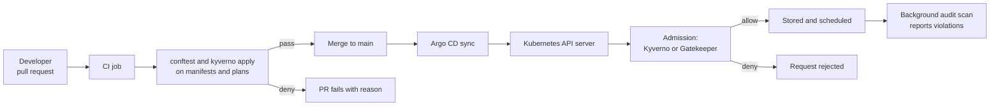
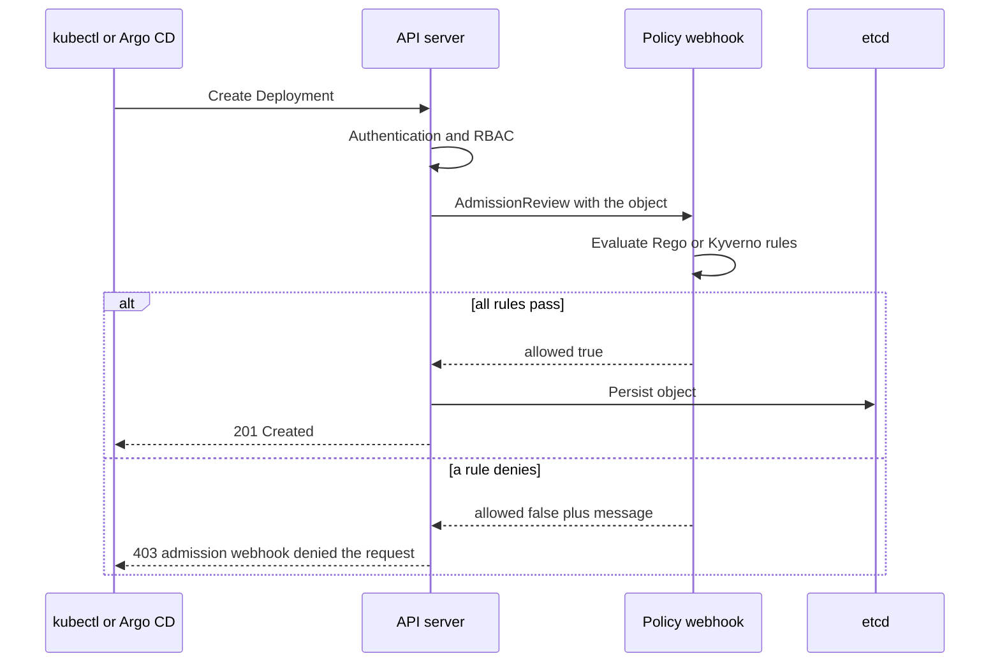

# L18.7 — Policy as Code

> **Level 18: Platform Engineering** · Topic 7 of 10 · ⏱ ~5 hours · Difficulty: Intermediate

## 1. What it is

**Policy as code** means writing your organisation's rules ("every Deployment has an owner label", "no public S3
buckets", "images come only from our registry") as version-controlled, testable programs that machines enforce, instead
of as a wiki page that humans are supposed to remember. A policy engine takes **input** (a Kubernetes manifest, a
Terraform plan, a Dockerfile, an API request) plus a set of **rules**, and returns **allow/deny with a reason**.

Two engines dominate Kubernetes-centred platforms. **Open Policy Agent (OPA)** is a general-purpose engine whose rules
are written in a declarative language called **Rego**; it also powers **Conftest** (a CLI that tests config files in
CI) and **Gatekeeper** (a Kubernetes admission controller). **Kyverno** is Kubernetes-native: policies are ordinary
YAML resources (`ClusterPolicy`), so teams that already know Kubernetes do not need a new language, and it can also
*mutate* and *generate* resources, not just validate them.

## 2. Why it matters in DevOps

- **Guardrails instead of gates.** A platform that offers self-service ([Self-service Infrastructure](03-self-service-infrastructure.md))
  must also make unsafe choices impossible, otherwise it needs a human approval for every request.
- **Shift left.** A rule that fails in a pull request costs a minute; the same rule failing at admission costs a
  failed deploy; discovered in an audit it costs a finding. Enforce in CI *and* in the cluster.
- **Auditable compliance.** "Show me that all production workloads have resource limits" becomes a query, not a spreadsheet.
- **Consistency across tools.** The same rule ("must have `owner` and `cost-center` tags") can protect Terraform plans,
  Kubernetes manifests and cloud accounts.
- **Risk:** policies are code that can block every deploy. Untested policies, or policies switched to enforce without an
  audit phase, cause platform-wide outages.

See also: [Admission Controllers and Webhooks](../level-16-advanced-kubernetes/06-admission-controllers-and-webhooks.md),
[Pod Security](../level-16-advanced-kubernetes/03-pod-security.md) and [DevSecOps](../level-00-what-devops-is/12-devsecops.md).

## 3. Real-world system example

**OPA** is a graduated project of the Cloud Native Computing Foundation (CNCF). Its Kubernetes integration,
**Gatekeeper**, runs as a validating admission webhook and expresses policies as `ConstraintTemplate` resources
containing Rego plus `Constraint` resources that instantiate them. **Conftest** applies the same Rego to
Kubernetes YAML, Terraform plan JSON, Dockerfiles and other structured files in CI. **Kyverno** is also a CNCF project
and is widely used for Kubernetes-only policy; its policies are YAML and it ships a CLI that evaluates policies offline
in CI.

Kubernetes itself has a built-in, in-process option: **ValidatingAdmissionPolicy**, which uses the Common Expression
Language (CEL) and is generally available in current Kubernetes releases (since v1.30). Many platforms use a built-in
policy type for the simplest rules and an external engine for richer ones.

## 4. Diagram

Where a policy runs on the way from a developer's laptop to a running pod:



How a validating admission request is evaluated:



## 5. How it works

### Rego in five minutes

Rego rules are **queries over data**. A rule like `deny contains msg if { ... }` adds `msg` to a set when *every*
expression in the body is true. If any expression is undefined or false, the rule contributes nothing. That makes
policies read as "this is bad when ...".

| Concept | Meaning | Example |
|---------|---------|---------|
| `input` | the document being checked | `input.kind == "Deployment"` |
| `data` | static data and other rules | `data.main.deny` |
| `some x in coll` | iterate | `some c in input.spec.template.spec.containers` |
| `not expr` | true if `expr` is undefined/false | `not c.resources.limits.memory` |
| `deny` / `warn` / `violation` | Conftest conventions: `deny` fails, `warn` warns | `deny contains msg if {...}` |
| `package main` | Conftest runs the `main` package by default; `-n` selects another | `conftest test -n terraform` |

Rego policies are unit-tested with `_test.rego` files (`test_` rules) and `opa test` / `conftest verify`.

### OPA/Gatekeeper versus Kyverno

| | OPA / Gatekeeper / Conftest | Kyverno |
|--|-----------------------------|---------|
| Language | Rego (general purpose) | YAML with patterns, JMESPath and CEL |
| Scope | Anything JSON-shaped: K8s, Terraform, Dockerfiles, APIs | Kubernetes resources (plus image verification and CLI checks) |
| Mutate / generate | Mutation via Gatekeeper assign; no generate | Mutate and generate are first-class |
| Learning curve | Steeper, very expressive | Gentle for Kubernetes users |
| One policy for CI and cluster | Yes (same Rego) | Yes (same ClusterPolicy via the CLI) |
| Reporting | Gatekeeper audit results on constraints | `PolicyReport` / `ClusterPolicyReport` resources |

Neither is "better": choose Kyverno when the scope is only Kubernetes and the team prefers YAML; choose OPA when the
same engine must also guard Terraform plans, CI configs and service authorisation.

### Rollout modes

Almost every engine supports an **audit/warn** mode and an **enforce/deny** mode. The safe order is: write the policy
and unit tests, run it in audit mode and read the violation report, fix or exempt existing workloads, then switch to
enforce. Always support **exceptions** (an annotated namespace or an explicit `PolicyException`) so one legitimate
workload does not force you to disable a whole policy.

## 6. Step-by-step guide

**Prerequisites:** Linux or macOS shell. Install the OPA and Conftest binaries from their GitHub release pages (or run
Conftest via Docker: `docker run --rm -v "$PWD":/project openpolicyagent/conftest test ...`). For the Kyverno part
install the `kyverno` CLI from its release page. Nothing here needs a cluster or cloud account; all checks run offline
on files. The outputs below were produced with OPA 1.0.0, Conftest 0.56.0 and Kyverno CLI 1.13.4; yours will be
similar.

1. **Create a project and two test manifests.**
   ```bash
   mkdir -p ~/policy-lab/{policy,manifests,tf} && cd ~/policy-lab
   cat > manifests/deploy-bad.yaml <<'EOF'
   apiVersion: apps/v1
   kind: Deployment
   metadata:
     name: shop-api
   spec:
     replicas: 1
     selector:
       matchLabels: {app: shop-api}
     template:
       metadata:
         labels: {app: shop-api}
       spec:
         containers:
           - name: api
             image: shop-api:latest
   EOF
   cat > manifests/deploy-good.yaml <<'EOF'
   apiVersion: apps/v1
   kind: Deployment
   metadata:
     name: shop-api
     labels: {owner: team-shop}
   spec:
     replicas: 3
     selector:
       matchLabels: {app: shop-api}
     template:
       metadata:
         labels: {app: shop-api}
       spec:
         containers:
           - name: api
             image: ghcr.io/example/shop-api:1.4.2
             resources:
               limits: {memory: 256Mi}
   EOF
   ```

2. **Write the Rego policy.** `import rego.v1` makes the file valid on both older and current OPA releases.
   ```rego
   # policy/k8s.rego
   package main

   import rego.v1

   is_deployment if input.kind == "Deployment"

   containers contains c if {
   	is_deployment
   	some c in input.spec.template.spec.containers
   }

   deny contains msg if {
   	some c in containers
   	endswith(c.image, ":latest")
   	msg := sprintf("container %q uses the mutable tag :latest", [c.name])
   }

   deny contains msg if {
   	some c in containers
   	not contains(c.image, ":")
   	msg := sprintf("container %q has no image tag (defaults to :latest)", [c.name])
   }

   deny contains msg if {
   	some c in containers
   	not c.resources.limits.memory
   	msg := sprintf("container %q must set resources.limits.memory", [c.name])
   }

   deny contains msg if {
   	is_deployment
   	not input.metadata.labels.owner
   	msg := sprintf("Deployment %q must have an 'owner' label", [input.metadata.name])
   }

   warn contains msg if {
   	is_deployment
   	input.spec.replicas == 1
   	msg := sprintf("Deployment %q runs a single replica", [input.metadata.name])
   }
   ```

3. **Run Conftest against both files.**
   ```bash
   conftest test manifests/deploy-bad.yaml; echo "exit=$?"
   conftest test manifests/deploy-good.yaml; echo "exit=$?"
   ```
   Expected for the bad file (exit code 1) and the good file (exit code 0):
   ```text
   WARN - manifests/deploy-bad.yaml - main - Deployment "shop-api" runs a single replica
   FAIL - manifests/deploy-bad.yaml - main - Deployment "shop-api" must have an 'owner' label
   FAIL - manifests/deploy-bad.yaml - main - container "api" must set resources.limits.memory
   FAIL - manifests/deploy-bad.yaml - main - container "api" uses the mutable tag :latest

   5 tests, 1 passed, 1 warning, 3 failures, 0 exceptions
   ...
   5 tests, 5 passed, 0 warnings, 0 failures, 0 exceptions
   ```
   The non-zero exit code is what makes a CI job fail.

4. **Unit-test the policy itself.** Policies are code; they need tests.
   ```rego
   # policy/k8s_test.rego
   package main

   import rego.v1

   good := {
   	"kind": "Deployment",
   	"metadata": {"name": "shop-api", "labels": {"owner": "team-shop"}},
   	"spec": {"replicas": 3, "template": {"spec": {"containers": [{
   		"name": "api",
   		"image": "ghcr.io/example/shop-api:1.4.2",
   		"resources": {"limits": {"memory": "256Mi"}},
   	}]}}},
   }

   test_good_deployment_passes if {
   	count(deny) == 0 with input as good
   }

   test_latest_tag_denied if {
   	bad := json.patch(good, [{"op": "replace", "path": "/spec/template/spec/containers/0/image", "value": "shop-api:latest"}])
   	count(deny) == 1 with input as bad
   }

   test_missing_owner_denied if {
   	bad := json.patch(good, [{"op": "remove", "path": "/metadata/labels/owner"}])
   	deny["Deployment \"shop-api\" must have an 'owner' label"] with input as bad
   }
   ```
   ```bash
   conftest verify          # or: opa test policy -v
   ```
   Expect `3 tests, 3 passed`.

5. **Apply the same idea to a Terraform plan.** Conftest reads JSON, so policy can guard infrastructure before it
   exists. Save as `policy/tf.rego`:
   ```rego
   package terraform

   import rego.v1

   required_tags := {"owner", "cost-center"}

   changed contains rc if {
   	some rc in input.resource_changes
   	some action in rc.change.actions
   	action in {"create", "update"}
   }

   deny contains msg if {
   	some rc in changed
   	rc.type == "aws_s3_bucket_public_access_block"
   	rc.change.after.block_public_acls == false
   	msg := sprintf("%s: block_public_acls must be true", [rc.address])
   }

   deny contains msg if {
   	some rc in changed
   	rc.type == "aws_instance"
   	missing := required_tags - object.keys(object.get(rc.change.after, "tags", {}))
   	count(missing) > 0
   	msg := sprintf("%s: missing required tags %v", [rc.address, sort(missing)])
   }
   ```
   A real plan comes from `terraform plan -out=tfplan && terraform show -json tfplan > plan.json`. For a quick local
   test, a hand-written fragment is enough:
   ```bash
   cat > tf/plan.json <<'EOF'
   {"resource_changes": [
     {"address": "aws_instance.api", "type": "aws_instance",
      "change": {"actions": ["create"], "after": {"instance_type": "t3.micro", "tags": {"owner": "team-shop"}}}},
     {"address": "aws_s3_bucket_public_access_block.assets", "type": "aws_s3_bucket_public_access_block",
      "change": {"actions": ["create"], "after": {"block_public_acls": false}}}
   ]}
   EOF
   conftest test tf/plan.json -n terraform
   ```
   ```text
   FAIL - tf/plan.json - terraform - aws_instance.api: missing required tags ["cost-center"]
   FAIL - tf/plan.json - terraform - aws_s3_bucket_public_access_block.assets: block_public_acls must be true

   2 tests, 0 passed, 0 warnings, 2 failures, 0 exceptions
   ```

6. **Write the same rules in Kyverno.** Policies are plain Kubernetes YAML.
   ```yaml
   # kyverno/require-limits.yaml
   apiVersion: kyverno.io/v1
   kind: ClusterPolicy
   metadata:
     name: require-memory-limits-and-owner
   spec:
     validationFailureAction: Enforce   # use Audit while rolling out
     background: true
     rules:
       - name: memory-limit-required
         match:
           any:
             - resources:
                 kinds: [Deployment]
         validate:
           message: "Every container must set resources.limits.memory."
           pattern:
             spec:
               template:
                 spec:
                   containers:
                     - resources:
                         limits:
                           memory: "?*"
       - name: owner-label-required
         match:
           any:
             - resources:
                 kinds: [Deployment]
         validate:
           message: "Deployments must have an 'owner' label."
           pattern:
             metadata:
               labels:
                 owner: "?*"
       - name: no-latest-tag
         match:
           any:
             - resources:
                 kinds: [Deployment]
         validate:
           message: "Images must not use the :latest tag."
           pattern:
             spec:
               template:
                 spec:
                   containers:
                     - image: "!*:latest"
   ```
   Evaluate it offline with the CLI, exactly as a CI job would:
   ```bash
   kyverno apply kyverno/require-limits.yaml --resource manifests/deploy-bad.yaml
   ```
   ```text
   Applying 3 policy rule(s) to 1 resource(s)...
   policy require-memory-limits-and-owner -> resource default/Deployment/shop-api failed:
   1 - memory-limit-required validation error: Every container must set resources.limits.memory. ...
   2 - owner-label-required validation error: Deployments must have an 'owner' label. ...
   3 - no-latest-tag validation error: Images must not use the :latest tag. ...

   pass: 0, fail: 3, warn: 0, error: 0, skip: 0
   ```
   The same command with `deploy-good.yaml` reports `pass: 3, fail: 0`.

7. **Enforce in CI.** One job runs both engines on every pull request.
   ```yaml
   # .github/workflows/policy.yml
   name: policy
   on:
     pull_request:
   jobs:
     policy:
       runs-on: ubuntu-latest
       steps:
         - uses: actions/checkout@v4
         - name: Install conftest
           run: |
             curl -sSL -o conftest.tgz https://github.com/open-policy-agent/conftest/releases/download/v0.56.0/conftest_0.56.0_Linux_x86_64.tar.gz
             tar xzf conftest.tgz conftest && sudo mv conftest /usr/local/bin/
         - run: conftest verify
         - run: conftest test manifests/ --all-namespaces
   ```

8. **Enforce in the cluster (optional, needs a kind cluster).** Install Kyverno from its Helm chart, apply the policy in
   `Audit` first, and read the report:
   ```bash
   helm repo add kyverno https://kyverno.github.io/kyverno/ && helm repo update
   helm install kyverno kyverno/kyverno -n kyverno --create-namespace
   kubectl apply -f kyverno/require-limits.yaml
   kubectl get clusterpolicyreport
   ```
   Switch `validationFailureAction` to `Enforce` only when the report is clean. Then
   `kubectl apply -f manifests/deploy-bad.yaml` is rejected with the policy message.

## 7. Real-world scenario

*(Illustrative.)* A platform team wants every workload to have memory limits. They write the policy and switch the
cluster admission rule straight to enforce on a Friday. On Monday the cluster's own add-ons cannot upgrade: several
system DaemonSets in `kube-system` have no limits, and the admission webhook rejects their rollout. Worse, the webhook
itself has `failurePolicy: Fail`, and when its pods are evicted during a node drain nothing can be created.

The recovery is to exclude `kube-system` and the policy engine's own namespace, then re-run in audit mode. The
durable fix: policies are unit-tested, new rules always ship in audit first, the report is reviewed for a week, and
the webhook runs multiple replicas with a PodDisruptionBudget. CI also runs the same rules, so developers see failures
in the pull request rather than as an admission error in Argo CD. **Lesson:** a policy engine is on the critical path
of every deploy; roll out like any production change.

## 8. Common mistakes and best practices

**Don't**

- Turn on enforcement before reading an audit report of existing workloads.
- Enforce only at admission: developers then discover problems after merge, in the deploy pipeline.
- Write policies without unit tests, or with messages like "denied" that do not say how to fix it.
- Make the admission webhook a single replica with `failurePolicy: Fail` and no exclusions for system namespaces.
- Maintain two divergent copies of "the same rule" for CI and for the cluster.

**Do**

- Keep policies in Git, reviewed and released like application code (see [Infrastructure Templates](06-infrastructure-templates.md)).
- Write messages that name the offender and the fix.
- Layer: IDE or pre-commit, CI (Conftest / Kyverno CLI), admission (Kyverno / Gatekeeper / ValidatingAdmissionPolicy), then background audit.
- Provide a documented exception process with an expiry date.
- Start with a short list of high-value rules: owner label, resource limits, trusted registries, no privileged containers, required cost tags.

## 9. Tasks

- [ ] **T1 — Run the Conftest lab** *(≈30 min, beginner)*
  - **Goal:** see a policy fail and pass on real YAML.
  - **Steps:**
    1. Create the files from section 6 steps 1-3.
    2. Run `conftest test` on the bad and the good manifest and check the exit codes with `echo $?`.
  - **Done when:** the bad manifest exits 1 with three `FAIL` lines and the good one exits 0.

- [ ] **T2 — Add a rule and its test** *(≈40 min, intermediate)*
  - **Goal:** extend a policy test-first.
  - **Steps:**
    1. Add a `deny` rule rejecting images that do not start with `ghcr.io/example/`.
    2. Write `test_foreign_registry_denied` first and watch it fail with `conftest verify`.
    3. Implement the rule until the tests pass, then run it against both manifests.
  - **Done when:** `conftest verify` shows all tests passing and `deploy-bad.yaml` has an additional failure line.

- [ ] **T3 — Guard a Terraform plan** *(≈45 min, intermediate)*
  - **Goal:** block bad infrastructure before apply.
  - **Steps:**
    1. Use the policy in step 5. Generate a real plan JSON from any small Terraform configuration with
       `terraform show -json tfplan > plan.json` (a `terraform_data` or `local_file` resource is enough, adapt the `type` in the rule).
    2. Make the rule fail, fix the configuration, and re-run.
  - **Done when:** the pipeline step goes from exit 1 to exit 0 after you fix the configuration, not the policy.

- [ ] **T4 — Port a rule to Kyverno and test it** *(≈45 min, intermediate)*
  - **Goal:** compare the two engines on one rule.
  - **Steps:**
    1. Use the Kyverno policy from step 6 and run `kyverno apply` on both manifests.
    2. Add a `kyverno-test.yaml` (`apiVersion: cli.kyverno.io/v1alpha1`, `kind: Test`) with one expected `fail` and one `pass`, and run `kyverno test .`.
  - **Done when:** `kyverno test .` reports all tests passed.

- [ ] **T5 — Break it and enforce in a cluster** *(≈60 min, advanced)*
  - **Goal:** experience audit-then-enforce on a live API server.
  - **Steps:**
    1. Create a kind cluster, install Kyverno (step 8) and apply the policy with `validationFailureAction: Audit`.
    2. Deploy the bad manifest, read `kubectl get policyreport -A` and see the violations.
    3. Change to `Enforce` and retry the bad manifest. Then exclude one namespace using `exclude` in the rule.
  - **Done when:** the bad manifest is accepted in Audit, rejected in Enforce, and accepted again in the excluded namespace.

- [ ] **T6 — Prove it: policy rollout plan** *(≈45 min, advanced)*
  - **Goal:** be able to introduce a new mandatory policy safely.
  - **Steps:**
    1. Without notes, write a rollout plan for "all production Deployments must have resource limits" covering CI, audit, exceptions and enforce.
    2. State which failures cause a platform outage and how your plan avoids them.
  - **Done when:** a teammate can follow your plan and name the rollback action if enforcement breaks deploys.

## 10. Self-check questions

1. What does it mean that a Rego `deny` rule "contributes nothing" when an expression is undefined?
2. Why enforce policy in CI as well as in the cluster?
3. When would you choose Kyverno over OPA/Gatekeeper, and when the reverse?
4. Why should a new policy run in audit mode first?
5. What risks does a validating admission webhook introduce for cluster availability?

<details>
<summary>Answers</summary>

1. The rule body is a conjunction. If any expression is undefined or false the whole body fails, so nothing is added to the `deny` set and the object is allowed by that rule.
2. CI gives fast feedback in the pull request and covers non-cluster inputs such as Terraform plans; the cluster is the last line of defence against anything that bypasses the pipeline (kubectl, other tools).
3. Kyverno for Kubernetes-only scope, YAML familiarity, and mutate/generate needs. OPA when the same engine and language must cover Terraform, CI configs, Dockerfiles or application authorisation.
4. To find existing violations and legitimate exceptions without blocking deploys; enforcement on day one can stall the whole delivery path.
5. If the webhook is down or slow and `failurePolicy` is `Fail`, resource creation can be blocked cluster-wide; mitigate with replicas, a PodDisruptionBudget, short timeouts and exclusions for system namespaces.
</details>

## 11. Further reading

- Open Policy Agent documentation: "Policy Language" (Rego), "Policy Testing" and the Conftest documentation.
- OPA Gatekeeper documentation (ConstraintTemplates and Constraints).
- Kyverno documentation: "Writing Policies", "Kyverno CLI" and policy reports.
- Kubernetes documentation: "Validating Admission Policy".
- CNCF Cloud Native Security Whitepaper (policy and admission sections).

<!-- nav -->
---
← Previous: [Infrastructure Templates](06-infrastructure-templates.md) · [Level 18 index](README.md) · Next: [Backstage](08-backstage.md) →
