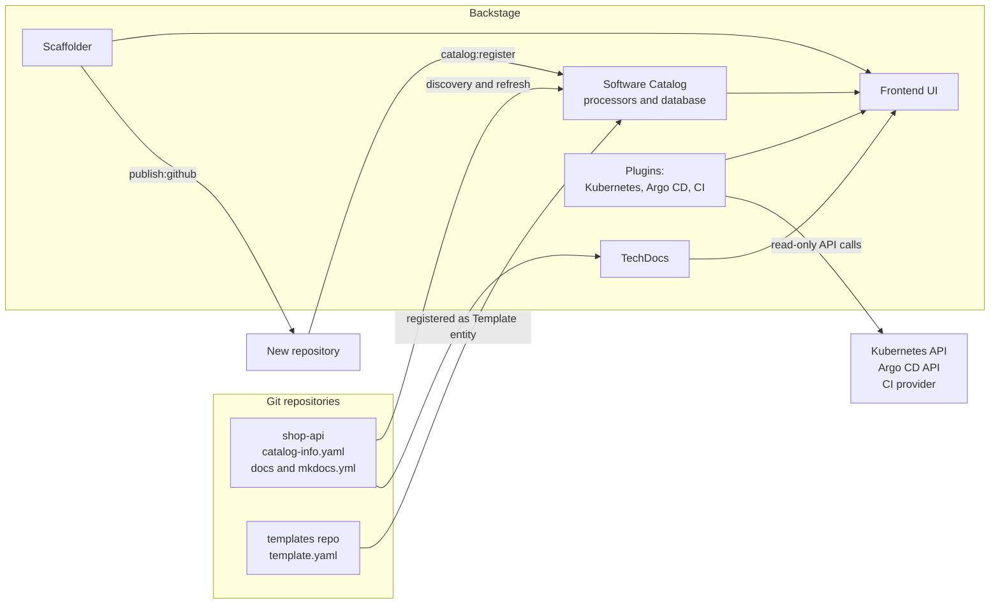
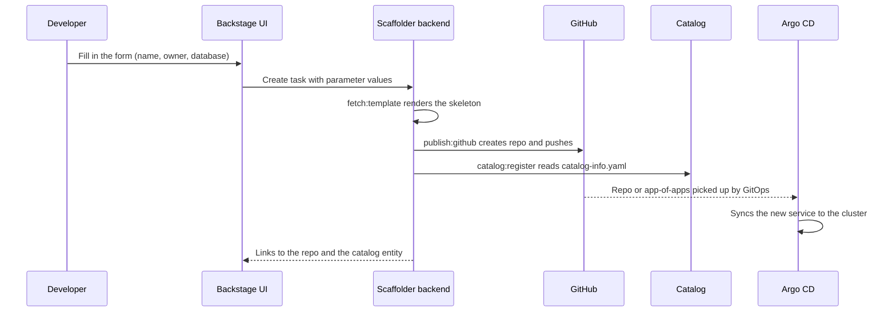

# L18.8 — Backstage

> **Level 18: Platform Engineering** · Topic 8 of 10 · ⏱ ~6 hours · Difficulty: Intermediate

## 1. What it is

**Backstage** is an open-source framework for building a **developer portal**: one web application where engineers
find every service, API, library and piece of infrastructure the company owns, see who owns it, read its docs, check
its CI/CD and Kubernetes status, and create new things from approved templates. It was created at Spotify and is now a
CNCF project. Backstage is not a finished product you install and forget -- it is a TypeScript/React codebase you
configure, extend with plugins and deploy yourself (or buy as a hosted/commercial distribution).

It has four core pieces that map to this topic's checklist: the **Software Catalog** (a graph of entities described by
`catalog-info.yaml` files kept next to the code), **Software Templates** (the "Scaffolder": forms that run steps such
as "create a repository" and "register it"), **TechDocs** (docs-as-code: Markdown in the repo, rendered in the portal),
and a **plugin system** for everything else (Kubernetes, Argo CD, PagerDuty, cost dashboards, and so on).

## 2. Why it matters in DevOps

- **Discoverability.** "Who owns the payments queue?" stops being a Slack archaeology exercise.
- **Self-service with guardrails.** A template turns "open a ticket, wait a week" into a form that creates a repo, a
  pipeline and an Argo CD application in minutes, using the golden path (see [Golden Paths](04-golden-paths.md)).
- **One front door** for the platform's capabilities, instead of ten bookmarks (see [Developer Portals](02-developer-portals.md)).
- **Ownership as data.** The catalog gives cost reports ([FinOps](../level-20-cost-optimization/01-finops.md)),
  incident routing and policy checks a trustworthy `owner` field.
- **Cost of running it.** Backstage needs a team: upgrades, plugin maintenance, catalog data quality. A portal full
  of stale entities is worse than none, so ownership of the portal itself must be explicit.

## 3. Real-world system example

**Spotify** built Backstage internally to tame the sprawl of services and tooling across hundreds of teams, then
open-sourced it in 2020; it entered the CNCF as a project afterwards. Many other companies publicly describe running it
as the front end of their internal platform. The pattern those adopters describe is consistent: the catalog is the
source of truth for ownership, a handful of software templates encode the golden paths for new services, and TechDocs
keeps documentation in the same repo as the code so it gets reviewed with the code.

Backstage's own repository ships the reference app generator (`@backstage/create-app`), the plugin catalogue in the
`backstage/backstage` monorepo, and community plugins (for example the Kubernetes plugin and an Argo CD plugin) that
read live status from the systems of record rather than copying it.

## 4. Diagram



What happens when a developer uses a software template:



## 5. How it works

### Catalog: entities and relations

Everything is an **entity** with `apiVersion`, `kind`, `metadata` and `spec`. Entities refer to each other with
references like `group:default/team-shop`; Backstage builds a graph from those references.

| Kind | Represents | Key fields |
|------|-----------|-----------|
| `Component` | a deployable thing: service, website, library | `spec.type`, `lifecycle`, `owner`, `system`, `dependsOn` |
| `API` | an interface a component provides or consumes | `spec.type` (openapi, grpc), `definition` |
| `Resource` | infrastructure a component needs (database, bucket) | `spec.type`, `owner` |
| `System` / `Domain` | grouping of components / of systems | `owner`, `domain` |
| `Group` / `User` | org structure, usually ingested from the IdP | `spec.members`, `parent` |
| `Template` | a scaffolder template | `spec.parameters`, `spec.steps` |
| `Location` | pointer to other catalog files | `spec.targets` |

Catalog data enters through **entity providers/discovery** (scan a GitHub organisation for `catalog-info.yaml`),
static `catalog.locations` in config, or manual registration in the UI. Annotations connect plugins to entities:
`github.com/project-slug`, `backstage.io/techdocs-ref`, `backstage.io/kubernetes-id`, `argocd/app-name`.

### Software Templates

A template has **parameters** (a JSON-Schema form), **steps** (actions such as `fetch:template`, `publish:github`,
`catalog:register`) and **output** (links shown at the end). A skeleton directory contains files with
`${{ values.name }}`-style placeholders. Platform teams can also write **custom actions** (a TypeScript backend
module) to call internal APIs, such as "request a database from Crossplane" (see [Crossplane](09-crossplane.md)).

### Plugins and the app layout

A scaffolded app is a Yarn monorepo: `packages/app` is the React frontend, `packages/backend` the Node backend, and
`plugins/` holds your own plugins. Backend plugins are added to the backend entry point (the "new backend system"
registers them with `backend.add(import('@backstage/plugin-...'))`); frontend plugins are installed as packages and
mounted in the app. Because frontend plugin wiring has changed between Backstage releases, follow the documentation for
the version `create-app` generated for you rather than copying old blog posts.

### TechDocs

TechDocs is docs-as-code: a `docs/` folder and an `mkdocs.yml` (MkDocs) live in the component's repo and the
`backstage.io/techdocs-ref: dir:.` annotation points at them. In the simplest "basic" setup Backstage builds the
site on demand (with MkDocs installed locally or via Docker); in the recommended production setup CI builds with
`techdocs-cli generate` and publishes to object storage (for example an S3 bucket), and Backstage only reads it.

## 6. Step-by-step guide

**Prerequisites:** a current Node.js LTS release (check the `engines` entry in the Backstage getting-started page for
the supported versions), Yarn, Git, and about 4 GB of free disk. Docker is optional (used by TechDocs generation).
The first install downloads many npm packages and takes several minutes. Everything runs on localhost; no cost. The
UI addresses below are Backstage defaults; exact console output varies by version, so treat outputs as similar to
what is shown.

1. **Create the app.**
   ```bash
   npx @backstage/create-app@latest
   # App name: shop-portal
   cd shop-portal
   ```
   The generator asks only for a name and creates `shop-portal/` with `app-config.yaml`, `packages/app`,
   `packages/backend` and an example catalog under `examples/`.

2. **Start it.**
   ```bash
   yarn start
   ```
   Wait for the frontend to compile. Open `http://localhost:3000`; the backend listens on `http://localhost:7007`.
   The default configuration uses an in-memory SQLite database and guest sign-in, which is fine for a lab and
   wrong for production (use PostgreSQL and a real identity provider).

3. **Describe `shop-api` in the catalog.** In a repo (or a local folder), create `catalog-info.yaml`:
   ```yaml
   apiVersion: backstage.io/v1alpha1
   kind: Component
   metadata:
     name: shop-api
     description: Node.js API for the shop (PostgreSQL, Redis, Nginx in front)
     annotations:
       github.com/project-slug: example-org/shop-api
       backstage.io/techdocs-ref: dir:.
       argocd/app-name: shop-api-prod
     tags: [nodejs, api]
   spec:
     type: service
     lifecycle: production
     owner: group:default/team-shop
     system: shop
     dependsOn:
       - resource:default/shop-db
     providesApis:
       - shop-api-http
   ---
   apiVersion: backstage.io/v1alpha1
   kind: Resource
   metadata:
     name: shop-db
     description: PostgreSQL database for shop-api
   spec:
     type: database
     owner: group:default/team-shop
     system: shop
   ---
   apiVersion: backstage.io/v1alpha1
   kind: API
   metadata:
     name: shop-api-http
   spec:
     type: openapi
     lifecycle: production
     owner: group:default/team-shop
     system: shop
     definition: |
       openapi: 3.0.3
       info: {title: shop-api, version: 1.0.0}
       paths: {}
   ```

4. **Register it through config.** Add a local file location to `app-config.yaml` (use the absolute path on your machine;
   file locations are read from the filesystem, so this is a lab-only shortcut):
   ```yaml
   catalog:
     rules:
       - allow: [Component, API, Resource, System, Domain, Group, User, Template, Location]
     locations:
       - type: file
         target: /home/you/lab/shop-api/catalog-info.yaml
   ```
   Restart `yarn start`, open **Catalog**, and find `shop-api`. Its page shows the owner, the `shop-db` dependency and the API
   relation graph. In production you would instead use GitHub discovery so every repo with a `catalog-info.yaml` appears
   automatically.

5. **Add a software template.** Create `templates/nodejs-service/template.yaml`:
   ```yaml
   apiVersion: scaffolder.backstage.io/v1beta3
   kind: Template
   metadata:
     name: nodejs-service
     title: Node.js service with PostgreSQL
     description: Scaffolds a repo with Dockerfile, CI, Helm values and an Argo CD Application
     tags: [nodejs, recommended]
   spec:
     owner: group:default/platform-team
     type: service
     parameters:
       - title: Service details
         required: [name, owner]
         properties:
           name:
             title: Name
             type: string
             pattern: '^[a-z][a-z0-9-]{2,30}$'
             description: Lowercase letters, digits and dashes
           owner:
             title: Owner
             type: string
             ui:field: OwnerPicker
             ui:options:
               catalogFilter:
                 kind: Group
       - title: Infrastructure
         properties:
           database:
             title: Needs a PostgreSQL database?
             type: boolean
             default: true
           size:
             title: Database size
             type: string
             enum: [small, medium]
             default: small
     steps:
       - id: fetch
         name: Fetch skeleton
         action: fetch:template
         input:
           url: ./skeleton
           values:
             name: ${{ parameters.name }}
             owner: ${{ parameters.owner }}
             database: ${{ parameters.database }}
             size: ${{ parameters.size }}
       - id: publish
         name: Create repository
         action: publish:github
         input:
           repoUrl: github.com?owner=example-org&repo=${{ parameters.name }}
           description: ${{ parameters.name }} service
           defaultBranch: main
       - id: register
         name: Register in catalog
         action: catalog:register
         input:
           repoContentsUrl: ${{ steps['publish'].output.repoContentsUrl }}
           catalogInfoPath: /catalog-info.yaml
     output:
       links:
         - title: Repository
           url: ${{ steps['publish'].output.remoteUrl }}
         - title: Open in catalog
           icon: catalog
           entityRef: ${{ steps['register'].output.entityRef }}
   ```
   The skeleton directory (`templates/nodejs-service/skeleton/`) holds the files to generate, for example
   `catalog-info.yaml` with `name: ${{ values.name }}`, a `Dockerfile`, a CI workflow, and a
   `deploy/application.yaml` Argo CD `Application`. Register the template like any entity by adding
   `- type: file` / `target: .../template.yaml` under `catalog.locations`, then open **Create...** in the UI.

6. **Allow the `publish:github` step to work (optional).** It needs a GitHub integration with a token or GitHub App:
   ```yaml
   integrations:
     github:
       - host: github.com
         token: ${GITHUB_TOKEN}      # export GITHUB_TOKEN=<YOUR_TOKEN> before yarn start
   ```
   Use a fine-grained token limited to a test organisation. Without it, the form renders but the publish step fails,
   which is still a useful experiment (T4).

7. **Turn on TechDocs.** In the `shop-api` repo add `mkdocs.yml` and `docs/index.md`:
   ```yaml
   site_name: shop-api
   nav:
     - Home: index.md
   plugins:
     - techdocs-core
   ```
   In `app-config.yaml` use the local builder for the lab:
   ```yaml
   techdocs:
     builder: 'local'
     generator:
       runIn: 'docker'     # or 'local' if mkdocs and the techdocs-core plugin are installed
     publisher:
       type: 'local'
   ```
   Open the component's **Docs** tab; the first load builds the site. For production, set `builder: 'external'`,
   build in CI with `npx @techdocs/cli generate` / `publish`, and use a cloud storage publisher.

8. **Add a plugin.** Follow the plugin's README for your Backstage version; the general shape is: install the frontend
   and backend packages with `yarn --cwd packages/app add ...` and `yarn --cwd packages/backend add ...`, register them
   in the app/backend, add configuration (for example the Kubernetes cluster list), and add the annotation (for
   example `backstage.io/kubernetes-id: shop-api`) to your `catalog-info.yaml`. Start with the Kubernetes plugin
   against a local kind cluster, which only needs read access.

## 7. Real-world scenario

*(Illustrative.)* A company launches its portal and a "new service" template. Adoption is slow: teams keep copying
old repositories. Looking at the catalog, the platform team sees 40 percent of components have no owner and most `System`
entities were typed by hand. A cost review cannot attribute a third of the bill to anyone.

The fix has three parts: groups and users are ingested from the identity provider so `owner` is a valid reference; the
template now writes `catalog-info.yaml` with the owner chosen from a picker, and a CI check using Conftest fails any
repo whose `catalog-info.yaml` lacks an owner or lifecycle (see [Policy as Code](07-policy-as-code.md)); and the
template also adds a TechDocs skeleton so documentation exists from day one. New services made by the template are
fully catalogued; the old ones are migrated by a scripted pull request per repo. **Lesson:** a portal succeeds when the
easiest way to create something is also the way that produces clean metadata.

## 8. Common mistakes and best practices

**Don't**

- Treat Backstage as a one-time installation; it needs an owning team, upgrades and a roadmap.
- Run production on the lab defaults (in-memory SQLite, guest login, static file locations).
- Let humans maintain catalog data by hand in a central repo; keep `catalog-info.yaml` next to the code.
- Copy plugin wiring from old tutorials without checking your Backstage version.
- Give the scaffolder a broad GitHub token; scope it to what templates need.

**Do**

- Start small: catalog plus one excellent template, then add plugins that remove a real daily pain.
- Ingest users and groups from your identity provider so ownership references resolve.
- Make templates the *only* easy path: they should register the component, add docs and wire GitOps (see [Golden Paths](04-golden-paths.md)).
- Validate `catalog-info.yaml` in CI and treat missing owners as build failures.
- Let plugins read from systems of record (Kubernetes, Argo CD) instead of duplicating state.

## 9. Tasks

- [ ] **T1 — Run Backstage locally** *(≈60 min, beginner)*
  - **Goal:** get the stock app running.
  - **Steps:**
    1. Run `npx @backstage/create-app@latest` and `yarn start` as in section 6.
    2. Open `http://localhost:3000` and browse the example catalog.
  - **Done when:** you can open the Catalog page and see at least one example component and its owner.

- [ ] **T2 — Catalog `shop-api`** *(≈30 min, beginner)*
  - **Goal:** model a service, its database and its API.
  - **Steps:**
    1. Create the three-entity `catalog-info.yaml` from step 3 and register it under `catalog.locations`.
    2. Restart and open the component page.
  - **Done when:** the page shows owner `team-shop` and a relation graph containing `shop-db` and `shop-api-http`.

- [ ] **T3 — Write a software template** *(≈60 min, intermediate)*
  - **Goal:** scaffold a service from a form.
  - **Steps:**
    1. Create the template and a small skeleton (Dockerfile, `catalog-info.yaml` using `${{ values.name }}`, a README).
    2. Register the template and open **Create...**.
    3. Replace `publish:github` with `publish:file` if your Backstage release lists it, or the dry-run feature, so you can test without GitHub.
  - **Done when:** running the template produces a directory (or repo) whose `catalog-info.yaml` has the name you typed in the form.

- [ ] **T4 — Break and fix the template** *(≈45 min, intermediate)*
  - **Goal:** learn to read scaffolder failures.
  - **Steps:**
    1. Remove the GitHub token and run the template; read the failing step in the task log.
    2. Introduce a typo in a `${{ parameters.xyz }}` reference and read the error.
    3. Fix both.
  - **Done when:** the task log goes from failed to completed, and you can explain which step produced each error.

- [ ] **T5 — Add TechDocs** *(≈45 min, intermediate)*
  - **Goal:** docs rendered from the repo.
  - **Steps:**
    1. Add `mkdocs.yml`, `docs/index.md` and the annotation `backstage.io/techdocs-ref: dir:.`.
    2. Configure the local builder and open the Docs tab.
    3. Edit `index.md`, refresh and observe the change.
  - **Done when:** your Markdown text is visible in the Docs tab of the component.

- [ ] **T6 — Prove it: portal design review** *(≈60 min, advanced)*
  - **Goal:** justify a minimal production design.
  - **Steps:**
    1. On one page, draw the production deployment: database, auth provider, catalog ingestion, TechDocs storage and the GitOps link from the scaffolder.
    2. List three metrics that show the portal is succeeding (for example share of services with owners, template usage, time to first deploy).
  - **Done when:** a colleague can find where each lab shortcut (SQLite, guest login, file locations) is replaced.

## 10. Self-check questions

1. What are the four core capabilities of Backstage covered here?
2. Why should `catalog-info.yaml` live in the service's repository?
3. What do the `fetch:template`, `publish:github` and `catalog:register` actions do, in order?
4. What is the difference between TechDocs `builder: local` and `builder: external`?
5. Which parts of the default `create-app` setup must change before production?

<details>
<summary>Answers</summary>

1. Software Catalog, Software Templates (Scaffolder), TechDocs, and the plugin system.
2. Ownership and metadata change with the code, get reviewed in the same pull request, and can be discovered automatically; a central hand-edited repo goes stale.
3. Render the skeleton with the form values; create the Git repository and push the rendered files; add the new repository's `catalog-info.yaml` to the catalog.
4. `local` builds the docs inside Backstage on demand (simple, slower, needs MkDocs or Docker there); `external` expects CI to build and publish to storage, and Backstage only reads it.
5. In-memory SQLite (use PostgreSQL), guest authentication (use a real identity provider), static file-based catalog locations (use provider-based discovery), and local TechDocs publishing.
</details>

## 11. Further reading

- Backstage documentation (backstage.io/docs): "Software Catalog", "Software Templates", "TechDocs" and "Getting Started".
- The `backstage/backstage` repository on GitHub, including the plugin directory and the app templates.
- CNCF project page for Backstage.
- Platform Engineering community material on measuring portal adoption (for example the CNCF Platforms White Paper).

<!-- nav -->
---
← Previous: [Policy as Code](07-policy-as-code.md) · [Level 18 index](README.md) · Next: [Crossplane](09-crossplane.md) →
