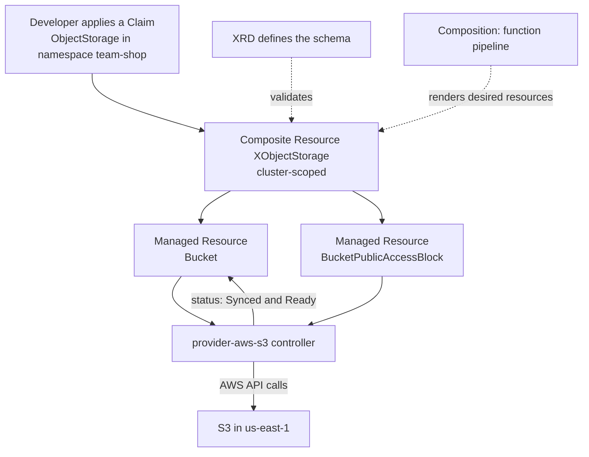
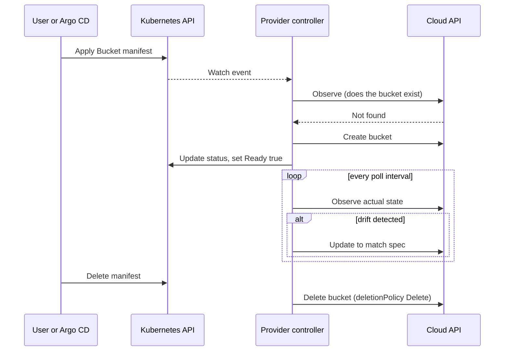

# L18.9 — Crossplane

> **Level 18: Platform Engineering** · Topic 9 of 10 · ⏱ ~6 hours · Difficulty: Advanced

## 1. What it is

**Crossplane** is an open-source CNCF project that turns a Kubernetes cluster into a **control plane for
infrastructure**. You describe cloud resources (an S3 bucket, an RDS database, a VPC) as Kubernetes objects; Crossplane
**controllers** continuously reconcile the real cloud to match, the same way the Deployment controller keeps Pods
running. Because the API is Kubernetes, you get RBAC, admission policy, GitOps delivery and `kubectl` for free.

Its distinctive idea is not "Terraform in YAML" but **building your own platform API**. Platform engineers define
higher-level resource types ("an ObjectStorage for a team") and map each to a bundle of low-level cloud resources;
product teams request the simple type and never see the 14 underlying objects. The vocabulary:

| Term | Meaning |
|------|---------|
| **Provider** | a package with controllers and CRDs for one external system (AWS S3, GCP, Kubernetes, Helm, Terraform) |
| **Managed Resource (MR)** | one Kubernetes object that maps 1:1 to one external resource (`s3.aws.upbound.io/Bucket`) |
| **ProviderConfig** | how a provider authenticates (credentials, IRSA/Pod Identity, region) |
| **CompositeResourceDefinition (XRD)** | the schema of your new platform API type (like a CRD factory) |
| **Composite Resource (XR)** | an instance of that type; the thing that owns the managed resources |
| **Composition** | the recipe: which managed resources an XR expands into, wired by a pipeline of **functions** |
| **Claim** | a namespaced, developer-facing handle on a cluster-scoped XR (the self-service surface) |
| **Function** | a small program that renders desired resources in a Composition pipeline |

> **Version note.** Crossplane v2 (released in 2025) made composite resources namespaced by default, so the separate
> "claim" layer is no longer needed for new-style XRDs, and it removed the older built-in "patch and transform"
> composition mode in favour of function pipelines. Claims, cluster-scoped XRs and the manifests below remain the
> model used by the large amount of existing documentation and installations, and legacy XRDs are still supported.
> Read the upgrade notes for your Crossplane version before copying manifests; the concepts (provider, MR, XRD,
> Composition, function) are the same.

## 2. Why it matters in DevOps

- **Self-service without ticket queues.** A developer applies a 10-line claim; the platform provisions bucket,
  encryption, access block and tags exactly as the platform team decided.
- **Continuous reconciliation of infrastructure.** Terraform detects drift when you run `plan`; a Crossplane controller
  corrects drift continuously (see [Drift Detection](../level-07-terraform-iac/09-drift-detection.md)).
- **One control plane, one workflow.** Apps and infrastructure are both Kubernetes manifests delivered by Argo CD
  (see [Argo CD and Flux](../level-17-gitops/02-argo-cd-and-flux.md)).
- **Platform as product.** The XRD is a versioned API contract with your internal customers
  (see [Infrastructure Templates](06-infrastructure-templates.md) and [Self-service Infrastructure](03-self-service-infrastructure.md)).
- **Costs and risks.** The management cluster becomes critical infrastructure; deleting an MR can delete real data;
  credentials for the cloud now live in (or are reachable from) a cluster.

## 3. Real-world system example

Crossplane was created by Upbound and donated to the CNCF; it is a CNCF project with a public list of adopters in its
GitHub repository. The widely used cloud providers come from the Upbound
`provider-aws`, `provider-azure` and `provider-gcp` families, which are generated from Terraform provider schemas via the
Upjet tool, so coverage of resources is broad. A public package marketplace (Upbound Marketplace) and OCI registries
host providers, functions and **Configuration packages** (XRD plus Composition bundles) that organisations publish
internally to distribute their platform APIs.

The same "custom resource plus controller" pattern is how Kubernetes itself works: see
[Custom Resource Definitions](../level-16-advanced-kubernetes/05-custom-resource-definitions.md) and
[Operators](../level-16-advanced-kubernetes/04-operators.md). Crossplane is a general-purpose operator framework for
infrastructure composition.

## 4. Diagram



The reconcile loop for a managed resource:



## 5. How it works

### Layers

1. **Install Crossplane** (a controller in `crossplane-system`).
2. **Install providers and functions** as `Provider` / `Function` resources. Crossplane pulls the OCI package, installs
   its CRDs and starts the provider pod.
3. **Configure credentials** with a `ProviderConfig`. Prefer workload identity (IRSA or EKS Pod Identity) over static keys.
4. **Define your API** with an `XRD`: the OpenAPI schema defines exactly which fields developers can set, with defaults,
   enums and required fields, so invalid requests are rejected by the API server.
5. **Write a Composition** that references the XRD (`compositeTypeRef`) and lists the managed resources and how XR fields
   patch into them. In pipeline mode, each step calls a **function**; `function-patch-and-transform` handles the
   classic patching style, and others (Go templating, KCL, CEL) are available when you need logic.
6. **Developers create claims** (or XRs, in v2 style) in their namespace.

### Useful behaviours

| Topic | Detail |
|-------|--------|
| Status conditions | MRs have `Synced` (spec was applied) and `Ready` (external resource is usable). Read `kubectl describe` events first. |
| `deletionPolicy` | `Delete` (default) removes the cloud resource when the MR is deleted; `Orphan` leaves it. Choose deliberately for databases. |
| `managementPolicies` | restrict what Crossplane may do (for example `Observe` only, for importing existing resources). |
| Import | set the `crossplane.io/external-name` annotation to adopt an existing resource. |
| Composition revisions | updating a Composition creates a new revision; XRs can be pinned or follow the latest, controlling rollout of template changes. |
| Debugging | `crossplane beta trace <kind> <name>` shows the tree from claim to MRs and their conditions. |
| Testing | `crossplane render xr.yaml composition.yaml functions.yaml` shows what a Composition would produce without a cluster (it runs functions in containers). |

### Crossplane versus Terraform

| | Crossplane | Terraform / OpenTofu |
|--|-----------|----------------------|
| Execution | continuous controllers in a cluster | run on demand (CI, local) |
| State | the Kubernetes API (etcd) | a state file / backend |
| Drift | corrected continuously | detected at plan time |
| Developer API | custom types via XRD | module variables |
| Ecosystem | growing, provider coverage varies | very large, mature |
| Complexity | needs a management cluster and Kubernetes skills | simpler to start |

They compose well: see [Integrating Argo CD, Terraform and Kubernetes into a Platform](10-platform-stack-integration.md)
for when each belongs in the platform.

## 6. Step-by-step guide

**Prerequisites:** Docker, `kind`, `kubectl`, `helm`, and an **AWS sandbox account** with an IAM user or role limited to
S3. **Cost:** the lab creates one empty S3 bucket, which costs effectively nothing, but set an AWS Budget/billing alarm
first and run the cleanup step. Provider package versions below are examples; check the Upbound Marketplace for current
ones. Output is similar to what is shown, not byte-for-byte.

1. **Create a cluster and install Crossplane.**
   ```bash
   kind create cluster --name crossplane-lab
   helm repo add crossplane-stable https://charts.crossplane.io/stable
   helm repo update
   helm install crossplane crossplane-stable/crossplane \
     --namespace crossplane-system --create-namespace
   kubectl -n crossplane-system get pods
   ```
   Expect `crossplane` and `crossplane-rbac-manager` pods `Running`.

2. **Install the S3 provider and the patch-and-transform function.**
   ```yaml
   # packages.yaml
   apiVersion: pkg.crossplane.io/v1
   kind: Provider
   metadata:
     name: provider-aws-s3
   spec:
     package: xpkg.upbound.io/upbound/provider-aws-s3:v1.20.0   # example version
   ---
   apiVersion: pkg.crossplane.io/v1
   kind: Function
   metadata:
     name: function-patch-and-transform
   spec:
     package: xpkg.upbound.io/crossplane-contrib/function-patch-and-transform:v0.8.2   # example version
   ```
   ```bash
   kubectl apply -f packages.yaml
   kubectl get providers,functions
   ```
   Wait until `INSTALLED` and `HEALTHY` are `True` for both (a minute or two).

3. **Give the provider credentials (lab only).** Create a credentials file with a sandbox key and store it as a Secret.
   Never commit it. In production use IRSA / Pod Identity instead.
   ```bash
   cat > aws-creds.conf <<'EOF'
   [default]
   aws_access_key_id = <YOUR_ACCESS_KEY_ID>
   aws_secret_access_key = <YOUR_SECRET_ACCESS_KEY>
   EOF
   kubectl -n crossplane-system create secret generic aws-creds --from-file=creds=./aws-creds.conf
   rm aws-creds.conf
   ```
   ```yaml
   # providerconfig.yaml
   apiVersion: aws.upbound.io/v1beta1
   kind: ProviderConfig
   metadata:
     name: default
   spec:
     credentials:
       source: Secret
       secretRef:
         namespace: crossplane-system
         name: aws-creds
         key: creds
   ```
   ```bash
   kubectl apply -f providerconfig.yaml
   ```

4. **Create one managed resource by hand** to see the lowest layer before abstracting it.
   ```yaml
   # bucket-mr.yaml
   apiVersion: s3.aws.upbound.io/v1beta1
   kind: Bucket
   metadata:
     name: crossplane-lab-example-12345      # S3 names are global: make this unique
   spec:
     forProvider:
       region: us-east-1
       tags:
         owner: team-shop
     providerConfigRef:
       name: default
   ```
   ```bash
   kubectl apply -f bucket-mr.yaml
   kubectl get bucket
   ```
   Expect `SYNCED True` and `READY True` shortly. Check with `aws s3 ls`. Delete it (`kubectl delete -f bucket-mr.yaml`)
   and confirm the bucket disappears from AWS.

5. **Define the platform API (XRD).** Developers will see only `owner` and `region`.
   ```yaml
   # xrd.yaml
   apiVersion: apiextensions.crossplane.io/v1
   kind: CompositeResourceDefinition
   metadata:
     name: xobjectstorages.platform.example.org
   spec:
     group: platform.example.org
     names:
       kind: XObjectStorage
       plural: xobjectstorages
     claimNames:
       kind: ObjectStorage
       plural: objectstorages
     versions:
       - name: v1alpha1
         served: true
         referenceable: true
         schema:
           openAPIV3Schema:
             type: object
             properties:
               spec:
                 type: object
                 properties:
                   parameters:
                     type: object
                     properties:
                       owner:
                         type: string
                       region:
                         type: string
                         default: us-east-1
                         enum: [us-east-1, eu-west-1]
                     required: [owner]
                 required: [parameters]
   ```

6. **Write the Composition.** One request becomes a bucket plus a public-access block, with the owner tag patched in.
   ```yaml
   # composition.yaml
   apiVersion: apiextensions.crossplane.io/v1
   kind: Composition
   metadata:
     name: xobjectstorages.aws.platform.example.org
     labels:
       provider: aws
   spec:
     compositeTypeRef:
       apiVersion: platform.example.org/v1alpha1
       kind: XObjectStorage
     mode: Pipeline
     pipeline:
       - step: patch-and-transform
         functionRef:
           name: function-patch-and-transform
         input:
           apiVersion: pt.fn.crossplane.io/v1beta1
           kind: Resources
           resources:
             - name: bucket
               base:
                 apiVersion: s3.aws.upbound.io/v1beta1
                 kind: Bucket
                 spec:
                   forProvider:
                     region: us-east-1
               patches:
                 - type: FromCompositeFieldPath
                   fromFieldPath: spec.parameters.region
                   toFieldPath: spec.forProvider.region
                 - type: FromCompositeFieldPath
                   fromFieldPath: spec.parameters.owner
                   toFieldPath: spec.forProvider.tags.owner
             - name: public-access-block
               base:
                 apiVersion: s3.aws.upbound.io/v1beta1
                 kind: BucketPublicAccessBlock
                 spec:
                   forProvider:
                     region: us-east-1
                     blockPublicAcls: true
                     blockPublicPolicy: true
                     ignorePublicAcls: true
                     restrictPublicBuckets: true
                     bucketSelector:
                       matchControllerRef: true
               patches:
                 - type: FromCompositeFieldPath
                   fromFieldPath: spec.parameters.region
                   toFieldPath: spec.forProvider.region
   ```
   ```bash
   kubectl apply -f xrd.yaml
   kubectl wait --for=condition=Established xrd/xobjectstorages.platform.example.org --timeout=60s
   kubectl apply -f composition.yaml
   ```

7. **Request storage as a developer (the claim).**
   ```yaml
   # claim.yaml
   apiVersion: platform.example.org/v1alpha1
   kind: ObjectStorage
   metadata:
     name: shop-assets
     namespace: team-shop
   spec:
     parameters:
       owner: team-shop
       region: us-east-1
   ```
   ```bash
   kubectl create namespace team-shop
   kubectl apply -f claim.yaml
   kubectl -n team-shop get objectstorage
   kubectl get composite
   kubectl get managed
   ```
   Expect the claim to become `READY True`, one XR, and two managed resources (`bucket` and `bucketpublicaccessblock`).
   If something is stuck, run `kubectl -n team-shop describe objectstorage shop-assets` and read the events.

8. **Break the contract on purpose.** A region outside the enum is rejected by the API server before anything is created:
   ```bash
   kubectl -n team-shop apply -f - <<'EOF'
   apiVersion: platform.example.org/v1alpha1
   kind: ObjectStorage
   metadata:
     name: bad
   spec:
     parameters:
       owner: team-shop
       region: ap-south-1
   EOF
   ```
   Expect an error similar to `Unsupported value: "ap-south-1": supported values: "us-east-1", "eu-west-1"`.

9. **Clean up (do not skip).**
   ```bash
   kubectl -n team-shop delete objectstorage shop-assets      # deletes the S3 bucket
   kubectl get managed                                          # wait until empty
   kind delete cluster --name crossplane-lab
   ```
   Finally verify in the AWS console or with `aws s3 ls` that no lab buckets remain, and delete the sandbox IAM access key.

## 7. Real-world scenario

*(Illustrative.)* A team deletes the namespace `team-shop` during a clean-up. Claims in that namespace go with it, and
because the default `deletionPolicy` is `Delete`, Crossplane dutifully deletes the real S3 bucket holding customer
uploads. The bucket had versioning off, so there is nothing to recover from the console; the data is restored from the
nightly cross-region copy, with 14 hours of uploads lost.

The post-incident changes: the Composition now sets `deletionPolicy: Orphan` for data-bearing resources and enables
versioning and a replication rule; Kyverno policy (see [Policy as Code](07-policy-as-code.md)) denies deleting
namespaces labelled `data=true`; Argo CD's sync policy for the infra applications has `prune: false` with manual
approval for deletes. **Lesson:** a control plane that reconciles also deletes; the safety rails (deletion policy,
prune policy, RBAC on who may delete claims) are part of the platform design.

## 8. Common mistakes and best practices

**Don't**

- Expose every field of the underlying resources in the XRD; keep the API small and opinionated.
- Leave `deletionPolicy: Delete` on databases and buckets without backups and a deliberate review.
- Use long-lived static cloud keys in a Secret outside labs; use workload identity.
- Edit a Composition in production without understanding revisions; test with `crossplane render` and in a staging cluster.
- Treat the management cluster as disposable; it holds the only reconciling copy of your infrastructure intent (Git must hold it too).

**Do**

- Version your XRDs (`v1alpha1` to `v1`) and publish Compositions as Configuration packages.
- Put validation in the XRD schema (enum, default, required) so bad requests fail at admission.
- Deliver all Crossplane resources through Git and Argo CD; use sync waves so XRD, Composition and claims apply in order.
- Alert on MRs that are not `Synced` or not `Ready` for more than a few minutes.
- Combine with policy to enforce tags, regions and deletion protection.

## 9. Tasks

- [ ] **T1 — Install Crossplane and one provider** *(≈45 min, intermediate)*
  - **Goal:** reach a healthy control plane.
  - **Steps:**
    1. Follow steps 1-3 of the guide in a kind cluster.
    2. Run `kubectl get providers,functions`.
  - **Done when:** both packages show `INSTALLED=True` and `HEALTHY=True`.

- [ ] **T2 — Create and delete a managed resource** *(≈30 min, intermediate)*
  - **Goal:** observe the 1:1 mapping and reconcile loop.
  - **Steps:**
    1. Apply the `Bucket` MR from step 4 and confirm it exists in AWS.
    2. Change a tag in the manifest and re-apply; verify the tag changes in AWS.
    3. Delete the MR.
  - **Done when:** the bucket appeared, the tag changed, and the bucket is gone after deletion (check with `aws s3 ls`).

- [ ] **T3 — Build the ObjectStorage API** *(≈60 min, advanced)*
  - **Goal:** go from MR to platform API.
  - **Steps:**
    1. Apply the XRD, Composition and claim from steps 5-7.
    2. Run `kubectl get managed` and `crossplane beta trace objectstorage shop-assets -n team-shop` (if the CLI is installed).
  - **Done when:** the claim is `READY=True` and `kubectl get managed` lists a bucket and a public-access block.

- [ ] **T4 — Extend the Composition** *(≈45 min, advanced)*
  - **Goal:** add a feature without changing the developer API.
  - **Steps:**
    1. Add a third resource, `BucketVersioning` (or server-side encryption), to the Composition.
    2. Re-apply and watch the existing XR gain the new managed resource.
  - **Done when:** `kubectl get managed` shows the new resource for the existing claim and AWS shows versioning enabled.

- [ ] **T5 — Break it and diagnose it** *(≈45 min, advanced)*
  - **Goal:** learn the failure modes.
  - **Steps:**
    1. Reuse a bucket name that is already taken, or break the credentials Secret.
    2. Find the cause using `kubectl describe` on the claim, the XR and the MR (events and conditions).
    3. Fix it and watch the claim become `Ready`.
  - **Done when:** you can state which object first showed the error and the exact condition message.

- [ ] **T6 — Prove it: Crossplane versus Terraform decision** *(≈45 min, advanced)*
  - **Goal:** make and defend a platform decision.
  - **Steps:**
    1. Without notes, write a one-page comparison of using Crossplane versus Terraform modules for "team requests an S3 bucket" in your org.
    2. Recommend one, name three risks and one mitigation each (deletion policy, credentials, upgrade).
  - **Done when:** a teammate can explain your recommendation back and identify the rollback plan.

## 10. Self-check questions

1. What is the difference between a Managed Resource and a Composite Resource?
2. What does an XRD do that a plain CRD does not?
3. Why can a developer not set `region: ap-south-1` in the example claim?
4. What does `deletionPolicy: Orphan` change?
5. How does Crossplane's handling of drift differ from Terraform's?

<details>
<summary>Answers</summary>

1. An MR maps 1:1 to one external resource and is owned by a provider; an XR is your own abstraction that is composed into several MRs by a Composition.
2. It defines a new platform API type, generates the CRDs for the XR and the claim, and links them to Compositions that say how to implement it.
3. The XRD schema restricts `region` to an enum, and the API server rejects values outside it before any controller runs.
4. Deleting the Kubernetes object no longer deletes the external resource; it is left running and unmanaged.
5. Crossplane providers poll and reconcile continuously, correcting drift automatically; Terraform only detects and fixes drift when a plan/apply runs.
</details>

## 11. Further reading

- Crossplane documentation (docs.crossplane.io): "Concepts", "Composition" and "Get Started".
- Upbound Marketplace for provider and function packages and their API references.
- Crossplane GitHub repository (`crossplane/crossplane`) and release notes, especially the v2 upgrade notes.
- CNCF Platforms White Paper for control-plane based platform design.

<!-- nav -->
---
← Previous: [Backstage](08-backstage.md) · [Level 18 index](README.md) · Next: [Integrating Argo CD, Terraform and Kubernetes into a Platform](10-platform-stack-integration.md) →
