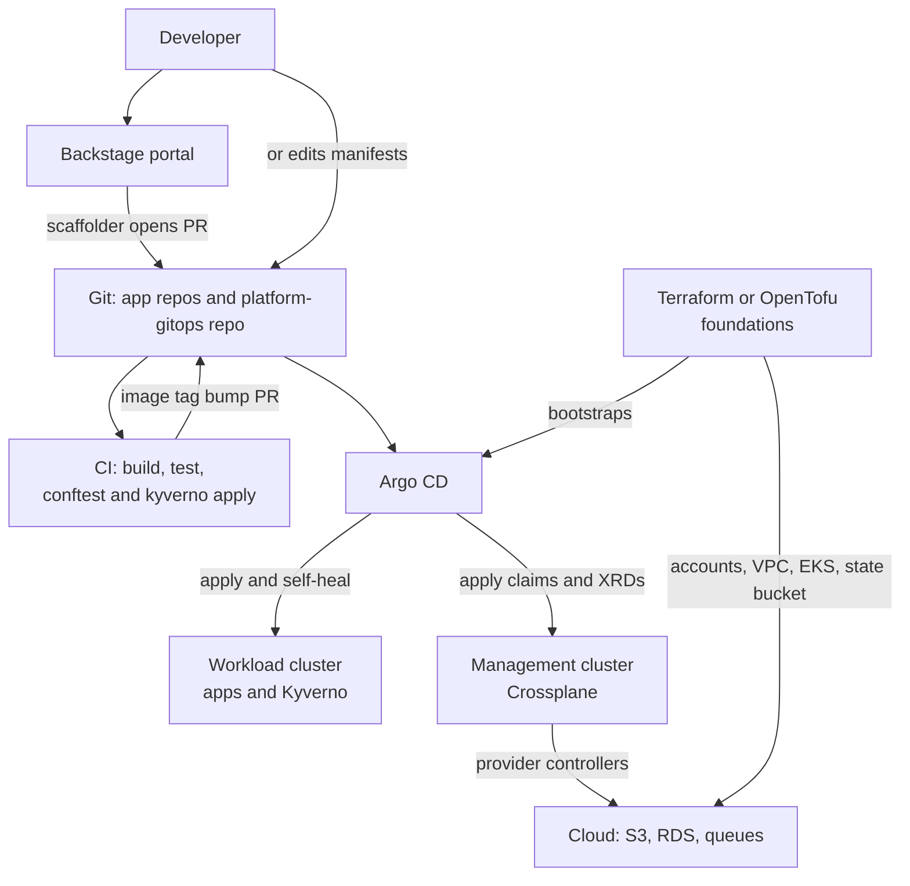
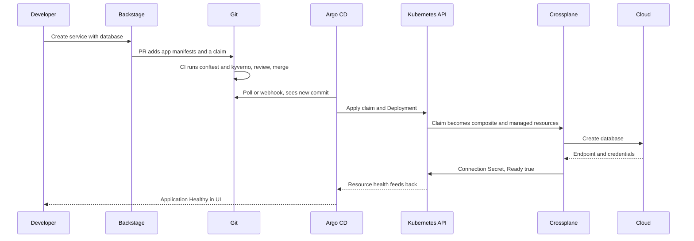

# L18.10 — Integrating Argo CD, Terraform and Kubernetes into a Platform

> **Level 18: Platform Engineering** · Topic 10 of 10 · ⏱ ~5 hours · Difficulty: Advanced

## 1. What it is

A platform is not one tool; it is a handful of tools that each own one job, wired together so a developer's single
action (a form, a pull request) turns into running software and infrastructure. This topic is about the **composition**:
which tool is the **control plane** for what, how **GitOps delivery** moves changes, and -- the part that breaks most
platforms -- who owns which **state**.

The usual cast: **Git** holds desired state; **Argo CD** (see [Argo CD and Flux](../level-17-gitops/02-argo-cd-and-flux.md))
continuously applies Git to Kubernetes; **Kubernetes** is the runtime and, with **Crossplane**, a control plane for cloud
resources ([Crossplane](09-crossplane.md)); **Terraform/OpenTofu** builds the foundations that must exist before any
cluster does (accounts, networks, the cluster itself) and anything not worth modelling as a Kubernetes API;
**policy engines** ([Policy as Code](07-policy-as-code.md)) guard every path; and **Backstage**
([Backstage](08-backstage.md)) is the human front door that writes to Git.

## 2. Why it matters in DevOps

- **Two tools managing one resource is the classic platform outage.** If Terraform and Crossplane (or Terraform and a
  controller, or a human in the console) all believe they own a database, one of them will "fix" the other's change.
- **Every tool has a state store, and the stores disagree.** Terraform has a state file, Kubernetes has etcd, Git
  has history, and the cloud has the truth. Knowing which is authoritative for what is the core skill.
- **Bootstrapping order.** You cannot run Crossplane on a cluster that Crossplane must create. Foundations come first,
  and the dependency direction must never loop.
- **Delivery safety.** A merge to `main` is now a production change for apps *and* infrastructure; sync order,
  pruning and approvals decide whether that is safe.
- **Team scaling.** A clear contract (developers touch claims and app manifests; platform team touches templates and
  foundations) is what lets a small platform team serve many product teams
  (see [Internal Developer Platforms](01-internal-developer-platforms.md)).

## 3. Real-world system example

The pattern of **GitOps for apps with Argo CD, a cloud control plane for infrastructure, and Terraform for the
foundations** is described across public CNCF material, Argo CD and Crossplane documentation, and conference talks.
The Argo CD documentation describes **app of apps** and **ApplicationSet** as the ways to manage many applications
from one repository, and its **sync waves** and **hooks** for ordering. Crossplane's documentation explains running
it alongside GitOps tools so that claims live in Git like any other manifest. Terraform's own documentation and many
public architectures use it to create the Kubernetes cluster and bootstrap Argo CD, after which Argo CD takes over
everything inside the cluster.

Kubernetes itself models this layering: the API server stores desired state, controllers (the built-in ones, Argo
CD's application controller, Crossplane's provider controllers) reconcile independently, and each controller owns a
clearly bounded set of objects, with ownership recorded in `ownerReferences` and field managers.

## 4. Diagram

The whole platform on one page:



Ownership and the flow of state, for one `shop-api` database request:



## 5. How it works

### Who owns what (the state-ownership contract)

| Concern | Tool (owner) | Desired state lives in | Actual state read from | Drift handling |
|---------|--------------|------------------------|------------------------|----------------|
| Cloud accounts, org policy, networks, the clusters, Argo CD bootstrap | Terraform / OpenTofu | Git (HCL) | cloud, compared via the **state file** | `plan` in CI on a schedule, human approves apply |
| Per-team cloud resources (buckets, queues, databases) | Crossplane | Git (claims) | the cloud, observed by provider controllers | continuous, automatic |
| Applications and cluster add-ons | Argo CD | Git (manifests, Helm values) | Kubernetes API | continuous (`selfHeal`), prune optional |
| Security and compliance rules | Kyverno / OPA | Git (policies) | admission requests and background scans | audit reports, enforced at admission |
| Service metadata and ownership | Backstage catalog | `catalog-info.yaml` in each repo | rebuilt from Git | refresh from source |

The rules that keep this sane:

1. **One resource, one owner.** If Terraform created it, Crossplane must not also manage it. If you move ownership,
   do it explicitly: remove from one state (`terraform state rm`) and import into the other with the external-name
   annotation, with the controller in `Observe` mode first.
2. **Git is the source of truth for intent, the system of record for actual state is the cloud.** State files and etcd
   are caches and bookkeeping. Back them up, but never edit them as a normal workflow.
3. **Dependencies point one way:** Terraform (foundations) → cluster → Argo CD → Crossplane and policy → team claims and apps.
   Nothing lower in the chain depends on something higher.
4. **Humans approve what is hard to undo** (accounts, networks, deletion), automation applies what is routine
   (claims, image bumps).

### Delivery mechanics

- **App of apps / ApplicationSet:** one root Argo CD `Application` (or an `ApplicationSet` with a Git directory
  generator) points at a folder; each subfolder becomes an Application. Adding a team is adding a folder.
- **Sync waves:** `argocd.argoproj.io/sync-wave` annotations order the apply: policy engine and Crossplane first
  (negative waves), then XRDs and Compositions, then claims and apps.
- **Health of custom resources:** Argo CD does not know what "healthy" means for a claim; add a custom health check that
  looks at the `Ready` condition, otherwise dependent waves proceed too early.
- **Pruning:** `prune: true` deletes cloud resources when you delete a claim from Git. That is correct for dev and
  often wrong for production data; combine with `deletionPolicy: Orphan` or manual sync for stateful claims.
- **Where Terraform runs:** in CI (plan on PR, apply on merge with approval, see [Terraform CI/CD](../level-07-terraform-iac/07-terraform-ci-cd.md)),
  or in-cluster via a controller. Both keep the same rule: state in a locked remote backend
  (see [State Locking](../level-07-terraform-iac/08-state-locking.md)).

### Typical repository layout

| Repo | Contains | Owned by |
|------|----------|----------|
| `infra-foundations` | Terraform for accounts, VPCs, clusters, bootstrap of Argo CD | platform team |
| `platform-gitops` | Argo CD root app, add-ons, Crossplane XRDs and Compositions, policies, `teams/<team>/<env>/` claims | platform team (platform parts), product teams (their `teams/` folder) |
| `shop-api` (app repo) | code, Dockerfile, Helm chart or Kustomize, `catalog-info.yaml` | product team |

## 6. Step-by-step guide

**Prerequisites:** Git, Docker, `kind`, `kubectl`, and for the policy check the `conftest` binary. The first half runs
offline on files; the optional second half installs Argo CD into a kind cluster and uses a GitHub repository you own
(any Git host Argo CD can reach works). No cloud account or cost is required. Cluster outputs are similar to what is
shown.

1. **Lay out the platform GitOps repository.**
   ```bash
   mkdir -p platform-gitops/{bootstrap,platform/{policy,crossplane,addons},teams/team-shop/prod,teams/team-pay/prod,policy}
   cd platform-gitops && git init -b main
   ```
   `bootstrap/` holds the root Argo CD apps, `platform/` holds what the platform team owns, `teams/<team>/<env>/` holds
   what product teams own, and the top-level `policy/` is for CI checks (Conftest).

2. **Add two team claims, one wrong on purpose.** (These use the `ObjectStorage` API from [Crossplane](09-crossplane.md).)
   ```bash
   cat > teams/team-shop/prod/assets.yaml <<'EOF'
   apiVersion: platform.example.org/v1alpha1
   kind: ObjectStorage
   metadata:
     name: shop-assets
     namespace: team-shop
   spec:
     parameters:
       owner: team-shop
       region: us-east-1
   EOF
   cat > teams/team-pay/prod/receipts.yaml <<'EOF'
   apiVersion: platform.example.org/v1alpha1
   kind: ObjectStorage
   metadata:
     name: receipts
     namespace: team-pay
   spec:
     parameters:
       owner: team-shop
   EOF
   ```

3. **Add a CI-side guardrail: a team may only declare storage owned by itself.**
   ```rego
   # policy/claims.rego
   package main

   import rego.v1

   deny contains msg if {
   	input.kind == "ObjectStorage"
   	input.spec.parameters.owner != input.metadata.namespace
   	msg := sprintf("ObjectStorage %q: owner %q must equal its namespace %q", [input.metadata.name, input.spec.parameters.owner, input.metadata.namespace])
   }
   ```
   ```bash
   conftest test teams/*/*/*.yaml
   ```
   Expected:
   ```text
   FAIL - teams/team-pay/prod/receipts.yaml - main - ObjectStorage "receipts": owner "team-shop" must equal its namespace "team-pay"

   2 tests, 1 passed, 0 warnings, 1 failure, 0 exceptions
   ```
   Fix `receipts.yaml` (`owner: team-pay`) and re-run to get exit code 0. This runs in CI before merge; the cluster-side
   Kyverno policy is the second layer.

4. **Define the ApplicationSet that turns folders into Applications.** Adding `teams/team-x/prod/` creates an app, no Argo CD change needed.
   ```yaml
   # bootstrap/teams-appset.yaml
   apiVersion: argoproj.io/v1alpha1
   kind: ApplicationSet
   metadata:
     name: team-resources
     namespace: argocd
   spec:
     goTemplate: true
     goTemplateOptions: ["missingkey=error"]
     generators:
       - git:
           repoURL: https://github.com/example-org/platform-gitops.git   # use your own repo
           revision: main
           directories:
             - path: teams/*/*
     template:
       metadata:
         name: '{{ index .path.segments 1 }}-{{ index .path.segments 2 }}'
       spec:
         project: default
         source:
           repoURL: https://github.com/example-org/platform-gitops.git
           targetRevision: main
           path: '{{ .path.path }}'
         destination:
           server: https://kubernetes.default.svc
           namespace: '{{ index .path.segments 1 }}'
         syncPolicy:
           automated:
             prune: false        # deleting a claim from Git will not silently delete cloud data
             selfHeal: true
           syncOptions:
             - CreateNamespace=true
   ```

5. **Order the platform components with sync waves.** Policy engine and Crossplane first, then packages, then the API
   definitions, then team claims. Each child `Application` (or resource) gets an annotation:
   ```text
   wave -2 : Kyverno and Crossplane installs (Helm-based Applications)
   wave -1 : Provider and Function packages, ProviderConfig
   wave  0 : XRDs and Compositions (the default wave)
   wave  1 : team claims and applications
   ```
   For example, the Application that installs Crossplane:
   ```yaml
   # bootstrap/crossplane-app.yaml
   apiVersion: argoproj.io/v1alpha1
   kind: Application
   metadata:
     name: crossplane
     namespace: argocd
     annotations:
       argocd.argoproj.io/sync-wave: "-2"
   spec:
     project: default
     source:
       repoURL: https://charts.crossplane.io/stable
       chart: crossplane
       targetRevision: 1.20.0        # example version, pin the one you tested
     destination:
       server: https://kubernetes.default.svc
       namespace: crossplane-system
     syncPolicy:
       automated: {selfHeal: true}
       syncOptions: [CreateNamespace=true]
   ```
   Waves order resources inside one sync. When the waves live on child `Application` objects created by a root
   app-of-apps, the root application's sync honours them, which is how cross-application ordering is done.

6. **Teach Argo CD what "healthy" means for a claim.** Add a custom health check to the `argocd-cm` ConfigMap so waves
   wait for `Ready`:
   ```yaml
   apiVersion: v1
   kind: ConfigMap
   metadata:
     name: argocd-cm
     namespace: argocd
     labels:
       app.kubernetes.io/part-of: argocd
   data:
     resource.customizations.health.platform.example.org_ObjectStorage: |
       hs = {}
       hs.status = "Progressing"
       hs.message = "Waiting for Ready condition"
       if obj.status ~= nil and obj.status.conditions ~= nil then
         for _, c in ipairs(obj.status.conditions) do
           if c.type == "Ready" and c.status == "True" then
             hs.status = "Healthy"
             hs.message = "Ready"
           end
         end
       end
       return hs
   ```

7. **(Optional) Bring up Argo CD locally and sync the repo.**
   ```bash
   kind create cluster --name platform-lab
   kubectl create namespace argocd
   kubectl apply -n argocd -f https://raw.githubusercontent.com/argoproj/argo-cd/stable/manifests/install.yaml
   kubectl -n argocd rollout status deploy/argocd-server
   kubectl -n argocd get secret argocd-initial-admin-secret -o jsonpath='{.data.password}' | base64 -d; echo
   kubectl -n argocd port-forward svc/argocd-server 8080:443
   ```
   Open `https://localhost:8080` (accept the self-signed certificate), push your repo to GitHub, edit the `repoURL`
   values, and `kubectl apply -f bootstrap/teams-appset.yaml`. Without Crossplane installed, the claim Applications
   will show an error about the unknown kind -- that is the point of T4: ordering matters.

8. **Write the bootstrap story down.** The order that must hold on a fresh environment:
   ```text
   1. terraform apply        -> VPC, cluster, state bucket, IAM, installs Argo CD (Helm) and ONE root Application
   2. Argo CD syncs root     -> Kyverno, Crossplane, providers, functions, XRDs, Compositions, policies
   3. Argo CD syncs teams    -> ApplicationSet creates one Application per teams/<team>/<env> folder
   4. Crossplane reconciles  -> claims become cloud resources; connection Secrets appear in team namespaces
   ```

## 7. Real-world scenario

*(Illustrative.)* A platform team provisions the production database for `shop-api` with Terraform in
`infra-foundations`, and a few months later adds the Crossplane `PostgresInstance` claim so product teams can request
their own databases. A well-meaning engineer migrates `shop-api`'s database to a claim by writing a new claim with the
same identifier. Crossplane, seeing no existing managed resource, creates a *second* database; the next
`terraform apply` plan wants to delete the first one because it was "renamed" in the HCL. The pipeline stops at the
manual approval, which is the only reason production data survives.

The fix is the ownership rule: a migration runbook that first sets Terraform to stop managing the resource
(`terraform state rm` after removing the block), then imports it into Crossplane with the external-name annotation and
`managementPolicies: ["Observe"]`, verifies the XR reads it correctly, and only then enables full management.
A Conftest rule now rejects a claim whose resource name collides with one in the Terraform state inventory.
**Lesson:** integrating tools means defining handover procedures; the dangerous moment is always the transfer of ownership.

## 8. Common mistakes and best practices

**Don't**

- Let two controllers or tools manage the same resource, even "temporarily".
- Enable `prune: true` plus `deletionPolicy: Delete` for production data without human approval.
- Put Terraform state in the same account and bucket with no locking or backups.
- Let Argo CD proceed to claims before Crossplane's provider is healthy; use waves and health checks.
- Hide platform behaviour in the portal only; every action must be a Git change that can be reviewed and reverted.

**Do**

- Write a one-page ownership matrix (like section 5) and keep it next to the repositories.
- Keep the dependency chain acyclic: foundations, cluster, Argo CD, platform controllers, teams.
- Run policy checks in CI and at admission so the same rules apply on both paths.
- Treat the management cluster and its Git repo as the crown jewels: restrict who can merge, back up Terraform state, test a full rebuild from scratch.
- Measure the platform: lead time from "I need a service" to "serving traffic", and the share of requests that needed a human.

## 9. Tasks

- [ ] **T1 — Build the repo skeleton and guardrail** *(≈30 min, beginner)*
  - **Goal:** have a GitOps repo whose bad claim is caught in CI.
  - **Steps:**
    1. Follow steps 1-3 of the guide.
    2. Run `conftest test teams/*/*/*.yaml`, then fix the bad claim.
  - **Done when:** the command fails with one `FAIL` line for the bad claim and exits 0 after your fix.

- [ ] **T2 — Draw your ownership matrix** *(≈30 min, intermediate)*
  - **Goal:** make state ownership explicit for the `shop-api` stack.
  - **Steps:**
    1. List every resource `shop-api` needs (cluster, VPC, Postgres, Redis, bucket, Deployment, DNS record, alert rules).
    2. For each, choose the owner (Terraform, Crossplane, Argo CD) and where its desired state lives.
  - **Done when:** every resource has exactly one owner and a justification you can say aloud.

- [ ] **T3 — Generate Applications with an ApplicationSet** *(≈60 min, intermediate)*
  - **Goal:** onboard a team by adding a folder.
  - **Steps:**
    1. Do step 7: kind plus Argo CD, with your repository.
    2. Apply the ApplicationSet, then add `teams/team-new/prod/` with a simple ConfigMap and push.
  - **Done when:** a new Application named `team-new-prod` appears and syncs without any Argo CD configuration change.

- [ ] **T4 — Break the ordering and fix it** *(≈60 min, advanced)*
  - **Goal:** feel why sync waves and health checks exist.
  - **Steps:**
    1. Apply the claim before Crossplane and its XRD exist; read the Argo CD error.
    2. Add sync waves and the custom health check, then resync from empty.
  - **Done when:** a fresh sync from a new kind cluster converges to Healthy with no manual retries.

- [ ] **T5 — Practise an ownership handover** *(≈60 min, advanced)*
  - **Goal:** move a resource from Terraform to Crossplane safely (on paper plus a local simulation).
  - **Steps:**
    1. Using a harmless resource (for example a `local_file` in Terraform), write the runbook: remove from state, adopt elsewhere, verify.
    2. Execute the Terraform half: `terraform state rm` the resource, confirm `terraform plan` shows no changes and the file still exists.
  - **Done when:** the plan is clean after `state rm` and the real resource was never destroyed.

- [ ] **T6 — Prove it: explain the platform in five minutes** *(≈45 min, advanced)*
  - **Goal:** be able to teach the composition to a new engineer.
  - **Steps:**
    1. Without notes, draw the two diagrams from section 4 and walk through "a developer needs a database for a new service".
    2. Name the owner of each piece of state and what happens if two owners collide.
  - **Done when:** a teammate can answer "where do I change X, and what will reconcile it?" for five different X.

## 10. Self-check questions

1. Why is Terraform usually the right tool for the cluster and Crossplane for per-team resources inside it?
2. What does the rule "one resource, one owner" prevent?
3. Why does the ApplicationSet in the guide use `prune: false`?
4. What breaks if Argo CD has no health check for a custom resource?
5. In what order must the platform be bootstrapped, and why can it not be circular?

<details>
<summary>Answers</summary>

1. Terraform runs outside the cluster and can create the cluster and its network, which Crossplane would need to exist first; Crossplane gives developers a Kubernetes-native, continuously reconciled API for resources that teams request repeatedly.
2. Competing reconciliation: two tools "correcting" each other's changes, duplicate creates, or one tool destroying what the other created.
3. So removing a claim from Git cannot silently trigger deletion of real cloud data; deletes become an explicit, reviewed action.
4. Argo CD treats the resource as healthy as soon as it exists, so later sync waves start before the infrastructure is actually ready.
5. Terraform foundations and Argo CD first, then the platform controllers and policy, then teams. If a lower layer depended on a higher one (Crossplane creating the cluster it runs on) you could not rebuild from nothing.
</details>

## 11. Further reading

- Argo CD documentation: "ApplicationSet", "Sync Waves", "Resource Health" and "Declarative Setup".
- Crossplane documentation: "Composition", "Providers" and guidance on using it with GitOps tools.
- Terraform / OpenTofu documentation: "State", "Remote State" and `import`.
- CNCF Platforms White Paper and the CNCF Platform Engineering maturity model.
- *Platform Engineering on Kubernetes* by Mauricio Salatino.

<!-- nav -->
---
← Previous: [Crossplane](09-crossplane.md) · [Level 18 index](README.md) · Next: [Level capstone project](99-capstone-project.md) →
