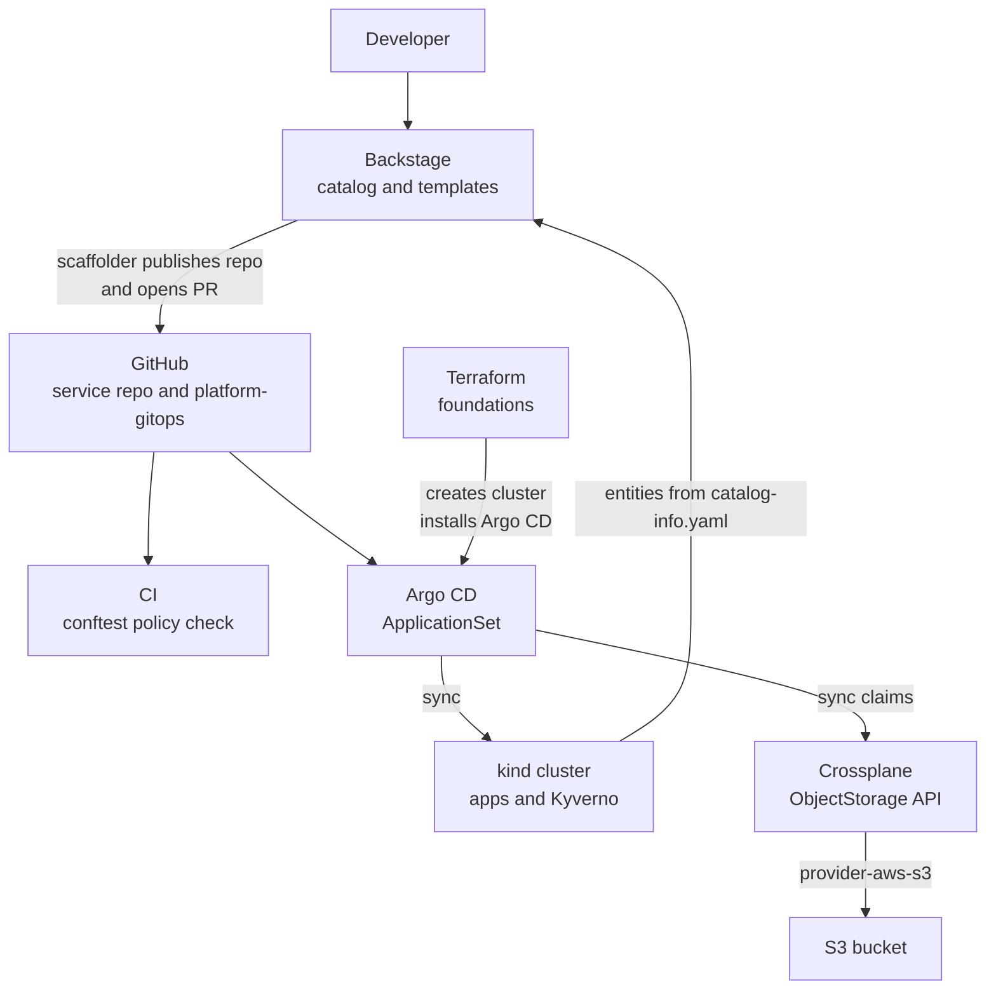
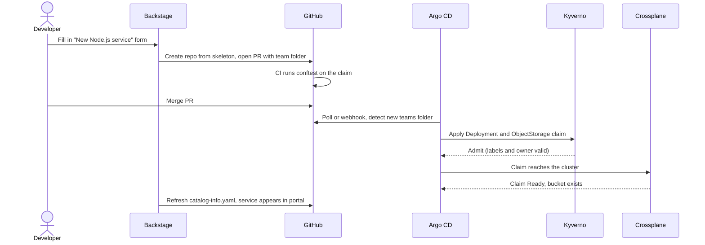

# L18 Capstone — A Mini Internal Developer Platform

> **Level 18: Platform Engineering** · Capstone · ⏱ ~14 hours

## 1. Goal and outcome

Build a small but real **internal developer platform (IDP)** on a laptop. A developer fills in one form in a portal;
minutes later a new service repository exists, its infrastructure is requested through a Kubernetes API, policy has
checked it, and Argo CD has deployed it. By the end you will have:

- a **Backstage** portal with a **catalog** (`shop-api` as a `Component`, its database as a `Resource`) and a
  **software template** that scaffolds a service repository;
- a **golden path** service skeleton: Dockerfile, CI workflow, Kubernetes manifests and `catalog-info.yaml`;
- a **platform GitOps repository** (`platform-gitops`) with an Argo CD **ApplicationSet** that turns every
  `teams/<team>/<env>` folder into an Application;
- a **Crossplane** `ObjectStorage` API (XRD + Composition) so a team requests a bucket with ten lines of YAML;
- **policy as code** in two layers: **Conftest/Rego** in CI and **Kyverno** at admission;
- **Terraform** for the foundations (the cluster and the Argo CD bootstrap), with a clear ownership contract.

This exercises every topic: [Internal Developer Platforms](01-internal-developer-platforms.md),
[Developer Portals](02-developer-portals.md), [Self-service Infrastructure](03-self-service-infrastructure.md),
[Golden Paths](04-golden-paths.md), [Service Catalogs](05-service-catalogs.md),
[Infrastructure Templates](06-infrastructure-templates.md), [Policy as Code](07-policy-as-code.md),
[Backstage](08-backstage.md), [Crossplane](09-crossplane.md) and
[Integrating Argo CD, Terraform and Kubernetes into a Platform](10-platform-stack-integration.md).

## 2. Architecture



What happens when a developer clicks "Create":



## 3. Prerequisites and cost

- Docker, `kind`, `kubectl`, `helm`, `git`, `terraform` (or `tofu`), `node` 20+ with `yarn` for Backstage, `gh` (GitHub CLI),
  and the `conftest` binary.
- A GitHub account where you can create two empty repositories: `platform-gitops` and (created by the template) a service repo.
  A personal access token is needed for the Backstage scaffolder (a fine-grained token limited to your lab repositories).
- About 8 GB of free RAM and 20 GB of disk (Backstage plus a kind cluster is the heavy part).
- **Cost:** the cluster and Backstage are free. Milestone 4 creates **one empty S3 bucket** in an AWS sandbox account, which costs
  effectively nothing, but set an AWS Budget or billing alarm first and run Teardown. You may skip the AWS part and still
  complete everything except the final "bucket is Ready" check.
- All versions below are examples; pin the versions you tested. Outputs are illustrative and will differ in names,
  ages and timings. Never commit credentials; use placeholders such as `<YOUR_TOKEN>`.

## 4. Build it step by step

### Milestone 1 — Foundations with Terraform (topics 3, 6, 10)

Terraform owns what must exist before any cluster workload: here, the kind cluster and the Argo CD installation.

```hcl
# infra-foundations/main.tf
terraform {
  required_providers {
    kind = {
      source  = "tehcyx/kind"
      version = "~> 0.6"
    }
    helm = {
      source  = "hashicorp/helm"
      version = "~> 2.14"
    }
  }
}

resource "kind_cluster" "platform" {
  name           = "platform-lab"
  wait_for_ready = true
}

provider "helm" {
  kubernetes {
    config_path = kind_cluster.platform.kubeconfig_path
  }
}

resource "helm_release" "argocd" {
  name             = "argocd"
  namespace        = "argocd"
  create_namespace = true
  repository       = "https://argoproj.github.io/argo-helm"
  chart            = "argo-cd"
  version          = "7.6.0" # example version
}
```

```bash
cd infra-foundations
terraform init
terraform apply        # review the plan, then type yes
kind export kubeconfig --name platform-lab     # makes kubectl point at the new cluster
kubectl -n argocd get pods
```

Expect the `argocd-server`, `argocd-repo-server` and `argocd-application-controller` pods `Running`. If the
`kind` provider is not available to you, create the cluster by hand with `kind create cluster --name platform-lab` and
install Argo CD with `helm install`; the ownership idea is unchanged.

### Milestone 2 — The platform GitOps repository (topics 3, 10)

```bash
mkdir -p platform-gitops/{bootstrap,platform/{policy,crossplane},teams/team-shop/dev,policy}
cd platform-gitops && git init -b main
```

The ApplicationSet turns any `teams/<team>/<env>` folder into an Application, so onboarding a team is adding a folder.
Replace the repository URL with your own.

```yaml
# bootstrap/teams-appset.yaml
apiVersion: argoproj.io/v1alpha1
kind: ApplicationSet
metadata:
  name: team-resources
  namespace: argocd
spec:
  goTemplate: true
  goTemplateOptions: ["missingkey=error"]
  generators:
    - git:
        repoURL: https://github.com/<YOUR_GITHUB_USER>/platform-gitops.git
        revision: main
        directories:
          - path: teams/*/*
  template:
    metadata:
      name: '{{ index .path.segments 1 }}-{{ index .path.segments 2 }}'
    spec:
      project: default
      source:
        repoURL: https://github.com/<YOUR_GITHUB_USER>/platform-gitops.git
        targetRevision: main
        path: '{{ .path.path }}'
      destination:
        server: https://kubernetes.default.svc
        namespace: '{{ index .path.segments 1 }}'
      syncPolicy:
        automated:
          prune: false
          selfHeal: true
        syncOptions:
          - CreateNamespace=true
```

Add a root Application so platform components sync before team content (negative sync waves, see
[topic 10](10-platform-stack-integration.md)):

```yaml
# bootstrap/kyverno-app.yaml
apiVersion: argoproj.io/v1alpha1
kind: Application
metadata:
  name: kyverno
  namespace: argocd
  annotations:
    argocd.argoproj.io/sync-wave: "-2"
spec:
  project: default
  source:
    repoURL: https://kyverno.github.io/kyverno/
    chart: kyverno
    targetRevision: 3.3.0        # example version, pin the one you tested
  destination:
    server: https://kubernetes.default.svc
    namespace: kyverno
  syncPolicy:
    automated: {selfHeal: true}
    syncOptions: [CreateNamespace=true, ServerSideApply=true]
```

Commit and push `platform-gitops`, then `kubectl apply -f bootstrap/` (the Crossplane Application follows the same
pattern with the chart from `https://charts.crossplane.io/stable`).

### Milestone 3 — Policy as code, two layers (topic 7)

Layer one runs in CI on the claim files before merge:

```rego
# policy/claims.rego
package main

import rego.v1

deny contains msg if {
	input.kind == "ObjectStorage"
	input.spec.parameters.owner != input.metadata.namespace
	msg := sprintf("ObjectStorage %q: owner %q must equal its namespace %q", [input.metadata.name, input.spec.parameters.owner, input.metadata.namespace])
}

deny contains msg if {
	input.kind == "ObjectStorage"
	not input.spec.parameters.region
	msg := sprintf("ObjectStorage %q: spec.parameters.region is required", [input.metadata.name])
}
```

```yaml
# teams/team-shop/dev/assets.yaml
apiVersion: platform.example.org/v1alpha1
kind: ObjectStorage
metadata:
  name: shop-assets
  namespace: team-shop
spec:
  parameters:
    owner: team-shop
    region: us-east-1
```

```bash
conftest test teams/*/*/*.yaml
```

Expected: `1 test, 1 passed, 0 warnings, 0 failures, 0 exceptions` (similar to this). The same policy can be checked without
Conftest using `opa eval` or `opa test`; the Rego is identical.

Layer two is a Kyverno `ClusterPolicy` that enforces the same convention at admission, so a `kubectl apply` that bypasses
CI is still stopped. Start it in `Audit` mode and switch to `Enforce` once clean:

```yaml
# platform/policy/require-team-label.yaml
apiVersion: kyverno.io/v1
kind: ClusterPolicy
metadata:
  name: require-team-label
spec:
  validationFailureAction: Audit
  background: true
  rules:
    - name: deployments-need-team-label
      match:
        any:
          - resources:
              kinds: ["Deployment"]
      validate:
        message: "Deployments must carry the label 'team'."
        pattern:
          metadata:
            labels:
              team: "?*"
```

### Milestone 4 — Crossplane `ObjectStorage` API (topics 3, 6, 9)

Install Crossplane (Helm or an Argo CD Application), then the S3 provider and function from
[Crossplane](09-crossplane.md): `provider-aws-s3`, `function-patch-and-transform`, a `ProviderConfig` with sandbox
credentials stored as a Secret (lab only; production uses IRSA or Pod Identity), then the XRD
(`XObjectStorage` / claim `ObjectStorage`) and a Composition that creates one `Bucket` with versioning and
public-access-block. Put the XRD and Composition in `platform/crossplane/` so Argo CD owns them.

```bash
kubectl get providers,functions
kubectl get xrd
```

Wait until providers show `INSTALLED` and `HEALTHY` `True`. Then copy `assets.yaml` into the cluster by letting Argo CD
sync it (Milestone 2 already points at `teams/team-shop/dev`) and watch it:

```bash
kubectl -n team-shop get objectstorage
kubectl get managed
```

Expect `SYNCED` and `READY` to become `True` for the claim and a managed `Bucket` (names and ages will differ).

### Milestone 5 — Backstage catalog and template (topics 1, 2, 4, 5, 8)

Create the portal and register a first component:

```bash
npx @backstage/create-app@latest      # app name: shop-portal
cd shop-portal && yarn start
```

Register the `shop-api` entities with a `catalog-info.yaml` in a repository (or `catalog.locations` in
`app-config.yaml`), as described in [Backstage](08-backstage.md):

```yaml
# catalog-info.yaml
apiVersion: backstage.io/v1alpha1
kind: Component
metadata:
  name: shop-api
  description: Node.js API for the shop
  annotations:
    github.com/project-slug: <YOUR_GITHUB_USER>/shop-api
    argocd/app-name: team-shop-dev
spec:
  type: service
  lifecycle: production
  owner: group:default/team-shop
  dependsOn:
    - resource:default/shop-assets
---
apiVersion: backstage.io/v1alpha1
kind: Resource
metadata:
  name: shop-assets
  description: S3 bucket for static assets, provisioned by Crossplane
spec:
  type: s3-bucket
  owner: group:default/team-shop
```

Then add the golden-path template. It takes a name and team, copies a skeleton, publishes a repository, and opens a pull
request against `platform-gitops` that adds the team folder:

```yaml
# templates/nodejs-service/template.yaml
apiVersion: scaffolder.backstage.io/v1beta3
kind: Template
metadata:
  name: nodejs-service
  title: New Node.js service
  description: Scaffolds a service repo on the golden path
spec:
  owner: group:default/platform-team
  type: service
  parameters:
    - title: Service details
      required: [name, team]
      properties:
        name:
          type: string
          pattern: '^[a-z][a-z0-9-]{2,30}$'
        team:
          type: string
          description: Owning team namespace, for example team-shop
  steps:
    - id: fetch
      name: Fetch skeleton
      action: fetch:template
      input:
        url: ./skeleton
        values:
          name: ${{ parameters.name }}
          team: ${{ parameters.team }}
    - id: publish
      name: Create repository
      action: publish:github
      input:
        repoUrl: github.com?owner=<YOUR_GITHUB_USER>&repo=${{ parameters.name }}
        defaultBranch: main
    - id: register
      name: Register in catalog
      action: catalog:register
      input:
        repoContentsUrl: ${{ steps['publish'].output.repoContentsUrl }}
        catalogInfoPath: /catalog-info.yaml
  output:
    links:
      - title: Repository
        url: ${{ steps['publish'].output.remoteUrl }}
```

The skeleton directory holds a `Dockerfile`, a `.github/workflows/ci.yaml`, a `k8s/` folder with a Deployment
(carrying the `team` label), and a `catalog-info.yaml` using `${{ values.name }}`. Add `GITHUB_TOKEN` to the
environment of the Backstage backend (`GITHUB_TOKEN=<YOUR_TOKEN> yarn start`) and an `integrations.github` entry in
`app-config.local.yaml`.

### Milestone 6 — End to end (topic 10)

1. In Backstage, open Create, choose **New Node.js service**, name it `orders-api`, team `team-shop`.
2. Confirm the repo exists, then copy its `k8s/` manifests into `platform-gitops/teams/team-shop/dev/orders-api/` (or
   add a second scaffolder step that opens this PR automatically).
3. Open a PR; CI runs `conftest test`; merge it.
4. Watch Argo CD:
   ```bash
   kubectl -n argocd get applications
   kubectl -n team-shop get deploy,objectstorage
   ```
5. Refresh the catalog and confirm `orders-api` appears with an owner, a repository link and an Argo CD annotation.

## 5. Tasks

- [ ] **T1 — Bootstrap the foundations** *(≈60 min, intermediate; Milestone 1; topics 3, 10)*
  - **Goal:** Terraform creates the cluster and installs Argo CD.
  - **Steps:**
    1. Write `main.tf`, run `terraform init` and `terraform apply`.
    2. Run `terraform plan` again and read the "no changes" result.
    3. Delete the `argocd` namespace by hand and run `terraform plan` to see the drift.
  - **Done when:** Argo CD pods are `Running`, a second plan shows no changes, and you can explain the drift plan.

- [ ] **T2 — Onboard a team by adding a folder** *(≈45 min, intermediate; Milestone 2; topics 3, 10)*
  - **Goal:** the ApplicationSet creates Applications from directories.
  - **Steps:**
    1. Push `platform-gitops` and apply `bootstrap/`.
    2. Add `teams/team-pay/dev/` with one ConfigMap and push.
    3. Observe the new Application, then remove the folder.
  - **Done when:** `kubectl -n argocd get applications` listed `team-pay-dev` while the folder existed, with no Argo CD config change.

- [ ] **T3 — Make the policy fail, then pass** *(≈45 min, intermediate; Milestone 3; topic 7)*
  - **Goal:** the CI guardrail blocks a bad claim.
  - **Steps:**
    1. Create a claim in namespace `team-pay` with `owner: team-shop`.
    2. Run `conftest test` and read the failure message.
    3. Fix it and re-run, then add a CI workflow step that runs it on pull requests.
  - **Done when:** the failing run exits non-zero, the fixed run exits 0, and a PR shows the check.

- [ ] **T4 — Audit, then enforce, at admission** *(≈45 min, advanced; Milestone 3; topic 7)*
  - **Goal:** feel the safe rollout of a Kyverno rule.
  - **Steps:**
    1. Apply the `Audit` policy and create a Deployment without a `team` label.
    2. Read the policy report (`kubectl get policyreport -A`).
    3. Switch to `Enforce` and retry.
  - **Done when:** the audit run reports a violation without blocking, and the enforce run rejects the Deployment with your message.

- [ ] **T5 — Ship the `ObjectStorage` API** *(≈90 min, advanced; Milestone 4; topics 3, 6, 9)*
  - **Goal:** a claim becomes a real bucket.
  - **Steps:**
    1. Install Crossplane, the provider, the function, XRD and Composition.
    2. Let Argo CD sync `assets.yaml` and wait for `Ready`.
    3. Check the bucket exists with `aws s3api head-bucket` and its public-access block is on.
  - **Done when:** `kubectl get objectstorage -n team-shop` shows `READY True` and the AWS CLI confirms the bucket. Then delete the claim and confirm the bucket is removed.

- [ ] **T6 — Publish a golden-path template** *(≈120 min, advanced; Milestone 5; topics 1, 2, 4, 5, 8)*
  - **Goal:** a developer creates a working service from a form.
  - **Steps:**
    1. Run Backstage, register `shop-api` and `shop-assets` in the catalog.
    2. Add the template and skeleton, then create `orders-api`.
    3. Open the entity page and find its owner, repo link and dependency graph.
  - **Done when:** a new repository exists from the template and the `orders-api` entity is visible in the catalog with a correct owner.

- [ ] **T7 — Wire the whole path and break it** *(≈90 min, advanced; Milestone 6; topic 10)*
  - **Goal:** understand ordering and ownership failures.
  - **Steps:**
    1. Complete the end-to-end flow once.
    2. Temporarily remove the sync wave from the Crossplane Application and sync a fresh cluster, noting the claim error about an unknown kind.
    3. Restore the wave. Then try to delete a claim from Git and confirm `prune: false` leaves the bucket until you remove it deliberately.
  - **Done when:** you have logs showing the ordering failure and its fix, and you can state which tool owns each resource.

- [ ] **T8 — Prove it** *(≈90 min, advanced; all milestones; all topics)*
  - **Goal:** rebuild the core of the platform from memory and explain it.
  - **Steps:**
    1. On a clean cluster, without this guide, stand up Argo CD, one policy, and one Crossplane claim delivered through an ApplicationSet.
    2. Draw the ownership table: who owns the cluster, the bucket, the app, and the policy.
    3. Write a half-page explanation of why a developer should not need to know any of these tools.
  - **Done when:** the pieces work end to end and your explanation names the golden path, the control plane and the guardrails.

## 6. Verification checklist

- [ ] `terraform plan` in `infra-foundations` shows no changes.
- [ ] `kubectl -n argocd get applications` lists the kyverno, crossplane and team applications as `Synced` and `Healthy`.
- [ ] `conftest test teams/*/*/*.yaml` exits 0 on `main` and non-zero on a deliberately bad claim.
- [ ] A Deployment without a `team` label is rejected once the Kyverno policy is in `Enforce`.
- [ ] `kubectl -n team-shop get objectstorage` shows `READY True` (if you used AWS).
- [ ] The Backstage catalog shows `shop-api`, `shop-assets` and the scaffolded service, each with an owner.
- [ ] No credentials are committed: `git log -p | grep -i 'secret_access'` finds nothing.

## 7. Teardown

```bash
# 1. Delete claims first so Crossplane removes the cloud resources
kubectl -n team-shop delete objectstorage --all
kubectl get managed          # wait until empty
aws s3 ls | grep -i shop     # confirm no lab bucket remains

# 2. Remove the cluster and foundations
cd infra-foundations && terraform destroy

# 3. Remove local artefacts and revoke the token you created for Backstage
rm -rf ../shop-portal
```

Delete the lab GitHub repositories you no longer need, and delete the fine-grained token and any AWS access key you created.
Check the AWS Billing console once more the next day.

## 8. Stretch goals and what to learn next

- Add a second template for a `PostgresInstance` claim and show it in the portal as a `Resource` with a dependency edge.
- Add Argo CD health checks for claims (see topic 10) so sync waves wait for `Ready`.
- Add a scheduled `terraform plan` in CI to detect drift in the foundations.
- Measure the platform: time from "Create" click to running service, and number of tickets avoided.
- Next: [Level 19: Architecture](../level-19-architecture/01-scalability.md) turns these building blocks into whole-system trade-offs, and
  [Level 20: Cost Optimization](../level-20-cost-optimization/01-finops.md) shows how to keep a platform's cloud bill under control.

<!-- nav -->
---
← Previous: [Integrating Argo CD, Terraform and Kubernetes into a Platform](10-platform-stack-integration.md) · [Level 18 index](README.md) · Next level: [Level 19 — Architecture](../level-19-architecture/README.md) →
