# Level 18 — Platform Engineering

> **Goal:** Build internal platforms that let product teams self-serve infrastructure safely and quickly.

| | |
|---|---|
| **Recommended time** | 4-6 weeks |
| **Topics** | 10 |
| **Practice / capstone** | Build a mini internal developer platform: Backstage catalog + software template that scaffolds a service repo, provisions infra via Crossplane/Terraform and deploys through Argo CD. |

## Topics

| # | Topic | What you will learn |
|---|-------|---------------------|
| 1 | [Internal Developer Platforms](01-internal-developer-platforms.md) | IDP concept, platform as a product, thinnest viable platform |
| 2 | [Developer Portals](02-developer-portals.md) | what a portal offers, build vs buy, adoption |
| 3 | [Self-service Infrastructure](03-self-service-infrastructure.md) | request flows, guardrails, ticket-ops to API-ops |
| 4 | [Golden Paths](04-golden-paths.md) | paved roads vs mandates, templates, measuring adoption |
| 5 | [Service Catalogs](05-service-catalogs.md) | ownership metadata, catalog-info.yaml, dependency graphs, scorecards |
| 6 | [Infrastructure Templates](06-infrastructure-templates.md) | reusable modules/compositions, versioning, template testing |
| 7 | [Policy as Code](07-policy-as-code.md) | OPA/Rego, Kyverno, Conftest, enforcing in CI and cluster |
| 8 | [Backstage](08-backstage.md) | install, catalog, software templates, plugins, TechDocs |
| 9 | [Crossplane](09-crossplane.md) | providers, managed resources, compositions, XRDs, claims |
| 10 | [Integrating Argo CD, Terraform and Kubernetes into a Platform](10-platform-stack-integration.md) | how the pieces compose: control planes, GitOps delivery, state ownership |
| ★ | [Level capstone project](99-capstone-project.md) | Build a mini internal developer platform: Backstage catalog + software template that scaffolds a service repo, provisions infra via Crossplane/Terraform and deploys through Argo CD. |

## How to work through this level

1. Read each topic in order: *what it is → why it matters → real-world example → diagram → guide*.
2. Do **every task** in the topic's *Tasks* section and tick the box (`- [x]`) in your own fork or notes.
3. Answer the *Self-check questions* without looking, then reveal the answers.
4. Finish with the **capstone project**, which combines all topics of the level.
5. Move on only when you can do the capstone's *Prove it* task without the guide.

## Topic flow

```mermaid
flowchart LR
    T1["1. Internal Developer Platforms"]
    T2["2. Developer Portals"]
    T3["3. Self-service Infrastructure"]
    T4["4. Golden Paths"]
    T5["5. Service Catalogs"]
    T6["6. Infrastructure Templates"]
    T7["7. Policy as Code"]
    T8["8. Backstage"]
    T9["9. Crossplane"]
    T10["10. Integrating Argo CD, Terraform and Kubernetes into a Platform"]
    CAP(["Capstone"])
    T1 --> T2 --> T3 --> T4 --> T5 --> T6 --> T7 --> T8 --> T9 --> T10 --> CAP
```

---
← [Level 17 — GitOps](../level-17-gitops/README.md) · [Roadmap home](../README.md) · [Level 19 — Architecture](../level-19-architecture/README.md) →
