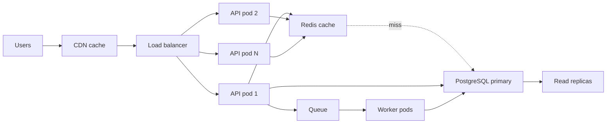
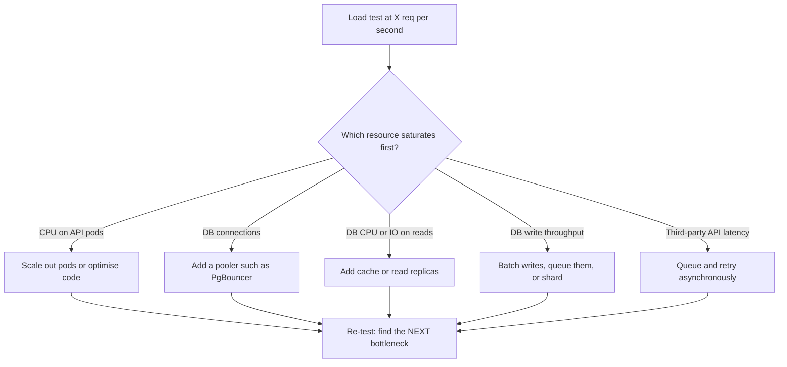

# L19.1 — Scalability

> **Level 19: Architecture** · Topic 1 of 11 · ⏱ ~4 hours · Difficulty: Advanced

## 1. What it is

**Scalability** is a system's ability to handle more work (requests, data, users) by adding resources, without a
redesign and without cost or latency growing faster than the load. It is not "being fast": a system can be fast for 10
users and collapse at 10,000. Scalability is about the *shape of the curve* when load grows.

There are two **scaling axes**. **Vertical scaling** (scale up) means a bigger machine: more CPU, RAM, faster disks.
**Horizontal scaling** (scale out) means more machines behind a load balancer, queue or shard map. Vertical is simple
but has a ceiling and a single point of failure; horizontal has almost no ceiling but demands that the application be
**stateless** (any instance can serve any request) and that shared state lives somewhere designed for it (database,
cache, object storage). Architecture work is mostly finding the *next bottleneck* and deciding which axis removes it.

## 2. Why it matters in DevOps

- **Launch-day and sale-day outages** are almost always a bottleneck nobody measured: a connection pool, a single
  database writer, a synchronous call to a third party.
- **Cost:** scaling the wrong tier (adding web pods when the database is the limit) burns money and fixes nothing.
- **Autoscaling is only as good as the design:** Kubernetes can add pods in seconds, but it cannot add database write capacity.
- **Capacity numbers drive everything downstream:** pod counts, node counts, connection limits, queue depth alarms and the cloud bill.

Related reading: [High Availability and Scalability](../level-00-what-devops-is/08-high-availability-and-scalability.md),
[Horizontal and Vertical Scaling](../level-13-databases-distributed-systems/10-horizontal-and-vertical-scaling.md),
[Capacity Planning](../level-14-sre/09-capacity-planning.md).

## 3. Real-world system example

**Stateless web tier plus scalable data tier, as documented by large platforms.** Instagram's engineering blog has
described running Django web servers that are stateless, with PostgreSQL and Memcached/Redis carrying the state,
and later sharding PostgreSQL by logical shard ids. Shopify has publicly described its "pods" approach: isolating
groups of shops into independent shards of the whole stack so that one huge merchant or one failing database does not
take everyone down. Amazon's Builders' Library and the AWS Well-Architected Framework both describe the same
recurring pattern: stateless compute that scales horizontally, queues to absorb bursts, caches to shield databases,
and partitioned data stores.

The recurring lesson: the compute tier is the *easy* part to scale. The hard parts are the **data tier** and the
**shared dependencies**, which is where design effort belongs. (Exact numbers vary by company and year; read the
engineering blogs for current figures instead of relying on remembered ones.)

## 4. Diagram

Where each scaling technique sits in the request path of `shop-api`:



Finding the bottleneck: utilization of each tier as load grows. The first tier to hit its ceiling sets the system limit.



## 5. How it works

### Scaling axes

| Axis | How | Strengths | Limits |
|------|-----|-----------|--------|
| Vertical (scale up) | Bigger instance or DB | No code change, simple ops | Ceiling, downtime to resize, single point of failure, price rises faster than capacity at the top end |
| Horizontal (scale out) | More identical instances | Near-linear for stateless tiers, also adds redundancy | Needs stateless design, shared state becomes the bottleneck |
| Functional split | Separate services or queues per workload (API vs worker vs reports) | Scale each part independently | More moving parts to operate |
| Data partitioning | Shard or partition by key (tenant, user id, date) | Removes the single-writer limit | Cross-shard queries and transactions get hard; re-sharding is painful |

### Stateless services

A service is stateless when a request can be served by any replica. To get there: sessions live in Redis or a signed
token (not process memory), uploads go straight to object storage (S3) via pre-signed URLs, configuration comes
from the environment, and any local disk is treated as scratch. Statelessness is what lets Kubernetes kill and
reschedule pods freely and lets the autoscaler work. See [Horizontal Pod Autoscaling](../level-08-kubernetes/16-horizontal-pod-autoscaling.md).

### Caching

Caches trade freshness for speed and database relief. Layers: browser, CDN, application (Redis), database (buffer
cache). The key numbers are the **hit ratio** and the **invalidation strategy** (TTL, explicit delete, write-through).
A cache with a 90% hit ratio removes 90% of read load from the database; at 99% the remaining 1% is a hundred
times smaller than the original. The danger is a **cache stampede** (many misses at once when a hot key expires) and
a **cold cache** after restart. See [Redis](../level-13-databases-distributed-systems/07-redis.md).

### Queues

A queue decouples "accept the work" from "do the work". It absorbs bursts (the queue grows instead of the database
falling over), allows independent scaling of workers, and enables retries. Costs: eventual consistency, the need
for idempotent consumers, and a new thing to monitor (queue depth and age of oldest message). See
[Kafka](../level-13-databases-distributed-systems/08-kafka.md), [RabbitMQ](../level-13-databases-distributed-systems/09-rabbitmq.md),
[Idempotency](../level-13-databases-distributed-systems/14-idempotency.md).

### Bottleneck analysis

Use **Little's Law**: `concurrency = throughput x latency`. If an API pod handles requests that take 200 ms, and you
need 150 req/s per pod, you need about 30 requests in flight per pod; a pool of 10 database connections cannot
sustain that if each request holds a connection for the whole 200 ms. Then apply the **Universal Scalability
Law** intuition: contention (locks, a single hot row) and coherence costs (cross-node chatter) make returns diminish
and can even reverse throughput past some point. Always measure; never assume linear scaling.

## 6. Step-by-step guide

**Prerequisites:** Python 3.9+ (no packages). Optionally Docker for step 5. No cloud cost.

1. **Write a back-of-envelope capacity model for `shop-api`.** Save as `capacity.py`:
   ```python
   import math

   dau = 2_000_000              # daily active users (assumption, state it)
   reqs_per_user_per_day = 40   # assumption
   peak_factor = 5              # peak RPS vs daily average (assumption)
   avg_rps = dau * reqs_per_user_per_day / 86_400
   peak_rps = avg_rps * peak_factor

   rps_per_pod = 150            # MEASURE this in a load test, never guess
   target_util = 0.6            # headroom for spikes and a lost availability zone
   pods = math.ceil(peak_rps / (rps_per_pod * target_util))

   print(f"avg RPS   : {avg_rps:,.0f}")
   print(f"peak RPS  : {peak_rps:,.0f}")
   print(f"pods      : {pods}")

   conns_per_pod = 10
   print(f"DB conns  : {pods * conns_per_pod} (PostgreSQL default max_connections is 100)")

   hit = 0.9
   db_reads = peak_rps * 0.8 * (1 - hit)   # assume 80% of requests are reads
   print(f"DB reads/s with {hit:.0%} cache hit ratio: {db_reads:,.0f}")
   ```
   ```bash
   python3 capacity.py
   ```
   Expected output:
   ```text
   avg RPS   : 926
   peak RPS  : 4,630
   pods      : 52
   DB conns  : 520 (PostgreSQL default max_connections is 100)
   DB reads/s with 90% cache hit ratio: 370
   ```
   **Read the result:** compute scales fine (52 pods), but 520 database connections blows past the default limit of
   100. The model just told you the first bottleneck is the *connection count*, not CPU. The fix is a pooler
   (PgBouncer) or fewer connections per pod. See [Database Connection Pooling](../level-13-databases-distributed-systems/06-db-connection-pooling.md).

2. **Apply Little's Law to find required concurrency.**
   ```bash
   python3 -c "rps=150; latency=0.2; print('in-flight per pod:', rps*latency)"
   ```
   Expected: `in-flight per pod: 30.0`. If your pod allows 10 DB connections, requests will queue inside the pod.

3. **Add the cache and re-run.** Change `hit` to `0.99` and re-run. Reads to the database should drop from 370 to about 37 per
   second. Write down the new bottleneck (probably writes, since caching does not help them).

4. **Model a queue absorbing a burst.**
   ```python
   # burst.py: queue depth when arrivals exceed worker capacity
   arrival = 400      # msgs/s during a 60 s flash sale
   workers = 20
   per_worker = 10    # msgs/s each
   capacity = workers * per_worker
   backlog = max(0, (arrival - capacity) * 60)
   drain_s = backlog / capacity
   print(f"backlog after burst: {backlog} msgs, drain time: {drain_s:.0f} s")
   ```
   ```bash
   python3 burst.py
   ```
   Expected: `backlog after burst: 12000 msgs, drain time: 60 s`. Without the queue those 12,000 extra messages would have hit the database
   at once. With it, users see a one-minute delay in emails instead of errors.

5. **See statelessness break (optional, Docker).**
   ```bash
   docker run -d --name web1 -p 8081:80 nginx:alpine
   docker run -d --name web2 -p 8082:80 nginx:alpine
   curl -s -o /dev/null -w "%{http_code}\n" localhost:8081 localhost:8082
   docker rm -f web1 web2
   ```
   Two identical replicas answer the same way because neither holds user state. Now imagine each held the user's
   shopping cart in memory: the load balancer would send the next request to the other replica and the cart would vanish.
   That is why carts belong in Redis.

6. **Write the scaling decision as a one-page table**: for each tier (CDN, API, worker, Redis, queue, PostgreSQL, S3), write
   the current limit, how you will detect it (the metric), and the next action. This table is the output of bottleneck analysis.

## 7. Real-world scenario

*(Illustrative, not a documented incident.)* A retailer's flash sale starts at 12:00. Autoscaling takes the API from 6 to
60 pods in four minutes. Error rate **rises** instead of falling. Dashboards show API CPU at 25%, but PostgreSQL has
`FATAL: sorry, too many clients already` in its logs. Each new pod opened 10 connections; 60 pods wanted 600, and the
database allows 100. The autoscaler made things worse by adding more connection hunters.

The on-call engineer deploys PgBouncer in transaction-pooling mode in front of PostgreSQL, caps each pod at 3 app-side
connections, and raises the cache TTL for the product catalogue from 5 to 60 seconds. Errors stop within minutes.
**Lesson:** scale the system by finding the *first* saturated resource, not the most visible one. Load test with
realistic pod counts *before* the sale, and alert on connection saturation, not just CPU.

## 8. Common mistakes and best practices

**Don't**

- Scale the stateless tier and assume the whole system scales: the database is almost always the real limit.
- Store sessions or uploads on the pod's local disk.
- Cache without a plan for invalidation, TTLs and stampedes.
- Adopt sharding, microservices or multi-region "for scale" before a measurement says you need it.
- Trust a vendor's "unlimited" claim; every managed service has quotas, so find and monitor them.

**Do**

- Write assumptions down (users, requests per user, peak factor) and keep the model in the repo.
- Measure per-pod throughput in a load test and size from the measurement.
- Put a queue between "accept" and "process" for anything that can be asynchronous.
- Keep headroom (target 50-70% utilisation at peak) so you survive a lost zone or a spike.
- Re-run the bottleneck analysis after every significant change; the bottleneck moves.

## 9. Tasks

- [ ] **T1 — Build the capacity model** *(≈40 min, intermediate)*
  - **Goal:** produce a reproducible back-of-envelope estimate for `shop-api`.
  - **Steps:**
    1. Create `capacity.py` from step 6.1 and run it.
    2. Add a `STORAGE` section: 2 KB per order, 50,000 orders per day, 3 years retention, plus 30% index overhead.
    3. Print total storage in GB.
  - **Done when:** the script prints pods, DB connections and storage, and the storage figure matches a hand calculation of `50000 x 365 x 3 x 2 KB x 1.3` (about 142 GB in decimal units).

- [ ] **T2 — Find the first bottleneck** *(≈30 min, intermediate)*
  - **Goal:** use numbers to name the first thing that breaks.
  - **Steps:**
    1. Extend the model with limits: PostgreSQL `max_connections=100`, Redis 50,000 ops/s, queue 5,000 msgs/s, each pod 150 RPS.
    2. For peak RPS of 1,000, 5,000 and 20,000 print the utilisation of each resource.
    3. Mark the first resource above 100% for each load level.
  - **Done when:** a table shows which resource fails first at each load, and you can justify the fix for each.

- [ ] **T3 — Cache what-if analysis** *(≈30 min, intermediate)*
  - **Goal:** quantify what caching buys.
  - **Steps:**
    1. Compute database read rate at hit ratios 0%, 50%, 90%, 99%, 99.9% for a fixed 4,000 RPS.
    2. Plot or tabulate the results and note the diminishing returns.
    3. Add a stampede scenario: the hit ratio drops to 0% for 10 seconds after a deploy. Compute the peak DB load.
  - **Done when:** you can state the DB read rate in each case and name two mitigations for the stampede (for example request coalescing and jittered TTLs).

- [ ] **T4 — Prove the queue protects the database** *(≈45 min, advanced)*
  - **Goal:** break it, then fix it, in simulation.
  - **Steps:**
    1. Write a Python simulation: 400 msgs/s arrive for 60 s; the database handles 150 writes/s; without a queue, excess writes are dropped (errors).
    2. Count dropped writes. Add a queue with 20 workers each handling 10 msgs/s and count again.
    3. Add a worker autoscale rule that doubles workers after 30 s of backlog and report the new drain time.
  - **Done when:** the simulation shows dropped writes without the queue and zero with it, with backlog drain times printed.

- [ ] **T5 — Make a service stateless** *(≈60 min, advanced)*
  - **Goal:** find and remove hidden state.
  - **Steps:**
    1. Take any small web app you have (or `shop-api`) and list every place it keeps state: memory, local files, sticky sessions, in-process caches, cron on one host.
    2. For each, write the replacement (Redis, S3, database, a Kubernetes CronJob).
    3. Run two replicas locally (Docker Compose) and prove a user session survives a request landing on either.
  - **Done when:** with two replicas behind Nginx, repeated `curl` requests with the same cookie succeed regardless of which replica answers.

- [ ] **T6 — Prove it: scaling review** *(≈45 min, advanced)*
  - **Goal:** defend a scaling plan.
  - **Steps:**
    1. Without the guide, write a one-page scaling plan for 10x growth of `shop-api`: assumptions, capacity numbers, first three bottlenecks, and what you will measure.
    2. Explain it aloud (or write it) as if to a skeptical staff engineer: why not just buy a bigger database?
  - **Done when:** the plan names each bottleneck with a metric to detect it, and states one thing you deliberately will *not* build yet and why.

## 10. Self-check questions

1. What makes a service "stateless", and what three kinds of state must move out of the pod?
2. Why can adding more API pods make an outage worse?
3. State Little's Law and use it to size a connection pool.
4. What are the costs of adding a queue between the API and the database?
5. Why is the data tier harder to scale horizontally than the compute tier?

<details>
<summary>Answers</summary>

1. Any replica can serve any request. Sessions, uploaded files and in-process caches/scheduled jobs must move to Redis or tokens, object storage, and shared or external schedulers.
2. Each pod adds database connections and load on shared dependencies. If the database or pooler is the bottleneck, more pods increase contention and failures.
3. Concurrency = throughput x latency. At 150 req/s with 200 ms per request holding a connection, you need about 30 connections of concurrency per pod (or a pooler that multiplexes).
4. Eventual consistency, duplicate delivery (so idempotent consumers), an extra system to run and monitor (depth and age), and harder debugging end to end.
5. State must be kept consistent: writes need a single owner or coordination, and partitioning forces cross-shard queries, transactions and rebalancing.
</details>

## 11. Further reading

- *Designing Data-Intensive Applications* by Martin Kleppmann — chapters on replication, partitioning and batch/stream processing.
- *Site Reliability Engineering* (Google, free online) — chapters on load balancing and handling overload.
- Amazon Builders' Library (aws.amazon.com/builders-library) — articles on load shedding and queue-based designs.
- AWS Well-Architected Framework — Performance Efficiency and Reliability pillars.
- *The Art of Scalability* by Abbott and Fisher — the scale cube (x, y, z axes).

<!-- nav -->
---
← Previous level: [Level 18 — Platform Engineering](../level-18-platform-engineering/README.md) · [Level 19 index](README.md) · Next: [Availability](02-availability.md) →
