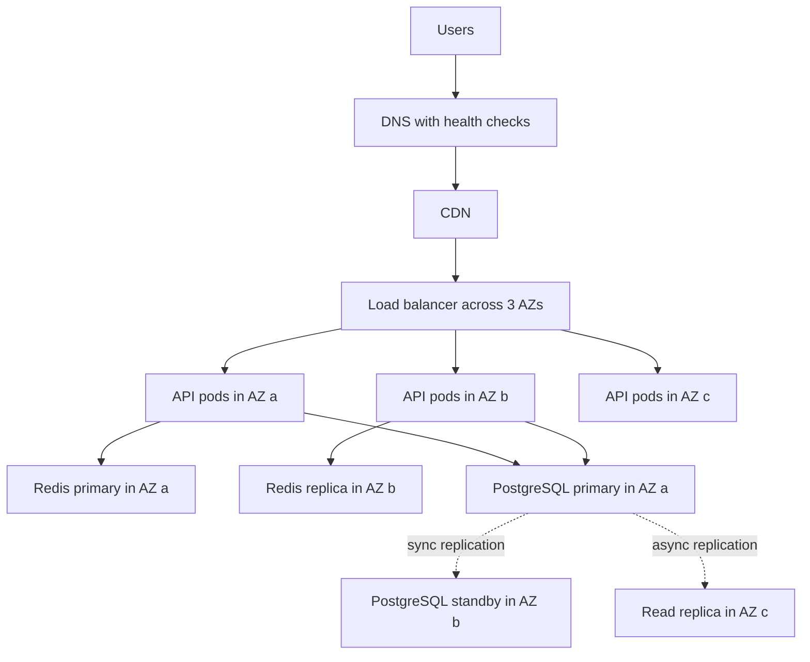
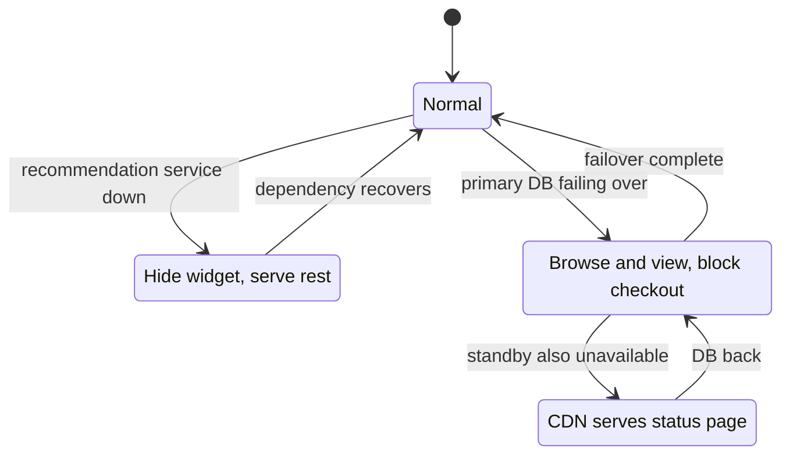

# L19.2 — Availability

> **Level 19: Architecture** · Topic 2 of 11 · ⏱ ~4 hours · Difficulty: Advanced

## 1. What it is

**Availability** is the fraction of time (or fraction of requests) for which a system does what users need it to do. It
is usually written as "nines": 99.9% is "three nines". Designing for availability means finding every **single point
of failure (SPOF)** (a component whose failure takes the whole system down), adding redundancy across independent
failure domains (instance, rack, **availability zone (AZ)**, region), and deciding in advance how the system
behaves when something it depends on is broken (**graceful degradation**).

Availability is a *number you choose and then pay for*. Going from 99.9% to 99.99% typically means more redundancy,
more automation, more testing, and a more expensive on-call practice. The architect's job is to pick the right target per
component, not to maximise it everywhere.

## 2. Why it matters in DevOps

- **Customer trust and contracts:** an SLA (Service Level Agreement) with credits turns downtime into money.
  See [SLOs](../level-14-sre/02-slos.md) and [SLAs](../level-14-sre/03-slas.md).
- **Dependencies multiply:** a chain of five 99.9% components is not 99.9%; it is about 99.5%. Most "mystery" availability
  gaps are arithmetic nobody did.
- **Redundancy that was never tested is not redundancy.** Failover that has never been exercised usually fails when needed.
- **It shapes the bill:** multi-AZ roughly doubles some costs, multi-region more so. You need to know what you are buying.

## 3. Real-world system example

**AWS regions and Availability Zones.** AWS documents that each Region consists of multiple AZs, which are
physically separate groups of data centres with independent power, cooling and networking, connected by low-latency
links. Its Well-Architected guidance recommends spreading workloads across at least two AZs, and services such as
RDS Multi-AZ, ALB, and S3 are built around that model (S3 stores objects redundantly across multiple facilities in a
Region for most storage classes). A well-known lesson from public AWS post-event summaries is that regional control-plane
issues can still affect customers who are "multi-AZ" inside one Region, which is why teams with strict targets also
design for *static stability* (data plane keeps working if the control plane is impaired) and sometimes multi-region.
Google's SRE book makes the complementary point: you should not target more availability than your users can
perceive or your dependencies (for example the network and phones) can deliver.

## 4. Diagram

A multi-AZ layout for `shop-api` with no single point of failure in the request path:



Graceful degradation as a state machine:



## 5. How it works

### The nines table

| Target | Downtime per 30 days | Downtime per year |
|--------|---------------------|-------------------|
| 99% | 7.2 hours | 3.65 days |
| 99.9% | 43.2 minutes | 8.76 hours |
| 99.95% | 21.6 minutes | 4.38 hours |
| 99.99% | 4.32 minutes | 52.6 minutes |
| 99.999% | 26 seconds | 5.26 minutes |

At four nines you have ~4 minutes a month. A human cannot be paged, log in and diagnose in that time, so the
recovery must be **automatic** (health checks, failover, rollbacks).

### Series and parallel math

- **In series** (all must work): availability multiplies. `A = A1 x A2 x ... x An`. More hard dependencies always lowers availability.
- **In parallel** (any one works): unavailability multiplies. `A = 1 - (1-A1) x (1-A2)`. Two independent 99.9% replicas give 99.9999% *in theory*.
- The theory breaks when failures are **correlated**: same bad deploy, same config, same cloud region, same shared database. Real
  redundancy needs independent failure domains and independent change (do not roll out to all replicas at once).

### Failure domains

| Domain | Example failure | Mitigation |
|--------|----------------|------------|
| Process / pod | OOM kill, crash | Replicas, restart policy, probes |
| Node / instance | Hardware, kernel panic | Spread pods across nodes (anti-affinity, topology spread) |
| AZ | Power, network, cooling | Multi-AZ subnets, nodes in 3 AZs, replicated data |
| Region | Regional service event, major disaster | Multi-region active-passive or active-active, DR plan |
| Provider | Account suspension, global control plane issue | Backups outside the account, exit plan |
| Change | Bad deploy, bad config | Canary, staged rollout, fast rollback |
| Dependency | Payment API down | Timeouts, retries with backoff, circuit breakers, fallbacks |

Most real outages come from **change** and **dependencies**, not hardware. See
[Circuit Breakers](../level-12-advanced-networking/14-circuit-breakers.md) and [Failover](../level-15-disaster-recovery/05-failover.md).

### Graceful degradation patterns

- **Shed non-essential features** (recommendations, avatars) before core flows (checkout).
- **Serve stale data** from cache when the origin is down (`stale-if-error` at the CDN).
- **Read-only mode** during database failover; queue writes where possible.
- **Load shedding:** reject excess traffic early with `503` rather than let everything time out.
- **Static fallback:** the CDN serves a status or cached catalogue page.

## 6. Step-by-step guide

**Prerequisites:** Python 3.9+, no cloud cost.

1. **Compute the nines table and a dependency chain.** Save as `nines.py`:
   ```python
   def downtime_min(avail, days=30):
       return (1 - avail) * days * 24 * 60

   for n in ["99", "99.9", "99.95", "99.99", "99.999"]:
       a = float(n) / 100
       print(f"{n:>7}% -> {downtime_min(a):8.2f} min/30d  {downtime_min(a, 365)/60:7.2f} h/yr")

   def series(*a):
       p = 1.0
       for x in a:
           p *= x
       return p

   def parallel(*a):
       p = 1.0
       for x in a:
           p *= (1 - x)
       return 1 - p

   # CDN, load balancer, app, database - all in the critical path
   chain = series(0.9999, 0.999, 0.9995, 0.999)
   print("series chain availability:", round(chain * 100, 4), "%")
   print("two independent 99.9 app replicas:", round(parallel(0.999, 0.999) * 100, 6), "%")
   ```
   ```bash
   python3 nines.py
   ```
   Expected output:
   ```text
         99% ->   432.00 min/30d    87.60 h/yr
       99.9% ->    43.20 min/30d     8.76 h/yr
      99.95% ->    21.60 min/30d     4.38 h/yr
      99.99% ->     4.32 min/30d     0.88 h/yr
    99.999% ->     0.43 min/30d     0.09 h/yr
   series chain availability: 99.7402 %
   two independent 99.9 app replicas: 99.9999 %
   ```
   Notice: four components that are each "three nines or better" combine to about 99.74%, which is roughly 112 minutes of downtime
   per 30 days. Redundancy at the database layer is what moves the chain, not more replicas of the app.

2. **Find the SPOFs.** Redraw the architecture from section 4 on paper and for every box ask: "If this disappears, what
   breaks and what is the recovery time?" Record the answers in a table with columns *component, failure mode, redundancy,
   detection, recovery time, tested on (date)*.

3. **Spread pods across zones in Kubernetes** (the manifest pattern; apply in a kind or cloud cluster if you have one).
   ```yaml
   apiVersion: apps/v1
   kind: Deployment
   metadata: { name: shop-api }
   spec:
     replicas: 6
     selector: { matchLabels: { app: shop-api } }
     template:
       metadata: { labels: { app: shop-api } }
       spec:
         topologySpreadConstraints:
           - maxSkew: 1
             topologyKey: topology.kubernetes.io/zone
             whenUnsatisfiable: DoNotSchedule
             labelSelector: { matchLabels: { app: shop-api } }
         containers:
           - name: api
             image: example.com/shop-api:1.0.0
   ---
   apiVersion: policy/v1
   kind: PodDisruptionBudget
   metadata: { name: shop-api }
   spec:
     minAvailable: 4
     selector: { matchLabels: { app: shop-api } }
   ```
   With three zones and six replicas you get two pods per zone; losing a zone leaves four, which equals the PDB
   `minAvailable`. See [Pods](../level-08-kubernetes/02-pods.md) and [Scheduling](../level-08-kubernetes/13-scheduling.md).

4. **Compute the capacity you need to survive an AZ loss ("N+1 across zones").** If peak needs 52 pods
   at 60% target utilisation, losing 1 of 3 zones leaves 2/3 of capacity:
   ```bash
   python3 -c "import math; need=52; zones=3; print('pods total:', math.ceil(need*zones/(zones-1)))"
   ```
   Expected: `pods total: 78`. You are paying for 50% extra capacity as the price of zone-failure tolerance (or you accept degraded
   performance and rely on headroom and autoscaling).

5. **Decide the degradation ladder.** Write a table of what the user sees when each dependency is down:
   | Dependency down | User impact | Mechanism |
   |-----------------|-------------|-----------|
   | Recommendations | Widget hidden | Timeout 200 ms, fallback to empty list |
   | Redis | Slower pages | Bypass cache, rate-limit expensive queries |
   | Payment provider | Checkout shows "try again" | Circuit breaker, queue order for retry |
   | PostgreSQL primary | Read-only browsing | Failover to standby, API returns 503 on writes with Retry-After |

6. **Test the redundancy.** In a sandbox cluster, delete one pod (`kubectl delete pod`), then drain a node
   (`kubectl drain <node> --ignore-daemonsets`) while running `curl` in a loop against the service. Count failed requests.
   Record the result: this is evidence, not an assumption.

## 7. Real-world scenario

*(Illustrative, not a documented incident.)* A team advertises 99.95% and runs two API replicas, a managed PostgreSQL in
one AZ, and a single NAT gateway. One evening the AZ hosting the database and NAT has a networking event. The API pods in the other AZ
are healthy but cannot reach the database or the internet. The page goes out; recovery is a manual restore of the database
into a second AZ and takes 70 minutes. The month's budget for 99.95% is 21.6 minutes.

The review finds: the "two replicas" were redundancy for the *easy* tier, while the data tier and the egress path were
SPOFs. Fixes: Multi-AZ database with automatic failover, one NAT gateway per AZ, a read-only degraded mode, a game day twice a year,
and the SLO is restated at 99.9% until those are proven. **Lesson:** availability is the weakest component in the
critical path, and untested redundancy is a belief, not a control.

## 8. Common mistakes and best practices

**Don't**

- Multiply nines in your head: compute them, including every hard dependency (DNS, auth, payments, the CI that gates rollbacks).
- Count replicas in the same AZ, same deploy, or sharing the same database as independent.
- Promise 99.99% with a manual failover runbook.
- Retry without backoff and jitter: retries from a thousand clients become a self-inflicted outage.
- Make a non-critical feature a hard dependency of the critical path.

**Do**

- Draw the critical path and write a target per component and per user journey.
- Use three AZs for stateful quorum systems and spread stateless pods with topology constraints.
- Set timeouts everywhere, use circuit breakers, and define the fallback behaviour in code and in the design doc.
- Roll changes out progressively; most outages follow a change.
- Run game days: kill a zone, a node, a dependency, and write down what actually happened.

## 9. Tasks

- [ ] **T1 — Nines calculator** *(≈30 min, intermediate)*
  - **Goal:** convert between availability targets and downtime budgets.
  - **Steps:**
    1. Create `nines.py` from step 6.1 and run it.
    2. Add a function `budget(avail, window_days)` returning minutes, and print 30-day and 90-day budgets for 99.9% and 99.95%.
    3. Compute how many 20-minute incidents per quarter a 99.9% target allows.
  - **Done when:** the output shows 129.6 minutes for 99.9% over 90 days, and you state that this allows 6 such incidents per quarter.

- [ ] **T2 — Critical-path availability** *(≈40 min, intermediate)*
  - **Goal:** compute a realistic composite availability.
  - **Steps:**
    1. List the hard dependencies of one `shop-api` checkout request with assumed availabilities (use obviously labelled example numbers: DNS 99.99%, CDN 99.99%, LB 99.99%, API 99.95%, Redis 99.9%, PostgreSQL 99.95%, payment provider 99.9%).
    2. Compute the series result.
    3. Show the effect of making Redis optional (cache bypass) and the payment call asynchronous (queued).
  - **Done when:** you have two numbers (before and after) and the written reason each change helps.

- [ ] **T3 — SPOF hunt** *(≈45 min, advanced)*
  - **Goal:** find hidden single points of failure.
  - **Steps:**
    1. Take the diagram from section 4 and extend it with DNS, secrets, CI/CD, the container registry, the IdP (login), and NAT.
    2. For each, state if it is in the runtime critical path or only in the deploy path.
    3. Mark five SPOFs and write a mitigation plus its cost class (low, medium, high) for each.
  - **Done when:** the table has five SPOFs with detection, mitigation and a statement of what you accept.

- [ ] **T4 — Zone-failure drill (kind or cloud)** *(≈60 min, advanced)*
  - **Goal:** observe real behaviour when capacity disappears.
  - **Steps:**
    1. Create a kind cluster with 3 worker nodes labelled with `topology.kubernetes.io/zone=a|b|c`.
    2. Apply the Deployment and PDB from step 6.3 with `nginx` as the image.
    3. Run `while true; do curl -s -o /dev/null -w "%{http_code}\n" <service-url>; sleep 0.2; done | sort | uniq -c` in one terminal, then cordon and drain one node in another.
  - **Done when:** you can show the status-code counts, the remaining pod distribution (`kubectl get pods -o wide`), and explain whether the PDB blocked or allowed the drain.

- [ ] **T5 — Design a degradation ladder** *(≈45 min, advanced)*
  - **Goal:** decide failure behaviour before the failure.
  - **Steps:**
    1. List 6 dependencies of `shop-api` and classify each as critical or optional.
    2. For each optional one specify timeout, fallback response and user-visible effect.
    3. Implement one fallback in code (for example return cached or empty recommendations if the call takes longer than 200 ms).
  - **Done when:** a test that makes the dependency sleep 2 s still returns a `200` from your endpoint within about 250 ms.

- [ ] **T6 — Prove it: defend a target** *(≈45 min, advanced)*
  - **Goal:** choose and justify an availability target.
  - **Steps:**
    1. Without the guide, choose SLO targets for three components (CDN-served pages, checkout API, nightly report job) and justify each in a sentence.
    2. Show the composite availability and the monthly downtime budget.
    3. State what you would need to add to move the checkout API one nine higher and what it would cost.
  - **Done when:** each target has a number, a budget in minutes, a justification and a list of required controls.

## 10. Self-check questions

1. What is the availability of three 99.9% components in series, and of two in parallel (assuming independence)?
2. Why does the independence assumption often fail for replicas?
3. What are the typical most common causes of outages, and which design practice addresses each?
4. Why is a 99.99% target incompatible with a manual runbook-only recovery?
5. What does "static stability" mean?

<details>
<summary>Answers</summary>

1. Series: 0.999^3, about 99.7%. Parallel: 1 - 0.001^2 = 99.9999%.
2. Replicas share deployment, configuration, region, a database or a dependency, so one bad change or event kills them together.
3. Changes (progressive rollout, fast rollback) and dependencies (timeouts, breakers, fallbacks), plus capacity exhaustion (load shedding, headroom) and infrastructure failure (multi-AZ).
4. The monthly budget is about 4 minutes; paging, diagnosis and action by a human cannot reliably fit. Detection and recovery must be automatic.
5. The system keeps operating in its current state when a control plane or dependency is impaired, because it does not need to make changes (scale, fail over) to keep serving; capacity is pre-provisioned.
</details>

## 11. Further reading

- *Site Reliability Engineering* and *The Site Reliability Workbook* (Google, free online) — embracing risk, service level objectives.
- AWS Well-Architected Framework — Reliability pillar.
- Amazon Builders' Library — articles on static stability and avoiding fallback in distributed systems.
- *Release It!* by Michael Nygard — stability patterns (timeouts, bulkheads, circuit breakers).
- Kubernetes documentation — Pod Topology Spread Constraints and Disruptions (PodDisruptionBudget).

<!-- nav -->
---
← Previous: [Scalability](01-scalability.md) · [Level 19 index](README.md) · Next: [Security Architecture](03-security-architecture.md) →
