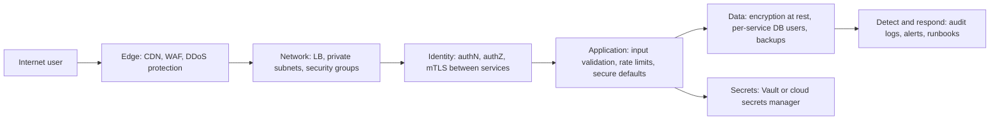
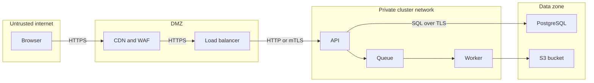

# L19.3 — Security Architecture

> **Level 19: Architecture** · Topic 3 of 11 · ⏱ ~4 hours · Difficulty: Advanced

## 1. What it is

**Security architecture** is designing a system so that a single mistake, bug or stolen credential does not become a
breach. Instead of one strong wall, you build several independent layers (**defense in depth**), you refuse to trust
a request just because of where it came from (**zero trust**), you systematically ask "what can go wrong?" before
building (**threat modeling**, commonly with **STRIDE**), and you shrink the damage any one compromise can do (**blast
radius**).

STRIDE is a checklist of six threat categories: **S**poofing (pretending to be someone else), **T**ampering (modifying
data or code), **R**epudiation (denying an action with no proof), **I**nformation disclosure (leaking data), **D**enial
of service (making the system unavailable), and **E**levation of privilege (gaining rights you should not have).

## 2. Why it matters in DevOps

- **Most breaches chain small weaknesses**: an exposed dashboard, an over-broad IAM role, a secret in Git. Architecture breaks the chain.
- **You build the paths attackers use**: CI/CD pipelines, Kubernetes service accounts, cloud roles and registries are the new perimeter.
- **Retrofitting is expensive**: network segmentation, identity-based auth and encryption are cheap at design time and painful after launch.
- **Compliance and customer reviews** ask for threat models, data-flow diagrams, and evidence of least privilege.

Related reading: [DevSecOps](../level-00-what-devops-is/12-devsecops.md),
[Least-privilege IAM](../level-11-security-devsecops/02-least-privilege-iam.md),
[mTLS](../level-12-advanced-networking/12-mtls.md), [NetworkPolicies](../level-08-kubernetes/19-networkpolicies.md).

## 3. Real-world system example

**Google BeyondCorp and the zero-trust model.** Google has publicly described BeyondCorp, its move from a
privileged corporate network to a model where access to applications depends on the identity of the user and the state of
the device, not on being "inside the network". NIST published SP 800-207 (Zero Trust Architecture), which formalises the same ideas.
**Capital One (2019)** is a widely documented cautionary case: public reporting and the US government complaint described a
misconfigured web application firewall that let an attacker obtain credentials for an over-privileged cloud role and read
data from storage; the lessons usually drawn are least-privilege roles, metadata-service hardening and detection, not
"the cloud is insecure". **Kubernetes** itself bakes in layering: authentication, RBAC authorization, admission control,
Pod Security Standards, NetworkPolicies and audit logs are separate layers. (Treat details of any incident as a pointer
to read the primary sources, not as a complete account.)

## 4. Diagram

Defense in depth for a request to `shop-api`, with a control at every layer:



A data flow diagram with trust boundaries, the starting point for STRIDE:



## 5. How it works

### Defense in depth

Assume any single control will fail and make sure another still stands. Layers for a typical cloud-native app:

| Layer | Example controls |
|-------|------------------|
| Edge | CDN, WAF (Web Application Firewall), DDoS protection, bot rules |
| Network | Private subnets, security groups, Kubernetes NetworkPolicies default-deny |
| Identity | OIDC login, short-lived tokens, mTLS between services, workload identity (no static cloud keys) |
| Compute | Non-root minimal images, Pod Security Standards, read-only root filesystem, patched nodes |
| Application | Input validation, parameterised queries, authorization checks per object |
| Data | Encryption in transit and at rest (KMS), column-level protection for secrets/PII, backups in another account |
| Supply chain | Image scanning, pinned dependencies, signed images, protected branches, CI with least privilege |
| Detect and respond | Audit logs (CloudTrail, Kubernetes audit), alerts on anomalies, practised incident response |

### Zero trust in practice

Core principles (from NIST SP 800-207): never trust based on network location; authenticate and authorize *every*
request; use least privilege; assume breach; log everything. In a cluster this translates to mTLS between workloads
(service mesh or SPIFFE-style identities), authorization policies per service, per-workload cloud identity instead of
node-wide roles, and short-lived credentials. See [Service Mesh](../level-12-advanced-networking/09-service-mesh.md).

### Threat modeling with STRIDE

Process: (1) draw a data flow diagram with **trust boundaries**; (2) for every element and flow, ask each STRIDE
question; (3) record a threat, a mitigation and an owner; (4) decide: mitigate, accept, transfer, or avoid; (5) revisit when the architecture changes.

| Category | Violates | Typical question | Typical mitigation |
|----------|----------|------------------|--------------------|
| Spoofing | Authentication | Could someone pretend to be this service or user? | mTLS, OIDC, signed tokens, MFA |
| Tampering | Integrity | Could data be changed in flight or at rest? | TLS, signatures, immutable logs, DB permissions |
| Repudiation | Non-repudiation | Could someone deny an action? | Audit logs with identity, append-only storage |
| Information disclosure | Confidentiality | Could data leak? | Encryption, least privilege, no secrets in logs |
| Denial of service | Availability | Could this be overwhelmed? | Rate limits, autoscaling, quotas, WAF |
| Elevation of privilege | Authorization | Could a low-privilege actor gain more? | RBAC, no root, validated input, segmentation |

### Blast radius

Blast radius is how much is lost if one thing is compromised or breaks. Reduce it with separate cloud accounts per
environment, separate IAM roles per workload, namespaces with quotas and default-deny network policies, per-service
database users, and **cells** (independent copies of the stack serving subsets of customers). Smaller blast radius
also helps availability: the same design serves both goals. See [RBAC](../level-08-kubernetes/18-rbac.md).

## 6. Step-by-step guide

**Prerequisites:** Python 3.9+. Optional: Docker and `kind` for step 5. No cloud cost.

1. **Draw the data flow diagram.** Reuse the second diagram in section 4 and list every arrow as a numbered flow. Mark
   each trust boundary crossing (internet to DMZ, DMZ to cluster, cluster to data zone). Threats cluster at crossings.

2. **Fill in a STRIDE worksheet.** Create `stride.py`; it records mitigations per flow and reports gaps:
   ```python
   STRIDE = ["Spoofing", "Tampering", "Repudiation", "Information disclosure",
             "Denial of service", "Elevation of privilege"]

   model = {
       "Browser -> CDN": {
           "Spoofing": "TLS 1.2+, HSTS",
           "Tampering": "TLS",
           "Denial of service": "CDN rate limiting and WAF",
       },
       "CDN -> Load balancer": {
           "Spoofing": "Origin only accepts CDN header and IP ranges",
           "Tampering": "TLS to origin",
       },
       "API -> PostgreSQL": {
           "Spoofing": "mTLS or IAM auth, per-service DB user",
           "Tampering": "Least-privilege grants, parameterised queries",
           "Information disclosure": "TLS, encryption at rest",
           "Elevation of privilege": "No superuser from the app",
       },
       "Worker -> Queue": {"Tampering": "Signed or validated messages"},
   }

   total = covered = 0
   for element, threats in model.items():
       missing = [s for s in STRIDE if s not in threats]
       total += len(STRIDE)
       covered += len(STRIDE) - len(missing)
       print(f"{element}: {len(threats)}/6 covered; open: {', '.join(missing) or 'none'}")
   print(f"overall coverage: {covered}/{total} = {covered/total:.0%}")
   ```
   ```bash
   python3 stride.py
   ```
   Expected output:
   ```text
   Browser -> CDN: 3/6 covered; open: Repudiation, Information disclosure, Elevation of privilege
   CDN -> Load balancer: 2/6 covered; open: Repudiation, Information disclosure, Denial of service, Elevation of privilege
   API -> PostgreSQL: 4/6 covered; open: Repudiation, Denial of service
   Worker -> Queue: 1/6 covered; open: Spoofing, Repudiation, Information disclosure, Denial of service, Elevation of privilege
   overall coverage: 10/24 = 42%
   ```
   Not every cell must be filled: some are "not applicable" or "accepted". The point is that each gap is a
   *decision*, written down, not an oversight.

3. **Quantify blast radius for different designs.**
   ```python
   customers = 120_000   # illustrative
   for design, cells in [("single shared stack", 1), ("4 cells", 4), ("20 cells", 20)]:
       print(f"{design:20s} -> one cell holds {customers/cells:>9,.0f} customers ({100/cells:5.1f}%)")
   ```
   Expected:
   ```text
   single shared stack  -> one cell holds   120,000 customers (100.0%)
   4 cells              -> one cell holds    30,000 customers ( 25.0%)
   20 cells             -> one cell holds     6,000 customers (  5.0%)
   ```

4. **Write the mitigation backlog.** For each open STRIDE gap decide: mitigate / accept / transfer / avoid, an owner and
   a ticket. Example: *Worker -> Queue, Spoofing: mitigate, use per-worker credentials with publish/consume permissions
   limited to one queue.*

5. **Implement one layer: Kubernetes default-deny and an explicit allow** (needs a CNI that enforces NetworkPolicy, such as Calico or Cilium;
   kind's default CNI does not enforce it).
   ```yaml
   apiVersion: networking.k8s.io/v1
   kind: NetworkPolicy
   metadata: { name: default-deny, namespace: shop }
   spec:
     podSelector: {}
     policyTypes: [Ingress, Egress]
   ---
   apiVersion: networking.k8s.io/v1
   kind: NetworkPolicy
   metadata: { name: api-to-postgres, namespace: shop }
   spec:
     podSelector: { matchLabels: { app: postgres } }
     policyTypes: [Ingress]
     ingress:
       - from:
           - podSelector: { matchLabels: { app: shop-api } }
         ports:
           - { protocol: TCP, port: 5432 }
   ```
   Remember that default-deny egress also blocks DNS; you must add an allow rule for CoreDNS. See
   [NetworkPolicies in Depth](../level-16-advanced-kubernetes/02-networkpolicies-in-depth.md) and
   [Pod Security](../level-16-advanced-kubernetes/03-pod-security.md).

6. **Review identities, not just networks.** List every credential in the system (DB passwords, cloud roles, CI tokens,
   registry pull secrets, Sentry DSN) with: who holds it, scope, lifetime, rotation. Anything long-lived and broad is
   the first target for replacement with short-lived workload identity. See
   [Secrets Management and Encryption](../level-11-security-devsecops/04-secrets-management-and-encryption.md).

## 7. Real-world scenario

*(Illustrative, not a documented incident.)* A developer accidentally exposes the `shop-api` debug endpoint `/debug/env` on the
public ingress. An attacker finds it and reads environment variables including a database URL and a cloud access key.
What happens next is decided by architecture, not luck.

Because the database sits in a private subnet and its security group only allows the API pods, the database URL is
useless from the internet. Because the cloud key was replaced with workload identity (the pod gets a role limited to one S3
prefix, via short-lived tokens) the stolen key expires within an hour and can read only that prefix. CloudTrail alerts on the
unusual role usage from a foreign IP and the team rotates within 20 minutes. The incident is a bug plus a contained
exposure instead of a breach. **Lesson:** each layer assumed the previous one would fail; blast radius, not perfection, was the design goal.

## 8. Common mistakes and best practices

**Don't**

- Rely on a network perimeter ("it is inside the VPC, so it is trusted").
- Share one credential or one IAM role across services and environments.
- Do threat modeling once, as a document nobody updates, or only after launch.
- Put long-lived cloud keys in CI variables or container images.
- Treat the build pipeline as outside the threat model; it can push to production.

**Do**

- Model trust boundaries explicitly and run STRIDE on each crossing.
- Default-deny at the network and IAM layers, then add narrow allows.
- Use per-workload identities and short-lived credentials; rotate what cannot be short-lived.
- Keep separate accounts or projects for production, staging and security tooling.
- Log security-relevant events to storage that attackers in the app cannot modify, and alert on them.
- Prefer secure defaults in the platform (Pod Security Standards, admission policies) over code review alone.

## 9. Tasks

- [ ] **T1 — Draw the data flow diagram with trust boundaries** *(≈40 min, intermediate)*
  - **Goal:** produce the artefact STRIDE needs.
  - **Steps:**
    1. Create a Mermaid flowchart of `shop-api` with at least 4 trust boundaries (use `subgraph`).
    2. Number every data flow and note the protocol and authentication used.
    3. Commit it to a repo folder `docs/security/dfd.md`.
  - **Done when:** the diagram renders on GitHub and each arrow has a number, a protocol and an auth method.

- [ ] **T2 — STRIDE worksheet** *(≈60 min, advanced)*
  - **Goal:** find at least 10 distinct threats and handle them.
  - **Steps:**
    1. Using your DFD, create a table with columns: flow, STRIDE category, threat, likelihood (L/M/H), impact (L/M/H), mitigation, decision (mitigate, accept, transfer, avoid), owner.
    2. Cover every flow crossing a trust boundary against all six categories.
    3. Extend `stride.py` to read your table from a dict and print uncovered cells.
  - **Done when:** at least 10 threats are recorded, each with a decision, and the script lists every unaddressed STRIDE cell.

- [ ] **T3 — Blast radius budget** *(≈40 min, advanced)*
  - **Goal:** compare designs by damage if one component is compromised.
  - **Steps:**
    1. For each of: one shared database user, one DB user per service, one cloud role for the cluster nodes, one role per workload, one cloud account vs three accounts, write what an attacker with the app's credentials can read or change.
    2. Express the exposure as a percentage of data or customers (use clearly labelled assumptions).
    3. Pick the cheapest change that cuts the exposure most.
  - **Done when:** you have a before/after table and a single recommended change with a justification.

- [ ] **T4 — Default-deny network in a real cluster** *(≈60 min, advanced)*
  - **Goal:** implement and test a network segmentation layer.
  - **Steps:**
    1. Create a kind cluster with Calico or Cilium (see their quickstarts) so NetworkPolicy is enforced.
    2. Deploy `nginx` labelled `app=shop-api` and `postgres` (or `nginx` pretending) labelled `app=postgres` in namespace `shop`, plus a `test` pod labelled `app=other`.
    3. Apply the default-deny and allow policies from step 6.5, plus a DNS allow rule.
    4. Test with `kubectl exec` and `curl`/`nc` from both pods.
  - **Done when:** `shop-api` reaches `postgres:5432` while `app=other` times out, and you show both outputs.

- [ ] **T5 — Credential inventory and rotation plan** *(≈45 min, intermediate)*
  - **Goal:** find where long-lived secrets hide.
  - **Steps:**
    1. List every secret in your sample project (repo files, CI variables, Kubernetes Secrets, env vars).
    2. Run a secret scanner on the repository (for example `gitleaks detect` if installed) and record results.
    3. For each credential, write scope, lifetime and a replacement (workload identity, short-lived token, secrets manager reference).
  - **Done when:** the inventory table exists, the scan result is attached, and each long-lived credential has a replacement plan.

- [ ] **T6 — Prove it: attack walk-through** *(≈60 min, advanced)*
  - **Goal:** explain an attack path and where your architecture stops it.
  - **Steps:**
    1. Without the guide, write an attack path for "stolen CI token to production data" as a numbered chain.
    2. For each step name the layer and control that should stop or detect it.
    3. Identify the weakest link and propose a change.
  - **Done when:** the chain has at least five steps, each mapped to a control, and the weakest link has a concrete fix with an owner.

## 10. Self-check questions

1. What does STRIDE stand for and which security property does each letter violate?
2. What is the difference between defense in depth and zero trust?
3. Why are trust boundary crossings the most important places to look for threats?
4. Name three ways to reduce blast radius in Kubernetes and the cloud.
5. Why does default-deny egress usually break DNS first?

<details>
<summary>Answers</summary>

1. Spoofing (authentication), Tampering (integrity), Repudiation (non-repudiation), Information disclosure (confidentiality), Denial of service (availability), Elevation of privilege (authorization).
2. Defense in depth is multiple independent layers of control. Zero trust is the principle of verifying every request by identity and context rather than network location. Zero trust is one way to implement the identity layer of defense in depth.
3. Data crosses between different levels of trust and control there, so authentication, validation and encryption must be enforced and attackers have the most leverage.
4. Namespaces with RBAC and quotas, default-deny NetworkPolicies, per-workload service accounts and cloud roles, separate clusters or accounts per environment, cells for customers.
5. Pods need to resolve names via CoreDNS (UDP/TCP 53). If egress is denied by default and no rule allows DNS, name lookups fail before any application traffic.
</details>

## 11. Further reading

- NIST SP 800-207, *Zero Trust Architecture* (free).
- *Threat Modeling: Designing for Security* by Adam Shostack.
- OWASP Threat Modeling Cheat Sheet and OWASP Top 10 (owasp.org).
- Kubernetes documentation — Security concepts, Pod Security Standards, Network Policies.
- AWS Well-Architected Framework — Security pillar. Google's BeyondCorp papers (research.google).

<!-- nav -->
---
← Previous: [Availability](02-availability.md) · [Level 19 index](README.md) · Next: [Performance](04-performance.md) →
