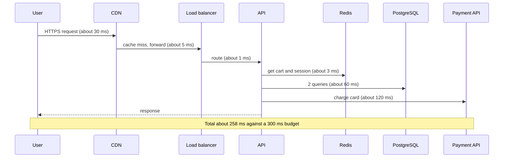
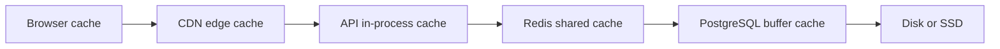

# L19.4 — Performance

> **Level 19: Architecture** · Topic 4 of 11 · ⏱ ~4 hours · Difficulty: Advanced

## 1. What it is

**Performance** in architecture means how quickly and efficiently a system responds under a given load. Two numbers
matter: **latency** (how long one request takes) and **throughput** (how many requests per second the system sustains).
They are linked: past a certain load, queues form and latency climbs steeply.

Averages hide the truth. If 1 request in 100 takes 2 seconds, the average looks fine while 1% of users (and, as you
will see, many more of your *page views*) have a bad experience. So we talk in **percentiles**: p50 (median), p95,
p99. The slow end is **tail latency**. A **latency budget** divides the total time you allow (for example 300 ms) between the
components on the path, so each team knows what it may spend.

## 2. Why it matters in DevOps

- **Latency is a product feature and a revenue lever**: slow checkouts convert less, and slow APIs time out their callers, which retry, which overloads you further.
- **SLOs are written in percentiles**: "99% of requests under 300 ms" is a performance target you must design, measure and alert on. See [SLOs](../level-14-sre/02-slos.md).
- **Performance is cost**: a 2x faster service needs half the servers.
- **Regressions ship silently** unless a load test or benchmark runs in the pipeline.

## 3. Real-world system example

**Google's "The Tail at Scale".** Jeff Dean and Luiz Barroso's paper (Communications of the ACM, 2013) describes how
large fan-out services see tail latency dominate: when a request touches many backends, the chance that at least one is
slow grows quickly, so the response is slow even when each backend is usually fast. The paper describes mitigation techniques such as
hedged requests (send a duplicate after a short delay and take the first reply) and tied requests. **Content delivery networks**
(Cloudflare, Fastly, CloudFront, Akamai) exist because physics sets a floor: light in fibre travels roughly 200,000 km
per second, so a round trip across an ocean costs tens of milliseconds before any code runs; caching near the user removes the trip.
**PostgreSQL** itself documents how the planner uses indexes and how `EXPLAIN ANALYZE` reveals where time goes, which is the
daily tool for database performance work.

## 4. Diagram

Where time goes in one `shop-api` checkout request (a latency budget made visible):



Caching layers, from closest to the user to closest to the data:



## 5. How it works

### Latency budgets

Pick the user-facing target (for example p99 under 300 ms for checkout), subtract network and TLS time, then
allocate the remainder to components. When a component exceeds its allocation you know where to work. Budgets also
set **timeouts**: a downstream timeout must be shorter than the caller's own deadline or you will waste work on requests nobody is waiting for.

### Caching layers

| Layer | Typical TTL | Good for | Watch out for |
|-------|-------------|----------|---------------|
| Browser | minutes to a year (versioned assets) | static assets | stale assets without file-name hashing |
| CDN | seconds to hours | public pages, images, API GETs without user data | caching private data by mistake (`Vary`, `Cache-Control: private`) |
| Application / Redis | seconds to minutes | computed results, sessions, lookups | invalidation, stampedes, cold start |
| Database buffer cache | automatic | hot rows and indexes | working set larger than RAM |

See [CDNs](../level-12-advanced-networking/07-cdns.md) and [Redis](../level-13-databases-distributed-systems/07-redis.md).

### Profiling: find the real cost first

Never optimise by guessing. Use the right tool for the question:

| Question | Tool |
|----------|------|
| Which code path burns CPU? | CPU profiler / flame graph (for Node.js `node --prof`, `clinic`, or `perf`; for Go `pprof`) |
| Which request is slow and why? | Distributed tracing (OpenTelemetry) shows spans per hop |
| Which SQL is slow? | `pg_stat_statements`, `EXPLAIN (ANALYZE, BUFFERS)`, slow query log |
| Is the machine saturated? | USE method: utilisation, saturation, errors for CPU, memory, disk, network |
| Is the app waiting? | Connection pool metrics, event-loop lag, queue depth |

See [Distributed Tracing](../level-10-observability/08-distributed-tracing.md) and
[PostgreSQL Indexes](../level-13-databases-distributed-systems/01-postgresql-indexes.md).

### Load testing

A load test applies realistic traffic to find capacity and regressions. Types: **smoke** (does it work), **load**
(expected peak), **stress** (beyond peak until it breaks), **soak** (hours, finds leaks), **spike** (sudden burst).
Use realistic data and a **closed-model vs open-model** awareness: a closed model (fixed number of virtual users who wait for responses) hides overload because
slow responses reduce the offered load ("coordinated omission"); an open model (fixed arrival rate) shows real queueing.
Tools: k6, Locust, wrk, vegeta, Gatling.

### Tail latency

Causes: garbage collection pauses, noisy neighbours, retries, lock contention, cold caches, connection setup, queueing. The
fan-out effect: if one request calls `n` backends and each exceeds the target with probability `p`, the chance at least one does is
`1 - (1-p)^n`. Mitigations: timeouts and deadlines, hedged requests for idempotent reads, load shedding,
bulkheads (separate pools), smaller fan-out, and caching.

## 6. Step-by-step guide

**Prerequisites:** Python 3.9+; optional Docker for step 7. Everything runs locally on loopback; no cost.

1. **Budget the request.** Save as `budget.py`:
   ```python
   budget_ms = 300
   parts = {"CDN+TLS": 30, "LB": 5, "API handler": 40, "Redis": 3,
            "PostgreSQL (2 queries)": 60, "Payment API": 120}
   total = sum(parts.values())
   for k, v in parts.items():
       print(f"{k:24s}{v:5d} ms {v/budget_ms:6.1%}")
   print(f"{'TOTAL':24s}{total:5d} ms  budget {budget_ms} ms  headroom {budget_ms-total} ms")
   ```
   ```bash
   python3 budget.py
   ```
   Expected output:
   ```text
   CDN+TLS                    30 ms  10.0%
   LB                          5 ms   1.7%
   API handler                40 ms  13.3%
   Redis                       3 ms   1.0%
   PostgreSQL (2 queries)     60 ms  20.0%
   Payment API                120 ms  40.0%
   TOTAL                     258 ms  budget 300 ms  headroom 42 ms
   ```
   The payment provider is 40% of the budget and outside your control, so you protect the rest with a timeout and an async fallback.

2. **Compute fan-out tail risk.** Save as `fanout.py`:
   ```python
   p_slow = 0.01   # 1% of calls to a backend exceed the latency target
   for n in (1, 5, 10, 50, 100):
       print(f"fan-out {n:>3}: P(at least one slow call) = {1-(1-p_slow)**n:6.1%}")
   ```
   ```bash
   python3 fanout.py
   ```
   Expected output:
   ```text
   fan-out   1: P(at least one slow call) =   1.0%
   fan-out   5: P(at least one slow call) =   4.9%
   fan-out  10: P(at least one slow call) =   9.6%
   fan-out  50: P(at least one slow call) =  39.5%
   fan-out 100: P(at least one slow call) =  63.4%
   ```
   A page that calls 50 services with a "99% fast" dependency is slow on four views in ten.

3. **Create a server with a realistic long tail.** Save as `server.py` (98% of responses take about 20 ms, 2% take about 400 ms):
   ```python
   import random, time
   from http.server import BaseHTTPRequestHandler, ThreadingHTTPServer

   class H(BaseHTTPRequestHandler):
       def do_GET(self):
           time.sleep(0.4 if random.random() < 0.02 else 0.02)
           self.send_response(200)
           self.send_header("Content-Length", "2")
           self.end_headers()
           self.wfile.write(b"ok")
       def log_message(self, *a):
           pass

   class S(ThreadingHTTPServer):
       request_queue_size = 128   # avoid SYN backlog effects distorting the test

   S(("127.0.0.1", 8099), H).serve_forever()
   ```
   ```bash
   python3 server.py &
   ```

4. **Write a small load generator that reports percentiles.** Save as `loadtest.py`:
   ```python
   import statistics, time, urllib.request
   from concurrent.futures import ThreadPoolExecutor

   URL, N, CONC = "http://127.0.0.1:8099/", 2000, 50

   def one(_):
       t = time.perf_counter()
       urllib.request.urlopen(URL).read()
       return (time.perf_counter() - t) * 1000

   start = time.perf_counter()
   with ThreadPoolExecutor(CONC) as ex:
       lat = sorted(ex.map(one, range(N)))
   elapsed = time.perf_counter() - start

   def pct(p):
       return lat[min(len(lat) - 1, int(len(lat) * p / 100))]

   print(f"requests={N} concurrency={CONC} throughput={N/elapsed:.0f} req/s")
   print(f"mean={statistics.mean(lat):.0f} ms  p50={pct(50):.0f} ms  "
         f"p95={pct(95):.0f} ms  p99={pct(99):.0f} ms  max={lat[-1]:.0f} ms")
   ```
   ```bash
   python3 loadtest.py
   ```
   Output varies by machine; expect something **similar to**:
   ```text
   requests=2000 concurrency=50 throughput=800 req/s
   mean=50 ms  p50=28 ms  p95=120 ms  p99=600 ms  max=1270 ms
   ```
   The point: the median is near 20-30 ms, the mean is about twice that, and p99 is more than ten times the median.
   (The Python client and its GIL add some noise of their own; production tests use k6 or wrk.) Stop the server with `kill %1`.

5. **Repeat with k6 for a realistic open-model test** (install from the official k6 docs). Save as `test.js`:
   ```javascript
   import http from 'k6/http';
   import { check } from 'k6';

   export const options = {
     scenarios: {
       steady: { executor: 'constant-arrival-rate', rate: 200, timeUnit: '1s',
                 duration: '1m', preAllocatedVUs: 50, maxVUs: 200 },
     },
     thresholds: {
       http_req_failed: ['rate<0.01'],
       http_req_duration: ['p(95)<250', 'p(99)<500'],
     },
   };

   export default function () {
     const res = http.get('http://127.0.0.1:8099/');
     check(res, { 'status 200': (r) => r.status === 200 });
   }
   ```
   ```bash
   k6 run test.js
   ```
   The `thresholds` make k6 exit non-zero when the SLO is violated, so the same file can gate a CI pipeline. With the
   2% slow tail against this server, `p(99)<500` is borderline: observe it and explain why.

6. **Profile a database query.** In any PostgreSQL (for example `docker run -d --name pg -e POSTGRES_PASSWORD=pw -p 5432:5432 postgres:16`):
   ```sql
   CREATE TABLE orders AS SELECT g AS id, (g % 1000) AS customer_id, now() AS created FROM generate_series(1, 1000000) g;
   EXPLAIN (ANALYZE, BUFFERS) SELECT * FROM orders WHERE customer_id = 42;
   CREATE INDEX ON orders (customer_id);
   EXPLAIN (ANALYZE, BUFFERS) SELECT * FROM orders WHERE customer_id = 42;
   ```
   Before the index you will see a `Seq Scan`; after, an `Index Scan` or `Bitmap Heap Scan` with a much lower execution time
   (exact times depend on the machine). Clean up with `docker rm -f pg`.

7. **Write the performance review table** for your own system: for each hop, the budget, the measured p50/p99 (from a trace or load test), and the
   action if over budget.

## 7. Real-world scenario

*(Illustrative, not a documented incident.)* After a Monday deploy, `shop-api` dashboards show average latency flat at 85 ms, so nobody
reacts, but support receives complaints about "random slow pages". The p99 panel shows 1.2 s, up from 400 ms. Traces reveal that the
new product page makes 12 sequential calls to an inventory service, and one in a hundred inventory calls waits on a lock for 400 ms; 12 sequential
calls make "at least one slow" happen on about 11% of page views. The team batches the 12 calls into one, adds a 150 ms timeout with a cached
fallback, and adds a p99 threshold to the load test in CI. **Lesson:** alert on percentiles, not averages, and keep fan-out small.

## 8. Common mistakes and best practices

**Don't**

- Report or alert on average latency.
- Optimise before measuring; the bottleneck is rarely where you think.
- Load-test an empty database, a warm cache only, or from the same machine as the server and call it capacity.
- Let timeouts at inner layers be longer than the caller's deadline.
- Cache user-specific data at a shared layer without a correct cache key.

**Do**

- Define SLOs in percentiles and track p50/p95/p99 per route.
- Keep a latency budget per request path and review it when architecture changes.
- Use traces to locate slow hops and a profiler for CPU-bound code.
- Run load tests in CI against a production-like environment and fail the build on threshold violations.
- Use caching layers deliberately, with TTLs, versioned keys and stampede protection.

## 9. Tasks

- [ ] **T1 — Measure the tail** *(≈30 min, intermediate)*
  - **Goal:** see that mean and p99 tell different stories.
  - **Steps:**
    1. Run `server.py` and `loadtest.py` from steps 6.3 and 6.4.
    2. Record mean, p50, p95, p99 for three runs.
    3. Change the slow probability to 5% and re-run.
  - **Done when:** you have a table of 6 runs and a written explanation of why the mean moved less than p99.

- [ ] **T2 — Fan-out arithmetic** *(≈30 min, intermediate)*
  - **Goal:** quantify tail amplification.
  - **Steps:**
    1. Extend `fanout.py` to take `p_slow` and `n` from command-line arguments.
    2. Find the largest `n` such that the probability of a slow page stays under 5% for `p_slow` of 1%, 0.1% and 0.01%.
    3. Write one sentence on what that implies about dependency quality.
  - **Done when:** the script prints three `n` values (5, 51, 512 with integer rounding down) and you can explain them.

- [ ] **T3 — Hedged requests experiment** *(≈60 min, advanced)*
  - **Goal:** reduce tail latency by duplicating slow requests.
  - **Steps:**
    1. Modify `loadtest.py` so that after waiting 60 ms with no reply it sends a second identical request and uses whichever returns first.
    2. Compare p99 with and without hedging, and count the extra requests sent (percentage).
    3. Explain why this is only safe for idempotent reads.
  - **Done when:** p99 drops noticeably, the extra load is under 10%, and your explanation mentions idempotency.

- [ ] **T4 — Index and EXPLAIN** *(≈45 min, intermediate)*
  - **Goal:** use query plans to prove an improvement.
  - **Steps:**
    1. Follow step 6.6 to create a table with 1,000,000 rows.
    2. Capture `EXPLAIN (ANALYZE, BUFFERS)` before and after the index.
    3. Record execution time and buffers read in both cases.
  - **Done when:** you can show the plan changed from `Seq Scan` to an index-based scan and that time and buffers fell.

- [ ] **T5 — Build the latency budget and threshold** *(≈60 min, advanced)*
  - **Goal:** turn a budget into an automated gate.
  - **Steps:**
    1. Write a budget for one endpoint of a sample app, with p99 targets per hop.
    2. Translate the end-to-end target into a k6 threshold (`p(99)<...`) as in step 6.5.
    3. Run the test, then deliberately add a 300 ms sleep to the handler and run again.
  - **Done when:** the first run exits 0, the second exits non-zero, and both outputs are saved.

- [ ] **T6 — Prove it: performance review** *(≈45 min, advanced)*
  - **Goal:** explain a regression end to end.
  - **Steps:**
    1. Without the guide, write the investigation plan for "p99 doubled after a deploy": which three data sources do you check first, in what order and why.
    2. Name the metric that would have caught it before release and where in the pipeline it would sit.
  - **Done when:** the plan names traces, a profile or `EXPLAIN`, and a CI threshold, and a peer can follow it.

## 10. Self-check questions

1. Why are percentiles preferred over averages for latency?
2. If each of 20 backend calls is slow 1% of the time, how often is the overall request slow (assuming independence)?
3. What is coordinated omission and how does an open-model load test avoid it?
4. Why must inner timeouts be shorter than outer deadlines?
5. When is a hedged request safe?

<details>
<summary>Answers</summary>

1. The average hides rare, very slow requests that real users experience; percentiles show the distribution and match SLO wording.
2. 1 - 0.99^20, about 18%.
3. A closed-model test waits for each response before sending the next, so when the system slows down the test offers less load and under-reports delays. An open model sends at a fixed arrival rate regardless, exposing queueing.
4. Otherwise the inner call keeps working after the caller has given up, wasting capacity and causing retries and cascading overload.
5. When the operation is idempotent (reads or safely repeatable writes), and the extra load from duplicates is bounded.
</details>

## 11. Further reading

- Dean and Barroso, *The Tail at Scale* (Communications of the ACM, 2013).
- *Systems Performance* by Brendan Gregg — USE method, flame graphs.
- *Designing Data-Intensive Applications* by Martin Kleppmann — chapter 1, describing load and performance (percentiles).
- k6 documentation (grafana.com/docs/k6) and PostgreSQL documentation — "Using EXPLAIN".
- web.dev (Google) — performance and Core Web Vitals for the front-end side.

<!-- nav -->
---
← Previous: [Security Architecture](03-security-architecture.md) · [Level 19 index](README.md) · Next: [Cost](05-cost-architecture.md) →
