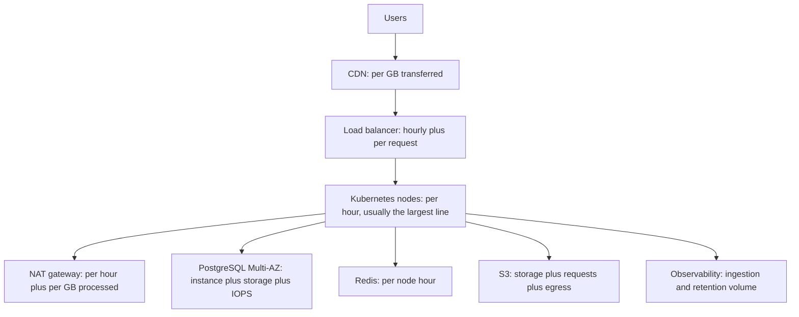
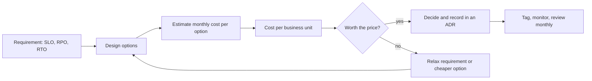

# L19.5 — Cost

> **Level 19: Architecture** · Topic 5 of 11 · ⏱ ~3 hours · Difficulty: Advanced

## 1. What it is

**Cost architecture** treats money as a design constraint on the same level as latency, availability and security.
Every architectural choice has a price tag: a Multi-AZ database, a NAT gateway per zone, a log pipeline that keeps every
debug line, a cross-region replica. Cost-aware design means estimating these before building, choosing consciously
what to pay for, and measuring **unit economics**: the cost to serve one unit of business value (one order, one active user, one
1,000 requests).

Total cloud spend is a poor signal on its own: a bill that doubled while traffic tripled is *good news*; a flat bill with
falling traffic is bad. **Unit cost** (cost per order, cost per tenant) tells you whether the architecture is getting more or
less efficient as it grows.

> **Important:** all prices in this topic are **illustrative example prices** in USD, chosen to be in the same range as public on-demand list prices.
> They change often and vary by region. Always get real numbers from your provider's pricing page or calculator
> before making a decision.

## 2. Why it matters in DevOps

- **Surprise bills are an architecture smell**: the usual culprits (NAT gateway data processing, cross-AZ and internet egress, unbounded logs and metrics, idle environments) are design decisions.
- **Trade-offs are explicit**: availability, security and cost pull against each other; a senior engineer can price each option.
- **Startups die of burn and enterprises lose budgets** when cost has no owner. FinOps makes engineering accountable.
- **Cost is a reliability concern**: a team that cannot afford redundancy skips it, and a team that over-provisions everything cannot afford to test.

Related reading: [FinOps](../level-20-cost-optimization/01-finops.md),
[Network Egress Costs](../level-20-cost-optimization/07-network-egress-costs.md),
[Kubernetes Infrastructure Costs](../level-20-cost-optimization/09-kubernetes-infrastructure-costs.md).

## 3. Real-world system example

**Amazon Prime Video's video-quality monitoring service.** In 2023 the Prime Video engineering team published a blog post
describing how they moved a monitoring service from a distributed, serverless-orchestrated design (AWS Step Functions
and Lambda, with intermediate data in S3) to a single-process design on containers, and reported a large reduction in infrastructure cost
(they stated over 90% for that component). The post is a good reminder that the "right" architecture depends on scale and workload: the cost
structure (state transitions and data transfer between components) mattered more than fashion. **Dropbox** has publicly described moving
most of its storage off a public cloud onto its own infrastructure (the "Magic Pocket" project), again driven by unit economics at very large scale.
Both are examples of changing architecture because the numbers changed, not because a pattern was or was not popular.
(Read the primary sources for precise figures and context; they apply to specific workloads, not to every system.)

## 4. Diagram

The cost drivers in the reference architecture, with the usual biggest line items at the top:



A cost-aware decision loop:



## 5. How it works

### Where the money goes

| Category | Typical drivers | Design levers |
|----------|----------------|---------------|
| Compute | Node hours, over-provisioned requests, idle environments | Right-size, autoscale, Spot for stateless/worker tiers, commitments for the baseline |
| Data stores | Instance size, Multi-AZ, provisioned IOPS, storage growth, backups | Right-size, read replicas only when needed, retention policies |
| Network | Cross-AZ traffic, internet egress, NAT processing, load balancer data | CDN, VPC endpoints for S3, keep chatty services in one AZ where acceptable, compress |
| Storage | Hot data kept forever, versioning without lifecycle | Lifecycle rules, tiering, TTLs |
| Observability | Metrics cardinality, log volume, trace sampling | Sampling, drop debug logs, retention tiers, recording rules |
| People | On-call, toil, complexity | Boring technology, managed services (see the next topic) |

### Unit economics

`cost per unit = total cost of the service / units of value delivered`. Choose a unit that the business understands
(orders, active users, API calls, tenants). Track it monthly. If it rises with scale your architecture has
negative economies of scale; if it falls you have leverage. Set a **gross-margin-style target** (for example, infrastructure
cost per order under 1% of average order value) and design to it.

### Cost-aware design patterns

- **Tier your reliability**: only the checkout path needs three AZs; the nightly report job can run on Spot in one AZ.
- **Cache and CDN** reduce both latency and egress. Compare per-GB prices: CDN transfer is often cheaper than origin egress.
- **Avoid chatty cross-AZ calls** on hot paths; they are billed per GB in each direction on most clouds.
- **Use VPC endpoints** for high-volume S3/ECR traffic so it does not pay NAT processing charges.
- **Cap telemetry**: sample traces, drop high-cardinality labels, set log retention, and budget the volume per service.
- **Buy committed capacity for the baseline only** (Savings Plans / Reserved Instances), keep the burst on-demand or Spot. See [Reserved Instances and Savings Plans](../level-20-cost-optimization/02-reserved-instances-and-savings-plans.md) and [Spot Instances](../level-20-cost-optimization/03-spot-instances.md).
- **Tag everything** (team, service, environment) so cost can be attributed; untagged spend cannot be owned.

## 6. Step-by-step guide

**Prerequisites:** Python 3.9+. Optional: the AWS Pricing Calculator (a free web tool). No cloud account needed.

1. **Build a monthly cost model with clearly labelled example prices.** Save as `cost.py`:
   ```python
   # EXAMPLE PRICES ONLY (illustrative USD). Replace with current numbers from your provider.
   HOURS = 730  # hours per month
   PRICE = {
       "node_hr": 0.17,          # 4 vCPU / 16 GB worker node
       "control_plane_hr": 0.10, # managed Kubernetes control plane
       "alb_hr": 0.0225, "alb_lcu_hr": 0.008,
       "db_multiaz_hr": 0.34,    # mid-size PostgreSQL, Multi-AZ
       "db_gb_month": 0.115,
       "redis_node_hr": 0.07,
       "s3_gb_month": 0.023,
       "egress_gb": 0.09,
       "nat_hr": 0.045, "nat_gb": 0.045,
       "cdn_gb": 0.085,
   }
   nodes, db_gb, s3_gb, egress_gb = 6, 200, 2_000, 3_000
   cdn_share, nat_gb, redis_nodes, nats = 0.8, 1_500, 2, 3
   orders_per_month = 400_000

   lines = {
       "Kubernetes nodes": nodes * PRICE["node_hr"] * HOURS,
       "Managed control plane": PRICE["control_plane_hr"] * HOURS,
       "Load balancer": (PRICE["alb_hr"] + 5 * PRICE["alb_lcu_hr"]) * HOURS,
       "PostgreSQL Multi-AZ": PRICE["db_multiaz_hr"] * HOURS + db_gb * PRICE["db_gb_month"] * 2,
       "Redis": redis_nodes * PRICE["redis_node_hr"] * HOURS,
       "S3 storage": s3_gb * PRICE["s3_gb_month"],
       "CDN transfer": egress_gb * cdn_share * PRICE["cdn_gb"],
       "Origin egress": egress_gb * (1 - cdn_share) * PRICE["egress_gb"],
       "NAT gateways": nats * PRICE["nat_hr"] * HOURS + nat_gb * PRICE["nat_gb"],
   }
   total = sum(lines.values())
   for k, v in sorted(lines.items(), key=lambda kv: -kv[1]):
       print(f"{k:24s} ${v:9,.2f} {v/total:6.1%}")
   print(f"{'TOTAL / month':24s} ${total:9,.2f}")
   print(f"cost per order: ${total/orders_per_month:.4f}")
   ```
   ```bash
   python3 cost.py
   ```
   Expected output (with these example prices):
   ```text
   Kubernetes nodes         $   744.60  43.0%
   PostgreSQL Multi-AZ      $   294.20  17.0%
   CDN transfer             $   204.00  11.8%
   NAT gateways             $   166.05   9.6%
   Redis                    $   102.20   5.9%
   Managed control plane    $    73.00   4.2%
   Origin egress            $    54.00   3.1%
   S3 storage               $    46.00   2.7%
   Load balancer            $    45.62   2.6%
   TOTAL / month            $ 1,729.68
   cost per order: $0.0043
   ```
   (The database storage is doubled in the model to approximate Multi-AZ storage; this is a simplification.)

2. **Run what-if scenarios.** Change one variable at a time and re-run:
   - `nats = 1` (one NAT gateway instead of one per AZ): saves about $66 per month in the example (2 x 0.045 x 730 hours), but a zone failure then breaks egress for the other zones. That is an availability-for-cost trade, to record in an ADR.
   - `cdn_share = 0.95`: moves traffic from the $0.09 to the $0.085 line, and also reduces origin load (the larger saving is often fewer nodes).
   - Add Spot for the worker pool: assume 3 of the 6 nodes are Spot at a 65% discount (illustrative) and recompute the node line.

3. **Compute cost per unit and a target.** If the average order value is $40 and your target is infrastructure cost below 1% of order value ($0.40), the example is at $0.0043 per order, a tiny
   fraction of the target. The exercise is the *method*: when this number trends up, investigate before the bill surprises you.

4. **Price the redundancy choice explicitly.** Write a three-row table: single-AZ database (cost X, RTO hours), Multi-AZ (cost 2X, RTO minutes), cross-region replica
   (cost 3X plus transfer, RTO tens of minutes). Add the expected loss: `downtime minutes x revenue per minute`. If an hour of outage costs $5,000 and
   Multi-AZ costs $150 more per month, it pays for itself if it avoids one such hour every 33 months.

5. **Enforce cost guardrails.** Create a budget alert (AWS Budgets or equivalent) at 50%, 80% and 100% of the monthly
   budget, require tags (`team`, `service`, `env`) in Terraform with a policy check, and set log and metric retention
   in code. See [Policy as Code](../level-18-platform-engineering/07-policy-as-code.md).

6. **Schedule a monthly cost review**: top five line items, unit cost trend, biggest increase and its cause, one action. Keep the notes in the repository next to the ADRs.

## 7. Real-world scenario

*(Illustrative, not a documented incident.)* A team's bill grows from $4,000 to $9,500 in a month with only 10% more traffic.
Cost Explorer filtered by usage type shows "NatGateway-Bytes" tripled. A new nightly job in a private subnet pulls 4 TB of
container images and dataset files from S3 and public registries through the NAT gateway, which charges per GB processed.

The fix is a free S3 gateway VPC endpoint (so S3 traffic bypasses the NAT), a pull-through cache for the registry, and an alert on NAT bytes.
The bill returns to normal in the next cycle. **Lesson:** unit cost and a breakdown by usage type reveal the cause in minutes; the root
issue was an architecture default (all egress through NAT), not "the cloud being expensive".

## 8. Common mistakes and best practices

**Don't**

- Optimise cost by deleting redundancy that the SLO requires, without recording the decision.
- Compare prices without including operations time: the "cheap" self-hosted option has a salary behind it.
- Commit (Savings Plans) before you understand the baseline; you may pay for unused capacity.
- Leave non-production environments running 24/7 at production size.
- Ship unbounded telemetry: log everything at debug, forever, with user ids as metric labels.

**Do**

- Estimate the monthly cost of every option in the ADR and record the assumptions and price dates.
- Track unit cost (per order or tenant) on a dashboard next to latency and error rate.
- Tag resources and use account/project boundaries so every dollar has an owner.
- Review the top-five line items monthly and attack the largest first.
- Match reliability spending to business value per component.

## 9. Tasks

- [ ] **T1 — Run and extend the cost model** *(≈40 min, intermediate)*
  - **Goal:** reproduce the estimate and make it yours.
  - **Steps:**
    1. Create `cost.py` from step 6.1 and run it; confirm the total is about $1,729.68.
    2. Replace the example prices with current prices for your region from the provider's pricing page; write the date and URL in comments.
    3. Add an observability line: Loki/Grafana/Prometheus storage (S3 GB) plus a managed Sentry plan (use the vendor's published price).
  - **Done when:** the script prints a total, a per-order cost, a pricing date comment for every line, and the observability line.

- [ ] **T2 — Three what-if scenarios** *(≈45 min, intermediate)*
  - **Goal:** quantify design trade-offs.
  - **Steps:**
    1. Scenario A: one NAT gateway instead of three. Scenario B: 50% of worker nodes on Spot. Scenario C: 95% CDN offload.
    2. For each, print the new total and the percentage change.
    3. Write the availability or risk cost of each saving in one line.
  - **Done when:** a table lists A, B, C with monthly savings and the risk accepted.

- [ ] **T3 — Redundancy vs expected loss** *(≈40 min, advanced)*
  - **Goal:** justify (or reject) spending on redundancy with arithmetic.
  - **Steps:**
    1. Assume revenue per hour (state it) and an expected frequency of zone-level incidents (state it; do not invent facts about a provider).
    2. Compute expected annual loss for single-AZ vs Multi-AZ using the downtime assumptions of each.
    3. Compare against the annual extra cost of Multi-AZ.
  - **Done when:** the output shows a break-even number and a recommendation with its assumptions listed.

- [ ] **T4 — Find the hidden network cost** *(≈45 min, advanced)*
  - **Goal:** model egress and NAT charges for a data-heavy workload.
  - **Steps:**
    1. Take a job pulling 2 TB per day from S3 to a pod through a NAT gateway; compute monthly NAT processing cost using the example `nat_gb` price.
    2. Recompute with an S3 gateway endpoint.
    3. List two more services in the reference architecture where a VPC endpoint or caching avoids per-GB charges.
  - **Done when:** the before/after numbers are printed and the savings percentage is stated.

- [ ] **T5 — Cost guardrails in code** *(≈60 min, advanced)*
  - **Goal:** make overspending hard.
  - **Steps:**
    1. Write a Terraform or Kubernetes policy (or a simple script) that fails when a resource lacks `team` and `env` tags/labels.
    2. Add an S3 lifecycle rule (transition to infrequent access after 30 days, expire after 365) to a sample bucket definition.
    3. Add a budget definition (AWS Budgets via Terraform) with an email alert at 80%. Do not apply it to a real account unless you want to; `terraform plan` is enough.
  - **Done when:** the policy check fails on an untagged example and passes on a tagged one, and `terraform validate` succeeds on the bucket and budget code.

- [ ] **T6 — Prove it: cost review** *(≈45 min, advanced)*
  - **Goal:** defend an architecture's cost.
  - **Steps:**
    1. Without the guide, produce a one-page cost estimate for the reference architecture with monthly total, top three line items and the unit cost.
    2. State three changes that would cut 20% without violating a 99.9% SLO, and one that would not be worth doing.
  - **Done when:** the estimate lists assumptions and price dates, and each proposed saving names its risk.

## 10. Self-check questions

1. Why is unit cost a better health signal than total spend?
2. Name four non-obvious sources of cloud cost that come from architecture rather than from instance size.
3. When does paying for Multi-AZ make economic sense?
4. Why should commitments cover only the baseline load?
5. What is the risk of using a single NAT gateway to save money?

<details>
<summary>Answers</summary>

1. It normalises for growth: spend rising with proportionally rising business value is healthy; unit cost rising signals inefficiency.
2. NAT gateway data processing, cross-AZ transfer, internet egress, log/metric/trace volume, idle environments, snapshot and versioned-object accumulation.
3. When the expected cost of downtime (downtime minutes x revenue or reputational loss per minute x probability) exceeds the extra monthly cost, or when the SLO/RTO cannot be met otherwise.
4. Commitments are paid whether used or not; the variable portion should stay flexible (on-demand or Spot) to avoid paying for idle capacity.
5. A failure of that gateway's zone, or the gateway itself, cuts egress for the other zones too: a new SPOF in the critical path.
</details>

## 11. Further reading

- *Cloud FinOps* by J.R. Storment and Mike Fuller; the FinOps Foundation framework (finops.org).
- AWS Well-Architected Framework — Cost Optimization pillar; the AWS Pricing Calculator.
- Amazon Prime Video Tech blog post on scaling up the audio/video monitoring service (2023) and Dropbox engineering posts on Magic Pocket.
- Kubecost / OpenCost documentation (opencost.io) for Kubernetes cost allocation.

<!-- nav -->
---
← Previous: [Performance](04-performance.md) · [Level 19 index](README.md) · Next: [Operational Complexity](06-operational-complexity.md) →
