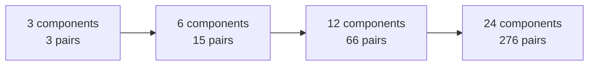
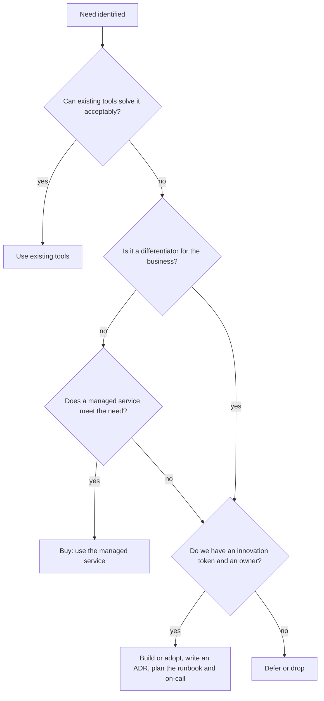

# L19.6 — Operational Complexity

> **Level 19: Architecture** · Topic 6 of 11 · ⏱ ~3 hours · Difficulty: Advanced

## 1. What it is

**Operational complexity** is the ongoing human effort needed to keep a system running: the number of moving parts, the
number of things an on-call engineer must understand at 3 a.m., the upgrades, the failure modes and the runbooks. It
is a cost that never appears on the cloud bill but is usually larger than it.

Three ideas anchor this topic. **Boring technology**: prefer well-understood, widely used tools (PostgreSQL, Linux, Nginx) and spend
your limited appetite for novelty only where it earns a real advantage. **Cognitive load**: the amount of mental effort a team can sustain is
finite, so architecture must fit the team that runs it. **Build vs buy**: for each component decide whether to run it yourself or pay someone else to,
based on total cost of ownership and whether it differentiates your business.

## 2. Why it matters in DevOps

- **Every component is a future incident.** Each new system adds upgrade work, security patching, monitoring, backups, runbooks and on-call knowledge.
- **Complexity compounds**: the interactions between ten components outnumber the components.
- **Teams burn out and leave** when on-call requires understanding too much. A system only one person understands is a bus-factor risk.
- **The most common architectural mistake** is copying a design built for a company 1,000 times larger. Kubernetes, service meshes and microservices solve real problems, at a real price.

Related reading: [Platform Engineering](../level-00-what-devops-is/13-platform-engineering.md),
[Internal Developer Platforms](../level-18-platform-engineering/01-internal-developer-platforms.md),
[Cluster, Nodes and Control Plane](../level-08-kubernetes/01-cluster-architecture.md).

## 3. Real-world system example

**"Choose Boring Technology" and Team Topologies.** Dan McKinley (formerly of Etsy) wrote the essay *Choose Boring Technology*,
which proposes that a team has a small budget of "innovation tokens" to spend on unproven technology; everything else should be
proven and boring. The book *Team Topologies* (Skelton and Pais) makes the same case about people: team cognitive load is a
design constraint, and platform teams exist to reduce the load on stream-aligned teams. **Basecamp (37signals)** has publicly written about
moving off the cloud to run its own hardware to cut costs, and has also argued for the "majestic monolith"; **Stack Overflow** has described serving
very large traffic from a small number of servers using a monolith and SQL Server. **Shopify** has described a "modular monolith" for a very large
Rails application. These are public examples that simple architectures can scale a long way; they are not proof that your system should look like theirs.
Meanwhile, **Kubernetes** itself came out of Google's experience with Borg, running thousands of services across many teams, which is exactly the scale at
which its complexity pays for itself.

## 4. Diagram

How complexity grows with the number of components (every pair is a possible interaction or failure path):



A decision flow for adding a new technology:



## 5. How it works

### Boring technology

A technology is "boring" when its failure modes are well known, hiring is easy, documentation is deep and your team has operated it before.
Boring does not mean old or bad: PostgreSQL is boring and excellent. The rule is to **spend innovation tokens deliberately**: a team might
afford two or three unfamiliar technologies in total. If you adopt Kubernetes, a service mesh, event sourcing and Kafka in the same quarter, you have
overspent, and each one will be operated badly.

### Cognitive load

Three kinds: **intrinsic** (the domain itself), **extraneous** (fighting tooling, YAML, yak-shaving) and **germane** (valuable learning). Architecture should minimise
extraneous load: golden paths, templates, sane defaults, one way to deploy, one way to observe. See [Golden Paths](../level-18-platform-engineering/04-golden-paths.md).
Practical limits: can a new engineer deploy to production in their first week? Can the on-call engineer explain the request path in five minutes? If not,
the system is more complex than the team can carry.

### Build vs buy

| Factor | Lean towards buying (managed/SaaS) | Lean towards building/self-hosting |
|--------|-----------------------------------|-----------------------------------|
| Differentiation | Commodity (email, auth, monitoring, databases) | Core to the product |
| Team size and skill | Small team, no specialist | Specialist team exists and wants to own it |
| Scale/economics | Moderate scale, where the vendor premium is smaller than staff time | Very large scale where unit costs dominate |
| Control/compliance | Vendor meets requirements | Data residency or customisation requires control |
| Lock-in | Acceptable, exit plan exists | Lock-in is unacceptable |
| Time to market | Need it now | Can invest months |

Always compare **total cost of ownership (TCO)**: licence or infrastructure plus engineering build time plus ongoing operations (patching, upgrades, on-call, incident time).

### When not to use Kubernetes

Kubernetes is a platform for building platforms; it is excellent when you run many services, need portable scheduling, rich autoscaling, and have people to operate it
(or a managed offering plus platform engineers). Consider alternatives when:

| Situation | Often a better fit |
|-----------|-------------------|
| One to a few services, small team | A PaaS (Heroku-style, Render, Fly.io, App Runner), or managed container services (ECS/Fargate, Cloud Run) |
| A monolith with a database | Two or three VMs plus a load balancer, with Docker Compose or systemd |
| Event-driven, spiky and small | Serverless functions |
| Batch only | Managed batch services or scheduled jobs |
| No one wants to be on call for the cluster | Managed services all the way |

Kubernetes is the right answer when the pain it removes (bin-packing, self-healing, uniform deployment for dozens of services, GitOps, ecosystem) outweighs
the cost it adds (upgrades, networking, RBAC, security, a steep learning curve). See [Stateful Workloads](../level-16-advanced-kubernetes/08-stateful-workloads.md) for what running databases there involves.

## 6. Step-by-step guide

**Prerequisites:** Python 3.9+. No cost.

1. **Count the interaction paths of your design.** Pairs = n(n-1)/2.
   ```bash
   python3 -c "
   for n in (3, 6, 12, 24):
       print(f'{n:>2} components -> {n*(n-1)//2:>3} possible pairwise interactions')"
   ```
   Expected:
   ```text
    3 components ->   3 possible pairwise interactions
    6 components ->  15 possible pairwise interactions
   12 components ->  66 possible pairwise interactions
   24 components -> 276 possible pairwise interactions
   ```
   Not every pair interacts, but every pair *could*, and each real dependency is an incident waiting to happen.

2. **Run an innovation token audit.** Save as `tokens.py`:
   ```python
   BUDGET = 3
   proposal = {            # name: is it new to this team?
       "Kubernetes": True, "Service mesh": True, "PostgreSQL": False,
       "Redis": False, "Event sourcing": True, "Kafka": True, "Node.js": False,
   }
   spent = [k for k, new in proposal.items() if new]
   print(f"tokens spent: {len(spent)} of {BUDGET} -> {', '.join(spent)}")
   if len(spent) > BUDGET:
       print(f"OVER BUDGET by {len(spent)-BUDGET}: drop or defer {len(spent)-BUDGET} item(s)")
   ```
   ```bash
   python3 tokens.py
   ```
   Expected:
   ```text
   tokens spent: 4 of 3 -> Kubernetes, Service mesh, Event sourcing, Kafka
   OVER BUDGET by 1: drop or defer 1 item(s)
   ```
   Decide what to defer. A defensible answer: defer the service mesh (use plain TLS and NetworkPolicies first) and event sourcing (plain tables and a queue first).

3. **Do a build-vs-buy TCO.** Save as `tco.py` (example numbers: replace with yours):
   ```python
   ENGINEER_MONTHLY = 12_000      # fully loaded monthly cost of one engineer (illustrative)
   options = {
       # name: (monthly infrastructure or licence, build effort in engineer-months, ops effort in engineer-months per month)
       "Managed PostgreSQL (buy)":      (900, 0.5, 0.10),
       "Self-hosted PostgreSQL on VMs": (450, 2.0, 0.40),
   }
   months = 36
   for name, (run, build, ops) in options.items():
       people = (build + ops * months) * ENGINEER_MONTHLY
       total = run * months + people
       print(f"{name:32s} infra ${run*months:>8,.0f}  people ${people:>9,.0f}  3-year TCO ${total:>9,.0f}")
   ```
   ```bash
   python3 tco.py
   ```
   Expected:
   ```text
   Managed PostgreSQL (buy)         infra $  32,400  people $   49,200  3-year TCO $  81,600
   Self-hosted PostgreSQL on VMs    infra $  16,200  people $  196,800  3-year TCO $  213,000
   ```
   The cheaper-looking infrastructure line produces the more expensive option once staff time is counted. Change the ops effort to 0.05 and see
   where the answer flips; that sensitivity is the real insight. (The effort numbers are assumptions, not benchmarks.)

4. **Fill in a Kubernetes fit assessment** for your own situation. Score each 0-2 (0 = no, 2 = yes):
   - More than 10 services deployed independently?
   - A team (or managed provider) responsible for cluster upgrades and security?
   - A need for autoscaling, multi-tenant isolation or portable deployment?
   - Engineers who already know Kubernetes?
   - Workloads that do not fit a PaaS or a few VMs?

   A total under 5 suggests a simpler platform first. Write the result and the reasoning down; it becomes an ADR.

5. **Measure cognitive load.** Time two things: how long a new engineer needs to get a change from laptop to production, and how long it takes someone to
   explain the request path of the system from memory. Anything over a week or over five minutes respectively is a signal to simplify or add a golden path.

6. **Write the runbook inventory.** For every component list: owner, upgrade cadence, backup method, the dashboard, the three most likely failures, and the
   runbook link. Components without all six are operational debt; each new technology should add a row before it ships.

## 7. Real-world scenario

*(Illustrative, not a documented incident.)* A five-person startup adopts Kubernetes, Istio, Kafka and a microservice per feature for an app serving a few hundred requests per second.
Within six months one engineer spends most of their time on cluster upgrades and mesh certificate issues, deploys take 25 minutes, and an outage is traced
to an Envoy sidecar memory limit that nobody understood. The product roadmap slips.

A review applies the token audit and TCO exercise. They merge four services into the main application (a modular monolith), remove the mesh (keeping TLS via the ingress and
NetworkPolicies), replace Kafka with a managed queue and move the app to a managed container service with a managed PostgreSQL. Deploys take 4 minutes and on-call becomes tolerable.
**Lesson:** the architecture was fine for a larger organisation; it was wrong for this team. Complexity must be matched to the size of the problem and of the team.

## 8. Common mistakes and best practices

**Don't**

- Choose technology for the résumé or because a large company uses it.
- Count only infrastructure when comparing build and buy.
- Introduce several unfamiliar systems at once.
- Split into microservices before you have clear boundaries and a platform to support them.
- Run stateful systems on Kubernetes without the skills to operate them, when a managed service exists.

**Do**

- Keep a short, explicit list of approved technologies and a process (an ADR) to add to it.
- Prefer managed services for undifferentiated heavy lifting.
- Start with a modular monolith and extract services when there is a team, scale or release-cadence reason.
- Design for the on-call engineer: fewer moving parts, clear dashboards, tested runbooks.
- Revisit decisions: when scale or team changes, the right answer changes.

## 9. Tasks

- [ ] **T1 — Complexity inventory** *(≈40 min, intermediate)*
  - **Goal:** list every moving part of the reference architecture and its ongoing cost.
  - **Steps:**
    1. List all components (CDN, LB, Kubernetes, ingress, API, worker, web, Redis, queue, PostgreSQL, S3, Prometheus, Grafana, Loki, OpenTelemetry Collector, Sentry).
    2. For each, write who upgrades it, how often, and the failure you fear most.
    3. Compute the pairwise interaction count with the formula from step 6.1.
  - **Done when:** you have a table of 16 components with owner/upgrade/failure, and the interaction count.

- [ ] **T2 — Innovation token audit** *(≈30 min, intermediate)*
  - **Goal:** make newness explicit.
  - **Steps:**
    1. Run `tokens.py` with a proposal for a team you know (say honestly what is new to *them*).
    2. If over budget, decide what to defer and write one sentence on how you will meet the need with boring tools.
  - **Done when:** the audit prints a count within budget after your changes, with reasons.

- [ ] **T3 — Build vs buy TCO with sensitivity** *(≈45 min, advanced)*
  - **Goal:** find the break-even.
  - **Steps:**
    1. Extend `tco.py` to compare managed Redis against self-hosted Redis on Kubernetes (choose and state example numbers).
    2. Loop over ops effort values from 0.02 to 0.5 engineer-months per month and print the TCO of each option.
    3. Identify the value at which self-hosting becomes cheaper (if it does).
  - **Done when:** the output shows a break-even point or a statement that none exists, with your assumptions.

- [ ] **T4 — Kubernetes: yes or no** *(≈45 min, advanced)*
  - **Goal:** make and defend a platform choice.
  - **Steps:**
    1. Choose a scenario: (a) a 3-person team with one API, (b) a 40-engineer company with 60 services. Answer the step 6.4 scorecard for each.
    2. For (a), name the specific alternative platform and what you give up.
    3. For (b), name the platform capabilities you would build around Kubernetes.
  - **Done when:** each scenario has a score, a recommendation and the main trade-off in one sentence.

- [ ] **T5 — Reduce a design** *(≈60 min, advanced)*
  - **Goal:** remove complexity without losing requirements.
  - **Steps:**
    1. Take a design with at least 10 components (the reference architecture will do).
    2. Remove or merge three components and show which requirements still hold and what is given up (for example: replace the queue with a Postgres-backed job table using `SELECT ... FOR UPDATE SKIP LOCKED`).
    3. Recount the pairwise interactions.
  - **Done when:** the simplified diagram renders, a requirement-by-requirement table shows what still holds, and the interaction count dropped.

- [ ] **T6 — Prove it: defend simplicity** *(≈45 min, advanced)*
  - **Goal:** argue against unnecessary complexity.
  - **Steps:**
    1. Without the guide, role-play: a teammate proposes adding a service mesh to a 6-service app. Write your response as a short memo covering the problem it solves, the alternatives, the tokens and runbooks it costs, and the conditions under which you would say yes.
  - **Done when:** the memo contains a clear recommendation, at least two alternatives, and measurable conditions for revisiting.

## 10. Self-check questions

1. What is an innovation token and why is the budget small?
2. Why can self-hosting be more expensive even when infrastructure is cheaper?
3. Name three situations where Kubernetes is probably not the right choice.
4. What are the three kinds of cognitive load and which should architecture reduce first?
5. How does a modular monolith differ from microservices?

<details>
<summary>Answers</summary>

1. A unit of "allowed novelty": each unproven technology costs learning, debugging and operating effort; teams can only absorb a few before quality drops.
2. People time (build, patching, upgrades, on-call, incidents) is usually larger than infrastructure savings at moderate scale.
3. A single service or monolith with a small team; spiky event-driven workloads suited to serverless; a team without capacity to operate a cluster when a PaaS or managed container service meets the need.
4. Intrinsic (domain), extraneous (tooling friction), germane (valuable learning). Reduce extraneous first.
5. A modular monolith is one deployable unit with strong internal module boundaries; microservices are separately deployed and operated services that communicate over the network, adding distributed-systems costs.
</details>

## 11. Further reading

- Dan McKinley, *Choose Boring Technology* (essay, boringtechnology.club).
- *Team Topologies* by Matthew Skelton and Manuel Pais — cognitive load and platform teams.
- *A Philosophy of Software Design* by John Ousterhout — managing complexity at the code level.
- Kubernetes documentation — "Production environment" considerations; and the documentation of the managed container service you would compare against.
- *Site Reliability Engineering* (Google, free online) — chapter on simplicity.

<!-- nav -->
---
← Previous: [Cost](05-cost-architecture.md) · [Level 19 index](README.md) · Next: [Deployment Strategy](07-deployment-architecture.md) →
