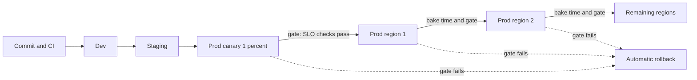
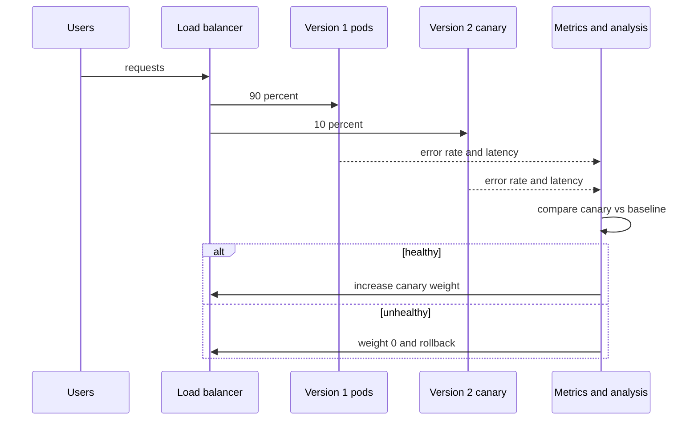

# L19.7 — Deployment Strategy

> **Level 19: Architecture** · Topic 7 of 11 · ⏱ ~4 hours · Difficulty: Advanced

## 1. What it is

**Deployment architecture** is the design of *how change reaches production*: which environments exist and what each is
for, how a new version is released (all at once, rolling, blue/green, canary), how a release proceeds across regions, and how you
limit the damage when a release is bad. It sits above the mechanics of individual pipelines (covered in Levels 5 and 17) and answers the
architect's question: "What is the maximum harm one bad change can do, and how fast can we undo it?"

Four terms. **Environment**: a separate, isolated copy of the stack (dev, staging, production). **Release strategy**: the way traffic
moves from the old version to the new one. **Progressive delivery**: exposing the new version to a growing share of traffic while
automatically checking health. **Blast-radius control**: structuring releases (waves, cells, regions, feature flags) so any failure affects the smallest possible audience.

## 2. Why it matters in DevOps

- **Changes cause most outages.** Reliability work that ignores the release path misses the biggest cause.
- **Speed and safety are the same goal**: small, frequent, reversible changes are safer than rare big ones (DORA research reports this repeatedly).
- **Multi-region systems fail in correlated ways** if every region gets the same change at the same moment, which cancels the benefit of having multiple regions.
- **Database changes** are the hard part: you can roll back code in seconds but not data.

Related reading: [Deployment Strategies](../level-00-what-devops-is/07-deployment-strategies.md),
[Rolling Deployments](../level-05-cicd/10-rolling-deployments.md),
[Blue/Green Deployments](../level-05-cicd/11-blue-green-deployments.md),
[Canary Deployments](../level-05-cicd/12-canary-deployments.md),
[Environment Promotion](../level-17-gitops/04-environment-promotion.md).

## 3. Real-world system example

**Amazon's automated, staged deployments.** The Amazon Builders' Library article *Automating safe, hands-off deployments*
describes how Amazon deploys through a pipeline that moves a change through pre-production stages, then to production in waves:
a small one-box stage first, then single Availability Zones or Regions, increasing in size, with automated alarms and
bake time between waves, and automatic rollback when alarms fire. Deployments are timed to avoid operating several
Regions simultaneously. **Netflix** open-sourced Spinnaker and, with Google, developed Kayenta for automated canary analysis, comparing
a canary against a baseline using metrics. **Google's SRE book** recommends canarying every change and describes releases that proceed in stages.
**GitHub** and **Facebook** have written publicly about feature flags and gradual rollouts through ring-based exposure (employees first, then a small percentage of users).
The shared pattern: *the pipeline, not a human, is the safety mechanism*.

## 4. Diagram

Promotion through environments and then production in waves, with a gate between each stage:



What a canary does at the traffic level:



## 5. How it works

### Environments

| Environment | Purpose | Notes |
|-------------|---------|-------|
| Local / ephemeral | Developer feedback, per-PR preview environments | Cheap, auto-destroyed |
| Dev / integration | Merge the team's work, run integration tests | Shared, may be flaky |
| Staging / pre-prod | Production-like rehearsal: same config shape, same deploy path, realistic data volume | The deploy mechanism must be identical to production, otherwise you are not testing the deploy |
| Production | Real users | Separate cloud account or project; stricter access |

Staging can never be perfectly like production (traffic, data, scale), which is why progressive delivery in production exists. Keep environments as **code** so they do not drift
(see [Reusable Environments](../level-07-terraform-iac/06-reusable-environments.md)).

### Release strategies compared

| Strategy | How | Rollback speed | Cost | Best for | Risk |
|----------|-----|---------------|------|----------|------|
| Recreate | Stop old, start new | Slow (redeploy) | Lowest | Dev, tolerable downtime | Downtime |
| Rolling | Replace pods gradually | Medium (roll back the roll) | Low (surge) | Default for stateless services | Mixed versions run together, slow detection |
| Blue/green | Two full stacks, switch traffic | Fast (switch back) | High (2x capacity during release) | Big risky changes, database-compatible changes | Costly, data sync issues |
| Canary | Small percentage first, grow on healthy metrics | Fast (set weight 0) | Low | High-traffic services with good metrics | Needs good SLI automation |
| Feature flags | Deploy dark, enable per user/group | Instant (toggle) | Low | Decoupling deploy from release | Flag debt, combinatorial states |
| Shadow / mirror | Copy live traffic to the new version, discard responses | N/A (no user impact) | Medium | Validating rewrites | Side effects if not isolated |

### Multi-region rollout

Never deploy to all regions at once. Order: internal/canary → one low-risk region → additional regions in increasing size, each with **bake time** (long enough for problems
to appear, such as a memory leak or a cache expiry) and **automated gates** on SLOs. Keep each region independently deployable and independently runnable (no hard dependency on
another region's control plane at runtime). Keep a global "stop" switch to halt all waves. For configuration and feature flags, treat them as deployments too: they cause outages just the same.

### Blast-radius control

Layers, outermost first: separate accounts per environment → regions → **cells** (independent stacks serving subsets of customers) → availability zones → canary slice → feature flag per tenant. The
smaller the unit of change, the smaller the harm. Backward-compatible database migrations (**expand → migrate → contract**) mean code can be rolled back without data loss. See
[Database Migrations in Pipelines](../level-05-cicd/09-database-migrations.md) and [Rollback](../level-05-cicd/07-rollback.md).

## 6. Step-by-step guide

**Prerequisites:** Python 3.9+. Optional: a kind cluster and `kubectl` for step 4 (Argo Rollouts is optional). No cloud cost.

1. **Simulate a staged rollout with an automatic gate.** Save as `rollout.py`:
   ```python
   import random
   random.seed(7)

   # (wave name, share of global traffic). A bad release has a 5 percent error rate.
   waves = [("canary (1% of traffic)", 0.01), ("us-east-1 (rest)", 0.20),
            ("eu-west-1", 0.20), ("ap-southeast-1", 0.15), ("rest of world", 0.44)]
   BAD_RELEASE = True
   GATE = 0.01            # halt if the error rate exceeds 1 percent
   requests_per_wave = 20_000

   exposed = 0.0
   for name, share in waves:
       err = 0.05 if BAD_RELEASE else 0.001
       errors = sum(random.random() < err for _ in range(requests_per_wave)) / requests_per_wave
       exposed += share
       print(f"{name:26s} error rate {errors:6.2%}  traffic exposed so far {exposed:5.0%}")
       if errors > GATE:
           print(f"GATE FAILED at '{name}': rollback. Max blast radius: {exposed:.0%} of traffic")
           break
   else:
       print("rollout complete")
   ```
   ```bash
   python3 rollout.py
   ```
   Expected with `BAD_RELEASE = True` (error rates vary slightly):
   ```text
   canary (1% of traffic)     error rate  4.98%  traffic exposed so far    1%
   GATE FAILED at 'canary (1% of traffic)': rollback. Max blast radius: 1% of traffic
   ```
   Set `BAD_RELEASE = False` and the script walks through all five waves and prints `rollout complete`. The bad release harmed 1% of traffic instead of 100%.

2. **Compare the harm of different strategies for the same bad release.** Assume 1,000 requests/s and detection plus rollback taking 5 minutes for a canary at 1% vs 2 minutes for a
   big-bang deploy with detection at 100% traffic:
   ```bash
   python3 -c "
   rps=1000; err=0.05
   big_bang = rps*120*err
   canary   = rps*0.01*300*err
   print(f'big-bang failed requests: {big_bang:,.0f}')
   print(f'canary failed requests:   {canary:,.0f}')"
   ```
   Expected: `big-bang failed requests: 6,000` and `canary failed requests: 150`. Even though the canary took longer to roll back, it harmed 40 times fewer requests.

3. **Design the environment matrix.** Fill in a table: environment, cloud account, who may deploy, data (synthetic or masked), cost-saving schedule, parity with production (what is *not* the same).
   Write down which differences are risks (for example staging has 1 replica, so it cannot reveal a concurrency bug).

4. **Write a canary rollout as code.** With Argo Rollouts (see its docs to install the controller), a Rollout replaces the Deployment:
   ```yaml
   apiVersion: argoproj.io/v1alpha1
   kind: Rollout
   metadata:
     name: shop-api
     namespace: shop
   spec:
     replicas: 10
     selector:
       matchLabels: { app: shop-api }
     strategy:
       canary:
         steps:
           - setWeight: 10
           - pause: { duration: 5m }
           - setWeight: 50
           - pause: { duration: 10m }
           - setWeight: 100
     template:
       metadata:
         labels: { app: shop-api }
       spec:
         containers:
           - name: api
             image: example.com/shop-api:1.4.0
   ```
   `kubectl argo rollouts get rollout shop-api -n shop --watch` shows the progress. Add an `AnalysisTemplate` that queries Prometheus for the error ratio
   so that failing the query aborts the rollout automatically. See [Argo CD and Flux](../level-17-gitops/02-argo-cd-and-flux.md).

5. **Plan database changes with expand/contract.** Write the three releases for renaming `orders.total` to `orders.amount_cents`:
   1. *Expand*: add the new column, write both, read the old. Roll back safely.
   2. *Migrate*: backfill in batches, switch reads to the new column. Roll back safely (old column is still being written).
   3. *Contract*: stop writing the old column, drop it later after a bake period. This is the only non-trivially reversible step.

6. **Define the abort and rollback rules** in writing before the release: which metrics gate each wave (error rate, p99 latency, saturation, business metric such as orders per minute), the thresholds, the bake time,
   who can press stop, and how to roll back (git revert and redeploy, or `kubectl argo rollouts abort`). See [Rollback Through Git](../level-17-gitops/06-rollback-through-git.md).

## 7. Real-world scenario

*(Illustrative, not a documented incident.)* A team ships a new connection-pool library on a Friday with a rolling update across both regions at once. Staging is fine because it has two replicas and almost no
traffic. At 14:10 production p99 latency climbs and error rates rise to 12% as the new pool leaks connections under real concurrency. Both regions fail together; rollback takes 18 minutes because the
pipeline needs a full rebuild and the one engineer who knows how is out.

The post-incident changes: a 1% canary with automatic analysis on error ratio and p99, regions deployed in sequence with 30 minutes of bake time, rollbacks that re-deploy the previous immutable image (not rebuild),
and a "no Friday afternoon deploys without a flag" convention replaced by deploy-dark-and-flag. **Lesson:** the multi-region design was useless for reliability because the release process made both regions fail identically.

## 8. Common mistakes and best practices

**Don't**

- Deploy to every region or every cell at the same time.
- Make staging a different deployment mechanism from production.
- Treat feature flags and config changes as "not deploys"; they need the same gates.
- Ship a destructive database change in the same release as the code that depends on it.
- Rely on a human watching a dashboard as the only gate.

**Do**

- Deploy immutable, versioned artifacts and roll back by redeploying a previous version.
- Roll out in waves with bake time and automatic metric-based gates, smallest blast radius first.
- Separate deploy from release with feature flags, and clean flags up.
- Use expand/contract migrations so each step is reversible.
- Rehearse rollback regularly; measure time to rollback as a key metric.

## 9. Tasks

- [ ] **T1 — Run the staged rollout simulation** *(≈30 min, intermediate)*
  - **Goal:** see the effect of gating on blast radius.
  - **Steps:**
    1. Create `rollout.py` and run it with `BAD_RELEASE = True` and `False`.
    2. Change the gate threshold to 0.10 (10%) and run again with `BAD_RELEASE = True`.
    3. Explain what happened and why gates should be set from SLOs.
  - **Done when:** you have three outputs and a two-sentence explanation of how a loose gate lets a bad release through.

- [ ] **T2 — Compare strategies by harm and cost** *(≈45 min, intermediate)*
  - **Goal:** quantify rolling, blue/green and canary for the same bad release.
  - **Steps:**
    1. Extend the arithmetic in step 6.2 for rolling (50% of pods updated before detection), blue/green (100% switched, instant rollback after 2 minutes), canary (1%).
    2. Add the extra infrastructure cost of blue/green using the example prices from the Cost topic's model (state the numbers you use).
    3. Print failed requests and extra cost per strategy.
  - **Done when:** a table shows failed requests and extra cost for all four strategies, and you can name the best fit for `shop-api` and why.

- [ ] **T3 — Canary with automatic abort (kind)** *(≈90 min, advanced)*
  - **Goal:** build a progressive delivery pipeline locally.
  - **Steps:**
    1. Create a kind cluster, install Argo Rollouts (follow its installation docs), and deploy an `nginx`-based Rollout with the steps in 6.4.
    2. Update the image to a version that returns errors (for example an `http-echo` configured to return 500) and watch the rollout.
    3. Add an analysis step (a Job-based or web metric check against a stub that returns failure) so the rollout aborts.
  - **Done when:** `kubectl argo rollouts get rollout` shows `Degraded`/aborted with traffic back on the stable version, and you show the output.

- [ ] **T4 — Expand/contract migration** *(≈60 min, advanced)*
  - **Goal:** make a schema change reversible at every step.
  - **Steps:**
    1. Run PostgreSQL in Docker and create `orders(id, total)` with sample rows.
    2. Execute the three phases from step 6.5 as SQL scripts (add column, backfill in batches of 1,000 rows, drop old column).
    3. After each phase, write the rollback command and prove it by running it in a copy of the database.
  - **Done when:** each phase has an apply script, a rollback script and a verification query, and the rollback of phases 1 and 2 loses no data.

- [ ] **T5 — Multi-region release plan** *(≈45 min, advanced)*
  - **Goal:** write the wave plan for the reference architecture.
  - **Steps:**
    1. Define waves for three regions (canary, region 1, region 2, region 3), bake time per wave, and metrics and thresholds per gate.
    2. Define the global stop switch and who can use it.
    3. Describe how config and feature-flag changes follow the same plan.
  - **Done when:** the plan is a table of wave, traffic share, bake time, gates, abort action, and has no step that changes all regions at once.

- [ ] **T6 — Prove it: release review** *(≈45 min, advanced)*
  - **Goal:** explain the release architecture and its failure modes.
  - **Steps:**
    1. Without the guide, draw the pipeline from commit to the last region in a Mermaid diagram and mark each gate.
    2. List three ways a bad change could still reach all regions (for example: config bypassing the pipeline) and the control that would close each.
  - **Done when:** the diagram renders, each gate names a metric, and the three bypass paths have mitigations.

## 10. Self-check questions

1. Why does a multi-region deployment not automatically give you multi-region reliability?
2. What are the trade-offs between rolling, blue/green and canary?
3. What does "bake time" protect against?
4. What is the expand/contract pattern and why does it help rollback?
5. Why should staging use the same deployment mechanism as production?

<details>
<summary>Answers</summary>

1. If all regions receive the same change at the same time (or share a dependency), they fail together. Staggered waves keep failures independent.
2. Rolling is cheap but mixes versions and detects slowly; blue/green rolls back instantly but doubles capacity; canary limits exposure and needs reliable automated metrics.
3. Problems that take time to appear: memory leaks, cache expiry, daily traffic peaks, slow queue growth.
4. Make additive changes first, migrate data, and remove old structures last. Each step is compatible with both old and new code so code can roll back without data loss.
5. Otherwise the deploy itself is untested; many failures come from the deployment process (permissions, config, ordering), not the application code.
</details>

## 11. Further reading

- Amazon Builders' Library — *Automating safe, hands-off deployments*.
- *Site Reliability Engineering* (Google) — chapter on release engineering, and *The Site Reliability Workbook* — canarying releases.
- *Accelerate* by Forsgren, Humble and Kim, and the annual DORA reports.
- *Continuous Delivery* by Humble and Farley.
- Argo Rollouts and Spinnaker/Kayenta documentation.

<!-- nav -->
---
← Previous: [Operational Complexity](06-operational-complexity.md) · [Level 19 index](README.md) · Next: [Monitoring](08-monitoring-architecture.md) →
