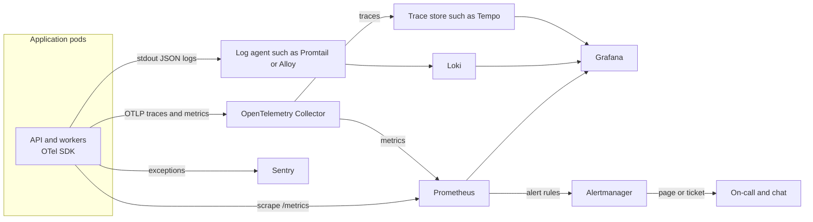
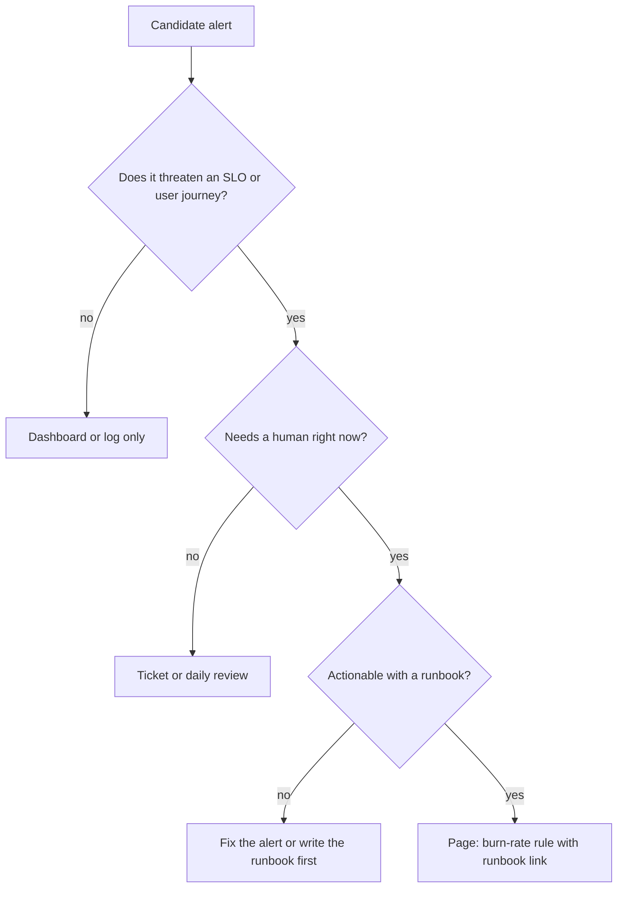

# L19.8 — Monitoring

> **Level 19: Architecture** · Topic 8 of 11 · ⏱ ~4 hours · Difficulty: Advanced

## 1. What it is

**Monitoring architecture** is the design of how a system tells you what it is doing: what telemetry it emits
(metrics, logs, traces, errors), how that data travels through a pipeline, where it is stored, how it becomes dashboards, and
above all **which conditions wake a human**. Level 10 taught the tools; this topic is about the *design decisions*.

Three principles. **Design observability in**: instrumentation, correlation ids and health endpoints are part of the feature, not a
follow-up ticket. **SLO-driven alerting**: page on symptoms that threaten a **Service Level Objective (SLO)** (a target such as 99.9% of requests succeed)
using error-budget **burn rate**, not on every CPU spike. **Telemetry costs money**: volume, cardinality and retention are architectural parameters you must size and cap.

## 2. Why it matters in DevOps

- **You cannot fix what you cannot see**, and you cannot add tracing to a running incident.
- **Bad alerting destroys teams**: noisy pages cause fatigue and missed real incidents; silent systems cause long outages. See [Alert Fatigue Reduction](../level-14-sre/08-alert-fatigue-reduction.md).
- **Observability is often the second or third largest line on the bill** when nobody budgets cardinality, log volume and retention.
- **Monitoring must outlive the thing it monitors**: if the monitoring stack fails with the cluster, you are blind exactly when you need it.

Related reading: [Observability](../level-00-what-devops-is/10-observability.md),
[The Three Pillars](../level-10-observability/01-three-pillars.md),
[SLOs](../level-14-sre/02-slos.md), [Error Budgets](../level-14-sre/04-error-budgets.md),
[What to Monitor](../level-10-observability/11-what-to-monitor.md).

## 3. Real-world system example

**Google SRE: SLO-based alerting.** *The Site Reliability Workbook* has a chapter on alerting on SLOs, which develops the
multiwindow, multi-burn-rate approach used below: page when the budget is being consumed fast over both a long and a short window, open a ticket when it is being consumed slowly.
**Prometheus, Grafana, Loki and Tempo** are open source projects with public documentation that together cover metrics, logs and traces ("the Grafana stack"),
and **OpenTelemetry** (a Cloud Native Computing Foundation project) standardises instrumentation and provides the Collector as a vendor-neutral pipeline component.
**Uber** open-sourced the Jaeger tracing system, and **Netflix** has publicly described how enormous telemetry volume forced it to build custom metric and trace pipelines,
which is a good reminder that at scale telemetry is itself a large distributed system. The practical takeaway for most teams: use the open standards (OpenTelemetry) at the edges, so storage backends can change.

## 4. Diagram

The telemetry pipeline of the reference architecture:



From SLO to alert: the decision path for every alert you write.



## 5. How it works

### Design observability in

| Layer | What to build in |
|-------|------------------|
| Code | Structured JSON logs with a `trace_id`/request id on every line, RED metrics (rate, errors, duration) per route, spans around outbound calls |
| Platform | Standard sidecar-free pipeline: stdout logs, `/metrics` scrape or OTLP push, Collector as the single egress point |
| Service | Health and readiness endpoints that reflect real dependencies, version and build info exposed as a metric |
| Business | Domain metrics: orders per minute, payments succeeded; they catch failures that technical metrics miss |
| Runbooks | Every alert links to a runbook, and every dashboard has an owner |

See [Structured Logging](../level-10-observability/05-structured-logging.md), [Correlation IDs](../level-10-observability/07-correlation-ids.md) and
[OpenTelemetry](../level-10-observability/09-opentelemetry.md).

### SLO-driven alerting

Given an SLO (say 99.9% over 30 days), the **error budget** is 0.1% of requests. **Burn rate** is how many times faster than "exactly on budget" you are consuming it.
A burn rate of 1 uses the whole budget in exactly 30 days; 14.4 uses 2% of the budget in one hour. The recommended pattern pairs a long window with a short one so alerts are both significant and recent:

| Severity | Long window | Short window | Burn rate | Budget consumed | Action |
|----------|-------------|--------------|-----------|-----------------|--------|
| Page | 1 h | 5 m | 14.4 | 2% | Wake someone |
| Page | 6 h | 30 m | 6 | 5% | Wake someone |
| Ticket | 3 d | 6 h | 1 | 10% | Handle in working hours |

(Numbers follow the example in the Google SRE Workbook for a 30-day window.) This replaces dozens of cause-based alerts ("CPU above 80%") with a few symptom-based alerts that map to
user pain. Keep a small set of cause-based alerts only for things that lead to certain failure soon (disk filling, certificate expiring).

### Telemetry pipeline design and cost

| Signal | Volume driver | Cost-control levers |
|--------|--------------|--------------------|
| Metrics | **Active series**: product of label cardinalities | Avoid unbounded labels (user id, request id, full URL), recording rules, drop unused metrics, shorter retention for high-resolution data |
| Logs | GB per day: requests x lines x bytes | Log levels, no debug in production by default, sample noisy lines, short retention for verbose logs and long for audit logs, store labels sparingly in Loki |
| Traces | Requests x spans x sampling rate | Head sampling (for example 5%), tail sampling at the Collector (keep all errors and slow traces) |
| Errors | Events per month | Sentry rate limits, sampling, grouping, release tagging |

Architecture choices: a **Collector tier** (agent per node and a gateway) to batch, sample, redact and route; **high availability** for Prometheus (two replicas) and long-term storage (Thanos, Mimir or a managed service);
**separate failure domains** so the monitoring plane is outside the failure domain it watches (for instance an external uptime check and a dead man's switch alert).

## 6. Step-by-step guide

**Prerequisites:** Python 3.9+. Optional: Docker/Prometheus for step 5 (`promtool` is shipped with Prometheus). No cost.

1. **Compute the error budget and burn-rate thresholds.** Save as `burn.py`:
   ```python
   slo = 0.999
   budget = 1 - slo
   window_days = 30
   print(f"error budget: {budget:.3%} of requests, {budget*window_days*24*60:.1f} minutes of total outage per {window_days} days\n")
   alerts = [("1h", "5m", 14.4, "page"), ("6h", "30m", 6, "page"), ("3d", "6h", 1, "ticket")]
   for long_w, short_w, rate, action in alerts:
       hours = {"1h": 1, "6h": 6, "3d": 72}[long_w]
       consumed = rate * hours / (window_days * 24)
       print(f"burn {rate:>5}x over {long_w:>2} (and {short_w:>3}) -> consumes {consumed:6.1%} of 30d budget -> {action}; error ratio threshold {rate*budget:.3%}")
   ```
   ```bash
   python3 burn.py
   ```
   Expected output:
   ```text
   error budget: 0.100% of requests, 43.2 minutes of total outage per 30 days

   burn  14.4x over 1h (and  5m) -> consumes   2.0% of 30d budget -> page; error ratio threshold 1.440%
   burn     6x over 6h (and 30m) -> consumes   5.0% of 30d budget -> page; error ratio threshold 0.600%
   burn     1x over 3d (and  6h) -> consumes  10.0% of 30d budget -> ticket; error ratio threshold 0.100%
   ```
   So, for a 99.9% SLO, you page when the error ratio is above 1.44% for both the last hour and the last 5 minutes.

2. **Turn it into a Prometheus rule.** Save as `alerts.yaml`:
   ```yaml
   groups:
     - name: shop-api-slo
       rules:
         - record: job:http_error_ratio:rate5m
           expr: |
             sum(rate(http_requests_total{job="shop-api",code=~"5.."}[5m]))
             /
             sum(rate(http_requests_total{job="shop-api"}[5m]))
         - record: job:http_error_ratio:rate1h
           expr: |
             sum(rate(http_requests_total{job="shop-api",code=~"5.."}[1h]))
             /
             sum(rate(http_requests_total{job="shop-api"}[1h]))
         - alert: ShopApiErrorBudgetFastBurn
           expr: |
             job:http_error_ratio:rate1h > (14.4 * 0.001)
             and
             job:http_error_ratio:rate5m > (14.4 * 0.001)
           for: 2m
           labels: { severity: page }
           annotations:
             summary: "shop-api is burning its 30-day error budget 14.4x too fast"
             runbook_url: "https://example.com/runbooks/shop-api-error-budget"
   ```
   Validate it (requires `promtool` from a Prometheus release, or run it via the container image):
   ```bash
   promtool check rules alerts.yaml
   ```
   Expected: `SUCCESS: 3 rules found`.

3. **Size the telemetry pipeline.** Save as `telemetry.py` (example numbers; substitute your own):
   ```python
   pods, series_per_pod, scrape_s, bytes_per_sample, retention_days = 60, 800, 15, 2, 15
   samples_per_day = 86_400 / scrape_s
   metrics_gb = pods * series_per_pod * samples_per_day * bytes_per_sample * retention_days / 1e9
   print(f"active series: {pods*series_per_pod:,}  metrics storage ({retention_days}d): {metrics_gb:,.1f} GB")

   rps, log_bytes_per_req = 900, 600
   log_gb_day = rps * 86_400 * log_bytes_per_req / 1e9
   print(f"logs: {log_gb_day:,.1f} GB/day raw; with 30d retention and 5x compression: {log_gb_day*30/5:,.0f} GB stored")

   sampling, spans_per_trace, bytes_per_span = 0.05, 12, 500
   trace_gb_day = rps * 86_400 * sampling * spans_per_trace * bytes_per_span / 1e9
   print(f"traces at {sampling:.0%} sampling: {trace_gb_day:,.1f} GB/day (100% sampling would be {trace_gb_day/sampling:,.0f} GB/day)")

   base = 5 * 40 * 8        # method x route x status
   print(f"series per histogram metric (10 buckets): {base*10:,}")
   print(f"adding a user_id label with 100,000 users: {base*10*100_000:,} series")
   ```
   ```bash
   python3 telemetry.py
   ```
   Expected:
   ```text
   active series: 48,000  metrics storage (15d): 8.3 GB
   logs: 46.7 GB/day raw; with 30d retention and 5x compression: 280 GB stored
   traces at 5% sampling: 23.3 GB/day (100% sampling would be 467 GB/day)
   series per histogram metric (10 buckets): 16,000
   adding a user_id label with 100,000 users: 1,600,000,000 series
   ```
   Lessons: logs dominate volume; sampling is what makes tracing affordable; one careless label turns a small metric into a billion series and takes Prometheus down. (Bytes-per-sample, bytes-per-log
   and span sizes are rough assumptions; measure your own.)

4. **Write the OpenTelemetry Collector pipeline as the single egress point.** Example `otel-collector.yaml`:
   ```yaml
   receivers:
     otlp:
       protocols:
         grpc: {}
         http: {}
   processors:
     memory_limiter: { check_interval: 1s, limit_mib: 400 }
     batch: {}
     attributes/redact:
       actions:
         - { key: http.request.header.authorization, action: delete }
         - { key: user.email, action: delete }
     tail_sampling:
       decision_wait: 10s
       policies:
         - { name: errors, type: status_code, status_code: { status_codes: [ERROR] } }
         - { name: slow, type: latency, latency: { threshold_ms: 500 } }
         - { name: baseline, type: probabilistic, probabilistic: { sampling_percentage: 5 } }
   exporters:
     otlp/tempo: { endpoint: tempo:4317, tls: { insecure: true } }
   service:
     pipelines:
       traces:
         receivers: [otlp]
         processors: [memory_limiter, attributes/redact, tail_sampling, batch]
         exporters: [otlp/tempo]
   ```
   Note `tail_sampling` ships in the Collector *contrib* distribution. It keeps every error and every slow trace plus 5% of the rest, which preserves what you debug with while cutting volume by roughly an order of magnitude. See
   [Distributed Tracing](../level-10-observability/08-distributed-tracing.md).

5. **Check the monitoring-of-monitoring.** List how you would know if (a) Prometheus is down, (b) Alertmanager cannot send, (c) the whole cluster is gone. Typical answers: a second Prometheus or managed service that scrapes the first;
   an always-firing "Watchdog" alert sent to an external dead man's switch; an external synthetic check (outside the cluster and region) against `https://example.com/healthz`.

6. **Produce the alert inventory.** Table: alert name, SLO or journey it protects, severity, threshold, runbook URL, owner, last time it fired and whether it was actionable. Delete or demote any alert with no runbook or no action taken in 90 days.

## 7. Real-world scenario

*(Illustrative, not a documented incident.)* An on-call engineer receives 40 pages a week, mostly "CPU above 80% on node X" and "pod restarted", and almost none lead to action. One Tuesday a payment-provider
timeout change makes 3% of checkouts fail for 40 minutes; the only alert that fires is a ticket-level "5xx above 1%" that nobody reads at 2 a.m. Customers notice first.

The team replaces its cause-based pages with two SLO burn-rate pages (checkout availability and p99 latency) and two ticket alerts, links runbooks, and adds an orders-per-minute business metric. Weekly pages drop from 40 to 3, and the next payment issue pages within 6 minutes
with a runbook link to the provider's status and the circuit-breaker toggle. **Lesson:** alert on user-visible symptoms measured against an SLO; keep causes on dashboards for diagnosis.

## 8. Common mistakes and best practices

**Don't**

- Page on resource thresholds that do not map to user impact.
- Put unbounded values (user id, URL with ids, request id) in metric labels.
- Log at debug level in production by default or log request bodies and secrets.
- Host your only alerting path inside the cluster it watches.
- Create dashboards no one owns; they rot and mislead.

**Do**

- Define SLOs per user journey first, then derive alerts from error-budget burn.
- Keep one correlation id across logs, traces and error reports so one id finds everything.
- Use the OpenTelemetry Collector for batching, redaction, sampling and routing.
- Budget telemetry (series, GB/day, sampling) per service and alert on growth.
- Give every page a runbook and review the alert inventory monthly.

## 9. Tasks

- [ ] **T1 — Burn-rate calculator** *(≈30 min, intermediate)*
  - **Goal:** derive alert thresholds from an SLO.
  - **Steps:**
    1. Run `burn.py` for 99.9%.
    2. Change the SLO to 99.5% and 99.99% and re-run.
    3. For 99.99%, compute the minimum error ratio at which a 14.4x burn pages, and explain whether you can reliably measure that with 5 requests per second.
  - **Done when:** three outputs are saved and you state the measurement limit for low-traffic services (hint: few requests means noisy ratios).

- [ ] **T2 — Validate an SLO alert rule** *(≈45 min, intermediate)*
  - **Goal:** write and lint a burn-rate alert.
  - **Steps:**
    1. Create `alerts.yaml` from step 6.2 and add the 6 h / 30 m rule at burn rate 6.
    2. Run `promtool check rules alerts.yaml` (use the `prom/prometheus` image's `promtool` entrypoint if not installed).
    3. Write a promtool unit test (`promtool test rules`) that feeds a series with 2% errors and asserts the fast-burn alert fires.
  - **Done when:** `check rules` reports SUCCESS and `test rules` passes, with outputs saved.

- [ ] **T3 — Cardinality explosion drill** *(≈60 min, advanced)*
  - **Goal:** see how a label breaks a metrics system.
  - **Steps:**
    1. Run Prometheus in Docker (`docker run -p 9090:9090 prom/prometheus`) and a small script that exposes a counter with a `user_id` label created for 50,000 distinct values using `prometheus_client` for Python.
    2. Scrape it and query `count({__name__="demo_requests_total"})` and Prometheus's own `prometheus_tsdb_head_series`.
    3. Fix it by removing the label and show the series count drop.
  - **Done when:** you show before and after series counts and the Prometheus memory difference (`process_resident_memory_bytes`).

- [ ] **T4 — Collector with tail sampling** *(≈75 min, advanced)*
  - **Goal:** build and test the sampling pipeline.
  - **Steps:**
    1. Run the OpenTelemetry Collector contrib image with the config from step 6.4, using the `debug` exporter instead of Tempo.
    2. Send traces from `telemetrygen` (from the OpenTelemetry project) with some marked as errors.
    3. Verify the debug output shows all error traces and a small fraction of the successful ones.
  - **Done when:** counts show 100% of error traces kept and roughly 5% of normal ones, with the command and output saved.

- [ ] **T5 — Design the monitoring plan for the reference architecture** *(≈60 min, advanced)*
  - **Goal:** produce the observability design section of a design doc.
  - **Steps:**
    1. List the three user journeys (browse, checkout, admin export) and one SLI and SLO for each.
    2. Choose where each signal is stored and for how long, and estimate GB/day using `telemetry.py`.
    3. Write the alert list with severity and runbook placeholders; include the monitoring-of-monitoring design.
  - **Done when:** the plan has SLOs, a storage and retention table with volumes, an alert table with at most 6 pages, and a statement of what the monitoring plane's failure domain is.

- [ ] **T6 — Prove it: alert review** *(≈45 min, advanced)*
  - **Goal:** justify every page.
  - **Steps:**
    1. Without the guide, take a list of 10 typical alerts (CPU high, disk 90%, pod restarts, 5xx rate, p99 latency, queue depth, certificate expiry in 7 days, DB replication lag, error-budget burn, node not ready).
    2. For each decide: page, ticket, dashboard, or delete; explain with the SLO test.
  - **Done when:** each of the 10 has a decision with a one-sentence reason, and at most 3 are pages.

## 10. Self-check questions

1. What is burn rate and why pair a long window with a short one?
2. Why is a user_id label on a Prometheus metric dangerous?
3. What is the difference between head sampling and tail sampling of traces?
4. Name two cause-based alerts that are still worth a page or ticket.
5. How do you make sure you notice when the monitoring system itself fails?

<details>
<summary>Answers</summary>

1. Burn rate is the speed of error-budget consumption relative to exactly using it all over the SLO window. The long window ensures significance (real budget impact) and the short window ensures the problem is still happening, so alerts reset quickly.
2. Each distinct value creates a new time series; cardinality explodes memory, storage and query cost.
3. Head sampling decides when the trace starts (cheap, but blind to outcome); tail sampling decides after the trace completes, so it can keep all errors and slow traces.
4. Disk about to fill, certificate about to expire, replication broken: they predict certain user-facing failure.
5. An independent watcher: a dead man's switch alert that must keep arriving, external synthetic checks, and a second monitoring path outside the failure domain.
</details>

## 11. Further reading

- *The Site Reliability Workbook* (Google, free online) — "Alerting on SLOs".
- *Observability Engineering* by Charity Majors, Liz Fong-Jones and George Miranda.
- Prometheus, Alertmanager, Grafana, Loki documentation; OpenTelemetry documentation (opentelemetry.io), including the Collector.
- *Implementing Service Level Objectives* by Alex Hidalgo.
- Sentry documentation — sampling, rate limits, release health.

<!-- nav -->
---
← Previous: [Deployment Strategy](07-deployment-architecture.md) · [Level 19 index](README.md) · Next: [Disaster Recovery](09-disaster-recovery-architecture.md) →
