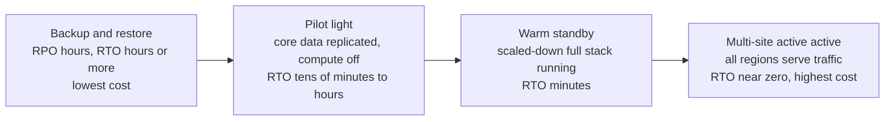
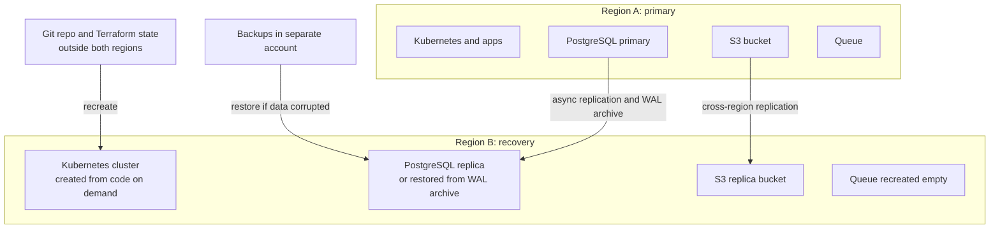

# L19.9 — Disaster Recovery

> **Level 19: Architecture** · Topic 9 of 11 · ⏱ ~4 hours · Difficulty: Advanced

## 1. What it is

**Disaster recovery (DR)** is the plan, and the architecture behind the plan, for getting a system working again after a
serious failure: a lost region, a corrupted database, a deleted bucket, ransomware, a bad migration, a compromised cloud account.
Two numbers drive every DR decision. **RPO (Recovery Point Objective)** is how much *data* you can afford to lose, measured as time (an RPO of 5 minutes means you may lose
at most the last 5 minutes of writes). **RTO (Recovery Time Objective)** is how long you can be *down* before service must be restored.

DR is not the same as high availability. High availability (previous topics) keeps the system running through *expected, small* failures such as a lost node or zone, automatically.
DR handles *large, rare, often human-caused or data-destroying* events where redundancy itself is damaged (replication faithfully copies a `DROP TABLE` to every replica).
The architectural job is to choose, **per component**, the cheapest DR tier that meets that component's RPO and RTO.

## 2. Why it matters in DevOps

- **Replication is not backup.** Multi-AZ protects against a dead zone, not against a developer, a bug or an attacker deleting data.
- **Untested recovery does not exist.** Most failed recoveries fail on missing credentials, missing runbooks, forgotten dependencies or restore times far above estimates.
- **DR is expensive** when applied uniformly. Pricing it per component prevents both over-spending and nasty surprises.
- **Regulation and customers** increasingly ask for documented RPO/RTO and evidence of restore tests.

Related reading: [Disaster Recovery](../level-00-what-devops-is/09-disaster-recovery.md),
[RPO](../level-15-disaster-recovery/06-rpo.md), [RTO](../level-15-disaster-recovery/07-rto.md),
[Backups and Point-in-Time Recovery](../level-13-databases-distributed-systems/05-backups-and-pitr.md),
[Failure Scenario Drills](../level-15-disaster-recovery/10-failure-scenario-drills.md).

## 3. Real-world system example

**AWS disaster recovery strategies.** AWS's whitepaper *Disaster Recovery of Workloads on AWS: Recovery in the Cloud* describes four strategies on a spectrum of cost and speed:
**backup and restore**, **pilot light**, **warm standby** and **multi-site active/active**. It maps them to RPO/RTO ranges (from hours down to near zero) and stresses that data replication
alone does not protect against corruption, so point-in-time backups are still needed. **GitLab (January 2017)** published a candid public postmortem of a production database incident in which an engineer removed the wrong data directory
while repairing replication, and several of the backup mechanisms turned out not to have been working or verified; a few hours of customer data were lost. It is a classic example of why restores must be tested.
Cloud providers' own post-incident summaries also repeatedly show the value of designing so that recovery does not depend on the thing that failed. (Check the primary sources for details.)

## 4. Diagram

The DR strategy spectrum: cost and complexity rise as RTO falls.



Per-component DR for the reference architecture, primary region and recovery region:



## 5. How it works

### The four strategies

| Strategy | What runs in the recovery region | Typical RPO | Typical RTO | Relative cost | Notes |
|----------|---------------------------------|-------------|-------------|---------------|-------|
| Backup and restore | Nothing; backups stored there | Hours | Hours to a day | Lowest | Must rebuild infrastructure from code and restore data; restore time grows with data size |
| Pilot light | Data replicated, infrastructure defined but not running (or minimal) | Minutes | Tens of minutes to hours | Low | Bring up compute during a disaster; needs automation |
| Warm standby | Scaled-down but complete working stack | Seconds to minutes | Minutes | Medium to high | Easy to test, always partially paid for |
| Multi-site active/active | Full stack serving traffic in each region | Near zero | Near zero | Highest | Data consistency and conflict resolution are hard (see [CAP and consistency](../level-13-databases-distributed-systems/12-cap-theorem-and-consistency.md)) |

(The ranges above are typical orders of magnitude, not guarantees; your numbers come from your own measured drills.)

### RPO/RTO-driven design

1. **List components and data** and classify each by business impact (not by how interesting the technology is).
2. **Set RPO and RTO per component** with the business owner; ask "what does an hour of downtime / an hour of lost orders cost?"
3. **Pick the mechanism** that meets each target (continuous replication for low RPO; backups for corruption protection; infrastructure as code for low-effort rebuilds).
4. **Compute the real restore time**: data size / restore throughput + replay time + DNS and cache warm-up + human decision time.
5. **Test**, record actual RPO/RTO, and update the design.

Some components need no DR at all beyond rebuild: caches (Redis) can be repopulated, stateless services are redeployed from images, dashboards are in Git. Concentrate budget on **stateful, irreplaceable data**: the database, object storage, secrets and keys.

### Threat types and the mechanism that covers them

| Threat | Does replication help? | What helps |
|--------|-----------------------|-----------|
| Instance or zone failure | Yes | Multi-AZ, automatic failover |
| Region outage | Yes (cross-region replica) | Cross-region replication, standby or pilot light |
| Accidental delete or bad migration | No (replicated instantly) | Point-in-time recovery, versioning, delayed replicas |
| Ransomware or compromised credentials | No | Immutable/off-account backups (object lock), separate account with separate credentials |
| Provider or account loss | No | Backups outside the account/provider, infrastructure code in Git |

See [Backups](../level-15-disaster-recovery/01-backups.md), [Off-site Backups](../level-15-disaster-recovery/08-offsite-backups.md) and
[Failover](../level-15-disaster-recovery/05-failover.md).

## 6. Step-by-step guide

**Prerequisites:** Python 3.9+; optional Docker for step 4. No cloud cost.

1. **Create a per-component RPO/RTO table and check it with code.** Save as `dr_check.py`:
   ```python
   # minutes. Columns: name, required RPO, required RTO, mechanism RPO, mechanism RTO, mechanism
   components = [
       ("PostgreSQL orders",  5,    60,  0.1, 15, "Multi-AZ sync standby + PITR (WAL) backups"),
       ("PostgreSQL region",  5,    120, 15,  57, "Cross-region WAL archive + restore (500 GB)"),
       ("Redis cache",        None, 30,  None, 10, "Rebuild from PostgreSQL, warm on start"),
       ("S3 uploads",         60,   240, 15,  60, "Versioning + cross-region replication"),
       ("Message queue",      5,    60,  0,   20, "Managed multi-AZ queue; DLQ replay"),
       ("Kubernetes cluster", None, 120, None, 90, "Recreate from Terraform and GitOps"),
       ("Grafana dashboards", 1440, 480, 60,  30, "Dashboards as code in Git"),
   ]
   bad = 0
   for name, rpo, rto, m_rpo, m_rto, mech in components:
       rpo_ok = rpo is None or (m_rpo is not None and m_rpo <= rpo)
       rto_ok = m_rto <= rto
       status = "OK  " if rpo_ok and rto_ok else "FAIL"
       bad += status == "FAIL"
       print(f"{status} {name:20s} RPO {str(m_rpo):>5}/{str(rpo):>5}  RTO {m_rto:>4}/{rto:>4}  {mech}")
   print(f"{bad} component(s) fail their targets")
   ```
   ```bash
   python3 dr_check.py
   ```
   Expected output:
   ```text
   OK   PostgreSQL orders    RPO   0.1/    5  RTO   15/  60  Multi-AZ sync standby + PITR (WAL) backups
   FAIL PostgreSQL region    RPO    15/    5  RTO   57/ 120  Cross-region WAL archive + restore (500 GB)
   OK   Redis cache          RPO  None/ None  RTO   10/  30  Rebuild from PostgreSQL, warm on start
   OK   S3 uploads           RPO    15/   60  RTO   60/ 240  Versioning + cross-region replication
   OK   Message queue        RPO     0/    5  RTO   20/  60  Managed multi-AZ queue; DLQ replay
   OK   Kubernetes cluster   RPO  None/ None  RTO   90/ 120  Recreate from Terraform and GitOps
   OK   Grafana dashboards   RPO    60/ 1440  RTO   30/ 480  Dashboards as code in Git
   1 component(s) fail their targets
   ```
   The region-loss case for PostgreSQL fails its RPO: WAL archives shipped every 15 minutes cannot meet a 5-minute RPO. The fix is a continuously streaming cross-region replica (RPO
   seconds), which costs a running instance. The table made that trade-off visible and priceable. (The mechanism numbers are example assumptions; replace them with measured values.)

2. **Compute the real restore time.** Backups' restore time grows with data size:
   ```bash
   python3 -c "
   gb=500; mb_per_s=150; replay_min=10; decision_min=15; dns_min=5
   restore=gb*1024/mb_per_s/60
   print(f'data copy: {restore:.0f} min, total RTO estimate: {restore+replay_min+decision_min+dns_min:.0f} min')"
   ```
   Expected: `data copy: 57 min, total RTO estimate: 87 min`. If the target RTO is 60 minutes, backup-and-restore does **not** meet it for 500 GB; you need a replica or snapshot-based approach.

3. **Choose the tier per component and price it.** For each stateful component write: the tier (backup-restore / pilot light / warm standby / active-active), the extra monthly cost (use the Cost topic's method and example prices), and the
   outage cost it avoids. If a component's DR costs more than the loss it prevents, lower its target and document that decision in an ADR.

4. **Rehearse a point-in-time recovery locally (PostgreSQL in Docker).** This proves that backups and replicas are different things.
   ```bash
   docker run -d --name pg -e POSTGRES_PASSWORD=pw postgres:16
   sleep 5
   docker exec pg psql -U postgres -c "CREATE TABLE orders(id int, total int); INSERT INTO orders SELECT g, g*10 FROM generate_series(1,1000) g;"
   docker exec pg pg_dump -U postgres -Fc postgres -f /tmp/before.dump     # the "backup"
   docker exec pg psql -U postgres -c "DROP TABLE orders;"                 # the "disaster" (a replica would copy this too)
   docker exec pg pg_restore -U postgres -d postgres /tmp/before.dump
   docker exec pg psql -U postgres -tc "SELECT count(*) FROM orders;"
   ```
   Expected last line: `1000`. Clean up with `docker rm -f pg`. In production, use continuous WAL archiving for true point-in-time recovery; a dump is the simplest demonstration. See [Restore Procedures](../level-15-disaster-recovery/04-restore-procedures.md).

5. **Write the DR runbook skeleton.** For the declared disaster "Region A unavailable": decision criteria and who declares it; the ordered steps (promote the database replica, apply Terraform in region B, let GitOps sync the apps, verify, switch DNS); verification checks; communication templates; and the **fail-back** procedure. Store the runbook somewhere that does not depend on Region A.

6. **Schedule tests**: quarterly restore test of backups into an empty environment, twice-yearly regional failover game day, and record actual RPO/RTO each time as the number that matters. See [Testing Backup Restoration](../level-15-disaster-recovery/09-testing-backup-restoration.md).

## 7. Real-world scenario

*(Illustrative, not a documented incident.)* A bad migration script run on a Thursday afternoon sets `orders.status = 'cancelled'` for every row in production. The Multi-AZ standby and the cross-region replica both applied the change within seconds, so
"we have replicas" was irrelevant. The on-call engineer stops writes, restores the database to a new instance at a timestamp one minute before the migration using point-in-time recovery from the WAL archive, and replays the few legitimate orders from the queue's logs.

Recovery takes 70 minutes for a 400 GB database against an RTO target of 60, and loses about 2 minutes of data against an RPO of 5. The review accepts the RPO result, notes the RTO miss, and adds a delayed replica (30 minutes behind) for faster recovery, a migration review rule, and a quarterly restore drill.
**Lesson:** replicas protect against hardware; point-in-time backups protect against humans, and drills turn estimates into facts.

## 8. Common mistakes and best practices

**Don't**

- Treat replication or RAID as a backup.
- Store backups in the same account, region or credentials as production.
- Assume the restore works because the backup job reports success.
- Apply one DR tier to everything; caches and dashboards do not need a warm standby.
- Keep the DR runbook, credentials or Terraform state only inside the failed region.

**Do**

- Set RPO and RTO per component with business owners and revisit annually.
- Keep immutable or separate-account copies of critical data (object lock, backup vault).
- Automate environment creation (Terraform, GitOps) so recovery is a pipeline run, not a heroic effort.
- Measure real recovery times in drills and record them next to the targets.
- Plan and test fail-back, not only fail-over.

## 9. Tasks

- [ ] **T1 — Per-component DR table** *(≈45 min, intermediate)*
  - **Goal:** assign targets and tiers to the reference architecture.
  - **Steps:**
    1. List all stateful and stateless components (CDN, LB, Kubernetes, API, worker, web, Redis, queue, PostgreSQL, S3, observability data, secrets).
    2. For each, set an RPO and RTO and choose a DR tier from the four strategies.
    3. Run the check logic of `dr_check.py` against your table.
  - **Done when:** every component has RPO, RTO, tier and mechanism, and the script reports zero failures (or you list the accepted failures with reasons).

- [ ] **T2 — Restore-time calculator** *(≈30 min, intermediate)*
  - **Goal:** find where backup-and-restore stops meeting your RTO.
  - **Steps:**
    1. Write a function `rto_minutes(gb, mb_per_s, replay, decision, dns)` and print results for 50 GB, 500 GB, 5 TB and 50 TB.
    2. Find the database size at which a 60-minute RTO is exceeded for your assumed throughput.
    3. Name the alternatives for databases beyond that size (snapshot restore, replica promotion, partial restore).
  - **Done when:** a table shows RTO per size and you state the crossover size.

- [ ] **T3 — Backup vs replica demonstration** *(≈45 min, intermediate)*
  - **Goal:** prove why replication is not backup.
  - **Steps:**
    1. Run two PostgreSQL containers with streaming replication (or use a docker-compose example from the PostgreSQL docs) and insert rows.
    2. `DELETE` all rows on the primary and show the replica is empty a moment later.
    3. Restore from a `pg_dump` taken before the delete and show the rows are back.
  - **Done when:** you show row counts on primary and replica after the delete (0 and 0), and after the restore (full count).

- [ ] **T4 — Point-in-time recovery drill** *(≈90 min, advanced)*
  - **Goal:** recover to a precise moment using WAL archiving.
  - **Steps:**
    1. Following the PostgreSQL documentation on continuous archiving, configure `archive_mode`, `archive_command` (to a local directory) and take a base backup with `pg_basebackup`.
    2. Insert rows, note a timestamp, then run a destructive statement.
    3. Restore the base backup, set `recovery_target_time` to just before the destructive statement and start the server.
  - **Done when:** the recovered database contains the rows from before the timestamp and not the effect of the destructive statement; save the logs and timings.

- [ ] **T5 — Write the Region-loss runbook** *(≈60 min, advanced)*
  - **Goal:** have an executable plan.
  - **Steps:**
    1. Write the runbook from step 6.5 with exact commands (Terraform workspace, `kubectl`, promotion of the replica, DNS change) as placeholders for your environment.
    2. Perform a tabletop exercise: a colleague reads the runbook aloud and challenges each step.
    3. Update the runbook with every gap found.
  - **Done when:** the runbook has decision criteria, ordered steps with owners, verification checks, communications, and fail-back, and the tabletop produced at least three fixes.

- [ ] **T6 — Prove it: DR design defence** *(≈60 min, advanced)*
  - **Goal:** justify a DR plan to a skeptical reviewer.
  - **Steps:**
    1. Without the guide, present the DR plan for the reference architecture: components, targets, tiers, costs, tests.
    2. Answer: "What happens if an engineer deletes the production database at 14:00?" and "What if the whole cloud account is compromised?"
  - **Done when:** both questions are answered with specific mechanisms, expected RPO/RTO, and the evidence (a drill) that supports each.

## 10. Self-check questions

1. What is the difference between RPO and RTO?
2. Why does a Multi-AZ replica not protect against an accidental `DROP TABLE`?
3. Name the four AWS DR strategies in order of increasing cost.
4. Which components can usually be rebuilt instead of backed up, and why?
5. Why store backups in a separate account?

<details>
<summary>Answers</summary>

1. RPO is the acceptable amount of data loss (time between last recoverable write and the failure); RTO is the acceptable time to restore service.
2. Replication copies every change, including destructive ones, almost immediately. Only point-in-time backups, delayed replicas or versioning can return to a prior state.
3. Backup and restore, pilot light, warm standby, multi-site active/active.
4. Stateless services (images + code), caches, dashboards and infrastructure-as-code managed resources: their content can be regenerated from Git or from the source-of-truth database.
5. If the production account is compromised or deleted, backups in it go too; a separate account with separate credentials (and object lock) limits the attacker's reach.
</details>

## 11. Further reading

- AWS whitepaper *Disaster Recovery of Workloads on AWS: Recovery in the Cloud*; Well-Architected Framework — Reliability pillar.
- PostgreSQL documentation — "Backup and Restore" and "Continuous Archiving and Point-in-Time Recovery (PITR)".
- GitLab's public postmortem of the January 2017 database incident.
- *Site Reliability Engineering* (Google) — data integrity chapter.
- *Release It!* by Michael Nygard — chapters on stability and recovery.

<!-- nav -->
---
← Previous: [Monitoring](08-monitoring-architecture.md) · [Level 19 index](README.md) · Next: [Reference Production Architecture Walkthrough](10-reference-architecture-walkthrough.md) →
