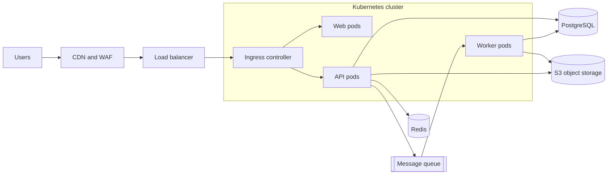
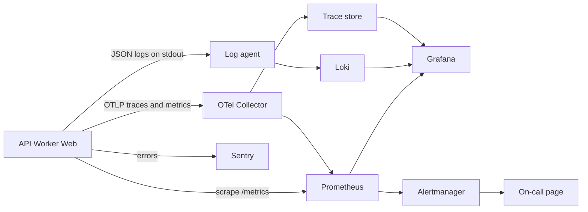
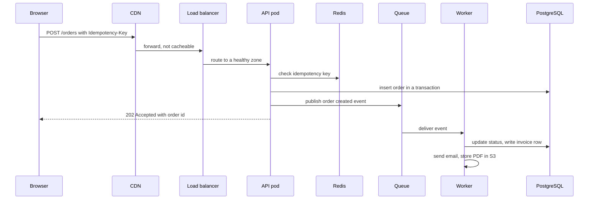

# L19.10 — Reference Production Architecture Walkthrough

> **Level 19: Architecture** · Topic 10 of 11 · ⏱ ~5 hours · Difficulty: Advanced

## 1. What it is

This topic walks, hop by hop, through one complete production architecture for the `shop-api` application and explains *why* each component is
there, what it costs you, how it fails, and which earlier topic of this level it exercises:

**CDN → Load Balancer → Kubernetes → API / Worker / Web → Redis → Message Queue → PostgreSQL / S3**, observed by **Prometheus, Grafana, Loki,
OpenTelemetry and Sentry**.

It is a *reference* architecture: a sensible, widely used starting point you adapt, not a law. The aim is that after reading it you can redraw it from memory, explain every arrow,
and say what you would remove for a smaller system and what you would add for a larger one. (Level 6 and Level 8 cover the AWS and Kubernetes building blocks; Level 10 covers the observability tools.)

## 2. Why it matters in DevOps

- **Most production systems are variations of this shape.** Recognising the pattern lets you onboard to a new company's stack in a day.
- **Each hop is a decision**: caching, queueing, state, identity, observability. Understanding the whole path prevents local optimisations that harm the system.
- **It is the shared vocabulary for design reviews and incident response**: "the worker is lagging because the queue is backed up because PostgreSQL is slow" is a sentence you can only say if the picture is in your head.

Related reading: [What Happens When You Visit a URL](../level-02-networking/11-what-happens-when-you-visit-a-url.md),
[Cluster, Nodes and Control Plane](../level-08-kubernetes/01-cluster-architecture.md),
[The Three Pillars](../level-10-observability/01-three-pillars.md),
[Integrating Argo CD, Terraform and Kubernetes](../level-18-platform-engineering/10-platform-stack-integration.md).

## 3. Real-world system example

**The same shape appears in public engineering write-ups from many companies.** The Kubernetes documentation and the AWS Well-Architected reference diagrams show variations of "edge cache,
load balancer, stateless compute cluster, cache, queue, relational database and object storage". Shopify's engineering blog describes a Rails monolith with MySQL, Redis and Kafka behind CDN and load balancers, deployed in "pods" (independent shards of the stack) for isolation.
GitHub has described a Rails monolith with MySQL, Redis and background job workers. Stripe and many others publicly describe queue-backed asynchronous processing and idempotency keys. Grafana Labs documents the combination of
Prometheus (metrics), Loki (logs) and Tempo (traces) with Grafana for visualisation, and the OpenTelemetry project documents the Collector as the central telemetry gateway. None of these is identical to the reference below, but all share the same
building blocks: the differences are in scale, data tier and team structure.

## 4. Diagram

The request path and the asynchronous path:



The observability plane (separate from the request path, but fed by every component):



## 5. How it works

### Component by component

| Hop | Role | Key design decisions | Fails how | Topic exercised |
|-----|------|----------------------|-----------|-----------------|
| **CDN + WAF** | Cache static assets and cacheable API responses near users, absorb DDoS, terminate TLS at the edge | Cache keys, TTLs, `stale-if-error`, origin shielding, restrict origin to CDN | Purge mistakes, caching private data, origin overload on cold cache | Performance, Security, Cost |
| **Load balancer** | Spread connections across zones and ingress nodes, health checks | L7 (ALB) vs L4 (NLB), cross-zone, idle timeouts, TLS policy | Misconfigured health check, idle-timeout mismatch causes 502/504 | Availability |
| **Kubernetes** | Schedule and heal pods, rolling updates, autoscaling | Managed control plane, multi-AZ node groups, requests/limits, PodDisruptionBudgets, topology spread, Pod Security Standards, NetworkPolicies | Node pressure, bad requests/limits, cluster upgrade mistakes | Scalability, Ops complexity |
| **API pods** | Stateless HTTP handlers | Timeouts and retries with backoff, idempotency keys, connection pool sizing, graceful shutdown | Thread/connection exhaustion, slow dependency | Scalability, Performance |
| **Worker pods** | Consume the queue: emails, exports, webhooks, image processing | Idempotent handlers, retry with backoff, dead-letter queue, scale on queue depth | Poison messages, duplicate processing, backlog | Scalability, Availability |
| **Web pods** | Server-rendered or static frontend (often just CDN + object storage) | Do you need pods at all? Static hosting on S3 + CDN is cheaper and simpler | Rarely the problem | Cost, Ops complexity |
| **Redis** | Cache, sessions, rate-limit counters, short-lived locks | TTLs, eviction policy, HA (replica + failover), treat as cache not source of truth | Stampede on restart, eviction of hot keys | Performance, Availability |
| **Message queue** | Decouple accept from process; absorb bursts | Managed queue (SQS, RabbitMQ, Kafka), at-least-once delivery, DLQ, ordering needs | Backlog growth, poison messages, lost messages if misconfigured | Scalability, DR |
| **PostgreSQL** | System of record | Managed (RDS/Aurora/Cloud SQL), Multi-AZ, pooled connections, PITR backups, read replicas, migrations that are backward compatible | Connection exhaustion, long transactions, disk full, bad migration | Availability, DR, Performance |
| **S3** | Uploads, exports, backups, logs/trace/metric blocks | Pre-signed URLs, lifecycle rules, versioning, encryption, VPC endpoint | Public bucket by mistake, unbounded growth | Cost, Security, DR |
| **Observability** | See and alert | OTel Collector gateway, SLO burn-rate alerts, cardinality and retention budgets | Pipeline outage, runaway cost | Monitoring |

### Cross-cutting concerns

- **Identity:** pods use workload identity (IRSA on EKS, equivalents elsewhere) to access S3 and the queue: no static keys. Humans use SSO. See [Least-privilege IAM](../level-11-security-devsecops/02-least-privilege-iam.md).
- **Secrets:** External Secrets Operator or the CSI driver pulls from a secrets manager; nothing sensitive in Git. See [Kubernetes Secrets](../level-08-kubernetes/07-secrets.md).
- **Delivery:** CI builds an immutable image; GitOps (Argo CD) syncs manifests; progressive delivery with a canary gate. See [The Full Flow: CI to GitOps](../level-17-gitops/07-ci-to-gitops-flow.md).
- **Infrastructure:** VPC, subnets, EKS, RDS, S3, IAM defined in Terraform with remote state and locking. See [Terraform CI/CD](../level-07-terraform-iac/07-terraform-ci-cd.md).
- **Network:** public subnets hold only the load balancer and NAT; nodes, databases and caches live in private subnets; security groups and NetworkPolicies default-deny.

### Request walk-through



The user gets a fast `202`; the slow work (PDF, email) happens asynchronously with retries. The idempotency key makes client retries safe.

## 6. Step-by-step guide

**Prerequisites:** Docker with Compose v2 for steps 1 and 2; a kind cluster and `kubectl` for step 3 (optional). All local, no cloud cost. If you do not have Docker, you can still do steps 4-6 on paper.

1. **Stand up the stateful services and observability stack locally with Docker Compose.** Save as `compose.yaml`:
   ```yaml
   services:
     postgres:
       image: postgres:16
       environment: { POSTGRES_PASSWORD: dev-only-password }
       ports: ["5432:5432"]
       healthcheck: { test: ["CMD-SHELL", "pg_isready -U postgres"], interval: 5s, retries: 10 }
     redis:
       image: redis:7
       ports: ["6379:6379"]
     rabbitmq:
       image: rabbitmq:3-management
       ports: ["5672:5672", "15672:15672"]
     minio:
       image: minio/minio
       command: server /data --console-address ":9001"
       environment: { MINIO_ROOT_USER: devuser, MINIO_ROOT_PASSWORD: dev-only-password }
       ports: ["9000:9000", "9001:9001"]
     prometheus:
       image: prom/prometheus
       volumes: ["./prometheus.yml:/etc/prometheus/prometheus.yml:ro"]
       ports: ["9090:9090"]
     loki:
       image: grafana/loki
       ports: ["3100:3100"]
     grafana:
       image: grafana/grafana
       ports: ["3000:3000"]
     otel-collector:
       image: otel/opentelemetry-collector-contrib
       volumes: ["./otel.yaml:/etc/otelcol-contrib/config.yaml:ro"]
       ports: ["4317:4317", "4318:4318"]
   ```
   Create the two small config files it mounts:
   ```yaml
   # prometheus.yml
   global: { scrape_interval: 15s }
   scrape_configs:
     - job_name: prometheus
       static_configs: [{ targets: ["localhost:9090"] }]
   ```
   ```yaml
   # otel.yaml
   receivers: { otlp: { protocols: { grpc: {}, http: {} } } }
   processors: { batch: {} }
   exporters: { debug: {} }
   service:
     pipelines:
       traces: { receivers: [otlp], processors: [batch], exporters: [debug] }
   ```
   ```bash
   docker compose up -d
   docker compose ps
   ```
   Expected: eight services in state `running` (PostgreSQL `healthy`). The queue (RabbitMQ, standing in for SQS or Kafka), the object store (MinIO, S3-compatible), and the three observability backends now exist. (Image tags are
   unpinned here for brevity; pin them in anything real.)

2. **Verify each component answers.**
   ```bash
   docker compose exec postgres pg_isready -U postgres        # accepting connections
   docker compose exec redis redis-cli ping                   # PONG
   curl -s -o /dev/null -w "prometheus %{http_code}\n" localhost:9090/-/ready
   curl -s -o /dev/null -w "grafana    %{http_code}\n" localhost:3000/api/health
   curl -s -o /dev/null -w "minio      %{http_code}\n" localhost:9000/minio/health/live
   curl -s -o /dev/null -w "rabbitmq   %{http_code}\n" -u guest:guest localhost:15672/api/overview
   ```
   Expect `200` from each HTTP check. (Loki may take about a minute to report ready: check `curl localhost:3100/ready`.) Open Grafana at `http://localhost:3000` (default login `admin`/`admin` on first start, change when prompted) and add Prometheus (`http://prometheus:9090`) and Loki (`http://loki:3100`) as data sources.

3. **Define the compute tier as Kubernetes manifests.** In a kind or other cluster, save as `api.yaml` the Deployment, Service, HPA and Ingress that mirror the diagram:
   ```yaml
   apiVersion: apps/v1
   kind: Deployment
   metadata: { name: shop-api, namespace: shop }
   spec:
     replicas: 3
     selector: { matchLabels: { app: shop-api } }
     template:
       metadata:
         labels: { app: shop-api }
         annotations: { prometheus.io/scrape: "true", prometheus.io/port: "3000" }
       spec:
         serviceAccountName: shop-api
         securityContext: { runAsNonRoot: true, seccompProfile: { type: RuntimeDefault } }
         topologySpreadConstraints:
           - maxSkew: 1
             topologyKey: topology.kubernetes.io/zone
             whenUnsatisfiable: ScheduleAnyway
             labelSelector: { matchLabels: { app: shop-api } }
         containers:
           - name: api
             image: example.com/shop-api:1.4.0
             ports: [{ containerPort: 3000 }]
             env:
               - { name: REDIS_URL, value: "redis://redis.shop.svc:6379" }
               - { name: OTEL_EXPORTER_OTLP_ENDPOINT, value: "http://otel-collector.observability.svc:4317" }
               - name: DATABASE_URL
                 valueFrom: { secretKeyRef: { name: shop-api-db, key: url } }
               - name: SENTRY_DSN
                 valueFrom: { secretKeyRef: { name: shop-api-sentry, key: dsn } }
             resources:
               requests: { cpu: 250m, memory: 256Mi }
               limits: { memory: 512Mi }
             readinessProbe: { httpGet: { path: /readyz, port: 3000 }, periodSeconds: 5 }
             livenessProbe: { httpGet: { path: /healthz, port: 3000 }, periodSeconds: 10, failureThreshold: 3 }
             securityContext: { allowPrivilegeEscalation: false, readOnlyRootFilesystem: true, capabilities: { drop: ["ALL"] } }
   ---
   apiVersion: v1
   kind: Service
   metadata: { name: shop-api, namespace: shop }
   spec:
     selector: { app: shop-api }
     ports: [{ port: 80, targetPort: 3000 }]
   ---
   apiVersion: autoscaling/v2
   kind: HorizontalPodAutoscaler
   metadata: { name: shop-api, namespace: shop }
   spec:
     scaleTargetRef: { apiVersion: apps/v1, kind: Deployment, name: shop-api }
     minReplicas: 3
     maxReplicas: 30
     metrics:
       - type: Resource
         resource: { name: cpu, target: { type: Utilization, averageUtilization: 60 } }
   ---
   apiVersion: networking.k8s.io/v1
   kind: Ingress
   metadata:
     name: shop
     namespace: shop
     annotations: { nginx.ingress.kubernetes.io/proxy-read-timeout: "30" }
   spec:
     ingressClassName: nginx
     tls: [{ hosts: [api.example.com], secretName: api-example-com-tls }]
     rules:
       - host: api.example.com
         http:
           paths:
             - { path: /, pathType: Prefix, backend: { service: { name: shop-api, port: { number: 80 } } } }
   ```
   Check it parses and passes server-side validation without creating anything:
   ```bash
   kubectl create namespace shop
   kubectl apply --dry-run=server -f api.yaml
   ```
   Expected: lines such as `deployment.apps/shop-api created (server dry run)`. (The Ingress needs an ingress controller CRD/class to exist; `ingressClassName: nginx` validates even if no controller is installed.) The worker Deployment
   is identical in shape except it has no Service or Ingress and scales on queue depth (KEDA, or an HPA on an external metric), and the web Deployment serves the frontend or is replaced by static hosting on S3 behind the CDN.

4. **Trace one write through the whole architecture and annotate the diagram.** Using the sequence diagram in section 5, for every arrow write the protocol, timeout, retry policy, and what the caller does if the callee is down. This
   table is the heart of the design doc; gaps (an arrow with no timeout) are your first findings.

5. **Run a failure-mode analysis.** For each component, answer: what happens to users if it dies, how do we detect it, what recovers it.
   | Component fails | User-visible effect | Detection | Recovery |
   |-----------------|--------------------|-----------|----------|
   | One API pod | None (readiness removes it) | Pod restarts metric | Kubernetes reschedules |
   | One AZ | Reduced capacity, possibly slower | LB healthy-host count, burn-rate alert | Surviving AZs absorb load (headroom) |
   | Redis | Slower responses, more DB load | Cache hit ratio, Redis up metric | Failover to replica; app bypasses cache |
   | Queue | Orders accepted but side effects delayed, or checkout blocked | Queue depth and age | Managed service failover; outbox table replays |
   | PostgreSQL primary | Writes fail for about a minute | DB health, error rate | Multi-AZ failover; read-only degradation |
   | Observability stack | Blind, but users unaffected | Dead man's switch, external checks | Restore from IaC; telemetry buffered at agents |
   | Region | Total outage | Synthetic checks, DNS health checks | DR runbook (previous topic) |

6. **Tear down.**
   ```bash
   docker compose down -v
   kubectl delete namespace shop     # if you created it
   ```

## 7. Real-world scenario

*(Illustrative, not a documented incident.)* A Monday morning email campaign sends 80,000 customers to the site. The CDN serves most of the catalogue, but the checkout API rises from 30 to 600 requests per second.
Dashboards in Grafana show API CPU modest, but the queue's oldest-message age climbs to 25 minutes and the order confirmation emails are late; support tickets begin.

Tracing the path: the API accepts orders quickly (the queue absorbed the burst, as designed), but workers are scaled to a fixed 4 replicas and each handler makes a slow synchronous call to a PDF service. The fix, within minutes, is to scale workers on queue depth (KEDA),
to raise the PDF service timeout budget separately, and to move PDF generation off the critical email path. Sentry shows no errors, because nothing failed, only slowed; the **age of the oldest message** SLI is what revealed the problem.
**Lesson:** each component can be healthy while the system is not; end-to-end signals (queue age, order-to-email latency) catch what per-component health checks miss.

## 8. Common mistakes and best practices

**Don't**

- Draw only the happy path: every arrow needs a timeout, a retry rule and a failure behaviour.
- Treat Redis as a durable store or make it a hard dependency of the critical path without a fallback.
- Share one PostgreSQL superuser among API, worker and migrations.
- Run workers without a dead-letter queue and idempotent handlers.
- Let the observability stack share a failure domain (and credentials) with what it monitors.

**Do**

- Keep the API stateless and push slow work to the queue with an outbox or idempotency keys.
- Put the database behind a connection pooler and define a read-only degraded mode.
- Scale workers on queue depth or age, not CPU alone.
- Use workload identity, default-deny network policies and non-root, read-only containers.
- Version the whole picture: Terraform for cloud, Git for manifests, dashboards and alerts as code.

## 9. Tasks

- [ ] **T1 — Bring up the platform locally** *(≈45 min, intermediate)*
  - **Goal:** run the stateful and observability components of the reference architecture.
  - **Steps:**
    1. Create `compose.yaml`, `prometheus.yml` and `otel.yaml` from step 6.1.
    2. Run `docker compose up -d` and the checks in step 6.2.
    3. Add Prometheus and Loki as Grafana data sources and run the query `up` in Explore.
  - **Done when:** every health check returns success and Grafana shows `up{job="prometheus"} = 1`.

- [ ] **T2 — Send telemetry through the Collector** *(≈60 min, advanced)*
  - **Goal:** prove the OTLP path works end to end.
  - **Steps:**
    1. Install the `telemetrygen` tool from the OpenTelemetry collector-contrib repository (via `go install`, or use its container image).
    2. Send 20 traces to `localhost:4317` with `--otlp-insecure`.
    3. Read the Collector logs (`docker compose logs otel-collector`) and find the received spans.
  - **Done when:** the Collector log shows 20 traces with their span names.

- [ ] **T3 — Validate the manifests** *(≈45 min, intermediate)*
  - **Goal:** make the compute tier machine-checked.
  - **Steps:**
    1. Create a kind cluster and the `shop` namespace.
    2. Apply `api.yaml` with `--dry-run=server`, then for real with a placeholder `nginx` image and matching port settings in a copy of the file.
    3. Break it on purpose (a nonexistent image tag, a wrong probe path) and read the resulting events with `kubectl describe pod`.
  - **Done when:** the valid version has Ready pods, the broken version shows the failure reason, and you fixed it.

- [ ] **T4 — Annotate the request path** *(≈60 min, advanced)*
  - **Goal:** reveal missing timeouts and retries.
  - **Steps:**
    1. For each arrow in the sequence diagram write: protocol, timeout, retry policy, idempotency, and behaviour on failure.
    2. Verify the budget: the timeouts on the path must nest (outer larger than inner).
    3. Mark any arrow whose failure takes down the checkout path.
  - **Done when:** the table is complete, the timeouts nest correctly, and at least two gaps are listed with fixes.

- [ ] **T5 — Failure-mode game day (paper plus local)** *(≈75 min, advanced)*
  - **Goal:** see what actually happens when a dependency disappears.
  - **Steps:**
    1. With the Compose stack running, stop Redis (`docker compose stop redis`) while a small script keeps calling a stub app that uses it with and without a fallback.
    2. Stop and restart RabbitMQ with messages in a durable queue; confirm messages survive or not depending on settings.
    3. Fill in a table: what broke, what degraded, how long recovery took.
  - **Done when:** you have measured results for both failures and you changed a setting (fallback or durability) that improved the outcome.

- [ ] **T6 — Prove it: redraw and defend** *(≈60 min, advanced)*
  - **Goal:** own the architecture.
  - **Steps:**
    1. Without the guide, redraw the architecture (two Mermaid diagrams: request path and observability).
    2. For three components, justify the choice, one alternative and the trade-off, and name the first thing you would drop for a team of three.
  - **Done when:** both diagrams render, and the justifications cite at least one topic of this level each (for example availability, cost, operational complexity).

## 10. Self-check questions

1. Why does the API return `202` and publish to a queue instead of doing all the work synchronously?
2. What is the role of the OpenTelemetry Collector versus talking to each backend directly?
3. Which components must be backed up, and which can be rebuilt?
4. What end-to-end signals would you add that component health checks do not give?
5. Which parts would you remove for a three-person team, and why?

<details>
<summary>Answers</summary>

1. It keeps latency low, absorbs bursts, isolates slow or failing downstream work, and allows retries; the cost is eventual consistency and the need for idempotent consumers.
2. The Collector is a single vendor-neutral egress point that batches, samples, redacts and routes telemetry, so applications do not know about backends and backends can change without redeploying apps.
3. Back up PostgreSQL, S3 data, secrets/keys and Terraform state; rebuild pods, caches, dashboards-as-code and infrastructure from Git and images.
4. Queue age, order-to-confirmation latency, synthetic checkout checks, SLO burn rate, business metrics such as orders per minute.
5. Typically Kubernetes (use a managed container platform), the separate web pods (static hosting + CDN), a self-hosted observability stack (use managed), and possibly the queue (a Postgres job table), as long as the SLOs are still met.
</details>

## 11. Further reading

- AWS Well-Architected Framework and the AWS Architecture Center reference diagrams.
- Kubernetes documentation — Concepts, and the production environment guidance.
- OpenTelemetry documentation — Collector architecture; Grafana documentation for Loki, Mimir/Prometheus and Tempo.
- *Designing Data-Intensive Applications* by Martin Kleppmann.
- *Building Microservices* by Sam Newman, for the trade-offs of splitting services.

<!-- nav -->
---
← Previous: [Disaster Recovery](09-disaster-recovery-architecture.md) · [Level 19 index](README.md) · Next: [Trade-offs and Architecture Decision Records](11-architecture-decision-records.md) →
