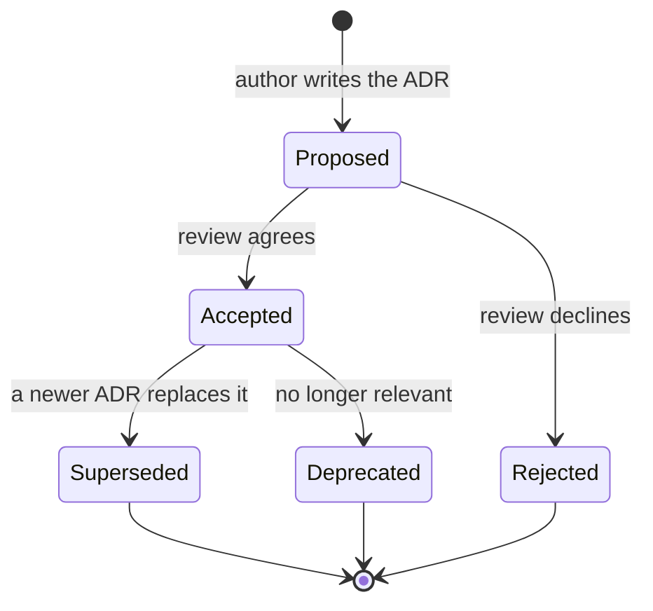
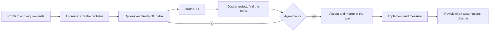

# L19.11 — Trade-offs and Architecture Decision Records

> **Level 19: Architecture** · Topic 11 of 11 · ⏱ ~4 hours · Difficulty: Advanced

## 1. What it is

Every architecture is a pile of trade-offs: consistency versus availability, speed versus cost, flexibility versus simplicity. An **Architecture Decision Record (ADR)** is a short document that captures *one* significant decision: the context that forced it, the
options considered, the choice, and the consequences accepted. ADRs live in the code repository, next to the thing they describe, and are immutable once accepted (you supersede, you do not rewrite).

Around the ADR sit three supporting skills. **Trade-off matrices** compare options against weighted criteria so the debate is about the weights and facts instead of opinions. **Design reviews** are structured conversations where peers try to find the flaws in a design before production does.
**Estimating** (back-of-envelope or "Fermi" calculations) gives order-of-magnitude numbers (storage, traffic, cost) quickly enough to rule options in or out.

## 2. Why it matters in DevOps

- **Teams forget why.** Two years later nobody remembers why you chose a queue over a database table; without a record, people either cargo-cult it or tear it out and repeat the mistake.
- **Onboarding and incident response** speed up when the reasoning is written down ("it is read-only during failover on purpose, see ADR-012").
- **Decisions get better when written**: stating alternatives and consequences exposes weak reasoning.
- **Reviews catch expensive mistakes cheaply**: an hour reviewing a design is far cheaper than a migration after launch.
- **Senior engineering is largely this skill**: choosing well under uncertainty, explaining it, and being willing to revisit it.

Related reading: [Platform Engineering](../level-00-what-devops-is/13-platform-engineering.md),
[Postmortems](../level-14-sre/07-postmortems.md),
[Policy as Code](../level-18-platform-engineering/07-policy-as-code.md).

## 3. Real-world system example

**Michael Nygard's ADR proposal and its adoption.** Michael Nygard's 2011 blog post *Documenting Architecture Decisions* proposed short, numbered, immutable records with the sections Title, Status, Context, Decision and Consequences, stored in the project repository.
The idea spread widely; the ADR GitHub organisation (adr.github.io) collects templates and tooling, **MADR** (Markdown Any Decision Records) is a popular template, and Thoughtworks' Technology Radar has listed lightweight ADRs as a recommended practice.
Large engineering organisations use related documents: the **Rust RFC** process, the **Python PEPs**, **Kubernetes Enhancement Proposals (KEPs)** and **Go proposals** are all public, reviewable, versioned design documents, with discussion and a recorded outcome. AWS and Google both describe design review as part of how they
build services (for example Amazon's published practice of writing narrative documents, and Google's design docs, as described in public engineering-culture writing). They differ in weight, but the structure is the same: write the options down and let others attack them.

## 4. Diagram

The life cycle of an ADR:



How a significant decision flows through the team:



## 5. How it works

### Writing ADRs

**When to write one:** when a decision is hard to reverse, affects several teams, has real alternatives, or you expect someone to ask "why?" later. Examples: choice of database, queue, deployment platform, multi-region strategy, authentication approach,
a major library. **Do not** write one for every function name. Rule of thumb: if reversing it costs weeks, write it.

**The format (Nygard / MADR style):**

```markdown
# ADR-0007: Use a managed queue (SQS) for asynchronous jobs

- Status: Accepted
- Date: 2026-03-04
- Deciders: platform team, shop-api team
- Supersedes: none

## Context
What problem, what forces and constraints (requirements, SLOs, team size, budget, deadlines, existing systems).
State facts and numbers, with sources.

## Decision drivers
The criteria that matter, ranked: operational simplicity, durability, cost, throughput headroom...

## Options considered
1. Postgres job table. Pros / cons.
2. Managed queue (SQS). Pros / cons.
3. Self-hosted Kafka. Pros / cons.

## Decision
We will use ... because ... (one paragraph, in active voice: "We will ...").

## Consequences
Positive, negative and neutral. What becomes easier, what becomes harder, what we must now do (runbooks, monitoring, migration).
Risks and how we will notice if the decision is wrong (the trigger to revisit).

## Links
Related ADRs, issues, benchmarks, diagrams.
```

Good ADR habits: one decision per record; short (one to two pages); numbered and stored in `docs/adr/`; state the **trade-offs honestly** including what you gave up; record **why not** for the rejected options; link to evidence;
and never edit an accepted ADR except to change its status (write a new one that supersedes it).

### Trade-off matrices

A weighted decision matrix scores each option on each criterion, multiplies by weights and sums. It will not make the decision for you, but it forces you to (1) name the criteria, (2) say how much each matters, and (3) expose disagreement: people often agree on the scores but not the weights.
Always run a **sensitivity check**: if a small change to a weight flips the winner, the options are close and the decision should be made on something else (reversibility, risk, team preference), and say so in the ADR.

Common trade-off pairs worth naming explicitly: consistency vs availability (see [CAP and consistency](../level-13-databases-distributed-systems/12-cap-theorem-and-consistency.md)), latency vs throughput, cost vs redundancy, build vs buy, flexibility vs simplicity, speed of delivery vs safety.
Prefer **reversible** ("two-way door") decisions to be made quickly and **irreversible** ("one-way door") decisions slowly, with more review.

### Design reviews

A good design review is a meeting that everyone has prepared for by reading the document. The author presents for five minutes; the rest is questions. Reviewers use a checklist (see the capstone for a full one) covering requirements, failure modes, security, operations, cost and migration.
Rules: critique the design, not the person; prefer questions to assertions ("what happens when the queue is full?"); record decisions and open questions; assign owners. Reviews should end with one of: approved, approved with changes, or needs another round.

### Estimating

Order-of-magnitude numbers are enough to choose between designs. Method: state assumptions, use round numbers, compute, then sanity-check against something known. Useful constants: 86,400 seconds in a day; about 2.6 million seconds in a month; 1 million requests per day is about 12 requests per second on average;
typical peak is 3-10x the daily average. Keep a list of numbers you have measured in your own system; they beat any table.

## 6. Step-by-step guide

**Prerequisites:** Python 3.9+, a Git repository for your docs folder. No cost.

1. **Create the ADR folder and the template.**
   ```bash
   mkdir -p docs/adr
   cat > docs/adr/0000-template.md <<'EOF'
   # ADR-0000: Short title in the form "Use X for Y"

   - Status: Proposed | Accepted | Rejected | Deprecated | Superseded by ADR-NNNN
   - Date: YYYY-MM-DD
   - Deciders: names or teams

   ## Context
   ## Decision drivers
   ## Options considered
   ## Decision
   ## Consequences
   ## Links
   EOF
   ls docs/adr
   ```
   Expected: `0000-template.md`. Commit this first so every later ADR starts from the same shape.

2. **Estimate before you decide.** Save as `fermi.py`:
   ```python
   orders_per_day = 50_000
   events_per_order = 12          # created, paid, packed, ...
   bytes_per_event = 700          # JSON with metadata
   retention_years = 7
   replication_factor = 2         # primary + one copy
   raw = orders_per_day * events_per_order * bytes_per_event * 365 * retention_years
   print(f"raw: {raw/1e12:.2f} TB over {retention_years} years")
   print(f"with replication: {raw*replication_factor/1e12:.2f} TB")
   avg = orders_per_day * events_per_order / 86400
   print(f"events per second (avg): {avg:.1f}; peak at 10x: {avg*10:.0f}")
   ```
   ```bash
   python3 fermi.py
   ```
   Expected output:
   ```text
   raw: 1.07 TB over 7 years
   with replication: 2.15 TB
   events per second (avg): 6.9; peak at 10x: 69
   ```
   Seven events per second and about 2 TB over seven years mean a Postgres table (partitioned by month) is plenty for the audit log; a streaming platform would be over-engineering. The estimate just *removed an option* in two minutes.

3. **Build a weighted decision matrix with a sensitivity check.** Save as `matrix.py`:
   ```python
   criteria = {"Operational simplicity": 30, "Durability / delivery guarantees": 25,
               "Throughput headroom": 15, "Cost": 15, "Team familiarity": 15}
   options = {
       "Postgres job table":  {"Operational simplicity": 5, "Durability / delivery guarantees": 4, "Throughput headroom": 2, "Cost": 5, "Team familiarity": 5},
       "Managed queue (SQS)": {"Operational simplicity": 4, "Durability / delivery guarantees": 5, "Throughput headroom": 4, "Cost": 4, "Team familiarity": 3},
       "Self-hosted Kafka":   {"Operational simplicity": 1, "Durability / delivery guarantees": 5, "Throughput headroom": 5, "Cost": 2, "Team familiarity": 1},
   }
   def scores(weights):
       return {o: sum(weights[c] * s[c] for c in weights) / sum(weights.values()) for o, s in options.items()}

   for o, v in sorted(scores(criteria).items(), key=lambda kv: -kv[1]):
       print(f"{o:22s} {v:4.2f}")
   w2 = dict(criteria); w2["Throughput headroom"] *= 2
   print("\nthroughput weight doubled:")
   for o, v in sorted(scores(w2).items(), key=lambda kv: -kv[1]):
       print(f"{o:22s} {v:4.2f}")
   ```
   ```bash
   python3 matrix.py
   ```
   Expected:
   ```text
   Postgres job table     4.30
   Managed queue (SQS)    4.10
   Self-hosted Kafka      2.75

   throughput weight doubled:
   Managed queue (SQS)    4.09
   Postgres job table     4.00
   Self-hosted Kafka      3.04
   ```
   The winner flips when throughput matters twice as much: the top two are close. The honest ADR says so, picks based on the stated drivers, and records the trigger to revisit ("if sustained load passes 500 jobs/s, move to the managed queue").
   (Scores are example judgments; yours should be backed by measurements and team discussion.)

4. **Write the ADR.** Copy the template to `docs/adr/0001-use-postgres-job-table-for-async-jobs.md` and fill it in, including the estimate (step 2), the matrix result (step 3), what you gave up, and the revisit trigger. Keep it to one page.

5. **Hold a design review.** Circulate the ADR 24 hours before. In the meeting, run the review checklist (capstone, section 4, the "Design review" milestone): requirements, failure modes, security, operability, cost, migration and rollback. Record outcomes as comments in the pull request; approve by merging.

6. **Supersede, don't rewrite.** Six months later the load has grown. Write `0014-move-async-jobs-to-sqs.md` with `Supersedes: ADR-0001`, and change ADR-0001's status line to `Superseded by ADR-0014`. The history of how your thinking changed is itself valuable.

## 7. Real-world scenario

*(Illustrative, not a documented incident.)* A new engineer joins and proposes replacing the `shop-api` queue with direct database writes "to remove a moving part". The team lead points to `docs/adr/0007`, which explains that the queue was chosen to absorb flash-sale bursts that previously took the
database down, with a trade-off of eventual consistency for order emails. The ADR also lists the trigger to revisit: "if flash sales are discontinued or sustained load stays below 50 jobs/s".

The engineer checks the metrics: peak is still 600 jobs/s at sale time. The proposal is dropped in ten minutes instead of causing a two-hour debate and, worse, a repeat outage. A month later the same engineer writes ADR-0015 for a genuine change (adding a dead-letter queue) that follows the same format. **Lesson:** an ADR turns institutional memory into
something that survives turnover and shortens future arguments.

## 8. Common mistakes and best practices

**Don't**

- Write ADRs after the fact to justify what you already built, with straw-man alternatives.
- Hide the downsides: an ADR with no negative consequences is advertising.
- Edit accepted ADRs; the history is the point.
- Write a book. Long ADRs are not read.
- Treat the matrix score as the decision; it is an input to judgment.

**Do**

- Write one when a decision is costly to reverse; store ADRs in the repo and review them like code.
- Always include rejected options and why.
- State assumptions and numbers, and the trigger that would make you revisit.
- Do a sensitivity check on weights and say if the call is close.
- Separate one-way-door from two-way-door decisions and spend review effort accordingly.

## 9. Tasks

- [ ] **T1 — Set up ADRs in a repo** *(≈20 min, beginner)*
  - **Goal:** have the infrastructure for decision records.
  - **Steps:**
    1. Create `docs/adr/0000-template.md` as in step 6.1 and commit it in a Git repository.
    2. Add `docs/adr/README.md` explaining when to write an ADR and the status values.
  - **Done when:** `git log --oneline -- docs/adr` shows the commit and the template renders on GitHub.

- [ ] **T2 — Estimate three numbers** *(≈40 min, intermediate)*
  - **Goal:** practise Fermi estimation with stated assumptions.
  - **Steps:**
    1. For `shop-api`, estimate: peak requests per second, daily log volume in GB, and database size after 3 years.
    2. Write each assumption as a variable at the top of a script and print the results.
    3. Sanity check each against a real number you can measure (for example your own sample app's log size per request).
  - **Done when:** a script prints the three results, each assumption is labelled, and you note one sanity check per number.

- [ ] **T3 — Decision matrix with sensitivity** *(≈45 min, intermediate)*
  - **Goal:** compare real options and test the robustness of the answer.
  - **Steps:**
    1. Pick a decision (managed vs self-hosted PostgreSQL, ECS vs Kubernetes, or Redis vs in-process cache).
    2. Build the matrix as in `matrix.py` with at least 5 criteria and 3 options, with weights agreed by you and (ideally) a colleague scoring independently.
    3. Vary each weight by plus or minus 50% and record whether the winner changes.
  - **Done when:** the script prints the base ranking and a table of weight changes that flip the winner (or states that none do).

- [ ] **T4 — Write a real ADR** *(≈60 min, advanced)*
  - **Goal:** produce a reviewable ADR.
  - **Steps:**
    1. Choose a decision from the reference architecture (for example "Use a managed PostgreSQL with Multi-AZ rather than running it on Kubernetes").
    2. Fill the template: context with numbers, drivers, three options, decision, consequences (positive and negative), revisit trigger.
    3. Open a pull request containing only the ADR.
  - **Done when:** the ADR is under two pages, has at least one honest negative consequence per chosen option, and includes a revisit trigger.

- [ ] **T5 — Run a design review** *(≈60 min, advanced)*
  - **Goal:** find flaws before production does.
  - **Steps:**
    1. Ask a colleague (or play both roles) to review the ADR from T4 using the checklist in the capstone.
    2. Record at least five questions and the answers or follow-up actions as PR comments.
    3. Update the ADR with the changes agreed.
  - **Done when:** the PR has at least five review comments, each resolved with an answer or a change, and the final ADR reflects them.

- [ ] **T6 — Prove it: supersede a decision** *(≈45 min, advanced)*
  - **Goal:** show the full life cycle.
  - **Steps:**
    1. Without the guide, write ADR-0001 for a decision with explicit revisit triggers.
    2. Invent (and label as hypothetical) a change in conditions that hits the trigger, then write ADR-0002 that supersedes it, updating the status in ADR-0001.
    3. Explain in three sentences what the history teaches a newcomer.
  - **Done when:** two linked ADRs exist with correct statuses, and the explanation mentions both the original reasoning and the changed assumption.

## 10. Self-check questions

1. What are the core sections of an ADR and why is it immutable once accepted?
2. When should you write an ADR and when not?
3. What does a sensitivity check on a decision matrix tell you?
4. Distinguish one-way-door and two-way-door decisions.
5. Why do estimates use round numbers and stated assumptions?

<details>
<summary>Answers</summary>

1. Title, status, context, decision, consequences (often also drivers and options). It is immutable so the history of reasoning stays intact; changes are made by writing a new ADR that supersedes it.
2. Write one when the decision is costly to reverse, has real alternatives, or affects several teams. Do not for easily reversible, local choices.
3. Whether the winner depends on contested weights. If a small change flips the result, the options are close and other factors (risk, reversibility) should decide.
4. One-way-door decisions are hard or impossible to reverse and deserve deep review; two-way-door decisions are cheap to undo and should be made quickly.
5. The goal is the order of magnitude to rule options in or out; explicit assumptions make the estimate reviewable and easy to correct.
</details>

## 11. Further reading

- Michael Nygard, *Documenting Architecture Decisions* (2011 blog post), and adr.github.io for templates and tools.
- MADR (Markdown Any Decision Records) project documentation.
- *Fundamentals of Software Architecture* by Mark Richards and Neal Ford; *Software Architecture: The Hard Parts* by Ford et al.
- *Thinking in Systems* by Donella Meadows (trade-offs and feedback).
- Public design-proposal processes: Kubernetes Enhancement Proposals (KEPs), Rust RFCs, Python PEPs.

<!-- nav -->
---
← Previous: [Reference Production Architecture Walkthrough](10-reference-architecture-walkthrough.md) · [Level 19 index](README.md) · Next: [Level capstone project](99-capstone-project.md) →
