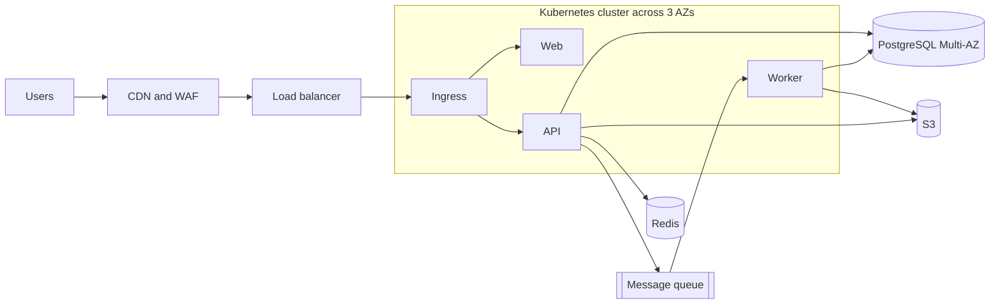
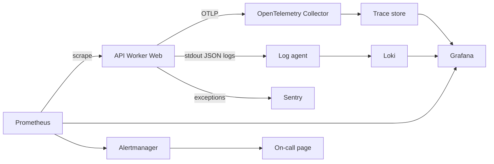

# L19 Capstone — Design the Reference Production Architecture

> **Level 19: Architecture** · Capstone · ⏱ ~14 hours

## 1. Goal and outcome

Design, on paper and in code-checked documents, a complete production architecture for `shop-api` and defend it like a senior engineer:

**CDN → Load Balancer → Kubernetes → API / Worker / Web → Redis → Message Queue → PostgreSQL / S3**, observed with **Prometheus, Grafana, Loki, OpenTelemetry and Sentry**.

This is a *design* capstone: you will not necessarily deploy it (Levels 6-10 and 17 do that). Instead you will produce a design package in a Git repository that a reviewer could use to build and operate the system:

| Deliverable | File | Topics it exercises |
|-------------|------|--------------------|
| Requirements, assumptions, estimates | `docs/requirements.md`, `model/model.py` | Scalability, Performance, ADRs and estimating |
| Architecture diagrams (Mermaid) | `docs/architecture.md` | Reference architecture walkthrough |
| Availability and capacity model | `model/model.py`, `docs/availability.md` | Availability, Scalability |
| Threat model (STRIDE) and blast-radius plan | `docs/threat-model.md` | Security architecture |
| Cost estimate with unit economics | `docs/cost.md` | Cost, Operational complexity |
| Release and environment strategy | `docs/deployment.md` | Deployment strategy |
| Observability design and SLOs | `docs/slo.md` | Monitoring |
| Disaster recovery plan | `docs/dr-plan.md` | Disaster recovery |
| Written ADRs (at least 6) | `docs/adr/*.md` | Trade-offs and ADRs, all topics |
| Design review checklist and review record | `docs/review-checklist.md`, `docs/review-record.md` | Trade-offs and ADRs |

**Outcome:** a repository whose `python3 check_design.py .` prints `design check passed`, plus a 20-minute design-review walkthrough you can deliver without notes.

## 2. Architecture

The target architecture (request path):



The observability plane:



Your design package adds what these diagrams cannot show: numbers, threats, decisions, costs and recovery procedures.

## 3. Prerequisites and cost

- Completed topics L19.1-L19.11 (this level). Helpful: Levels 6, 8, 10, 13, 14 and 15.
- Tools: Git, Python 3.9+, a text editor with Markdown preview (GitHub renders Mermaid natively). Optional: Docker for the walkthrough Compose stack from topic 10.
- **Cost: free.** All cost figures in your design are *estimates using clearly labelled example prices*; do not create cloud resources for this capstone.
- Time budget: about 14 hours across the milestones below; the review milestone is best done with a colleague.

## 4. Build it step by step

### Milestone 0 — Scaffold the design repository

```bash
mkdir -p reference-architecture/{docs/adr,model} && cd reference-architecture
git init
touch docs/{requirements,architecture,availability,threat-model,cost,deployment,slo,dr-plan,review-checklist,review-record}.md
```

Save the verifier as `check_design.py` (it checks that every deliverable exists and is well formed):

```python
import pathlib, re, sys

root = pathlib.Path(sys.argv[1] if len(sys.argv) > 1 else ".")
problems = []

def need(path):
    p = root / path
    if not p.exists():
        problems.append(f"missing {path}")
        return ""
    return p.read_text(encoding="utf-8")

arch = need("docs/architecture.md")
if len(re.findall(r"```mermaid", arch)) < 2:
    problems.append("docs/architecture.md needs at least 2 mermaid diagrams (request path + observability)")
for comp in ["CDN", "Load balancer", "Kubernetes", "Redis", "PostgreSQL", "S3", "Prometheus", "Grafana", "Loki", "OpenTelemetry", "Sentry"]:
    if comp.lower() not in arch.lower():
        problems.append(f"architecture.md never mentions {comp}")

adrs = sorted((root / "docs/adr").glob("0*.md")) if (root / "docs/adr").exists() else []
real = [a for a in adrs if not a.name.startswith("0000")]
if len(real) < 6:
    problems.append(f"need at least 6 ADRs besides the template, found {len(real)}")
for a in real:
    t = a.read_text(encoding="utf-8")
    for sec in ["Status", "Context", "Options considered", "Decision", "Consequences"]:
        if sec.lower() not in t.lower():
            problems.append(f"{a.name} lacks section {sec}")
    if "supersed" not in t.lower() and "revisit" not in t.lower():
        problems.append(f"{a.name} has no revisit trigger or supersedes note")

for f, words in {"docs/cost.md": ["per order", "assum"], "docs/dr-plan.md": ["RPO", "RTO", "fail-back"],
                 "docs/threat-model.md": ["Spoofing", "Tampering", "Repudiation", "Information disclosure", "Denial of service", "Elevation of privilege"],
                 "docs/slo.md": ["burn", "SLO"], "docs/review-checklist.md": ["- [ ]"]}.items():
    t = need(f)
    for w in words:
        if t and w.lower() not in t.lower():
            problems.append(f"{f} lacks '{w}'")

print("\n".join(problems) if problems else "design check passed")
print(f"{len(problems)} problems")
sys.exit(1 if problems else 0)
```

```bash
python3 check_design.py .      # expect a list of problems: that is your to-do list
```

### Milestone 1 — Requirements and estimates (topics 1, 4, 11)

Write `docs/requirements.md` with: functional scope (browse, cart, checkout, order history, admin export), users (2,000,000 daily active users as the working assumption), **non-functional requirements** (checkout availability SLO 99.9%, p99 checkout latency under 500 ms, RPO 5 minutes and RTO 60 minutes for orders, 7-year audit retention), constraints (team of 6, budget ceiling you choose, single cloud provider, regions `us-east-1` primary and `eu-west-1` for DR), and a list of **assumptions you will validate**.

Save the single-file model as `model/model.py` (example assumptions and example USD prices; every number is yours to change):

```python
import math

A = dict(dau=2_000_000, req_per_user=40, peak_factor=5, rps_per_pod=150, target_util=0.6,
         pods_per_node=8, zones=3, conns_per_pod=3, hit_ratio=0.9, read_share=0.8,
         orders_per_month=400_000)

# 1. capacity (Scalability, Performance)
avg = A["dau"] * A["req_per_user"] / 86_400
peak = avg * A["peak_factor"]
pods = math.ceil(peak / (A["rps_per_pod"] * A["target_util"]))
pods_az_loss = math.ceil(pods * A["zones"] / (A["zones"] - 1))
nodes = math.ceil(pods_az_loss / A["pods_per_node"])
print(f"[capacity] peak {peak:,.0f} rps -> {pods} pods ({pods_az_loss} with one-zone headroom) -> {nodes} nodes")
print(f"[capacity] DB connections {pods_az_loss*A['conns_per_pod']} (needs pooler if > 100); DB reads/s after cache {peak*A['read_share']*(1-A['hit_ratio']):,.0f}")

# 2. availability (Availability): critical-path components in series
chain = {"CDN": .9999, "Load balancer": .9999, "Kubernetes API pods": .9995,
         "Redis (optional, bypassed)": 1.0, "PostgreSQL Multi-AZ": .9995, "Payment provider (async)": 1.0}
avail = math.prod(chain.values())
TARGET = 0.999
print(f"[availability] composite {avail:.4%} (expected downtime {(1-avail)*30*24*60:.0f} min/30d) vs target {TARGET:.2%}: {'meets' if avail >= TARGET else 'MISSES'} target")

# 3. cost (Cost): EXAMPLE USD prices, replace with current ones
H = 730
cost = {"nodes": nodes*0.17*H, "control plane": 0.10*H, "load balancer": (0.0225+5*0.008)*H,
        "postgres multi-az": 0.34*H + 200*0.115*2, "redis": 2*0.07*H, "s3": 2000*0.023,
        "cdn+egress": 3000*0.8*0.085 + 3000*0.2*0.09, "nat": 3*0.045*H + 1500*0.045,
        "observability storage+saas": 120}
total = sum(cost.values())
print(f"[cost] example total ${total:,.0f}/month = ${total/A['orders_per_month']:.4f} per order; top item: {max(cost, key=cost.get)}")

# 4. DR (Disaster Recovery): required vs designed, minutes
dr = [("PostgreSQL", 5, 60, 0.1, 15), ("S3 uploads", 60, 240, 15, 60), ("Queue", 5, 60, 0, 20), ("Cluster", None, 120, None, 90)]
fails = [n for n, rpo, rto, mr, mt in dr if (rpo is not None and mr > rpo) or mt > rto]
print(f"[dr] {len(dr)} components checked, failing: {fails or 'none'}")
```

```bash
python3 model/model.py
```

Expected output with these assumptions:

```text
[capacity] peak 4,630 rps -> 52 pods (78 with one-zone headroom) -> 10 nodes
[capacity] DB connections 234 (needs pooler if > 100); DB reads/s after cache 370
[availability] composite 99.8800% (expected downtime 52 min/30d) vs target 99.90%: MISSES target
[cost] example total $2,346/month = $0.0059 per order; top item: nodes
[dr] 4 components checked, failing: none
```

Read it as a reviewer: the model already tells you the database needs a pooler and that the series chain **misses** the 99.9% target, so your availability design must change something (for example improve the weakest component, add redundancy, or relax the target with a reason).

### Milestone 2 — Architecture diagrams (topic 10)

In `docs/architecture.md` include the two diagrams from section 2 (extended for your decisions), a component table (role, key design decisions, how it fails), and the request walk-through as a `sequenceDiagram` for `POST /orders` with an idempotency key. Annotate every arrow with a timeout and a retry policy.

### Milestone 3 — Availability and scalability design (topics 1, 2)

In `docs/availability.md`: the SPOF table (component, failure mode, redundancy, detection, recovery time), the series/parallel calculation (extend `model.py` until the composite meets the target or document why not), the degradation ladder (what users see when Redis, the queue, the payment provider or the primary database is unavailable), the scaling plan (what scales on which metric: API on CPU, workers on queue depth, database via pooler then replicas), and the first three bottlenecks you expect with the metric that will show each.

### Milestone 4 — Security architecture (topic 3)

In `docs/threat-model.md`: a data flow diagram with trust boundaries (internet, edge, cluster, data zone), a STRIDE table covering every flow that crosses a boundary (at least 12 threats, each with mitigation and a decision: mitigate, accept, transfer or avoid), the identity plan (SSO for humans, workload identity for pods, no static cloud keys), the network plan (private subnets, default-deny NetworkPolicies), and a blast-radius statement (accounts, namespaces, per-service database users, optional cells). The file must contain all six STRIDE category names.

### Milestone 5 — Operability, build-vs-buy and deployment (topics 6, 7)

In `docs/deployment.md`: environments (dev, staging, production in separate accounts), the pipeline from commit to production (CI builds an immutable image, GitOps syncs, canary with automatic analysis), the **multi-region wave plan** (canary 1%, primary region, DR region), the expand/contract migration policy, and rollback rules with the time-to-rollback target. Add a **complexity budget**: list the innovation tokens you spend (for example Kubernetes) and a build-vs-buy table for PostgreSQL, the queue, Redis, and the observability stack (managed vs self-hosted) with a 3-year TCO sketch. State plainly when a simpler platform would be the better choice and at what scale this design becomes justified.

### Milestone 6 — Monitoring and SLOs (topic 8)

In `docs/slo.md`: three user journeys with SLIs and SLOs, the burn-rate alert table (page and ticket windows) for the checkout SLO, a Prometheus rule file (validated with `promtool check rules` if available), the telemetry pipeline (OTel Collector with tail sampling, Loki labels policy, Sentry sampling) and a telemetry volume and cost estimate. Include monitoring-of-monitoring (dead man's switch, external synthetic check).

### Milestone 7 — Cost (topic 5)

In `docs/cost.md`: the monthly cost model from `model.py` extended with observability, backups and DR (standby costs), every price labelled as an example with a date, the **cost per order** and a target, the top five levers (with estimated savings) and the guardrails (tags, budgets, lifecycle rules, retention caps). Include at least two what-if scenarios (for example single NAT gateway; 50% Spot workers).

### Milestone 8 — Disaster recovery (topic 9)

In `docs/dr-plan.md`: per-component RPO/RTO and chosen DR tier (use the table logic of topic 9), the mechanisms (Multi-AZ, PITR, cross-region replica, S3 replication and versioning, backups in a separate account with object lock, infrastructure as code), the region-loss runbook (declare, promote, recreate, verify, switch DNS), the **fail-back** procedure, communication templates, and the test schedule with the measured results you expect to record.

### Milestone 9 — Write the ADRs (topic 11)

Create `docs/adr/0000-template.md` from the template below, then write at least six ADRs, one page each. Suggested decisions: (1) Kubernetes vs a managed container service, (2) managed PostgreSQL Multi-AZ vs self-hosted, (3) queue technology, (4) Redis usage and failure behaviour, (5) multi-AZ now and warm-standby DR region vs active-active, (6) OpenTelemetry Collector plus Prometheus/Loki/Grafana vs a SaaS observability vendor, (7) canary release strategy, (8) CDN caching policy.

````markdown
# ADR-0000: Short title in the form "Use X for Y"

- Status: Proposed | Accepted | Rejected | Deprecated | Superseded by ADR-NNNN
- Date: YYYY-MM-DD
- Deciders: names or teams

## Context
The problem, constraints and numbers (requirements, SLOs, team size, budget, deadline). Cite your estimate.

## Decision drivers
Ranked criteria (for example: operational simplicity, durability, cost, throughput).

## Options considered
1. Option A: pros, cons.
2. Option B: pros, cons.
3. Option C: pros, cons, and why it was not chosen.

## Decision
We will ... because ...

## Consequences
Positive, negative, neutral. New work this creates (runbooks, alerts, migration).
Revisit trigger: the measurable condition under which we reconsider this decision.

## Links
Related ADRs, diagrams, benchmarks.
````

### Milestone 10 — Design review (topic 11)

Save this checklist as `docs/review-checklist.md`, run it with a reviewer, and record answers, actions and the verdict (approved, approved with changes, another round) in `docs/review-record.md`.

```markdown
# Design review checklist

## Requirements and scope
- [ ] Functional scope and non-goals are written down
- [ ] SLOs, RPO and RTO are numeric and agreed with an owner
- [ ] Assumptions and estimates are explicit and have a validation plan

## Scalability and performance
- [ ] Peak load, headroom and first three bottlenecks are identified with metrics
- [ ] Every service is stateless or its state is explained
- [ ] Latency budget exists per critical path; every call has a timeout and retry policy
- [ ] Caches have TTL, invalidation and stampede protection

## Availability and failure
- [ ] Every single point of failure is listed with a mitigation or an accepted risk
- [ ] Composite availability is calculated and meets the target
- [ ] Degraded modes are defined and tested; dependencies are classified critical or optional

## Security
- [ ] Trust boundaries and STRIDE threats reviewed; decisions recorded
- [ ] No static cloud keys; secrets in a manager; least-privilege roles and database users
- [ ] Network default-deny; encryption in transit and at rest; audit logging enabled

## Operations and complexity
- [ ] Owner and on-call for each component; runbooks exist for each page
- [ ] Number of new technologies is within the innovation budget; build-vs-buy is justified
- [ ] Upgrade and patching plan for Kubernetes, PostgreSQL and the observability stack

## Delivery
- [ ] Immutable artifacts; progressive rollout with automatic gates; rollback tested
- [ ] Migrations are backward compatible (expand and contract)
- [ ] No release step changes all regions at once

## Observability
- [ ] SLO burn-rate alerts exist; every page has a runbook link
- [ ] Telemetry volume, cardinality and retention are budgeted
- [ ] Monitoring-of-monitoring exists outside the failure domain

## Disaster recovery
- [ ] Per-component RPO/RTO met by a named mechanism; backups are in a separate account
- [ ] Restore and failover have been (or are scheduled to be) tested, with times recorded
- [ ] Fail-back is documented

## Cost
- [ ] Monthly estimate with assumptions and price dates; cost per unit defined
- [ ] Tagging, budgets, retention and lifecycle guardrails exist

## Decisions
- [ ] Each significant decision has an ADR with options, consequences and a revisit trigger
```

## 5. Tasks

- [ ] **T1 — Scaffold and baseline** *(≈45 min, intermediate; Milestones 0-1; topics 1, 4, 11)*
  - **Goal:** repository, verifier and a validated capacity model.
  - **Steps:**
    1. Create the folders and `check_design.py` (Milestone 0); run it and save the problem list.
    2. Write `docs/requirements.md` and `model/model.py`; run the model.
    3. Change two assumptions (for example `peak_factor` 5 to 10, `hit_ratio` 0.9 to 0.99) and record how the pods, DB connections and DB reads change.
  - **Done when:** `python3 model/model.py` prints four sections and your requirements file lists at least eight numeric assumptions with a note on how each will be validated.

- [ ] **T2 — Diagrams and the request walk-through** *(≈90 min, intermediate; Milestone 2; topic 10)*
  - **Goal:** an accurate, annotated architecture.
  - **Steps:**
    1. Build `docs/architecture.md` with the request-path and observability diagrams and the `POST /orders` sequence diagram.
    2. Add the component table and an annotation (timeout, retry, failure behaviour) for every arrow.
    3. Check the timeouts nest (outer larger than inner).
  - **Done when:** all diagrams render on GitHub and `check_design.py` no longer reports problems about `architecture.md`.

- [ ] **T3 — Meet the availability target** *(≈90 min, advanced; Milestone 3; topics 1, 2)*
  - **Goal:** fix the model's MISSES result with design, not wishful thinking.
  - **Steps:**
    1. Reproduce the 99.88% composite. List which components are in series on the critical path.
    2. Propose two changes (for example make the payment path asynchronous, a second PostgreSQL standby, remove a hard dependency) and encode each in `model.py`.
    3. Write the degradation ladder and the SPOF table.
  - **Done when:** `model.py` prints `meets target` (or your documented argument for a lower target), and `docs/availability.md` contains the SPOF table and ladder.

- [ ] **T4 — Threat model and blast radius** *(≈2 hours, advanced; Milestone 4; topic 3)*
  - **Goal:** at least 12 STRIDE threats with decisions.
  - **Steps:**
    1. Draw the data flow diagram with trust boundaries.
    2. For every boundary-crossing flow work through all six STRIDE categories and record threat, mitigation and decision.
    3. Quantify blast radius for two designs (single shared stack vs cells) as in topic 3.
  - **Done when:** `docs/threat-model.md` passes the verifier, has 12 or more threats, and a blast-radius comparison table.

- [ ] **T5 — SLOs, alerts and telemetry budget** *(≈2 hours, advanced; Milestone 6; topic 8)*
  - **Goal:** an alerting design a team could run.
  - **Steps:**
    1. Define SLIs and SLOs for browse, checkout and admin export.
    2. Write and lint the fast-burn and slow-burn Prometheus rules for checkout (`promtool check rules` if you have it, otherwise YAML-parse it).
    3. Estimate the telemetry volume (metrics series, log GB per day, trace GB per day with sampling) with a script.
  - **Done when:** `docs/slo.md` has the burn-rate table, the rule file passes its check, and the volume script output is included.

- [ ] **T6 — Cost and DR plan** *(≈3 hours, advanced; Milestones 5, 7, 8; topics 5, 6, 7, 9)*
  - **Goal:** the money and recovery sections.
  - **Steps:**
    1. Extend the cost model with observability, backups and the DR region standby; label every price as an example with a date; compute cost per order and two what-if scenarios.
    2. Write the complexity budget and build-vs-buy table, and the wave plan for multi-region rollout.
    3. Write the DR plan: per-component RPO/RTO check (a failing line is fine if you explain the accepted risk), region-loss runbook, fail-back and test schedule.
  - **Done when:** `docs/cost.md`, `docs/deployment.md` and `docs/dr-plan.md` pass the verifier, and your DR table was produced by running code.

- [ ] **T7 — ADRs and design review** *(≈3 hours, advanced; Milestones 9-10; topic 11)*
  - **Goal:** six defensible ADRs and a recorded review.
  - **Steps:**
    1. Write six ADRs from the suggested list, each with a matrix or estimate behind it and a revisit trigger.
    2. Run the review checklist with a colleague (or in two roles with a day between).
    3. Update the ADRs and record the verdict and open actions.
  - **Done when:** `python3 check_design.py .` prints `design check passed` and `docs/review-record.md` lists at least eight review questions with outcomes.

- [ ] **T8 — Prove it: the 20-minute design defence** *(≈2 hours, advanced; all milestones; all 11 topics)*
  - **Goal:** present and defend the design without notes.
  - **Steps:**
    1. Without looking at the guide, redraw the architecture, state the three biggest risks, and the three trade-offs you made on purpose.
    2. Answer these live: "Why Kubernetes?", "What if the primary database fails at 14:00?", "What if the cloud account is compromised?", "What is the cost per order and what would you cut first?", "What is the first bottleneck at 10x?"
    3. Record yourself or write the answers; compare with your documents and fix any inconsistency you find.
  - **Done when:** each of the five questions has a specific, numeric answer that matches the documents, and a listener can name your top three risks afterwards.

## 6. Verification checklist

- [ ] `python3 check_design.py .` prints `design check passed`
- [ ] `python3 model/model.py` runs and its availability line says `meets target` (or the docs justify the exception)
- [ ] Every Mermaid block renders on GitHub (preview the files)
- [ ] The threat model contains all six STRIDE categories and at least 12 threats with decisions
- [ ] At least six ADRs, each with options considered, consequences and a revisit trigger
- [ ] Cost file labels all prices as examples, states assumptions and the cost per order
- [ ] DR plan has per-component RPO/RTO, region-loss runbook, fail-back and a test schedule
- [ ] SLO file has numeric SLOs and a burn-rate alert table
- [ ] No section contradicts another (for example the cost file's node count matches the model)
- [ ] The design review record exists with a verdict and actions

## 7. Teardown

There is nothing to tear down in the cloud. If you ran the optional Compose stack from topic 10:

```bash
docker compose down -v
```

Keep the repository: it is a portfolio piece. Remove any real credentials (there should be none) before publishing, and make sure you did not paste real account identifiers into the documents.

## 8. Stretch goals and what to learn next

- Convert the design into Terraform modules and a Helm chart and deploy a minimal version (Levels 6-9), then compare real costs with your estimate.
- Add a second design option (for example a PaaS-based architecture) and write the ADR comparing both with a decision matrix and sensitivity analysis.
- Add a cell-based variant and quantify blast radius and cost.
- Run a game day for one failure (drop Redis, fail the primary database in a test environment) and record measured RTO/RPO against your plan.
- Add a `CODEOWNERS` file and a pull-request check that runs `check_design.py` so the design stays valid as it evolves.
- Study cost optimisation in depth: continue to [FinOps](../level-20-cost-optimization/01-finops.md) in Level 20, then revisit your cost model with Savings Plans, Spot and rightsizing.

<!-- nav -->
---
← Previous: [Trade-offs and Architecture Decision Records](11-architecture-decision-records.md) · [Level 19 index](README.md) · Next level: [Level 20 — Cost Optimization](../level-20-cost-optimization/README.md) →
