# Level 19 — Architecture

> **Goal:** Design complete production systems and evaluate trade-offs like a senior engineer.

| | |
|---|---|
| **Recommended time** | Ongoing |
| **Topics** | 11 |
| **Practice / capstone** | Design (diagram + written ADRs + cost + DR plan) the reference architecture: CDN -> Load Balancer -> Kubernetes -> API/Worker/Web -> Redis -> Message Queue -> PostgreSQL/S3, with Prometheus, Grafana, Loki, OpenTelemetry and Sentry. |

## Topics

| # | Topic | What you will learn |
|---|-------|---------------------|
| 1 | [Scalability](01-scalability.md) | scaling axes, stateless services, caching, queues, bottleneck analysis |
| 2 | [Availability](02-availability.md) | SPOFs, multi-AZ/region, nines math, graceful degradation |
| 3 | [Security Architecture](03-security-architecture.md) | defense in depth, zero trust, threat modeling (STRIDE), blast radius |
| 4 | [Performance](04-performance.md) | latency budgets, caching layers, profiling, load testing, tail latency |
| 5 | [Cost](05-cost-architecture.md) | cost as a design constraint, unit economics, cost-aware design |
| 6 | [Operational Complexity](06-operational-complexity.md) | boring technology, cognitive load, build vs buy, when not to use Kubernetes |
| 7 | [Deployment Strategy](07-deployment-architecture.md) | environments, release strategies, multi-region rollout, blast-radius control |
| 8 | [Monitoring](08-monitoring-architecture.md) | designing observability in, SLO-driven alerting, telemetry pipeline cost |
| 9 | [Disaster Recovery](09-disaster-recovery-architecture.md) | choosing a DR tier per component, RPO/RTO driven design |
| 10 | [Reference Production Architecture Walkthrough](10-reference-architecture-walkthrough.md) | CDN -> LB -> K8s -> API/Worker/Web -> Redis -> queue -> Postgres/S3 + observability stack |
| 11 | [Trade-offs and Architecture Decision Records](11-architecture-decision-records.md) | writing ADRs, trade-off matrices, design reviews, estimating |
| ★ | [Level capstone project](99-capstone-project.md) | Design (diagram + written ADRs + cost + DR plan) the reference architecture: CDN -> Load Balancer -> Kubernetes -> API/Worker/Web -> Redis -> Message Queue -> PostgreSQL/S3, with Prometheus, Grafana, Loki, OpenTelemetry and Sentry. |

## How to work through this level

1. Read each topic in order: *what it is → why it matters → real-world example → diagram → guide*.
2. Do **every task** in the topic's *Tasks* section and tick the box (`- [x]`) in your own fork or notes.
3. Answer the *Self-check questions* without looking, then reveal the answers.
4. Finish with the **capstone project**, which combines all topics of the level.
5. Move on only when you can do the capstone's *Prove it* task without the guide.

## Topic flow

```mermaid
flowchart LR
    T1["1. Scalability"]
    T2["2. Availability"]
    T3["3. Security Architecture"]
    T4["4. Performance"]
    T5["5. Cost"]
    T6["6. Operational Complexity"]
    T7["7. Deployment Strategy"]
    T8["8. Monitoring"]
    T9["9. Disaster Recovery"]
    T10["10. Reference Production Architecture Walkthrough"]
    T11["11. Trade-offs and Architecture Decision Records"]
    CAP(["Capstone"])
    T1 --> T2 --> T3 --> T4 --> T5 --> T6 --> T7 --> T8 --> T9 --> T10 --> T11 --> CAP
```

---
← [Level 18 — Platform Engineering](../level-18-platform-engineering/README.md) · [Roadmap home](../README.md) · [Level 20 — Cost Optimization](../level-20-cost-optimization/README.md) →
