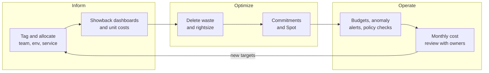
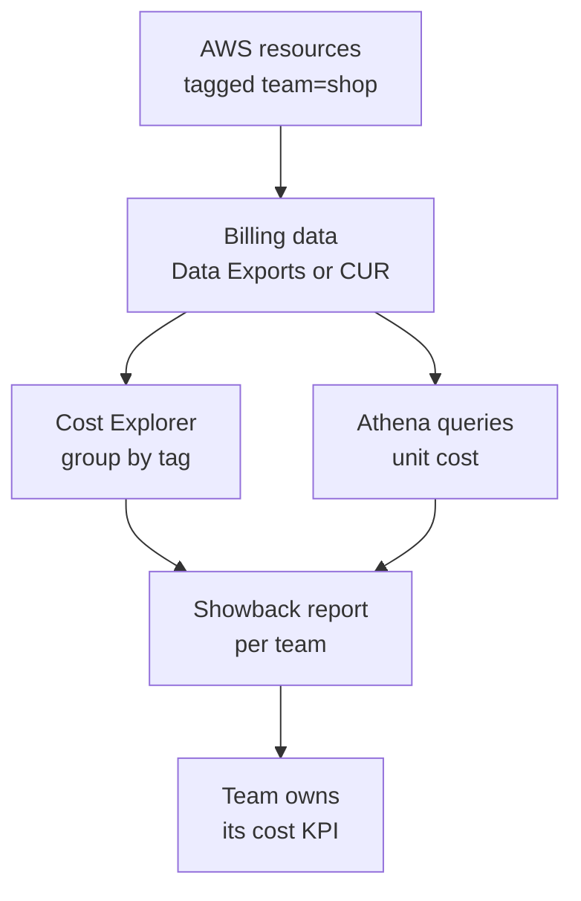

# L20.1 — FinOps

> **Level 20: Cost Optimization** · Topic 1 of 9 · ⏱ ~4 hours · Difficulty: Intermediate

## 1. What it is

**FinOps** (Cloud Financial Operations) is the practice of making cloud cost a shared engineering metric instead of a
surprise on an invoice. Cloud spend is variable: every autoscaling group, every NAT gateway and every forgotten snapshot
changes the bill, and the people who make those decisions (engineers) are not the people who receive the invoice
(finance). FinOps closes that gap with data, shared ownership and a repeating cycle.

The FinOps Foundation (a project of the Linux Foundation) describes a lifecycle with three phases that you loop through
continuously:

| Phase | Question it answers | Typical activities |
|-------|---------------------|--------------------|
| **Inform** | Who is spending what, and why? | tagging, cost allocation, dashboards, showback, anomaly alerts |
| **Optimize** | Where can we spend less for the same outcome? | rightsizing, commitments, Spot, storage lifecycle, deleting waste |
| **Operate** | How do we keep it that way? | budgets, policies as code, reviews, unit-cost targets, engineering KPIs |

You cannot optimize what you cannot attribute, so this level starts with **Inform**: tag everything, allocate it to a team
and a service, and express cost per unit of business value (per request, per customer, per build).

## 2. Why it matters in DevOps

- **Cost is an availability-grade signal.** A runaway job, a crash-looping pod that pulls images through a NAT gateway or a
  public bucket serving terabytes shows up on the bill before it shows up in a dashboard.
- **Untagged spend cannot be owned.** If 40 percent of the bill is "unallocated", nobody can be asked to reduce it.
- **Absolute dollars mislead.** A bill that doubled while traffic tripled is an improvement. **Unit economics** (cost per
  1,000 requests, per active customer, per deployment) tells you whether the system is getting more or less efficient.
- **Engineers control the levers.** Instance size, replica count, log retention, data transfer paths and storage class are
  all code. FinOps works when cost feedback reaches the pull request, not a quarterly review.
- Related levels: [Cost](../level-19-architecture/05-cost-architecture.md) covers cost as an architecture trade-off, and
  [Infrastructure as Code](../level-00-what-devops-is/03-infrastructure-as-code.md) is where tags are enforced.

## 3. Real-world system example

**AWS billing and cost tooling.** AWS publishes the building blocks most teams use: **Cost Explorer** for interactive
analysis, **AWS Budgets** for threshold alerts, **Cost Anomaly Detection** for unusual spikes, **Cost Categories** to group
spend into business units, and the **Cost and Usage Report** (now offered through **Data Exports**) for line-item data you
can query with Athena. Cost allocation works through **cost allocation tags**: a tag only appears in billing data after you
activate it in the Billing console, and it is not retroactive. AWS Organizations adds **tag policies** to standardize tag
keys and values across accounts.

**The FinOps Foundation framework** is the public reference for the Inform, Optimize, Operate lifecycle and for
terms such as showback and chargeback. **OpenCost**, a CNCF project, applies the same allocation ideas inside Kubernetes
(see [Kubernetes Infrastructure Costs](09-kubernetes-infrastructure-costs.md)). Large organizations commonly run a central
FinOps team that publishes dashboards and benchmarks while product teams own the actions, but the specific structure varies
by company.

## 4. Diagram



From a resource to a number a team can act on:



## 5. How it works

### Tagging

A good tag schema is small, mandatory and enforced. A starting set for `shop-api`:

| Tag key | Example value | Purpose |
|---------|---------------|---------|
| `team` | `shop` | who owns it and who gets the showback |
| `env` | `prod`, `staging`, `dev` | separate production from waste candidates |
| `service` | `shop-api` | roll up to a product |
| `cost-center` | `cc-1042` | finance mapping |

Not everything can be tagged (data transfer, some support charges, shared services), so allocation also uses account
structure, **Cost Categories** and, for Kubernetes, namespace or label based allocation. Aim for 80-90 percent allocated;
chasing 100 percent is a poor use of time.

### Showback versus chargeback

| Model | What happens | When to use |
|-------|--------------|-------------|
| **Showback** | Teams see their costs; no money moves | start here; builds awareness without politics |
| **Chargeback** | Costs are billed to team budgets | mature organizations with reliable allocation and a shared-cost policy |

Shared costs (networking, logging, the Kubernetes control plane) need an explicit rule: split evenly, proportionally to
usage, or hold centrally. Decide and document it before arguments start.

### Unit economics

Pick one or two denominators that reflect value: requests served, active customers, orders, builds, GB processed. Then
track `total cost / units` over time. A falling unit cost with a rising bill is healthy growth.

### Useful AWS CLI calls

| Command | Use |
|---------|-----|
| `aws ce get-cost-and-usage` | cost by service, tag or account over a period |
| `aws ce get-tags` / `aws ce list-cost-allocation-tags` | which tags exist and which are active |
| `aws budgets create-budget` | threshold alerts |
| `aws ce get-anomalies` | list detected anomalies |

## 6. Step-by-step guide

**Prerequisites:** Python 3 for the offline steps; `opa` (Open Policy Agent) or `conftest` for the tag policy; an AWS
sandbox account for the optional Cost Explorer steps. Cost Explorer is free to use in the console; each paid API request to
Cost Explorer is billed at a small per-request price, so keep CLI calls few. Prices and outputs are illustrative.

1. **Compute unit economics offline.** Save as `unit_cost.py`. All numbers are **EXAMPLES**; replace them with your own.
   ```python
   # unit_cost.py - unit economics from a monthly bill. All numbers are EXAMPLES.
   monthly_cost = {"compute": 6200.0, "database": 2900.0, "network": 1100.0, "storage": 450.0, "observability": 750.0}
   requests_per_month = 180_000_000      # from your load balancer metrics
   active_customers = 42_000             # from your product analytics

   total = sum(monthly_cost.values())
   print(f"total monthly cost        : ${total:,.2f}")
   print(f"cost per 1M requests      : ${total / (requests_per_month / 1e6):,.2f}")
   print(f"cost per active customer  : ${total / active_customers:,.4f}")
   for name, cost in sorted(monthly_cost.items(), key=lambda kv: -kv[1]):
       print(f"  {name:<14} ${cost:>9,.2f}  {cost / total:>6.1%}")
   ```
   ```bash
   python3 unit_cost.py
   ```
   Expected output:
   ```text
   total monthly cost        : $11,400.00
   cost per 1M requests      : $63.33
   cost per active customer  : $0.2714
     compute        $ 6,200.00   54.4%
     database       $ 2,900.00   25.4%
     network        $ 1,100.00    9.6%
     observability  $   750.00    6.6%
     storage        $   450.00    3.9%
   ```

2. **Define the tag schema as code.** In Terraform, set tags once on the provider so every resource inherits them:
   ```hcl
   provider "aws" {
     region = "us-east-1"
     default_tags {
       tags = {
         team        = "shop"
         env         = "prod"
         service     = "shop-api"
         "cost-center" = "cc-1042"
       }
     }
   }
   ```
   Resources created by this provider receive the tags (visible in `tags_all` in the plan).

3. **Enforce tags in CI with a policy.** This Rego policy reads `terraform show -json` output and fails when a taggable
   resource is created without the required keys. Save as `tags.rego`:
   ```rego
   package main

   import rego.v1

   required_tags := {"team", "env", "service", "cost-center"}
   taggable := {"aws_instance", "aws_s3_bucket", "aws_db_instance", "aws_ebs_volume", "aws_lb"}

   deny contains msg if {
   	some rc in input.resource_changes
   	rc.type in taggable
   	"create" in rc.change.actions
   	tags := object.get(rc.change.after, "tags_all", object.get(rc.change.after, "tags", {}))
   	missing := required_tags - {k | some k, _ in tags}
   	count(missing) > 0
   	msg := sprintf("%s is missing required cost tags: %v", [rc.address, sort(missing)])
   }
   ```
   Create a tiny fake plan to test it (`plan.json`):
   ```json
   {
     "resource_changes": [
       {"address": "aws_instance.api", "type": "aws_instance",
        "change": {"actions": ["create"], "after": {"instance_type": "m6i.large",
          "tags": {"team": "shop", "env": "prod", "service": "shop-api", "cost-center": "cc-1042"}}}},
       {"address": "aws_s3_bucket.assets", "type": "aws_s3_bucket",
        "change": {"actions": ["create"], "after": {"bucket": "shop-assets-example",
          "tags": {"team": "shop"}}}}
     ]
   }
   ```
   ```bash
   opa eval -f pretty -d tags.rego -i plan.json 'data.main.deny'
   # or, with Conftest:  conftest test --policy . plan.json
   ```
   Expected output:
   ```text
   [
     "aws_s3_bucket.assets is missing required cost tags: [\"cost-center\", \"env\", \"service\"]"
   ]
   ```
   In real use, run `terraform plan -out=tfplan && terraform show -json tfplan > plan.json` in the pipeline
   (see [Policy as Code](../level-18-platform-engineering/07-policy-as-code.md)).

4. **Activate cost allocation tags (AWS sandbox).** In the Billing console open *Cost allocation tags*, select `team`,
   `env`, `service` and `cost-center`, and choose *Activate*. Data appears for usage after activation (allow up to about a
   day); earlier usage is not retroactively tagged.

5. **Query cost by tag.** Pick a past month you have data for:
   ```bash
   aws ce get-cost-and-usage \
     --time-period Start=2026-09-01,End=2026-10-01 \
     --granularity MONTHLY \
     --metrics UnblendedCost \
     --group-by Type=TAG,Key=team
   ```
   Output is JSON with one `Groups` entry per `team$<value>`, including an empty value (`team$`) for untagged spend.
   That untagged line is your allocation gap.

6. **Add a budget with an alert.**
   ```bash
   cat > budget.json <<'EOF'
   {
     "BudgetName": "shop-monthly",
     "BudgetLimit": {"Amount": "500", "Unit": "USD"},
     "TimeUnit": "MONTHLY",
     "BudgetType": "COST"
   }
   EOF
   cat > notifications.json <<'EOF'
   [{
     "Notification": {"NotificationType": "ACTUAL", "ComparisonOperator": "GREATER_THAN",
                      "Threshold": 80, "ThresholdType": "PERCENTAGE"},
     "Subscribers": [{"SubscriptionType": "EMAIL", "Address": "finops@example.com"}]
   }]
   EOF
   aws budgets create-budget --account-id <YOUR_ACCOUNT_ID> \
     --budget file://budget.json --notifications-with-subscribers file://notifications.json
   ```
   Expect no output on success; confirm in the Budgets console. Delete the budget later with `aws budgets delete-budget`.

## 7. Real-world scenario

*(Illustrative.)* The finance team asks why the AWS bill rose 38 percent in a quarter. Cost Explorer grouped by service
shows EC2-Other and data transfer climbing, but grouped by `team` the largest slice is blank: 31 percent of spend is untagged.
Following the untagged resources shows a data-processing job started by a contractor, running in a public subnet through a NAT
gateway, copying log archives between Regions every night. The team tags it, moves the job into the right account, adds an S3
gateway endpoint (see [Network Egress Costs](07-network-egress-costs.md)) and sets a budget alert at 80 percent.

The lesson is not the saving, which is modest. It is that the investigation took two days because nothing was owned. After the
tag policy, the next anomaly alert named the owning team in the first message.

## 8. Common mistakes and best practices

**Don't**
- Don't launch a cost-cutting program before you can attribute cost; you will optimize the loudest team, not the biggest cost.
- Don't create a dozen tag keys with free-text values; `env=Prod`, `env=production` and `env=prd` split your report.
- Don't forget to activate tags in billing; an untouched tag produces no data.
- Don't make cost a finance-only metric that engineers see once a quarter.
- Don't chase the cheapest option blindly; an outage costs more than any instance discount.

**Do**
- Do enforce tags in IaC and CI, and use tag policies in AWS Organizations.
- Do start with showback, then consider chargeback when allocation is trusted.
- Do track unit cost, not just totals.
- Do alert on anomalies and review spend monthly with the owners present.
- Do keep a short backlog of savings ideas with an estimated value and an owner.

## 9. Tasks

- [ ] **T1 — Compute unit economics** *(≈20 min, beginner)*
  - **Goal:** turn a bill into a unit cost.
  - **Steps:**
    1. Run `unit_cost.py` with the example numbers.
    2. Replace the dictionary with five categories from a bill you know (a past project is fine).
    3. Add a cost per deployment metric for CI minutes.
  - **Done when:** the script prints cost per 1M requests and a percentage breakdown, and you can explain what a good trend looks like.

- [ ] **T2 — Define a tag schema** *(≈30 min, beginner)*
  - **Goal:** a four-tag schema with allowed values.
  - **Steps:**
    1. Choose keys and allowed values for `env` (`prod`, `staging`, `dev`).
    2. Add `default_tags` to a Terraform AWS provider block.
    3. Run `terraform plan` and find the tags in `tags_all`.
  - **Done when:** the plan output shows your four tags on a new resource.

- [ ] **T3 — Enforce tags with policy** *(≈40 min, intermediate)*
  - **Goal:** a CI check that rejects untagged resources.
  - **Steps:**
    1. Save `tags.rego` and `plan.json`.
    2. Run `opa eval` (or `conftest test`) and read the failure.
    3. Fix the bucket tags in `plan.json` and re-run.
  - **Done when:** the policy returns an empty list for the fixed plan and one message for the broken plan.

- [ ] **T4 — Find the allocation gap** *(≈45 min, intermediate; AWS sandbox)*
  - **Goal:** measure untagged spend.
  - **Steps:**
    1. Activate the `team` tag.
    2. Run the `get-cost-and-usage` command grouped by `team`.
    3. Compute untagged spend as a percentage of total.
  - **Done when:** you have a percentage and a list of three untagged resources to fix. Keep API calls few because Cost Explorer requests are charged.

- [ ] **T5 — Break it: remove a required tag and watch the alert** *(≈30 min, intermediate)*
  - **Goal:** see the guardrail fire in a pull request.
  - **Steps:**
    1. Add a CI step running the policy on `plan.json`.
    2. Remove `service` from one resource and push.
    3. Restore it.
  - **Done when:** a pull request check fails with the missing-tag message and passes after the fix.

- [ ] **T6 — Prove it** *(≈60 min, intermediate)*
  - **Goal:** explain the whole loop out loud.
  - **Steps:**
    1. Without the guide, define Inform, Optimize and Operate and give one concrete action for each in `shop-api`.
    2. Explain showback versus chargeback and propose how to split a shared NAT gateway bill.
    3. Write the unit metric you would put on a team dashboard and why.
  - **Done when:** you can walk a teammate through the loop in five minutes and they can name the tag keys and the unit metric.

## 10. Self-check questions

1. What are the three FinOps phases and which comes first?
2. Why is a tag useless until it is activated for cost allocation?
3. When would you choose showback over chargeback?
4. Why can a rising total bill still mean an improvement?
5. Name two kinds of cost that tags cannot allocate well.

<details>
<summary>Answers</summary>

1. Inform, Optimize, Operate; Inform first because you need attribution before you can optimize.
2. AWS only includes a tag in billing data after you activate it as a cost allocation tag, and it is not applied retroactively.
3. Early on, or when allocation is not yet trusted; showback builds awareness without moving money.
4. If unit cost (per request or customer) is falling while volume grows faster than spend.
5. Data transfer and shared services such as networking, logging or the Kubernetes control plane; these need account structure, Cost Categories or an allocation rule.

</details>

## 11. Further reading

- FinOps Foundation: the FinOps Framework and the "Cloud FinOps" book (O'Reilly).
- AWS documentation: Billing and Cost Management, Cost Explorer, Budgets, Cost Anomaly Detection, Data Exports, tag policies in AWS Organizations.
- AWS Well-Architected Framework: Cost Optimization pillar.
- OpenCost project documentation (opencost.io).

<!-- nav -->
---
← Previous level: [Level 19 — Architecture](../level-19-architecture/README.md) · [Level 20 index](README.md) · Next: [Reserved Instances and Savings Plans](02-reserved-instances-and-savings-plans.md) →
