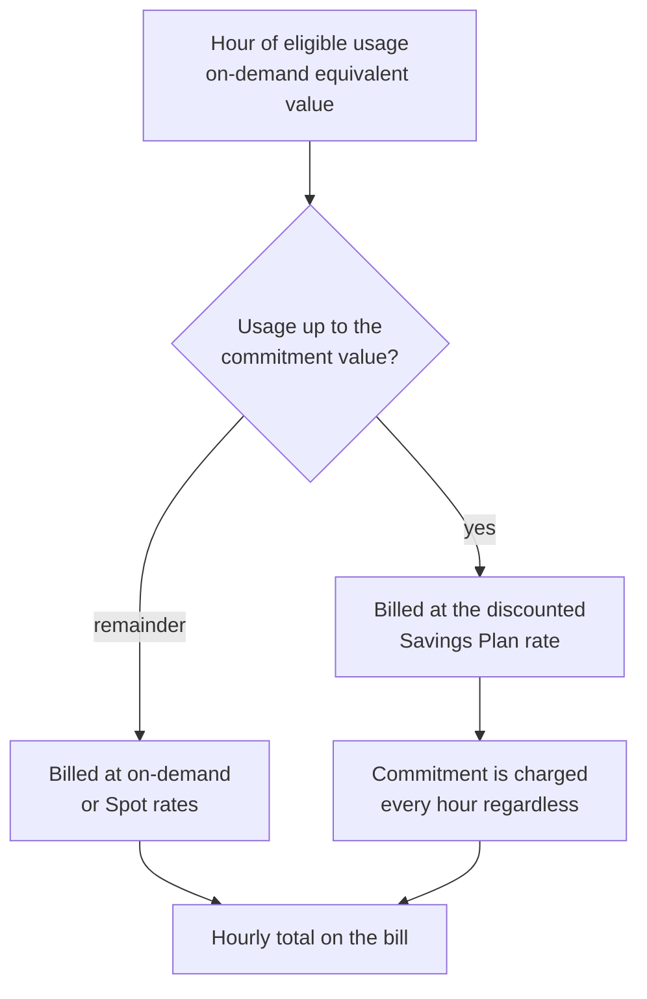
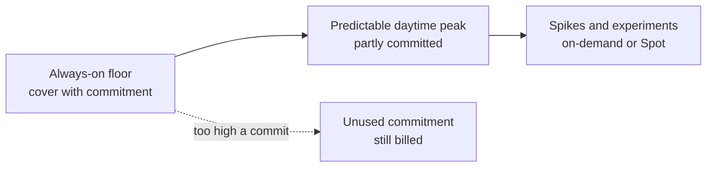

# L20.2 — Reserved Instances and Savings Plans

> **Level 20: Cost Optimization** · Topic 2 of 9 · ⏱ ~4 hours · Difficulty: Intermediate

## 1. What it is

On-demand cloud pricing is flexible and expensive. A **commitment** trades flexibility for a lower price: you promise to pay
for a certain amount of usage for one or three years, and the provider gives a discount against on-demand rates. On AWS there
are two main mechanisms:

- **Reserved Instances (RIs)** commit to a specific instance configuration (for example `m6i.large`, Linux, in one Region
  or Availability Zone). **Standard** RIs give the deepest discount but are the least flexible; **Convertible** RIs can be
  exchanged for other configurations at a smaller discount. RIs also exist for RDS, ElastiCache, OpenSearch and Redshift.
- **Savings Plans (SPs)** commit to a **dollar amount per hour** (for example $12 per hour) for one or three years.
  **Compute Savings Plans** apply automatically across EC2 instance families, sizes, Regions, operating systems and tenancy,
  and also to Fargate and Lambda. **EC2 Instance Savings Plans** are tied to one instance family in one Region for a
  higher discount. SageMaker has its own plan type.

Each can be paid **No Upfront**, **Partial Upfront** or **All Upfront**; more upfront money means a bigger discount.

Two numbers tell you whether commitments are healthy:

| Metric | Definition | Low value means |
|--------|-----------|-----------------|
| **Coverage** | share of eligible usage that is covered by commitments | you pay on-demand prices for steady load |
| **Utilization** | share of your commitment that was actually used | you are paying for commitment you do not use |

## 2. Why it matters in DevOps

- Compute is usually the largest line on the bill, and its steady baseline is the easiest thing to discount.
- A commitment is a **financial lock-in**: over-commit and you pay for idle capacity for up to three years.
- Commitments interact with engineering decisions. Moving to Graviton, containers or Lambda changes what a plan covers;
  a Compute Savings Plan survives these changes where a Standard RI may not.
- A good commitment strategy is boring: cover the stable floor with commitments, use [Spot Instances](03-spot-instances.md)
  for interruptible work, and leave the peaks on demand.
- See also [Cost](../level-19-architecture/05-cost-architecture.md) for the architecture-level view, and
  [Rightsizing](05-rightsizing.md): rightsize first, then commit, or you lock in waste.

## 3. Real-world system example

**AWS Cost Explorer's Savings Plans and RI reports.** AWS documents recommendations that analyze your recent usage (7, 30 or
60 days) and propose an hourly commitment, with estimated savings and a monthly commitment figure. Cost Explorer also
provides **coverage** and **utilization** reports for both RIs and Savings Plans, and **AWS Budgets** can alert when
utilization or coverage drops below a threshold you set. AWS also documents that commitments are applied automatically to
matching usage on the bill, in an order that favors the biggest discount, so you do not tag instances to "use" a plan.

**RDS and other services** have their own reserved offerings, which is why a database-heavy bill is often a separate
commitment exercise (see [Database Costs](08-database-costs.md)).

Treat any specific discount percentage as an example; it varies by service, instance family, Region, term and payment
option, and AWS can change it.

## 4. Diagram

How a Savings Plan is applied to an hour of usage:



Choosing the commitment level against a daily usage curve:



## 5. How it works

### Choosing between the options

| Option | Flexibility | Discount | Good for |
|--------|-------------|----------|----------|
| Compute Savings Plan | any family, size, Region, OS; also Fargate and Lambda | lower than the RI types | changing fleets, containers, migration to Graviton |
| EC2 Instance Savings Plan | one family in one Region | higher | stable, known families |
| Standard RI | one configuration (and optionally one AZ for capacity reservation) | highest | very stable databases and fixed fleets |
| Convertible RI | exchangeable for other configurations | between | if you need RI semantics but expect change |

Commitments are paid hourly even if you use nothing, so the **break-even point** is simple: if the commitment discount is
`d`, the commitment is cheaper than on-demand as long as the covered resource would otherwise run more than `1 - d` of the
hours. With a 34 percent discount, break-even utilization is 66 percent.

### How much to commit

Cover the **steady floor**, not the average. Look at the lowest sustained hourly spend over several weeks, and commit to
roughly that, then add commitments in stages (a "ladder") every quarter as the baseline grows. A coverage target of 60-80
percent of eligible compute with 95+ percent utilization is a common, conservative aim; there is no universal number.

### Useful commands

| Command | Use |
|---------|-----|
| `aws ce get-savings-plans-purchase-recommendation` | get a recommendation for a term, payment option and lookback |
| `aws ce get-savings-plans-coverage` | coverage over a time range |
| `aws ce get-savings-plans-utilization` | utilization over a time range |
| `aws ce get-reservation-coverage` / `get-reservation-utilization` | the same for RIs |

## 6. Step-by-step guide

**Prerequisites:** Python 3. The AWS CLI steps are read-only and need Cost Explorer enabled in a sandbox account; **do not
purchase a commitment while following this topic**, because commitments cannot be cancelled. All prices below are
**EXAMPLES**: check current pricing on the AWS pricing pages and the Savings Plans console before deciding.

1. **Calculate the break-even.** Save as `sp_breakeven.py`:
   ```python
   # sp_breakeven.py - Savings Plan / Reserved Instance break-even. EXAMPLE numbers only.
   # Check current pricing: discounts differ by instance family, Region, term and payment option.
   od_rate = 0.192          # example on-demand $/hour for one instance
   discount = 0.34          # example commitment discount vs on-demand (1-year, no upfront)
   hours_year = 8760

   committed_rate = od_rate * (1 - discount)
   print(f"committed cost per year  : ${committed_rate * hours_year:,.2f} (paid whether used or not)")
   print(f"break-even utilization   : {committed_rate / od_rate:.0%} of hours must be covered")
   print()
   print("instance running X% of the year -> on-demand vs commitment")
   for util in (0.30, 0.50, 0.66, 0.80, 1.00):
       on_demand = od_rate * hours_year * util
       commit = committed_rate * hours_year
       better = "commitment" if commit < on_demand else "on-demand"
       print(f"  {util:>4.0%}  on-demand ${on_demand:>8,.2f}  commitment ${commit:>8,.2f}  -> {better}")
   ```
   ```bash
   python3 sp_breakeven.py
   ```
   Expected output:
   ```text
   committed cost per year  : $1,110.07 (paid whether used or not)
   break-even utilization   : 66% of hours must be covered

   instance running X% of the year -> on-demand vs commitment
      30%  on-demand $  504.58  commitment $1,110.07  -> on-demand
      50%  on-demand $  840.96  commitment $1,110.07  -> on-demand
      66%  on-demand $1,110.07  commitment $1,110.07  -> commitment
      80%  on-demand $1,345.54  commitment $1,110.07  -> commitment
     100%  on-demand $1,681.92  commitment $1,110.07  -> commitment
   ```
   The 66 percent row is an exact tie, shown as "commitment" only because of the comparison. The lesson: a dev instance that
   runs 8 hours a day (33 percent) must not be covered.

2. **Size the commitment against a usage curve.** This simulates one week of hourly usage (a 20 dollars-per-hour floor, a
   daytime peak, quieter weekends) and sweeps the commitment level. Save as `sp_sizing.py`:
   ```python
   # sp_sizing.py - how big should the hourly commitment be? EXAMPLE usage and discount.
   # Usage is expressed as on-demand-equivalent dollars per hour for one week (168 hours).
   import math

   discount = 0.30
   usage = []
   for hour in range(168):
       day, h = divmod(hour, 24)
       base = 20.0                                              # always-on floor
       daytime = 12.0 * max(0.0, math.sin(math.pi * (h - 6) / 14)) if 6 <= h <= 20 else 0.0
       weekend = 0.6 if day >= 5 else 1.0
       usage.append(base + daytime * weekend)

   on_demand_total = sum(usage)
   print(f"all on-demand for the week: ${on_demand_total:,.2f}  (min ${min(usage):.2f}/h, max ${max(usage):.2f}/h)")
   print(f"{'commit $/h':>10} {'week cost':>11} {'saving':>8} {'coverage':>9} {'utilization':>12}")
   for commit in (10, 15, 18, 20, 22, 25, 30):
       covered_od_eq = commit / (1 - discount)                  # on-demand-equivalent value the commit can cover
       cost = 0.0; used = 0.0; covered = 0.0
       for u in usage:
           c = min(u, covered_od_eq)
           covered += c
           used += c * (1 - discount)                           # commitment actually consumed
           cost += commit + (u - c)                             # commit is always paid, remainder at on-demand
       util = used / (commit * len(usage))
       print(f"{commit:>10} {cost:>11,.2f} {1 - cost / on_demand_total:>8.1%} {covered / on_demand_total:>9.1%} {util:>12.1%}")
   ```
   ```bash
   python3 sp_sizing.py
   ```
   Expected output:
   ```text
   all on-demand for the week: $4,020.32  (min $20.00/h, max $32.00/h)
   commit $/h   week cost   saving  coverage  utilization
           10    3,300.32    17.9%     59.7%       100.0%
           15    3,050.32    24.1%     86.8%        96.9%
           18    3,231.89    19.6%     94.8%        88.3%
           20    3,438.93    14.5%     98.0%        82.1%
           22    3,701.56     7.9%     99.9%        76.0%
           25    4,200.00    -4.5%    100.0%        67.0%
           30    5,040.00   -25.4%    100.0%        55.8%
   ```
   Notice the best saving is around a 15 dollars-per-hour commitment, with high utilization, not the largest coverage. Past
   that point each extra commitment dollar is used less than 70 percent of the time and the saving shrinks and then turns
   negative. (The commit is expressed as discounted dollars, so a $15 per hour commitment covers $21.43 of on-demand-equivalent
   usage in this model.)

3. **Look at your real coverage and utilization (read-only).**
   ```bash
   aws ce get-savings-plans-coverage \
     --time-period Start=2026-09-01,End=2026-10-01 --granularity MONTHLY
   aws ce get-savings-plans-utilization \
     --time-period Start=2026-09-01,End=2026-10-01 --granularity MONTHLY
   ```
   In an account with no plans, coverage is 0 percent and utilization calls report no data. That is the expected baseline.

4. **Ask AWS for a recommendation (read-only).**
   ```bash
   aws ce get-savings-plans-purchase-recommendation \
     --savings-plans-type COMPUTE_SP \
     --term-in-years ONE_YEAR \
     --payment-option NO_UPFRONT \
     --lookback-period-in-days THIRTY_DAYS
   ```
   Read the `HourlyCommitmentToPurchase`, `EstimatedSavingsPercentage` and `EstimatedMonthlySavingsAmount` fields in the
   response. An empty result means there was not enough usage to recommend anything. Compare the recommended hourly
   commitment with the floor you found in step 2; recommendations are based on the lookback window, so a one-off
   spike inflates them.

5. **Write the purchase decision down.** Record: scope (Compute SP), term (1 year), payment (No Upfront), the hourly
   commitment, the expected coverage and utilization, who approved it, and the review date. Commitments are financial
   decisions with an owner, not a console click.

6. **Set a utilization alert.** In AWS Budgets, create a *Savings Plans utilization* budget with a 95 percent threshold, so a
   change that strands your commitment (migrating away from EC2, say) is caught within days.

## 7. Real-world scenario

*(Illustrative.)* A team buys a 3-year Standard RI for a fleet of `m5.2xlarge` instances because the discount is the
highest. Eight months later, the platform team moves to containers on Graviton-based nodes. The RIs still bill every hour,
the new nodes run at on-demand prices, and utilization drops to 30 percent. The team spends weeks trying to resell and
exchange what cannot be exchanged.

The fix going forward: rightsize and finish migrations first, buy a **Compute** Savings Plan for only the stable floor, ladder
purchases quarterly, keep a utilization alert at 95 percent, and put the one-year term first until the roadmap is stable.

## 8. Common mistakes and best practices

**Don't**
- Don't commit before rightsizing; you lock in waste at a discount.
- Don't cover the peak. Commit to the minimum steady usage, not the average or the maximum.
- Don't buy a 3-year term for a workload with a 12-month architecture roadmap.
- Don't forget that dev and staging fleets that stop at night have low utilization and should not be covered.
- Don't buy several large commitments on one day; stagger them so you can correct course.

**Do**
- Do start with Compute Savings Plans for flexibility, then add Instance Savings Plans or RIs for very stable load.
- Do monitor both coverage and utilization monthly.
- Do read recommendations with the lookback window in mind.
- Do assign an owner and a review date to each commitment.
- Do treat commitments as part of the FinOps loop in [FinOps](01-finops.md).

## 9. Tasks

- [ ] **T1 — Compute your break-even** *(≈20 min, beginner)*
  - **Goal:** know the utilization at which a commitment pays off.
  - **Steps:**
    1. Run `sp_breakeven.py`.
    2. Change `discount` to 0.20 (a smaller discount) and 0.50.
    3. Record the break-even each time.
  - **Done when:** you can state break-even utilization for three discounts and explain the formula `1 - discount`.

- [ ] **T2 — Sweep the commitment level** *(≈30 min, intermediate)*
  - **Goal:** find the sweet spot on a usage curve.
  - **Steps:**
    1. Run `sp_sizing.py`.
    2. Change the base floor from 20 to 12 and the peak height from 12 to 25.
    3. Re-run and note how the best commitment moves.
  - **Done when:** you can explain, from the numbers, why the best commitment follows the floor and not the peak.

- [ ] **T3 — Read real coverage and utilization** *(≈30 min, intermediate; AWS sandbox)*
  - **Goal:** use the AWS CLI to read your own numbers.
  - **Steps:**
    1. Run the coverage and utilization commands for last month.
    2. Run the purchase recommendation command with a 30-day lookback.
  - **Done when:** you have the three figures (coverage, utilization, recommended hourly commitment) written down, or you can explain why they are empty.

- [ ] **T4 — Break it: strand a commitment** *(≈30 min, intermediate)*
  - **Goal:** feel the cost of over-commitment.
  - **Steps:**
    1. In `sp_sizing.py`, set the commitment to 25 and then reduce the floor to 14 (a migration removes load).
    2. Compute the weekly loss compared with all on-demand.
  - **Done when:** you have a table showing the commitment becoming a loss and a sentence on how a utilization alert would have caught it.

- [ ] **T5 — Write a commitment policy** *(≈45 min, advanced)*
  - **Goal:** a one-page policy a team could follow.
  - **Steps:**
    1. Define target coverage and utilization ranges, term preference, approval owner and review cadence.
    2. Add a rule: rightsizing review must precede any purchase.
    3. Add the budget alert from step 6.
  - **Done when:** the policy is in your repo, reviewed by a teammate, and includes numeric thresholds.

- [ ] **T6 — Prove it** *(≈45 min, advanced)*
  - **Goal:** justify a savings plan proposal.
  - **Steps:**
    1. Using your own usage data (or the simulated week), propose a commitment amount, term and payment option.
    2. Show saving, coverage, utilization and worst-case loss if load drops by 30 percent.
    3. Present it in five minutes with the break-even formula.
  - **Done when:** a listener can reproduce your numbers and name the risk. Do not purchase anything while practicing.

## 10. Self-check questions

1. What is the difference between coverage and utilization?
2. A commitment gives a 40 percent discount. What is the break-even utilization?
3. Why do Compute Savings Plans suit teams that are moving to containers?
4. Why should you rightsize before committing?
5. What risk comes with a 3-year Standard RI compared with a 1-year Compute Savings Plan?

<details>
<summary>Answers</summary>

1. Coverage is the share of eligible usage that commitments cover; utilization is the share of the commitment you actually used.
2. 60 percent (1 minus 0.40): the resource must be used more than 60 percent of the time for the commitment to beat on-demand.
3. They apply across instance families, sizes, Regions, operating systems, and also to Fargate and Lambda, so changes in the fleet do not strand them.
4. Otherwise you commit to capacity you do not need and lock in the waste at a discount.
5. Lock-in: it ties you to a specific configuration for three years, so architecture changes can leave it unused.

</details>

## 11. Further reading

- AWS documentation: Savings Plans User Guide, Reserved Instances (EC2 User Guide), Cost Explorer recommendations and reports.
- AWS Well-Architected Framework: Cost Optimization pillar, "Pricing models".
- FinOps Foundation: Rate Optimization capability.

<!-- nav -->
---
← Previous: [FinOps](01-finops.md) · [Level 20 index](README.md) · Next: [Spot Instances](03-spot-instances.md) →
