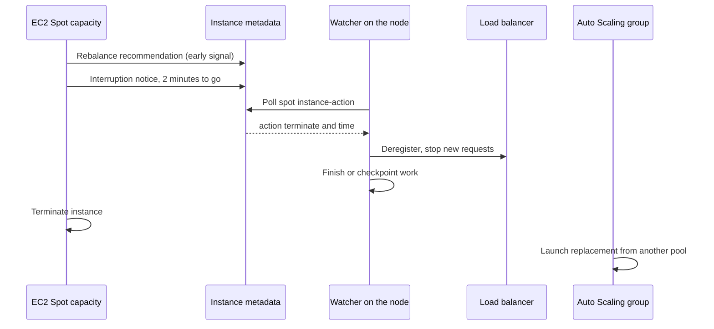
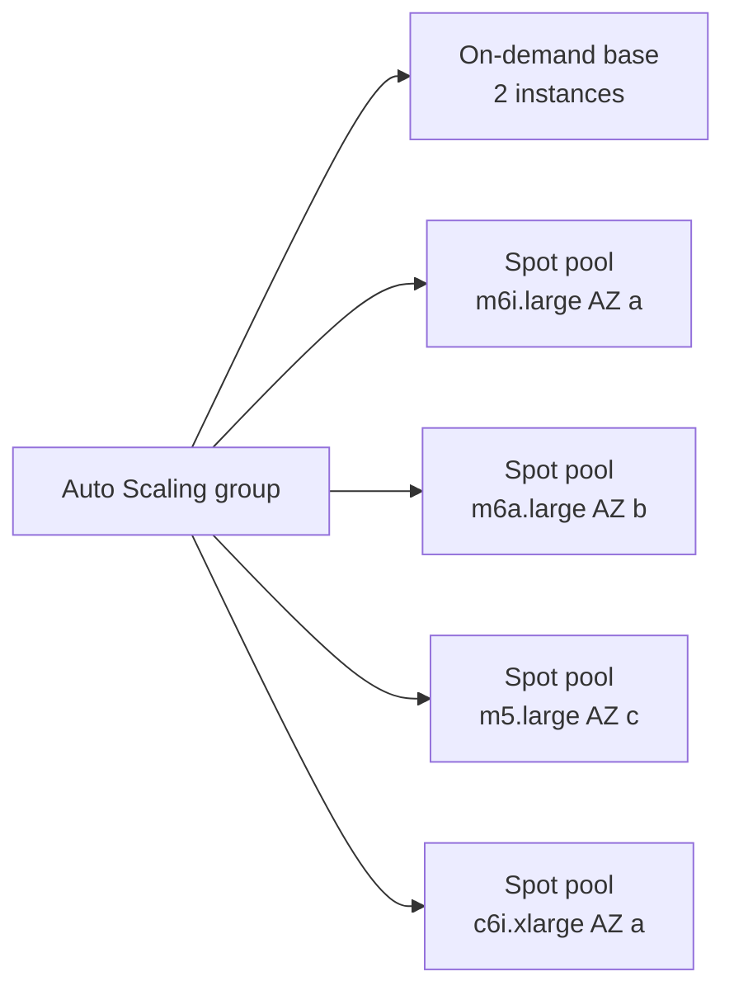

# L20.3 — Spot Instances

> **Level 20: Cost Optimization** · Topic 3 of 9 · ⏱ ~5 hours · Difficulty: Intermediate

## 1. What it is

**Spot Instances** are spare EC2 capacity that AWS sells at a large discount compared with on-demand prices (AWS advertises
discounts of up to roughly 90 percent; the real figure varies by instance type, Region and time). The trade is that AWS can
**reclaim** the capacity when it needs it back. When that happens your instance receives a **two-minute interruption notice**
and is then terminated or stopped.

Other clouds offer the same idea under other names: Azure Spot VMs and Google Cloud Spot VMs (formerly preemptible VMs).
This topic uses the AWS terms.

The discount is not free money. It is a payment for building workloads that tolerate losing a node at any time: stateless,
checkpointed, retryable or horizontally redundant.

## 2. Why it matters in DevOps

- Compute is typically the biggest cost line, and many workloads (CI runners, batch jobs, stateless web tiers, data processing,
  Kubernetes worker nodes) can run on Spot with little risk.
- Spot forces good engineering habits: graceful shutdown, idempotent jobs, health checks and diversification. Those habits
  improve reliability even for on-demand fleets.
- Done badly, Spot causes outages: a single-instance-type pool in one Availability Zone can disappear all at once.
- Spot stacks with other levers. Cover the stable baseline with [Savings Plans](02-reserved-instances-and-savings-plans.md),
  run the elastic part on Spot, and let [autoscaling](04-autoscaling-for-cost.md) match capacity to load.
- Related: [Auto Scaling](../level-06-cloud-aws/02-auto-scaling.md) and [EC2](../level-06-cloud-aws/01-ec2.md).

## 3. Real-world system example

**AWS Auto Scaling groups with mixed instances policies.** AWS documents using an Auto Scaling group with a
**mixed instances policy** that combines multiple instance types and purchase options: a base of on-demand capacity plus
Spot capacity above it, with the allocation strategy `price-capacity-optimized` recommended for most workloads. **Capacity
Rebalancing** lets the group proactively replace a Spot instance when AWS emits a **rebalance recommendation** (an early signal
that the instance is at elevated risk), before the two-minute interruption notice arrives.

**Karpenter** (an open-source Kubernetes node provisioner originated by AWS) chooses among many instance types and can provision
Spot capacity, then consolidates nodes to reduce cost. **AWS Node Termination Handler** and the EKS managed node group
Spot support watch interruption events so Kubernetes can cordon and drain nodes in time. Many CI systems (for example
self-hosted runner fleets) are a classic Spot use case because jobs are short and can be retried.

## 4. Diagram

The life of an interruption:



Diversified capacity:



## 5. How it works

### Interruption signals

| Signal | When | What to do |
|--------|------|-----------|
| **Rebalance recommendation** | may arrive well before the interruption (not guaranteed) | with Capacity Rebalancing, launch a replacement and drain the old node |
| **Interruption notice** | 2 minutes before reclaim | stop taking work, checkpoint, deregister from the load balancer |
| Instance metadata `spot/instance-action` | HTTP 404 normally, JSON when an interruption is scheduled | polled by your agent or by the termination handler |
| EventBridge event `EC2 Spot Instance Interruption Warning` | same two-minute notice, as an event | trigger automation or notifications |

### Diversification

Spot capacity is organized in **pools**: an instance type in an Availability Zone. Pools run out independently, so the key
resilience technique is **diversification**: ask for many instance types (similar vCPU and memory, across generations and
families) across several AZs. Prefer `price-capacity-optimized` (chooses pools with the most spare capacity and the lowest
price) over `lowest-price`, which tends to pick the pools most likely to be reclaimed.

### Which workloads suit Spot

| Good fit | Poor fit |
|----------|----------|
| CI runners, batch and ETL, rendering, big-data workers | single-instance databases and primary stateful stores |
| stateless web and API replicas behind a load balancer (with an on-demand base) | long jobs with no checkpoints |
| Kubernetes workers for stateless pods | workloads with strict single-node latency or licence binding |
| dev and test environments | anything where the interruption cost exceeds the saving |

### Break-even

If a Spot node is interrupted at a rate of `r` per hour and each interruption wastes `L` hours of work, the effective billed
hours grow by `r × L`. Spot is cheaper as long as `spot_price × (1 + r·L) < on_demand_price`.

## 6. Step-by-step guide

**Prerequisites:** Python 3 for the offline steps. The Auto Scaling and Karpenter steps need an AWS sandbox account and
a Kubernetes cluster respectively; Spot instances still cost money, so use small sizes, set a billing alarm and complete the
cleanup. Prices are **EXAMPLES**: check current Spot pricing (`aws ec2 describe-spot-price-history`) because it moves.

1. **Estimate whether Spot is worth it.** Save as `spot_breakeven.py`:
   ```python
   # spot_breakeven.py - is Spot still cheaper after interruptions? EXAMPLE numbers only.
   od_price = 0.384            # example on-demand $/hour
   spot_price = 0.115          # example Spot $/hour (varies by pool and time)
   job_hours = 10.0            # useful compute the job needs
   interrupt_per_hour = 0.05   # example: 5% chance per instance-hour of an interruption
   lost_hours_per_interrupt = 0.5   # work redone since the last checkpoint, plus restart time

   expected_interrupts = job_hours * interrupt_per_hour
   effective_hours = job_hours + expected_interrupts * lost_hours_per_interrupt
   print(f"expected interruptions     : {expected_interrupts:.2f}")
   print(f"effective hours billed     : {effective_hours:.2f} (vs {job_hours:.2f} useful)")
   print(f"on-demand cost             : ${od_price * job_hours:,.2f}")
   print(f"spot cost                  : ${spot_price * effective_hours:,.2f}")
   print(f"saving                     : {1 - spot_price * effective_hours / (od_price * job_hours):.1%}")
   # the Spot price at which you only break even
   be = od_price * job_hours / effective_hours
   print(f"break-even Spot price      : ${be:,.4f}/h ({be / od_price:.0%} of on-demand)")
   print()
   print("how much does lost work per interruption matter? (no checkpoints = more lost work)")
   for lost in (0.5, 2.0, 4.0):
       eff = job_hours + expected_interrupts * lost
       print(f"  lost {lost:>3}h per interrupt -> spot ${spot_price * eff:>6.2f} vs on-demand ${od_price * job_hours:.2f}")
   ```
   ```bash
   python3 spot_breakeven.py
   ```
   Expected output:
   ```text
   expected interruptions     : 0.50
   effective hours billed     : 10.25 (vs 10.00 useful)
   on-demand cost             : $3.84
   spot cost                  : $1.18
   saving                     : 69.3%
   break-even Spot price      : $0.3746/h (98% of on-demand)

   how much does lost work per interruption matter? (no checkpoints = more lost work)
     lost 0.5h per interrupt -> spot $  1.18 vs on-demand $3.84
     lost 2.0h per interrupt -> spot $  1.27 vs on-demand $3.84
     lost 4.0h per interrupt -> spot $  1.38 vs on-demand $3.84
   ```
   Even with a lot of lost work, a deep discount wins. The risk is not the arithmetic but **whole-fleet** interruption and
   work that cannot be redone, which the arithmetic does not show.

2. **Write an interruption watcher.** On EC2 the metadata service is at `169.254.169.254` and IMDSv2 needs a session token.
   Save as `spot_watcher.py`:
   ```python
   # spot_watcher.py - poll the instance metadata service for a Spot interruption notice.
   # On EC2 the base URL is http://169.254.169.254 ; pass another URL to test locally.
   import json, sys, time, urllib.request, urllib.error

   BASE = sys.argv[1] if len(sys.argv) > 1 else "http://169.254.169.254"

   def get(path, token=None, method="GET", headers=None):
       req = urllib.request.Request(BASE + path, method=method, headers=headers or {})
       if token:
           req.add_header("X-aws-ec2-metadata-token", token)
       with urllib.request.urlopen(req, timeout=2) as r:
           return r.read().decode()

   def token():
       try:   # IMDSv2 session token
           return get("/latest/api/token", method="PUT",
                      headers={"X-aws-ec2-metadata-token-ttl-seconds": "60"})
       except urllib.error.URLError:
           return None

   def drain():
       print("interruption notice received: stop taking new work, checkpoint, deregister from the load balancer")

   for _ in range(10):                        # a real watcher loops forever, every 5 seconds
       tok = token()
       try:
           body = get("/latest/meta-data/spot/instance-action", tok)
           action = json.loads(body)
           print(f"action={action['action']} time={action['time']}")
           drain()
           break
       except urllib.error.HTTPError as e:
           if e.code != 404:                  # 404 means no interruption is scheduled
               raise
           print("no interruption scheduled")
       time.sleep(0.2)
   ```

3. **Test it locally with a fake metadata server.** Save as `fake_imds.py`, which returns 404 twice and then an interruption:
   ```python
   # fake_imds.py - tiny local stand-in for the metadata service. Interruption appears after 3 requests.
   import http.server, json
   count = 0
   class H(http.server.BaseHTTPRequestHandler):
       def do_PUT(self):
           self.send_response(200); self.end_headers(); self.wfile.write(b"FAKE-TOKEN")
       def do_GET(self):
           global count
           if self.path.endswith("/spot/instance-action"):
               count += 1
               if count < 3:
                   self.send_response(404); self.end_headers(); return
               self.send_response(200); self.end_headers()
               self.wfile.write(json.dumps({"action": "terminate", "time": "2026-10-09T12:00:00Z"}).encode()); return
           self.send_response(404); self.end_headers()
       def log_message(self, *a): pass
   http.server.HTTPServer(("127.0.0.1", 8169), H).serve_forever()
   ```
   ```bash
   python3 fake_imds.py &
   python3 spot_watcher.py http://127.0.0.1:8169
   kill %1
   ```
   Expected output:
   ```text
   no interruption scheduled
   no interruption scheduled
   action=terminate time=2026-10-09T12:00:00Z
   interruption notice received: stop taking new work, checkpoint, deregister from the load balancer
   ```

4. **Create a diversified Auto Scaling group (AWS sandbox).** Assuming a launch template `shop-api-worker` and three private
   subnets already exist, save as `asg.json` (replace the subnet IDs):
   ```json
   {
     "AutoScalingGroupName": "shop-api-workers",
     "MinSize": 2,
     "MaxSize": 6,
     "DesiredCapacity": 3,
     "VPCZoneIdentifier": "subnet-aaaa1111,subnet-bbbb2222,subnet-cccc3333",
     "CapacityRebalance": true,
     "MixedInstancesPolicy": {
       "LaunchTemplate": {
         "LaunchTemplateSpecification": {"LaunchTemplateName": "shop-api-worker", "Version": "$Latest"},
         "Overrides": [
           {"InstanceType": "m6i.large"},
           {"InstanceType": "m6a.large"},
           {"InstanceType": "m5.large"},
           {"InstanceType": "m5a.large"},
           {"InstanceType": "m7i.large"}
         ]
       },
       "InstancesDistribution": {
         "OnDemandBaseCapacity": 1,
         "OnDemandPercentageAboveBaseCapacity": 0,
         "SpotAllocationStrategy": "price-capacity-optimized"
       }
     }
   }
   ```
   ```bash
   aws autoscaling create-auto-scaling-group --cli-input-json file://asg.json
   aws autoscaling describe-auto-scaling-groups --auto-scaling-group-names shop-api-workers \
     --query 'AutoScalingGroups[0].Instances[*].[InstanceId,InstanceType,LifecycleState]' --output table
   ```
   You should see a table of three instances, one on-demand and two Spot, across several instance types (output varies).
   Check which are Spot with `aws ec2 describe-instances --instance-ids <ID> --query 'Reservations[].Instances[].InstanceLifecycle'`
   (returns `spot` for Spot instances).

5. **Run Spot on Kubernetes with Karpenter.** A `NodePool` that allows both capacity types and many instance types, with
   consolidation (assumes Karpenter and an `EC2NodeClass` named `default` are installed, for example on EKS):
   ```yaml
   apiVersion: karpenter.sh/v1
   kind: NodePool
   metadata:
     name: spot-first
   spec:
     template:
       spec:
         nodeClassRef:
           group: karpenter.k8s.aws
           kind: EC2NodeClass
           name: default
         requirements:
           - key: karpenter.sh/capacity-type
             operator: In
             values: ["spot", "on-demand"]
           - key: karpenter.k8s.aws/instance-category
             operator: In
             values: ["c", "m", "r"]
           - key: karpenter.k8s.aws/instance-generation
             operator: Gt
             values: ["4"]
     limits:
       cpu: "100"
     disruption:
       consolidationPolicy: WhenEmptyOrUnderutilized
       consolidateAfter: 1m
   ```
   When both capacity types are allowed, Karpenter prefers Spot. Pin critical pods to on-demand with
   `nodeSelector: {karpenter.sh/capacity-type: on-demand}`.

6. **Make a workload interruption-friendly.** A Deployment that spreads across zones and a PodDisruptionBudget so a drain
   never takes down too many replicas at once:
   ```yaml
   apiVersion: apps/v1
   kind: Deployment
   metadata:
     name: shop-api
   spec:
     replicas: 4
     selector:
       matchLabels: {app: shop-api}
     template:
       metadata:
         labels: {app: shop-api}
       spec:
         terminationGracePeriodSeconds: 60
         topologySpreadConstraints:
           - maxSkew: 1
             topologyKey: topology.kubernetes.io/zone
             whenUnsatisfiable: ScheduleAnyway
             labelSelector:
               matchLabels: {app: shop-api}
         containers:
           - name: shop-api
             image: nginx:1.27
             resources:
               requests: {cpu: 250m, memory: 256Mi}
   ---
   apiVersion: policy/v1
   kind: PodDisruptionBudget
   metadata:
     name: shop-api
   spec:
     minAvailable: 3
     selector:
       matchLabels: {app: shop-api}
   ```
   ```bash
   kubectl apply -f shop-api.yaml
   kubectl get pdb shop-api
   ```
   Expect `ALLOWED DISRUPTIONS` of `1` once all four pods are ready.

7. **Clean up.**
   ```bash
   aws autoscaling delete-auto-scaling-group --auto-scaling-group-name shop-api-workers --force-delete
   kubectl delete -f shop-api.yaml
   ```
   Confirm no instances remain with `aws ec2 describe-instances --filters Name=tag:aws:autoscaling:groupName,Values=shop-api-workers`.

## 7. Real-world scenario

*(Illustrative.)* A team moves its CI runner fleet to Spot and saves most of its runner bill. Then a Friday-afternoon
capacity crunch in the one instance type they requested (`c5.2xlarge`, one zone) interrupts the entire fleet. Builds fail, the
queue grows, and deploys stall for an hour.

Investigation shows the Auto Scaling group had a single override and one subnet. The fix: eight instance types across three
zones, `price-capacity-optimized`, Capacity Rebalancing, a small on-demand base, and a job retry policy in CI so an interrupted
build restarts automatically. The next capacity event cost two retried jobs and no outage.

## 8. Common mistakes and best practices

**Don't**
- Don't run a Spot fleet with one instance type or one zone.
- Don't put databases, single-replica stateful services or the Kubernetes control plane on Spot.
- Don't ignore the two-minute notice; an unhandled interruption drops in-flight requests.
- Don't use `lowest-price` as the allocation strategy for important workloads.
- Don't forget that a hard Spot price limit can stop you from getting capacity at all; the default maximum is the on-demand price.

**Do**
- Do diversify across many instance types and zones.
- Do keep a small on-demand base for the critical floor.
- Do checkpoint long jobs and make them idempotent.
- Do use PodDisruptionBudgets and topology spread on Kubernetes.
- Do monitor the interruption rate and the time to replace capacity.

## 9. Tasks

- [ ] **T1 — Run the break-even model** *(≈20 min, beginner)*
  - **Goal:** quantify when Spot pays.
  - **Steps:**
    1. Run `spot_breakeven.py`.
    2. Set `interrupt_per_hour` to 0.3 and `lost_hours_per_interrupt` to 4.
    3. Note whether Spot still wins.
  - **Done when:** you can state the condition `spot × (1 + r·L) < on-demand` and show a case where it fails.

- [ ] **T2 — Handle a simulated interruption** *(≈30 min, intermediate)*
  - **Goal:** a watcher that reacts to the notice.
  - **Steps:**
    1. Run `fake_imds.py` and `spot_watcher.py`.
    2. Change `drain()` to write a file `/tmp/drained` and exit with code 0.
  - **Done when:** the file exists after the fake interruption and the watcher printed the action.

- [ ] **T3 — Build a diversified fleet** *(≈45 min, intermediate; AWS sandbox, small cost)*
  - **Goal:** a mixed on-demand and Spot Auto Scaling group.
  - **Steps:**
    1. Create the group from `asg.json`.
    2. List the instance types and lifecycle (`spot` or on-demand).
    3. Delete the group.
  - **Done when:** the table shows at least two instance types and `InstanceLifecycle` is `spot` for non-base instances, and the group is deleted.

- [ ] **T4 — Break it: a one-pool fleet** *(≈30 min, intermediate)*
  - **Goal:** understand concentrated risk.
  - **Steps:**
    1. Draw (or script) a fleet of 10 nodes in 1 pool and one in 8 pools.
    2. Simulate a pool reclaim removing 100 percent of one pool.
  - **Done when:** you can show the one-pool fleet loses 100 percent and the eight-pool fleet loses about 12.5 percent.

- [ ] **T5 — Spot-friendly Kubernetes workload** *(≈45 min, advanced; any cluster)*
  - **Goal:** survive a node drain.
  - **Steps:**
    1. Apply the Deployment and PDB.
    2. Run `kubectl drain <node> --ignore-daemonsets --delete-emptydir-data` on a worker.
    3. Watch the pods reschedule while at least three stay ready.
  - **Done when:** `kubectl get pods -w` shows the service never drops below `minAvailable`.

- [ ] **T6 — Prove it** *(≈45 min, advanced)*
  - **Goal:** choose and defend what runs on Spot.
  - **Steps:**
    1. List five workloads from `shop-api` and decide Spot, on-demand or mixed for each.
    2. For each Spot workload, write the interruption behaviour (retry, drain, checkpoint).
    3. Explain diversification and the two-minute notice.
  - **Done when:** a reviewer agrees with the classification and you can recite the signals without notes.

## 10. Self-check questions

1. How much warning does a Spot interruption give, and where do you read it?
2. Why is `price-capacity-optimized` preferred over `lowest-price`?
3. Name two workloads that suit Spot and two that do not.
4. What is a Spot pool, and why does diversification matter?
5. What does Capacity Rebalancing do?

<details>
<summary>Answers</summary>

1. Two minutes, from the instance metadata `spot/instance-action` path or the EventBridge interruption warning event.
2. It picks pools with deeper spare capacity as well as low price, so interruptions are less likely; `lowest-price` tends to pick the most reclaimed pools.
3. Suit: CI runners, stateless web replicas, batch jobs. Do not suit: primary databases, long jobs without checkpoints.
4. A pool is an instance type in an Availability Zone. Pools fail independently, so spreading across many reduces the share lost at once.
5. It launches a replacement when a rebalance recommendation signals elevated risk, so capacity is replaced before the interruption notice.

</details>

## 11. Further reading

- AWS documentation: EC2 Spot Instances user guide, Auto Scaling groups with multiple instance types and purchase options, Capacity Rebalancing.
- Karpenter documentation (karpenter.sh): NodePools, disruption and Spot.
- AWS Node Termination Handler documentation (GitHub: aws/aws-node-termination-handler).
- AWS Well-Architected Framework: Cost Optimization pillar.

<!-- nav -->
---
← Previous: [Reserved Instances and Savings Plans](02-reserved-instances-and-savings-plans.md) · [Level 20 index](README.md) · Next: [Autoscaling for Cost](04-autoscaling-for-cost.md) →
