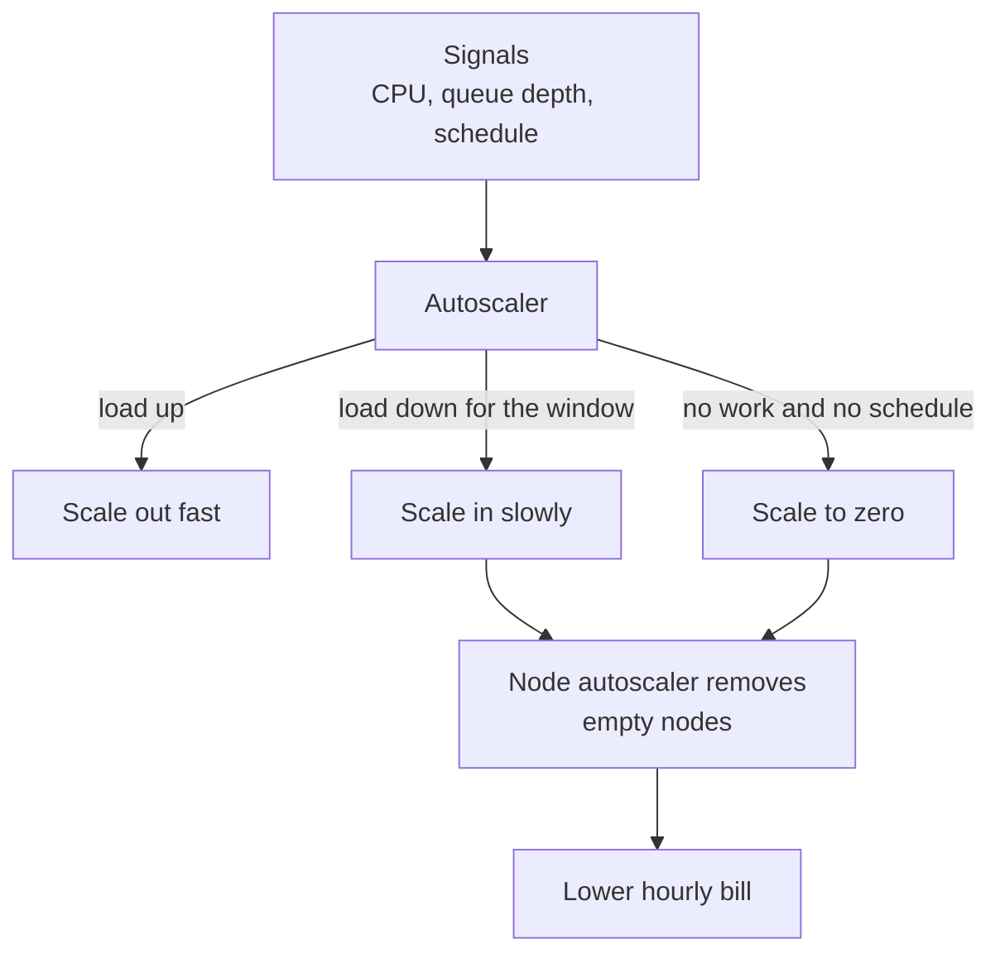

# L20.4 — Autoscaling for Cost

> **Level 20: Cost Optimization** · Topic 4 of 9 · ⏱ ~4 hours · Difficulty: Intermediate

## 1. What it is

Autoscaling is usually taught as a reliability tool: add capacity when load rises. Used for cost, the more important half is the
opposite: **remove capacity when load falls** and, for workloads that are idle for hours, remove it entirely. Four techniques
cover most of the savings:

| Technique | Idea | Example |
|-----------|------|---------|
| **Scale-in** | shrink quickly but safely after a peak | HPA scale-down policy, ASG target tracking scale-in |
| **Scheduled scaling** | change min and max capacity at known times | more replicas at 08:00, fewer at 20:00 |
| **Scale-to-zero** | run no replicas when there is no work | Lambda, KEDA with `minReplicaCount: 0`, Knative |
| **Off-hours shutdown** | stop non-production environments overnight and at weekends | EventBridge Scheduler, Instance Scheduler, a CronJob |

You pay for capacity by the second or hour whether it serves traffic or not. A fleet sized for the daily peak and left
running 24 hours a day wastes the gap between the peak and the average.

## 2. Why it matters in DevOps

- Most services have a daily and weekly rhythm. A production fleet that is flat all day is paying for the 3 a.m. peak at 3 p.m.
- Non-production environments are the cheapest saving: dev and staging used 12 hours a day, five days a week are idle about
  64 percent of the time.
- Aggressive scale-in is also a reliability risk. Scale in too fast and the next spike hits a cold, small fleet, so the settings
  matter as much as the idea.
- Autoscaling interacts with commitments: see [Reserved Instances and Savings Plans](02-reserved-instances-and-savings-plans.md)
  (cover only the floor) and [Spot Instances](03-spot-instances.md) (the elastic part).
- Related: [Auto Scaling](../level-06-cloud-aws/02-auto-scaling.md),
  [Horizontal Pod Autoscaling](../level-08-kubernetes/16-horizontal-pod-autoscaling.md) and
  [HPA, VPA and Cluster Autoscaler](../level-16-advanced-kubernetes/07-hpa-vpa-cluster-autoscaler.md).

## 3. Real-world system example

**AWS Auto Scaling and Application Auto Scaling** document three scaling modes: dynamic (target tracking and step scaling),
**scheduled** actions with a recurrence, and predictive scaling, which forecasts load from history for EC2 Auto Scaling groups. AWS also
publishes the **Instance Scheduler on AWS** solution, which starts and stops EC2 and RDS instances on a schedule, and Amazon
EventBridge Scheduler can call EC2, ECS and Lambda APIs on cron expressions.

**Kubernetes** documents the HorizontalPodAutoscaler with configurable `behavior` for scale-up and scale-down, including a
stabilization window that prevents flapping. **KEDA** (Kubernetes Event-driven Autoscaling, a CNCF project) extends it with event
sources such as queues and cron schedules and can scale a Deployment from zero to N and back. **AWS Lambda** and **Knative** are
the standard examples of scale-to-zero. The **Cluster Autoscaler** and **Karpenter** remove empty or under-used nodes so
that pod scale-in becomes a lower node bill (see [Kubernetes Infrastructure Costs](09-kubernetes-infrastructure-costs.md)).

## 4. Diagram



A weekday for a development environment:

```mermaid
gantt
    title Dev environment on a schedule
    dateFormat HH:mm
    axisFormat %H:%M
    section Capacity
    Stopped overnight      :done, 00:00, 08:00
    Running, 2 replicas    :active, 08:00, 20:00
    Stopped evening        :done, 20:00, 24:00
```



## 5. How it works

### Scale-in without hurting users

| Mechanism | Setting | Effect |
|-----------|---------|--------|
| HPA `behavior.scaleDown.stabilizationWindowSeconds` | for example 300 | uses the highest recommendation in the window, so a brief dip does not shrink the fleet |
| HPA `behavior.scaleDown.policies` | for example 20 percent per minute | limits the rate of removal |
| ASG target tracking | target 55-65 percent CPU | scales in when load stays well below target |
| Connection draining / `terminationGracePeriodSeconds` | 30-120 seconds | in-flight requests finish before a node goes away |
| PodDisruptionBudget | `minAvailable` | blocks too many pods leaving at once |

Scale out fast and scale in slowly: the asymmetry is the whole design.

### Scheduled scaling

When you know the pattern (traffic doubles at 08:00, a nightly batch), set **minimum** capacity ahead of time rather than
waiting for metrics to catch up. In an Auto Scaling group, a scheduled action changes `MinSize`, `MaxSize` or
`DesiredCapacity` at a cron time. Combine it with dynamic scaling so spikes still scale out.

### Scale-to-zero

A workload can reach zero only if something wakes it when work arrives, and the first request tolerates a cold start.
Fine for queue workers, cron-like processors, preview environments and internal tools; wrong for latency-sensitive user paths.
The standard Kubernetes HPA does not scale to zero by default (the feature is gated and not generally available), so use KEDA or Knative.

### Off-hours shutdown

Stopping an EC2 instance stops compute charges but **not** attached EBS volumes, Elastic IPs or NAT gateways. Bigger savings
come from tearing down the whole environment (infrastructure as code `destroy` or scaling node groups to zero) rather than only stopping VMs.
Make the environment reproducible so shutdown is safe.

## 6. Step-by-step guide

**Prerequisites:** Python 3 for the first step; a Kubernetes cluster (kind is fine) with `kubectl` for the Kubernetes steps; an
AWS sandbox only for the optional ASG steps. Prices are **EXAMPLES**: check current pricing.

1. **Calculate the off-hours saving.** Save as `offhours.py`:
   ```python
   # offhours.py - savings from shutting non-production down outside working hours. EXAMPLE price.
   hourly_cost_all_envs = 4.80      # example total $/hour for dev+staging compute when running
   hours_per_week_on = 12 * 5       # 08:00-20:00 Monday-Friday
   hours_per_week = 168
   always_on = hourly_cost_all_envs * hours_per_week * 52 / 12
   scheduled = hourly_cost_all_envs * hours_per_week_on * 52 / 12
   print(f"always on  : ${always_on:,.2f}/month")
   print(f"scheduled  : ${scheduled:,.2f}/month ({hours_per_week_on}/{hours_per_week} hours)")
   print(f"saving     : ${always_on - scheduled:,.2f}/month = {1 - scheduled / always_on:.0%}")
   print("note: EBS volumes, Elastic IPs and NAT gateways keep billing while instances are stopped")
   ```
   ```bash
   python3 offhours.py
   ```
   Expected output:
   ```text
   always on  : $3,494.40/month
   scheduled  : $1,248.00/month (60/168 hours)
   saving     : $2,246.40/month = 64%
   note: EBS volumes, Elastic IPs and NAT gateways keep billing while instances are stopped
   ```

2. **Tune HPA scale-in.** A Deployment and an HPA that scales out fast and in slowly:
   ```yaml
   apiVersion: apps/v1
   kind: Deployment
   metadata:
     name: shop-api
   spec:
     replicas: 2
     selector:
       matchLabels: {app: shop-api}
     template:
       metadata:
         labels: {app: shop-api}
       spec:
         containers:
           - name: shop-api
             image: nginx:1.27
             resources:
               requests: {cpu: 100m, memory: 128Mi}
   ---
   apiVersion: autoscaling/v2
   kind: HorizontalPodAutoscaler
   metadata:
     name: shop-api
   spec:
     scaleTargetRef:
       apiVersion: apps/v1
       kind: Deployment
       name: shop-api
     minReplicas: 2
     maxReplicas: 10
     metrics:
       - type: Resource
         resource:
           name: cpu
           target:
             type: Utilization
             averageUtilization: 60
     behavior:
       scaleUp:
         stabilizationWindowSeconds: 0
         policies:
           - type: Percent
             value: 100
             periodSeconds: 30
       scaleDown:
         stabilizationWindowSeconds: 300
         policies:
           - type: Percent
             value: 20
             periodSeconds: 60
   ```
   ```bash
   kubectl apply -f shop-api-hpa.yaml
   kubectl get hpa shop-api
   ```
   Expect `TARGETS` such as `cpu: 1%/60%` (a metrics server must be installed, as in kind with `metrics-server`) and `REPLICAS 2`.
   Without a metrics server, `TARGETS` shows `<unknown>`.

3. **Scale a worker to zero with KEDA.** Install KEDA (`helm repo add kedacore https://kedacore.github.io/charts`,
   `helm install keda kedacore/keda -n keda --create-namespace`), then:
   ```yaml
   apiVersion: keda.sh/v1alpha1
   kind: ScaledObject
   metadata:
     name: shop-worker
   spec:
     scaleTargetRef:
       name: shop-worker
     minReplicaCount: 0
     maxReplicaCount: 10
     cooldownPeriod: 300
     triggers:
       - type: cron
         metadata:
           timezone: America/New_York
           start: "0 8 * * 1-5"
           end: "0 20 * * 1-5"
           desiredReplicas: "2"
   ```
   ```bash
   kubectl apply -f shop-worker-scaledobject.yaml
   kubectl get scaledobject shop-worker
   ```
   Outside the 08:00-20:00 weekday window the Deployment `shop-worker` is scaled to 0 replicas; inside it holds 2. For queue-driven
   workers, replace the trigger with a queue scaler such as `aws-sqs-queue` so replicas follow backlog and drop to zero when the
   queue is empty (check the KEDA scaler documentation for the exact metadata and authentication fields).

4. **Shut dev down at night with a CronJob (no extra tooling).** A pair of CronJobs scale a dev namespace down at 20:00 and
   up at 08:00 (UTC here; adjust). It needs a ServiceAccount allowed to scale deployments:
   ```yaml
   apiVersion: v1
   kind: ServiceAccount
   metadata:
     name: scaler
     namespace: dev
   ---
   apiVersion: rbac.authorization.k8s.io/v1
   kind: Role
   metadata:
     name: scaler
     namespace: dev
   rules:
     - apiGroups: ["apps"]
       resources: ["deployments", "deployments/scale"]
       verbs: ["get", "list", "patch", "update"]
   ---
   apiVersion: rbac.authorization.k8s.io/v1
   kind: RoleBinding
   metadata:
     name: scaler
     namespace: dev
   subjects:
     - kind: ServiceAccount
       name: scaler
       namespace: dev
   roleRef:
     apiGroup: rbac.authorization.k8s.io
     kind: Role
     name: scaler
   ---
   apiVersion: batch/v1
   kind: CronJob
   metadata:
     name: dev-scale-down
     namespace: dev
   spec:
     schedule: "0 20 * * 1-5"
     jobTemplate:
       spec:
         template:
           spec:
             serviceAccountName: scaler
             restartPolicy: OnFailure
             containers:
               - name: kubectl
                 image: registry.k8s.io/kubectl:v1.31.0   # any image that contains kubectl works
                 command: ["kubectl", "scale", "deployment", "--all", "--replicas=0", "-n", "dev"]
   ```
   Create the matching `dev-scale-up` CronJob with `schedule: "0 8 * * 1-5"` and `--replicas=2`. Test immediately without waiting:
   ```bash
   kubectl -n dev create job --from=cronjob/dev-scale-down test-down
   kubectl -n dev get deploy
   ```
   Expect every Deployment to show `0/0`. Remember that a pure scale-to-zero leaves the nodes running unless a node
   autoscaler removes them.

5. **Scale an EC2 Auto Scaling group on a schedule (AWS sandbox).**
   ```bash
   aws autoscaling put-scheduled-update-group-action \
     --auto-scaling-group-name shop-api-workers \
     --scheduled-action-name weekday-morning \
     --recurrence "0 8 * * 1-5" --time-zone "America/New_York" \
     --min-size 4 --desired-capacity 4
   aws autoscaling put-scheduled-update-group-action \
     --auto-scaling-group-name shop-api-workers \
     --scheduled-action-name weeknight \
     --recurrence "0 20 * * 1-5" --time-zone "America/New_York" \
     --min-size 1 --desired-capacity 1
   aws autoscaling describe-scheduled-actions --auto-scaling-group-name shop-api-workers
   ```
   The output lists both actions with their recurrence. Use scheduled actions to raise or lower the **floor**; target tracking handles the
   rest between min and max.

6. **Clean up.** Delete the test objects and any sandbox resources:
   ```bash
   kubectl delete -f shop-api-hpa.yaml --ignore-not-found
   kubectl -n dev delete job test-down --ignore-not-found
   aws autoscaling delete-scheduled-action --auto-scaling-group-name shop-api-workers --scheduled-action-name weekday-morning
   aws autoscaling delete-scheduled-action --auto-scaling-group-name shop-api-workers --scheduled-action-name weeknight
   ```

## 7. Real-world scenario

*(Illustrative.)* A startup runs identical dev, staging and demo environments, 24 hours a day, and the three together cost about
as much as production. The team adds an off-hours CronJob for the namespaces and a node group minimum of zero, then discovers
the Monday 08:00 start takes 12 minutes because images are pulled to fresh nodes and a database restore job runs before the app
becomes ready. Engineers arriving early are blocked.

They move the start to 07:30, keep a pre-pulled image cache in a small always-on node group, and add a `/start-env` chat command for
weekend work. The monthly saving is over half of the non-production bill, and a documented "wake-up time" becomes part of the
environment contract.

## 8. Common mistakes and best practices

**Don't**
- Don't scale in on a single low CPU sample; use a stabilization window.
- Don't scale to zero on a user-facing path with a strict latency target.
- Don't assume stopped instances are free; volumes, IPs and NAT gateways still bill.
- Don't schedule shutdowns for resources with in-memory state you cannot rebuild.
- Don't forget the node layer: pods at zero with nodes still running saves nothing.

**Do**
- Do scale out fast and in slowly, and use PodDisruptionBudgets for safe drains.
- Do use scheduled scaling for known daily and weekly patterns.
- Do tag environments with their schedule so an off-hours policy can find them.
- Do measure savings from the bill, not from the schedule.
- Do keep a documented way to wake an environment on demand.

## 9. Tasks

- [ ] **T1 — Price the off-hours schedule** *(≈15 min, beginner)*
  - **Goal:** a number for the idea.
  - **Steps:**
    1. Run `offhours.py`.
    2. Change hours on to 10 hours (09:00-19:00) and weekends on for one environment.
  - **Done when:** you can state the monthly saving for both schedules.

- [ ] **T2 — Tune scale-in** *(≈40 min, intermediate)*
  - **Goal:** observe the scale-down window.
  - **Steps:**
    1. Apply the HPA and generate load with `kubectl run load --image=busybox:1.36 --restart=Never -- /bin/sh -c "while true; do wget -q -O- http://shop-api; done"` (create a Service named `shop-api` first).
    2. Delete the load pod and watch `kubectl get hpa shop-api -w`.
  - **Done when:** you see replicas rise quickly, then fall back no sooner than about five minutes after the load stops.

- [ ] **T3 — Scale a worker to zero** *(≈45 min, intermediate)*
  - **Goal:** a Deployment that returns to zero.
  - **Steps:**
    1. Install KEDA and a `shop-worker` Deployment.
    2. Apply the `ScaledObject` with a cron window that covers the next 10 minutes, then wait for it to end.
  - **Done when:** `kubectl get deploy shop-worker` shows 2 replicas inside the window and 0 after it (allowing for `cooldownPeriod`).

- [ ] **T4 — Break it: scale-in too fast** *(≈30 min, intermediate)*
  - **Goal:** feel the flapping risk.
  - **Steps:**
    1. Set `scaleDown.stabilizationWindowSeconds: 0` with a 100 percent policy.
    2. Create bursty load (30 seconds on, 30 seconds off).
  - **Done when:** `kubectl describe hpa shop-api` shows repeated scale events, and restoring the 300-second window stops the flapping.

- [ ] **T5 — Automate environment shutdown** *(≈60 min, advanced)*
  - **Goal:** the CronJob pair works.
  - **Steps:**
    1. Create the ServiceAccount, Role, binding and both CronJobs in a `dev` namespace.
    2. Run `test-down`, then run a matching `test-up`.
  - **Done when:** all Deployments in `dev` go to 0 and return to 2 on demand.

- [ ] **T6 — Prove it** *(≈45 min, advanced)*
  - **Goal:** propose an autoscaling cost plan.
  - **Steps:**
    1. Without the guide, list for `shop-api` which components get HPA scale-in, schedules, scale-to-zero and off-hours shutdown.
    2. State the node-layer change that makes each saving real.
    3. Estimate the saving with `offhours.py` numbers.
  - **Done when:** you can defend each choice and name one risk per technique.

## 10. Self-check questions

1. Why scale out fast and in slowly?
2. What does an HPA stabilization window do?
3. Why can stopping instances still leave a bill?
4. What must exist for scale-to-zero to work?
5. Why does a pod-level saving need a node autoscaler?

<details>
<summary>Answers</summary>

1. Late scale-out hurts users while late scale-in only costs a little; the asymmetry protects reliability.
2. It looks back over a time window and uses the highest recommended replica count, preventing flapping after brief dips.
3. EBS volumes, Elastic IPs, NAT gateways and snapshots keep charging.
4. A trigger that wakes the workload (queue, schedule, request) and a workload that tolerates a cold start.
5. Pods at zero still occupy nodes; only when nodes are removed does the hourly compute bill drop.

</details>

## 11. Further reading

- Kubernetes documentation: Horizontal Pod Autoscaling and its `behavior` section.
- KEDA documentation (keda.sh): scalers and `ScaledObject`.
- AWS documentation: Amazon EC2 Auto Scaling scheduled scaling and predictive scaling, Instance Scheduler on AWS, EventBridge Scheduler.
- Knative Serving documentation: scale to zero.

<!-- nav -->
---
← Previous: [Spot Instances](03-spot-instances.md) · [Level 20 index](README.md) · Next: [Rightsizing](05-rightsizing.md) →
