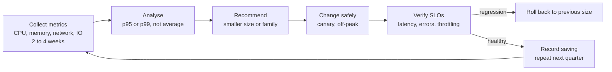
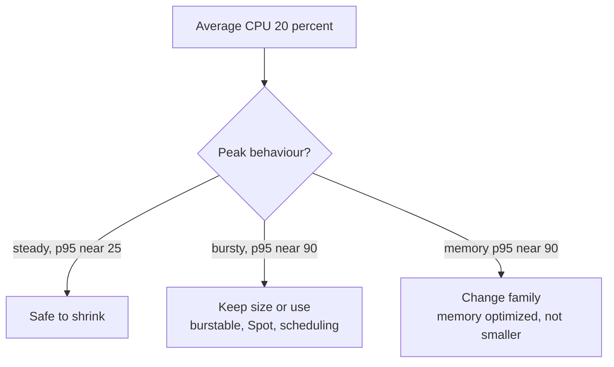

# L20.5 — Rightsizing

> **Level 20: Cost Optimization** · Topic 5 of 9 · ⏱ ~4 hours · Difficulty: Intermediate

## 1. What it is

**Rightsizing** is matching the size of a resource (an EC2 instance, an RDS database, a Kubernetes container request) to
what the workload actually needs. Engineers size for fear: a new service gets `m6i.2xlarge` "to be safe", a container gets
`cpu: 2`, and nothing is ever revisited. The result is capacity that is paid for every hour and used a small fraction of the
time.

The method is the same everywhere:

1. **Measure** real utilization (CPU, memory, network, disk I/O) over a window that includes your peaks.
2. **Choose** a smaller size, or a different family, that keeps a safe margin at the high percentile.
3. **Change** in a controlled way (canary, one node first, off-peak).
4. **Verify** performance and SLOs, then repeat on a schedule.

Rightsizing is the cheapest optimization to reason about and the easiest to get wrong, because shrinking a resource removes
the safety margin that was hiding other problems.

## 2. Why it matters in DevOps

- It is often the largest single saving that needs no architectural change: many fleets run at low average CPU.
- It must precede commitments. Buying a [Savings Plan](02-reserved-instances-and-savings-plans.md) for an oversized fleet locks in
  the waste.
- In Kubernetes it affects the whole cluster: inflated requests reserve capacity that nothing uses, which makes the cluster
  autoscaler add nodes (see [Kubernetes Infrastructure Costs](09-kubernetes-infrastructure-costs.md)).
- Wrong rightsizing causes incidents: out-of-memory kills, CPU throttling and latency spikes. The risk is why this is a
  practice with measurements, not a one-off cleanup.
- Related: [EC2](../level-06-cloud-aws/01-ec2.md), [Resource Requests and Limits](../level-08-kubernetes/14-resource-requests-and-limits.md)
  and [Capacity Planning](../level-14-sre/09-capacity-planning.md).

## 3. Real-world system example

**AWS Compute Optimizer** is the managed rightsizing service. After you opt in, it analyses CloudWatch metrics (by default the
previous 14 days, with an option for longer lookback) and classifies EC2 instances, Auto Scaling groups, EBS volumes, Lambda
functions and ECS services on Fargate as **over-provisioned**, **under-provisioned**, **optimized** or similar, with
alternative instance types and a projected performance risk. A key limitation AWS documents: memory metrics are only available if you install
the CloudWatch agent (or have the data from another supported source), so without it recommendations are CPU- and network-based.

**Kubernetes Vertical Pod Autoscaler (VPA)** watches actual container usage and publishes recommended requests. In
`updateMode: "Off"` it only recommends and does not evict pods, which is the safe way to use it for analysis. **Goldilocks**,
an open-source project from Fairwinds, creates a VPA in recommendation mode for each Deployment in a labelled namespace and
shows the results in a dashboard.

## 4. Diagram



Why averages mislead:



## 5. How it works

### What to look at

| Resource | Metrics to use | Percentile and margin |
|----------|----------------|-----------------------|
| EC2 compute | CPU, memory (needs agent), network in/out | size for p95 CPU around 60 percent, memory p95 around 80 percent |
| EBS volumes | IOPS, throughput, queue length | match gp3 IOPS and throughput to need, not to size |
| RDS / Aurora | CPU, freeable memory, connections, IOPS | see [Database Costs](08-database-costs.md) |
| Kubernetes containers | usage versus requests (CPU, memory) | request near p90-p95 usage plus headroom; memory limits stay safe |
| Lambda | memory used versus configured, duration | a bigger memory setting can be cheaper if duration drops |

Choose a window that contains your real peaks: month-end jobs, weekly batch, a campaign. Two weeks is the minimum; four to
six is better. Use the high percentile because a service that averages 12 percent CPU and hits 90 percent each day at 09:00 is
not oversized.

### Risks and how to control them

| Risk | Control |
|------|---------|
| Memory pressure (OOM kills) after shrinking | install memory metrics first; shrink memory conservatively; watch `OOMKilled` |
| CPU throttling on Kubernetes | keep limits generous or remove CPU limits; watch `container_cpu_cfs_throttled_periods_total` |
| Network bandwidth is tied to size | check the family's baseline and burst network limits |
| Burstable instances (T family) running out of credits | monitor CPU credit balance; prefer unlimited mode or a fixed-performance family if sustained |
| Licences or software that scale by core | involve the owner before changing |
| Change needs a restart | roll one instance at a time behind the load balancer |
| Seasonality hidden by the window | extend the window, compare year-on-year, keep an event headroom plan |

### Moving down, sideways and across

Rightsizing is not only "smaller". Moving from an older generation to a newer one, to ARM-based Graviton, or from a general-purpose to a
memory-optimized family can lower the cost for the same work. Test on a canary because architecture changes need a compatible image
(multi-arch container images, for example).

## 6. Step-by-step guide

**Prerequisites:** Python 3 for the offline analysis; an AWS sandbox with some running instances for Compute Optimizer
(it is free for its basic recommendations; enhanced infrastructure metrics are paid, so avoid enabling them for the exercise); a
Kubernetes cluster with the Vertical Pod Autoscaler CRDs for the Kubernetes steps. Prices are **EXAMPLES**: check
current pricing.

1. **Analyse utilization samples offline.** This script reads per-instance CPU and memory samples, takes the 95th percentile,
   and chooses the smallest size on an example ladder that keeps 60 percent CPU and 80 percent memory at that percentile. Save as
   `rightsize.py`:
   ```python
   # rightsize.py - suggest a smaller instance from utilization samples. EXAMPLE data and prices.
   import statistics

   # 20 hourly samples per instance; real data comes from CloudWatch (CPU) and the CloudWatch agent (memory)
   DATA = {
       "i-api-1":   {"cpu": [8, 10, 12, 9, 11, 14, 17, 13, 10, 8, 9, 12, 16, 15, 11, 9, 8, 10, 13, 19],
                     "mem": [22, 23, 23, 24, 25, 26, 26, 25, 24, 23, 23, 24, 26, 27, 25, 24, 23, 24, 25, 28]},
       "i-batch-1": {"cpu": [3, 4, 3, 5, 88, 91, 4, 3, 5, 4, 3, 85, 90, 4, 3, 4, 5, 3, 4, 3],
                     "mem": [10, 11, 10, 12, 55, 58, 11, 10, 12, 11, 10, 54, 57, 11, 10, 11, 12, 10, 11, 10]},
       "i-db-1":    {"cpu": [40, 45, 48, 52, 50, 47, 44, 46, 49, 51, 53, 48, 45, 44, 47, 50, 52, 49, 46, 45],
                     "mem": [86, 88, 89, 90, 90, 89, 88, 88, 89, 90, 91, 90, 89, 88, 89, 90, 90, 89, 88, 88]},
   }
   # example size ladder: name -> (vCPU, GiB, $/hour)
   LADDER = [("m6i.large", 2, 8, 0.096), ("m6i.xlarge", 4, 16, 0.192), ("m6i.2xlarge", 8, 32, 0.384)]
   CURRENT = "m6i.2xlarge"

   def p95(values):
       values = sorted(values)
       return values[min(len(values) - 1, int(round(0.95 * (len(values) - 1))))]

   cur = next(x for x in LADDER if x[0] == CURRENT)
   for inst, d in DATA.items():
       need_vcpu = cur[1] * p95(d["cpu"]) / 100 / 0.6      # aim for 60% CPU at the p95
       need_gib = cur[2] * p95(d["mem"]) / 100 / 0.8       # aim for 80% memory at the p95
       pick = next((x for x in LADDER if x[1] >= need_vcpu and x[2] >= need_gib), cur)   # keep if nothing fits
       saving = (cur[3] - pick[3]) * 730
       print(f"{inst:<10} cpu p95={p95(d['cpu']):>3}% avg={statistics.mean(d['cpu']):>3.0f}%  "
             f"mem p95={p95(d['mem']):>3}%  {cur[0]} -> {pick[0]:<12} saves ${saving:>4,.0f}/month")
   ```
   ```bash
   python3 rightsize.py
   ```
   Expected output:
   ```text
   i-api-1    cpu p95= 17% avg= 12%  mem p95= 27%  m6i.2xlarge -> m6i.xlarge   saves $ 140/month
   i-batch-1  cpu p95= 90% avg= 21%  mem p95= 57%  m6i.2xlarge -> m6i.2xlarge  saves $   0/month
   i-db-1     cpu p95= 52% avg= 48%  mem p95= 90%  m6i.2xlarge -> m6i.2xlarge  saves $   0/month
   ```
   Read the three results as three different stories. The API is a clear shrink. The batch host looks idle on average
   (21 percent) but spikes to 90 percent, so keep its size and consider scheduling or Spot instead. The database is
   **memory-bound** at 90 percent; the fix, if any, is a memory-optimized family, not a smaller general-purpose one.

2. **Install the CloudWatch agent for memory (EC2).** Without it, memory is invisible. A minimal configuration file
   `amazon-cloudwatch-agent.json`:
   ```json
   {
     "metrics": {
       "append_dimensions": {"InstanceId": "${aws:InstanceId}"},
       "metrics_collected": {
         "mem": {"measurement": ["mem_used_percent"], "metrics_collection_interval": 60},
         "disk": {"measurement": ["used_percent"], "resources": ["/"], "metrics_collection_interval": 60}
       }
     }
   }
   ```
   Install and start the agent following the AWS guide for your OS (Amazon Linux example: `sudo dnf install amazon-cloudwatch-agent`,
   then `sudo /opt/aws/amazon-cloudwatch-agent/bin/amazon-cloudwatch-agent-ctl -a fetch-config -m ec2 -c file:/path/to/amazon-cloudwatch-agent.json -s`).
   After a few minutes the `CWAgent` namespace shows `mem_used_percent`. The instance role needs the
   `CloudWatchAgentServerPolicy` managed policy.

3. **Opt in to Compute Optimizer and read recommendations.**
   ```bash
   aws compute-optimizer update-enrollment-status --status Active
   aws compute-optimizer get-ec2-instance-recommendations \
     --query 'instanceRecommendations[*].[instanceArn,finding,currentInstanceType,recommendationOptions[0].instanceType]' \
     --output table
   ```
   The first call returns the status immediately; recommendations need about 12 hours of metrics to appear and the table is empty
   until then. Findings look like `OVER_PROVISIONED`, `OPTIMIZED` or `UNDER_PROVISIONED`. Treat the options as hypotheses: check the
   `performanceRisk` score and test before changing.

4. **Get Kubernetes recommendations with a VPA in recommendation-only mode.** Assumes the VPA components are installed
   (see the Kubernetes autoscaler project). This VPA never evicts pods:
   ```yaml
   apiVersion: autoscaling.k8s.io/v1
   kind: VerticalPodAutoscaler
   metadata:
     name: shop-api
   spec:
     targetRef:
       apiVersion: apps/v1
       kind: Deployment
       name: shop-api
     updatePolicy:
       updateMode: "Off"
     resourcePolicy:
       containerPolicies:
         - containerName: "*"
           minAllowed: {cpu: 50m, memory: 64Mi}
           maxAllowed: {cpu: "2", memory: 2Gi}
   ```
   ```bash
   kubectl apply -f shop-api-vpa.yaml
   kubectl describe vpa shop-api | sed -n '/Recommendation/,$p'
   ```
   After some minutes of traffic you see `Lower Bound`, `Target`, `Uncapped Target` and `Upper Bound` per container. Compare **Target**
   with the current requests. (Output is similar to `Target: Cpu: 25m  Memory: 262144k` for a lightly loaded pod.)

5. **See requests versus usage with Prometheus.** If you run Prometheus with kube-state-metrics and cAdvisor, these queries
   compare what pods reserve with what they use:
   ```promql
   # CPU requested versus used, by namespace
   sum by (namespace) (kube_pod_container_resource_requests{resource="cpu"})
   sum by (namespace) (rate(container_cpu_usage_seconds_total{container!=""}[5m]))

   # memory requested versus working set
   sum by (namespace) (kube_pod_container_resource_requests{resource="memory"})
   sum by (namespace) (container_memory_working_set_bytes{container!=""})
   ```
   A ratio of used to requested below about 0.3 over weeks is a rightsizing candidate (see
   [Prometheus and PromQL](../level-10-observability/02-prometheus-and-promql.md)).

6. **Apply a change safely and verify.** Change one replica or one instance first, then watch the SLO signals:
   ```bash
   kubectl set resources deployment shop-api --requests=cpu=250m,memory=256Mi
   kubectl rollout status deployment/shop-api
   kubectl top pods -l app=shop-api
   kubectl get pods -l app=shop-api -o jsonpath='{range .items[*]}{.metadata.name}{" "}{.status.containerStatuses[0].lastState.terminated.reason}{"\n"}{end}'
   ```
   The last command prints `OOMKilled` if memory was set too low. To roll back: `kubectl rollout undo deployment/shop-api`. For EC2,
   stop the instance, change the type, start it, and keep the old type in your runbook.

## 7. Real-world scenario

*(Illustrative.)* The platform team finds that every `shop-api` pod requests 2 CPUs and 4 GiB, a value copied from a template. Usage
is around 150m CPU and 600 MiB. They halve requests across the fleet in one change. The cluster autoscaler consolidates nodes
and the monthly bill drops, until a Monday morning when memory-heavy report generation pods are `OOMKilled` and customers see
errors.

The investigation shows the VPA window was a quiet fortnight that excluded the month-end report job. The fix: restore the memory
request for that workload, extend the analysis window to cover a month-end, add an `OOMKilled` alert, and roll out requests changes
by workload class rather than fleet-wide.

## 8. Common mistakes and best practices

**Don't**
- Don't rightsize from averages or from a window that excludes your busiest period.
- Don't shrink without memory data; CPU-only recommendations can cause OOM kills.
- Don't change every service in one release.
- Don't treat tool recommendations as instructions; verify and test.
- Don't buy commitments before rightsizing.

**Do**
- Do collect memory metrics (the CloudWatch agent, cAdvisor).
- Do size at p95 or p99 with explicit headroom.
- Do change gradually and verify SLOs.
- Do automate a quarterly review and record savings.
- Do consider changing family or architecture, not only size.

## 9. Tasks

- [ ] **T1 — Run the rightsizing analysis** *(≈20 min, beginner)*
  - **Goal:** classify instances from numbers.
  - **Steps:**
    1. Run `rightsize.py`.
    2. Change the `i-batch-1` samples to steady 30 percent CPU and re-run.
  - **Done when:** the batch host moves from "keep" to a smaller size and you can explain why p95 drove the first result.

- [ ] **T2 — Add a memory-bound case** *(≈30 min, intermediate)*
  - **Goal:** see why smaller is not always right.
  - **Steps:**
    1. Add a memory-optimized entry to `LADDER` (for example 4 vCPU, 32 GiB at a price you choose).
    2. Re-run the database case and decide if the cheaper option exists.
  - **Done when:** the script suggests a memory-optimized size for the database or you can explain why it does not.

- [ ] **T3 — Use Compute Optimizer** *(≈40 min, intermediate; AWS sandbox)*
  - **Goal:** read a real recommendation.
  - **Steps:**
    1. Opt in and leave a test instance running with the CloudWatch agent.
    2. Query recommendations after a day.
    3. Record the finding, the proposed type and the performance risk.
  - **Done when:** you have one recommendation and a note on whether you would act, and why. Terminate the test instance afterwards.

- [ ] **T4 — Run a VPA in recommendation mode** *(≈45 min, intermediate)*
  - **Goal:** compare requests with VPA targets.
  - **Steps:**
    1. Apply the VPA with `updateMode: "Off"`.
    2. Generate light load and read the recommendation.
  - **Done when:** you can compare the current request with `Target` and compute the ratio.

- [ ] **T5 — Break it: shrink memory too far** *(≈30 min, intermediate)*
  - **Goal:** observe an OOM kill and recover.
  - **Steps:**
    1. Set a pod's memory limit to 20Mi with a memory-hungry command (for example `stress`-like allocation).
    2. Observe `OOMKilled` in `kubectl describe pod`.
    3. Fix the limit and roll back with `kubectl rollout undo`.
  - **Done when:** you show the `OOMKilled` reason and the recovered healthy pod.

- [ ] **T6 — Prove it** *(≈45 min, advanced)*
  - **Goal:** a rightsizing proposal with risk controls.
  - **Steps:**
    1. Without the guide, choose three workloads, list the metrics, window and percentile you would use.
    2. Write the rollout and rollback plan for one of them.
    3. Estimate the monthly saving using example prices.
  - **Done when:** a reviewer can follow your plan and the saving is traceable to numbers.

## 10. Self-check questions

1. Why is the average a poor basis for rightsizing?
2. What does Compute Optimizer need to include memory in recommendations?
3. What does the VPA `updateMode: "Off"` do?
4. Give two ways a rightsizing change can cause an incident.
5. Why rightsize before buying a Savings Plan?

<details>
<summary>Answers</summary>

1. It hides peaks; a service averaging 15 percent CPU may hit 90 percent at known times. Use p95 or p99 over a window that includes peaks.
2. Memory metrics, usually from the CloudWatch agent; without them recommendations rely on CPU, network and disk metrics.
3. It computes and shows recommendations but does not evict pods or apply changes.
4. OOM kills from too little memory, CPU throttling or credit exhaustion, or a missed seasonal peak.
5. Otherwise you commit to capacity you do not need and lock in the waste for one to three years.

</details>

## 11. Further reading

- AWS documentation: AWS Compute Optimizer User Guide, CloudWatch agent, EC2 instance types.
- Kubernetes autoscaler project documentation: Vertical Pod Autoscaler.
- Fairwinds Goldilocks documentation.
- *Site Reliability Engineering* (Google) chapters on capacity planning and load.

<!-- nav -->
---
← Previous: [Autoscaling for Cost](04-autoscaling-for-cost.md) · [Level 20 index](README.md) · Next: [Storage Lifecycle Policies](06-storage-lifecycle-policies.md) →
