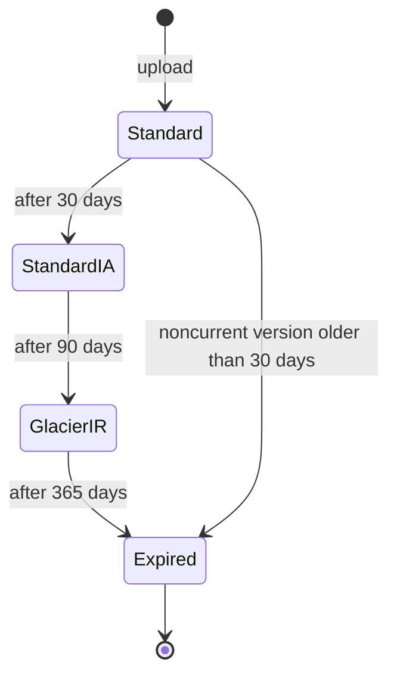
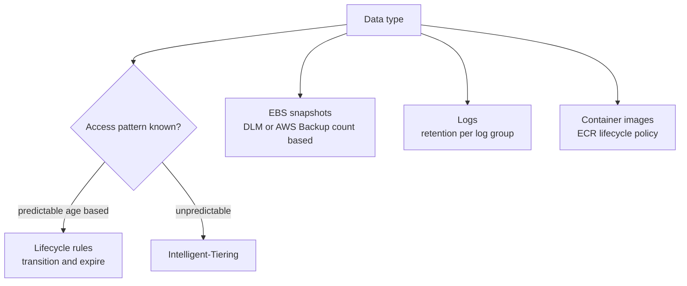

# L20.6 — Storage Lifecycle Policies

> **Level 20: Cost Optimization** · Topic 6 of 9 · ⏱ ~4 hours · Difficulty: Intermediate

## 1. What it is

Storage is cheap per gigabyte and expensive in aggregate, because nothing deletes itself. Logs, build artifacts, database
snapshots, container images, old object versions and half-finished uploads accumulate forever unless a rule removes them.
A **lifecycle policy** is that rule: it moves data to cheaper storage classes as it ages and deletes it when it is no longer
needed.

Three families of lifecycle controls cover most of a bill:

| Area | Mechanism | What it does |
|------|-----------|--------------|
| **Object storage** | S3 lifecycle rules, S3 Intelligent-Tiering | transition objects between storage classes, expire old objects and versions |
| **Block storage** | EBS snapshot lifecycle (Amazon Data Lifecycle Manager), AWS Backup | create and retain a fixed number of snapshots, delete the rest |
| **Logs and registries** | CloudWatch Logs retention, Loki or Elasticsearch retention, ECR lifecycle policies | stop keeping data past its useful life |

## 2. Why it matters in DevOps

- Unbounded growth is silent. A bucket that gains a few hundred gigabytes a month never triggers an alert, but after two years it
  is a large line item.
- CloudWatch Logs groups are created with **no expiration** by default, so log volume you stopped reading years ago is still billed
  every month.
- Compliance sets a floor, not a ceiling: you may *have* to keep audit logs for a year, but not for ten.
- Wrong lifecycle rules lose data or add cost: moving tiny objects to an infrequent-access class can cost more than leaving them, and
  deleting a snapshot you needed is an outage.
- Related: [S3](../level-06-cloud-aws/08-s3.md), [EBS and EFS](../level-06-cloud-aws/09-ebs-and-efs.md),
  [CloudWatch](../level-06-cloud-aws/18-cloudwatch.md), [Backups](../level-15-disaster-recovery/01-backups.md) and
  [Log Aggregation with Loki](../level-10-observability/06-loki-log-aggregation.md).

## 3. Real-world system example

**Amazon S3 storage classes** are a published ladder of price versus retrieval: S3 Standard for frequent access, Standard-IA
and One Zone-IA for infrequent access, Glacier Instant Retrieval, Glacier Flexible Retrieval and Glacier Deep Archive for
archives. AWS documents limits that matter when you design a rule: infrequent-access and archive classes have **minimum storage
durations** (30 days for the IA classes, 90 for Glacier Instant and Flexible Retrieval, 180 for Deep Archive), the IA classes
have a **128 KB minimum billable object size**, and retrieval from colder classes costs per GB. **S3 Intelligent-Tiering** moves
objects between access tiers automatically based on observed access, charges a small monitoring and automation fee per object, and has
no retrieval charge for its automatic tiers.

**Amazon Data Lifecycle Manager** automates EBS snapshot creation and retention by tag. **Grafana Loki** and other log systems
expose a retention setting so old chunks are deleted, and **Amazon ECR** supports lifecycle policies that expire images by count or age. The principle is
the same everywhere: define the useful life of the data, then automate the transition and the deletion.

Treat every price in this topic as an example and check current pricing.

## 4. Diagram

An object's life under a lifecycle policy:



Where to apply which control:



## 5. How it works

### S3 lifecycle rules

A rule has a **filter** (prefix, tags, object size), **transitions** (move after N days to a class) and **expiration**
(delete after N days). Separate settings control **noncurrent versions** in versioned buckets and **incomplete multipart uploads**
(invisible partial uploads that keep costing money). Transitions run asynchronously, roughly daily.

| Rule element | Purpose |
|--------------|---------|
| `Transitions` | move current objects to a cheaper class after N days |
| `Expiration` | delete current objects (or add a delete marker in a versioned bucket) |
| `NoncurrentVersionExpiration` | delete old versions after N days |
| `AbortIncompleteMultipartUpload` | remove abandoned multipart upload parts |
| `Filter` | scope by `Prefix`, `Tag`, `ObjectSizeGreaterThan`, `ObjectSizeLessThan` |

### Tier or Intelligent-Tiering?

| Choice | Use when |
|--------|----------|
| Explicit lifecycle transitions | access is predictable by age (logs are rarely read after a week) |
| Intelligent-Tiering | access is unknown or changes (user uploads), objects are larger than 128 KB and live for more than a month |
| Leave it in Standard | objects are tiny, short-lived or read constantly |

Retrieval costs matter: if you read the dataset frequently, the colder class can cost more than Standard.

### Snapshots, logs and images

- **EBS snapshots** are incremental, but deleting the middle of a chain is safe: AWS keeps the data other snapshots need. Cost still accumulates from
  forgotten snapshots of deleted volumes and old AMIs.
- **Log retention** should be set per log group: days for debug logs, months for application logs, a year or more for audit logs
  (follow your compliance obligation).
- **ECR lifecycle policies** keep the last N images and expire untagged ones.

## 6. Step-by-step guide

**Prerequisites:** Python 3 for the first step; the AWS CLI and a sandbox account for the rest. Storage in the exercise is a
few small test objects, so the cost is negligible; still clean up at the end. Prices are **EXAMPLES**: check current pricing.

1. **Compare storage classes for 10 TB.** Save as `tiers.py`:
   ```python
   # tiers.py - S3 storage-class comparison for 10 TB. EXAMPLE prices only (us-east-1 style), check current pricing.
   tb = 10
   gb = tb * 1024
   prices = {   # $/GB-month, retrieval $/GB, min storage days
       "STANDARD":       (0.023, 0.00, 0),
       "STANDARD_IA":    (0.0125, 0.01, 30),
       "GLACIER_IR":     (0.004, 0.03, 90),
       "DEEP_ARCHIVE":   (0.00099, 0.02, 180),
   }
   print(f"{'class':<14}{'storage/mo':>12}{'retrieve 1x':>13}{'min days':>10}")
   for name, (store, retr, mind) in prices.items():
       print(f"{name:<14}${store * gb:>10,.2f} ${retr * gb:>11,.2f}{mind:>10}")
   # how often can you read the full dataset per month before IA costs more than STANDARD?
   std, ia = prices["STANDARD"], prices["STANDARD_IA"]
   saved = (std[0] - ia[0]) * gb
   per_read = ia[1] * gb
   print(f"\nSTANDARD_IA saves ${saved:,.2f}/month; each full read costs ${per_read:,.2f}")
   print(f"break-even: reading the whole dataset {saved / per_read:.2f}x per month")
   ```
   ```bash
   python3 tiers.py
   ```
   Expected output:
   ```text
   class           storage/mo  retrieve 1x  min days
   STANDARD      $    235.52 $       0.00         0
   STANDARD_IA   $    128.00 $     102.40        30
   GLACIER_IR    $     40.96 $     307.20        90
   DEEP_ARCHIVE  $     10.14 $     204.80       180

   STANDARD_IA saves $107.52/month; each full read costs $102.40
   break-even: reading the whole dataset 1.05x per month
   ```
   The point: with these example prices Standard-IA only wins if you read the entire dataset about once a month or less. Archives win
   only for data you almost never touch.

2. **Write an S3 lifecycle configuration.** Save as `lifecycle.json`:
   ```json
   {
     "Rules": [
       {
         "ID": "logs-tiering-and-expiry",
         "Status": "Enabled",
         "Filter": {"Prefix": "logs/"},
         "Transitions": [
           {"Days": 30, "StorageClass": "STANDARD_IA"},
           {"Days": 90, "StorageClass": "GLACIER_IR"}
         ],
         "Expiration": {"Days": 365}
       },
       {
         "ID": "cleanup-noncurrent-and-multipart",
         "Status": "Enabled",
         "Filter": {},
         "NoncurrentVersionExpiration": {"NoncurrentDays": 30},
         "AbortIncompleteMultipartUpload": {"DaysAfterInitiation": 7}
       },
       {
         "ID": "uploads-intelligent-tiering",
         "Status": "Enabled",
         "Filter": {"Prefix": "uploads/"},
         "Transitions": [{"Days": 0, "StorageClass": "INTELLIGENT_TIERING"}]
       }
     ]
   }
   ```
   Check the JSON parses before applying it:
   ```bash
   python3 -c "import json; print(len(json.load(open('lifecycle.json'))['Rules']), 'rules')"
   ```
   Expected: `3 rules`.

3. **Apply it to a test bucket.** (Bucket names are global; use your own.)
   ```bash
   BUCKET=shop-lifecycle-lab-<YOUR_SUFFIX>
   aws s3api create-bucket --bucket "$BUCKET" --region us-east-1
   aws s3api put-bucket-versioning --bucket "$BUCKET" --versioning-configuration Status=Enabled
   aws s3api put-bucket-lifecycle-configuration --bucket "$BUCKET" \
     --lifecycle-configuration file://lifecycle.json
   aws s3api get-bucket-lifecycle-configuration --bucket "$BUCKET" \
     --query 'Rules[*].[ID,Status]' --output table
   ```
   The table lists the three rule IDs with `Enabled`. Transitions do not happen immediately; they run based on object age.

4. **Find the log groups that never expire.**
   ```bash
   aws logs describe-log-groups \
     --query 'logGroups[?retentionInDays==`null`].[logGroupName,storedBytes]' --output table
   ```
   Every row is a log group billed forever. Set a retention period for one:
   ```bash
   aws logs put-retention-policy --log-group-name /aws/lambda/shop-api --retention-in-days 30
   ```
   Valid values are a fixed list (1, 3, 5, 7, 14, 30, 60, 90, 120, 150, 180, 365 and more); an invalid number returns an error.

5. **Automate EBS snapshots with Data Lifecycle Manager.** Save the policy details as `dlm.json`:
   ```json
   {
     "ResourceTypes": ["VOLUME"],
     "TargetTags": [{"Key": "backup", "Value": "daily"}],
     "Schedules": [{
       "Name": "daily-keep-14",
       "CreateRule": {"Interval": 24, "IntervalUnit": "HOURS", "Times": ["03:00"]},
       "RetainRule": {"Count": 14},
       "CopyTags": true
     }]
   }
   ```
   ```bash
   aws dlm create-lifecycle-policy \
     --description "daily snapshots keep 14" \
     --state ENABLED \
     --execution-role-arn arn:aws:iam::<YOUR_ACCOUNT_ID>:role/AWSDataLifecycleManagerDefaultRole \
     --policy-details file://dlm.json
   ```
   The command returns a `PolicyId`. Volumes tagged `backup=daily` now get a snapshot at 03:00 UTC daily and only the latest 14 are kept. The role must exist
   (create it with `aws dlm create-default-role` if needed).

6. **Find orphaned snapshots.**
   ```bash
   aws ec2 describe-snapshots --owner-ids self \
     --query "Snapshots[?StartTime<='2026-07-01'].[SnapshotId,StartTime,VolumeSize,Description]" --output table
   ```
   Check each against live volumes and AMIs before deleting (`aws ec2 describe-images --owners self`); a snapshot used by an AMI cannot be
   deleted until the AMI is deregistered. Delete with `aws ec2 delete-snapshot --snapshot-id <ID>`.

7. **Expire old container images with an ECR lifecycle policy.** Save as `ecr-policy.json`:
   ```json
   {
     "rules": [
       {
         "rulePriority": 1,
         "description": "Keep the last 20 images",
         "selection": {"tagStatus": "any", "countType": "imageCountMoreThan", "countNumber": 20},
         "action": {"type": "expire"}
       }
     ]
   }
   ```
   ```bash
   aws ecr put-lifecycle-policy --repository-name shop-api --lifecycle-policy-text file://ecr-policy.json
   ```
   The response echoes the policy. ECR evaluates policies about once a day and the preview command `aws ecr start-lifecycle-policy-preview` shows what
   would be expired without deleting.

8. **Clean up the lab bucket.**
   ```bash
   aws s3 rb "s3://$BUCKET" --force
   ```
   If you uploaded test objects to the versioned bucket, `--force` removes only the current objects, so `rb` fails while old versions or
   delete markers remain. Use the console "Empty bucket" action, which removes all versions in one step, then delete the bucket.

## 7. Real-world scenario

*(Illustrative.)* A team notices S3 is 22 percent of the bill. One bucket holds 90 TB of CloudFront and ALB access logs, kept
forever because "we might need them". An engineer proposes moving everything to Glacier Deep Archive immediately. The numbers
look good until they read the minimum duration (180 days) and the retrieval rules: any security investigation would need
a slow restore and a fee.

The team settles on a tiered rule: 30 days Standard, then Glacier Instant Retrieval until 180 days, then expire at one year
(the audit requirement), plus a lifecycle rule for incomplete multipart uploads that cleans 4 TB of orphan parts nobody knew existed. They test the
policy on one prefix first. Monthly storage cost falls by roughly half, and the audit team confirms a one-year window meets the policy.

## 8. Common mistakes and best practices

**Don't**
- Don't move small objects (under 128 KB) to infrequent-access classes; the minimum billable size makes them cost more.
- Don't archive data you query often; retrieval fees and delays erase the saving.
- Don't delete without checking compliance, legal hold and restore needs.
- Don't leave CloudWatch log groups on "never expire".
- Don't forget versioned buckets: delete markers and noncurrent versions keep costing money.

**Do**
- Do start with a filtered prefix, observe, then widen the rule.
- Do add `AbortIncompleteMultipartUpload` to every bucket.
- Do use Intelligent-Tiering for unpredictable access and large objects.
- Do set retention in infrastructure as code, with a default for every log group.
- Do review storage with S3 Storage Lens or Storage Class Analysis before choosing thresholds.

## 9. Tasks

- [ ] **T1 — Compare classes with numbers** *(≈20 min, beginner)*
  - **Goal:** know the break-even read frequency.
  - **Steps:**
    1. Run `tiers.py`.
    2. Change the dataset to 1 TB and Standard-IA retrieval to 0.02 and compare.
  - **Done when:** you can state the break-even reads per month for both inputs.

- [ ] **T2 — Build and apply a lifecycle policy** *(≈40 min, intermediate; AWS sandbox)*
  - **Goal:** a policy live on a bucket.
  - **Steps:**
    1. Create the lab bucket with versioning.
    2. Apply `lifecycle.json` and read it back.
  - **Done when:** `get-bucket-lifecycle-configuration` lists all three rules.

- [ ] **T3 — Set log retention across an account** *(≈40 min, intermediate)*
  - **Goal:** no log group without retention.
  - **Steps:**
    1. List groups with no retention.
    2. Write a short loop that sets 30 days on non-audit groups (excluding names that contain `audit`).
  - **Done when:** the listing query returns only the groups you deliberately excluded.

- [ ] **T4 — Break it: a rule that costs more** *(≈30 min, intermediate)*
  - **Goal:** show a bad transition.
  - **Steps:**
    1. Model 10 million 20 KB objects moved to Standard-IA using the 128 KB minimum billable size.
    2. Compare the billed size to Standard.
  - **Done when:** you show the IA bill is higher than Standard for that dataset and write the `ObjectSizeGreaterThan` filter that prevents it.

- [ ] **T5 — Automate snapshot retention** *(≈45 min, advanced)*
  - **Goal:** hands-off snapshot cleanup.
  - **Steps:**
    1. Tag a test volume `backup=daily` and apply the DLM policy.
    2. Run `aws ec2 describe-snapshots --owner-ids self --filters Name=tag:backup,Values=daily` after the first scheduled run.
  - **Done when:** snapshots appear and the policy shows `RetainRule` of 14; delete the policy and test volume afterwards.

- [ ] **T6 — Prove it** *(≈45 min, advanced)*
  - **Goal:** write a storage retention plan.
  - **Steps:**
    1. For `shop-api`, list logs, uploads, backups, images and artifacts, and set an age-based plan for each.
    2. Justify each threshold with access pattern and compliance.
    3. Show the rules as code.
  - **Done when:** a reviewer can apply your policies and the plan names one risk and one rollback per data type.

## 10. Self-check questions

1. Why can moving tiny objects to Standard-IA increase the bill?
2. What does `AbortIncompleteMultipartUpload` clean up?
3. When is Intelligent-Tiering better than explicit rules?
4. What is the default retention of a CloudWatch Logs group?
5. Why test a lifecycle rule on one prefix first?

<details>
<summary>Answers</summary>

1. The IA classes bill a 128 KB minimum per object, so objects smaller than that are charged as if they were 128 KB.
2. Abandoned upload parts that are not visible as objects but still take storage space.
3. When access patterns are unknown or change, and objects are large and long-lived enough to justify the per-object monitoring fee.
4. Never expire.
5. Lifecycle actions, especially expiration, are not easily reversible; a small scope limits the impact of a mistake.

</details>

## 11. Further reading

- AWS documentation: Amazon S3 User Guide (Managing storage lifecycle, Storage classes, Intelligent-Tiering), Amazon Data Lifecycle Manager, CloudWatch Logs retention, Amazon ECR lifecycle policies.
- S3 Storage Lens and Storage Class Analysis documentation.
- Grafana Loki documentation: retention.

<!-- nav -->
---
← Previous: [Rightsizing](05-rightsizing.md) · [Level 20 index](README.md) · Next: [Network Egress Costs](07-network-egress-costs.md) →
