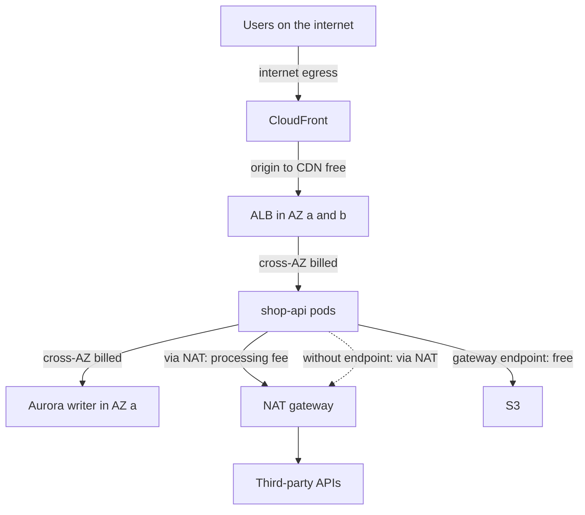
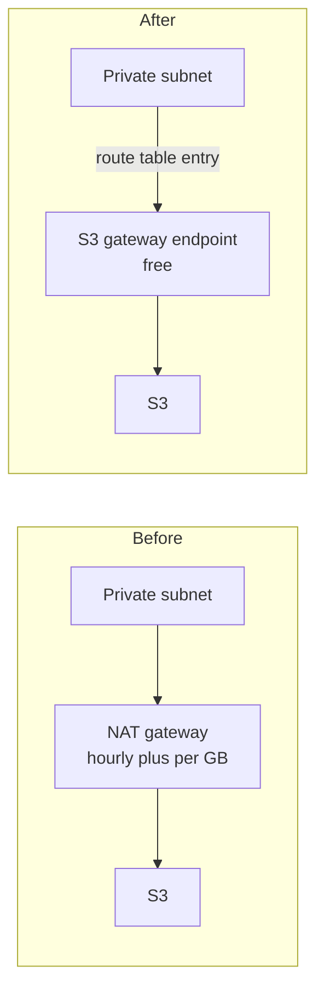

# L20.7 — Network Egress Costs

> **Level 20: Cost Optimization** · Topic 7 of 9 · ⏱ ~4 hours · Difficulty: Intermediate

## 1. What it is

Cloud providers charge for moving data, and the charge depends on **where the bytes go**. Traffic *into* AWS from the internet is
generally free. Traffic *out* to the internet, between Regions and even between **Availability Zones (AZs)** in one Region is
billed per gigabyte. Some services add their own processing fee on top: a **NAT gateway** charges both an hourly price and a
per-GB data-processing price for everything that passes through it.

Because it is metered in the background, network cost is the line item most often discovered after the fact. Nobody chooses
to spend money on a NAT gateway; it happens because a container image pull, an S3 download or a chatty service call routes through
a paid hop.

The main cost paths to know:

| Path | Billed how (pattern, check current pricing) |
|------|----------------------------------------------|
| Internet to AWS | usually free |
| AWS to internet | per GB, tiered, with a small monthly free allowance |
| Region to Region | per GB, cheaper than internet |
| AZ to AZ in one Region | per GB, charged in each direction |
| Through a NAT gateway | hourly price plus per-GB processing, on top of transfer charges |
| VPC gateway endpoint (S3, DynamoDB) | no hourly or data processing charge |
| VPC interface endpoint (PrivateLink) | hourly price per AZ plus per-GB processing |
| Origin to CloudFront | free from AWS origins; CloudFront to viewers is billed per GB |

## 2. Why it matters in DevOps

- A multi-AZ design (the recommended availability pattern) turns every cross-zone call into a charge. Chatty microservices and replicated
  datastores can quietly add four-figure monthly bills.
- NAT gateways are a classic surprise: private subnets pulling images, packages and S3 objects all pay per GB.
- Architecture decisions made for resilience (multi-AZ, multi-Region replication) have a data-transfer price. Your design needs to include it.
- Egress also shapes vendor choices: moving large datasets out of a cloud, or serving video straight from a compute fleet, is expensive.
- Related: [Route Tables, Internet Gateway and NAT Gateway](../level-06-cloud-aws/05-route-tables-igw-nat.md),
  [VPC and Subnets](../level-06-cloud-aws/04-vpc-and-subnets.md), [CloudFront](../level-06-cloud-aws/13-cloudfront.md),
  [CDNs](../level-12-advanced-networking/07-cdns.md) and [Cost](../level-19-architecture/05-cost-architecture.md).

## 3. Real-world system example

**AWS data transfer pricing and VPC endpoints.** AWS publishes the data transfer price structure for EC2: free inbound, tiered outbound to
the internet, a per-GB rate between Regions and a per-GB rate in each direction between AZs. AWS also documents **gateway endpoints** for
S3 and DynamoDB, which are free and route traffic over the AWS network instead of through a NAT gateway, and **interface endpoints**
(AWS PrivateLink) for other services, which cost an hourly fee per AZ plus a data processing charge. The AWS Well-Architected cost pillar
specifically calls out data transfer costs and the use of CDNs and endpoints to reduce them.

**CloudFront** is documented as free for data transfer from AWS origins (S3, ALB, EC2) to CloudFront, with CloudFront-to-viewer prices that
are tiered and include a monthly free allowance, so a high cache hit ratio reduces both origin load and the volume billed at the more expensive
origin egress rates. Many public engineering write-ups describe the same lesson: caching and keeping traffic inside a zone is cheaper than
moving bytes.

## 4. Diagram

Where egress charges appear for a `shop-api` stack:



Gateway endpoint versus NAT for S3 traffic:



## 5. How it works

### NAT gateway

A NAT gateway lets instances in private subnets reach the internet. Costs: an hourly charge per gateway (you usually run one per AZ
for resilience) plus a per-GB charge for **all** data it processes, in either direction. Common hidden consumers:

- Image pulls from public registries and ECR.
- Package manager updates and CI downloads.
- Access to S3, DynamoDB and other AWS APIs (avoidable with endpoints).
- Calls to SaaS APIs and telemetry vendors.

### Endpoints

| Endpoint type | Services | Cost model | Use for |
|---------------|----------|------------|---------|
| **Gateway** | S3 and DynamoDB | free | any private subnet that talks to S3 or DynamoDB |
| **Interface (PrivateLink)** | ECR, CloudWatch, STS, Secrets Manager, SQS, and many others | hourly per AZ plus per-GB | high-volume AWS API traffic; also a security benefit |

An interface endpoint pays off only above a volume threshold, because of its fixed hourly cost per AZ. Compute the break-even before
adding a dozen of them.

### Inter-AZ traffic

Common sources: a load balancer sending requests to targets in other zones (cross-zone load balancing), a service calling another service
in a different AZ, database replication, and reads hitting a replica in another zone. Mitigations: topology-aware routing in Kubernetes
(zone-aware service routing), keeping chatty pairs co-located, reading from a same-zone replica, and checking whether cross-zone
load balancing is needed for each load balancer. Do not give up multi-AZ resilience to save these costs; reduce the unnecessary part.

### Internet and CDN offload

Serving large static content (images, video, downloads) from a CDN lowers egress cost per GB, adds a free allowance, reduces origin
requests and improves latency. A cache hit ratio of 85-95 percent is a typical target for static assets (the achievable ratio depends
on your content). Compression (gzip, Brotli) and image optimization reduce bytes at the source.

## 6. Step-by-step guide

**Prerequisites:** Python 3 and `opa` (or `conftest`) for the offline steps; an AWS sandbox for the rest. Endpoints and NAT gateways cost
money while they exist, so create only what you need and run the cleanup. All prices are **EXAMPLES**; check current pricing.

1. **Model a month of network cost.** Save as `egress.py`:
   ```python
   # egress.py - monthly network cost model for shop-api. All prices are EXAMPLES; check current pricing.
   price = {
       "nat_hour": 0.045,        # $/hour per NAT gateway
       "nat_gb": 0.045,          # $/GB processed by NAT gateway
       "inter_az_gb": 0.01,      # $/GB each direction between AZs in a Region
       "internet_gb": 0.09,      # $/GB to the internet (first tier, ignoring free allowance)
       "cdn_gb": 0.085,          # $/GB from the CDN to viewers (example, varies by geography)
   }
   hours = 730

   # 1. NAT: 3 AZs, each with a NAT gateway; 8 TB/month of S3 and ECR pulls leave private subnets
   nat_gb_month = 8 * 1024
   nat_fixed = 3 * price["nat_hour"] * hours
   nat_var = nat_gb_month * price["nat_gb"]
   print(f"NAT gateways fixed        : ${nat_fixed:>9,.2f}")
   print(f"NAT data processing       : ${nat_var:>9,.2f}  ({nat_gb_month} GB)")
   print(f"with S3 gateway endpoint  : ${nat_fixed + nat_var * 0.25:>9,.2f}  (if 75% of that traffic is S3, endpoint is free)")

   # 2. Chatty cross-AZ service calls: 5 TB/month crossing AZs, charged in both directions
   x_gb = 5 * 1024
   print(f"\ncross-AZ traffic          : ${x_gb * price['inter_az_gb'] * 2:>9,.2f}  ({x_gb} GB, both directions)")

   # 3. Serving 20 TB/month of images from the origin vs through a CDN
   out_gb = 20 * 1024
   direct = out_gb * price["internet_gb"]
   cdn_free_gb = 1024            # example: first 1 TB/month free on the CDN
   cdn = (out_gb - cdn_free_gb) * price["cdn_gb"]
   hit = 0.85                    # cache hit ratio; origin only serves the misses
   print(f"\n20 TB direct to internet  : ${direct:>9,.2f}")
   print(f"20 TB via CDN             : ${cdn:>9,.2f}  (origin->CDN transfer is free when the origin is in the same cloud)")
   print(f"origin traffic and compute drop to {1 - hit:.0%} of the previous load; that saving is not priced here")
   ```
   ```bash
   python3 egress.py
   ```
   Expected output:
   ```text
   NAT gateways fixed        : $    98.55
   NAT data processing       : $   368.64  (8192 GB)
   with S3 gateway endpoint  : $   190.71  (if 75% of that traffic is S3, endpoint is free)

   cross-AZ traffic          : $   102.40  (5120 GB, both directions)

   20 TB direct to internet  : $ 1,843.20
   20 TB via CDN             : $ 1,653.76  (origin->CDN transfer is free when the origin is in the same cloud)
   origin traffic and compute drop to 15% of the previous load; that saving is not priced here
   ```
   The NAT line shows the pattern: the per-GB processing charge dwarfs the hourly one. For the CDN line, the visible price difference is small;
   most of the benefit is the work your origin no longer does.

2. **Enforce a gateway endpoint with policy.** A Conftest/OPA rule that fails a Terraform plan which creates a VPC and NAT gateway without
   an S3 gateway endpoint. Save as `endpoints.rego`:
   ```rego
   package main

   import rego.v1

   created(type) := {rc.address |
   	some rc in input.resource_changes
   	rc.type == type
   	"create" in rc.change.actions
   }

   s3_endpoints := {rc.address |
   	some rc in input.resource_changes
   	rc.type == "aws_vpc_endpoint"
   	endswith(rc.change.after.service_name, ".s3")
   }

   deny contains msg if {
   	some vpc in created("aws_vpc")
   	some nat in created("aws_nat_gateway")
   	count(s3_endpoints) == 0
   	msg := sprintf("%s has NAT gateway %s but no S3 gateway endpoint: S3 traffic will be billed per GB by NAT", [vpc, nat])
   }
   ```
   A minimal fake plan `plan_bad.json`:
   ```json
   {"resource_changes": [
     {"address": "aws_vpc.main", "type": "aws_vpc", "change": {"actions": ["create"], "after": {"cidr_block": "10.0.0.0/16"}}},
     {"address": "aws_nat_gateway.a", "type": "aws_nat_gateway", "change": {"actions": ["create"], "after": {}}}
   ]}
   ```
   ```bash
   opa eval -f pretty -d endpoints.rego -i plan_bad.json 'data.main.deny'
   ```
   Expected output:
   ```text
   [
     "aws_vpc.main has NAT gateway aws_nat_gateway.a but no S3 gateway endpoint: S3 traffic will be billed per GB by NAT"
   ]
   ```
   Add an `aws_vpc_endpoint` resource with `service_name` ending in `.s3` to the plan and the result becomes `[]`. With Conftest the same file works
   as `conftest test --policy . plan_bad.json`.

3. **Find out how much your NAT gateways carry.** In CloudWatch, the NAT gateway metric `BytesOutToDestination` (traffic to the internet) and
   `BytesInFromDestination` (responses) show volume:
   ```bash
   aws cloudwatch get-metric-statistics --namespace AWS/NATGateway \
     --metric-name BytesOutToDestination \
     --dimensions Name=NatGatewayId,Value=<NAT_GATEWAY_ID> \
     --start-time 2026-09-01T00:00:00Z --end-time 2026-10-01T00:00:00Z \
     --period 2592000 --statistics Sum
   ```
   The `Sum` value is bytes for the month; divide by 1,073,741,824 for GB and multiply by the NAT processing price. To see *who* is talking, enable VPC
   Flow Logs on the NAT's network interface and query by source address and destination (Athena or CloudWatch Logs Insights).

4. **Add a free S3 gateway endpoint.** In Terraform:
   ```hcl
   resource "aws_vpc_endpoint" "s3" {
     vpc_id            = aws_vpc.main.id
     service_name      = "com.amazonaws.us-east-1.s3"
     vpc_endpoint_type = "Gateway"
     route_table_ids   = [aws_route_table.private.id]
   }
   ```
   Or with the CLI:
   ```bash
   aws ec2 create-vpc-endpoint --vpc-id <VPC_ID> --service-name com.amazonaws.us-east-1.s3 \
     --vpc-endpoint-type Gateway --route-table-ids <PRIVATE_ROUTE_TABLE_ID>
   ```
   Afterwards the private route table has a route to a prefix list (`pl-...`) targeting the endpoint. Verify from a private instance:
   `aws s3 ls` still works, and NAT `BytesOutToDestination` for S3 traffic falls.

5. **Decide on an interface endpoint with arithmetic.** An interface endpoint has an hourly charge per AZ. With an example $0.01 per hour per
   AZ and $0.01 per GB processed, three AZs cost about 3 × 0.01 × 730 = $21.90 per month in fixed fees. The NAT route costs $0.045 per GB; the
   endpoint route costs $0.01 per GB. The saving per GB is $0.035, so the break-even is 21.90 / 0.035, about 626 GB per month through the endpoint.
   Only add it above that volume (or for security reasons).

6. **Reduce cross-AZ traffic in Kubernetes.** Ask for zone-aware routing on a Service. Kubernetes supports the annotation
   `service.kubernetes.io/topology-mode: Auto` on a Service, which tries to keep traffic within the caller's zone when there are enough endpoints:
   ```yaml
   apiVersion: v1
   kind: Service
   metadata:
     name: shop-api
     annotations:
       service.kubernetes.io/topology-mode: Auto
   spec:
     selector: {app: shop-api}
     ports:
       - port: 80
         targetPort: 8080
   ```
   ```bash
   kubectl apply -f shop-api-svc.yaml
   kubectl get endpointslice -l kubernetes.io/service-name=shop-api -o yaml | grep -A2 hints
   ```
   When hints are enabled you see `forZones` entries in the EndpointSlice (this needs endpoints spread across zones; with too few endpoints the
   hints are not applied). Check that load stays balanced, since zone routing can overload a smaller zone.

7. **Offload to a CDN and compress.** Put CloudFront in front of the static origin, and enable compression:
   ```bash
   curl -sI -H 'Accept-Encoding: br, gzip' https://example.com/static/app.js | grep -i -E 'content-encoding|x-cache|age'
   ```
   You want `content-encoding: br` or `gzip`, and on repeat requests `x-cache: Hit from cloudfront` with a growing `age`. In CloudFront reports,
   watch the *cache hit rate*; below roughly 80 percent for static assets, look for query strings, cookies or `Vary` headers that fragment the cache.
   (Replace `example.com` with your own distribution domain.)

8. **Clean up.** Delete anything you created: the endpoint (`aws ec2 delete-vpc-endpoints --vpc-endpoint-ids <ID>`), NAT gateways
   (`aws ec2 delete-nat-gateway --nat-gateway-id <ID>` and release the Elastic IP), the CloudFront distribution (disable, then delete) and test buckets.

## 7. Real-world scenario

*(Illustrative.)* Finance flags a 60 percent month-on-month rise in "EC2-Other". Cost Explorer shows NAT gateway data processing as the driver.
Flow logs show that most NAT traffic is a nightly job pulling a few terabytes from S3 and a Kubernetes cluster pulling container images from a
public registry on every new node.

The team adds an S3 gateway endpoint (an hour of work, zero ongoing cost), mirrors images to ECR with an interface endpoint for the highest-volume
cluster, and caches images on nodes. NAT processing falls by about two thirds, and they add the endpoint policy check from step 2 so new
VPCs are created with the endpoint by default. Cross-AZ costs remain, so they schedule a separate review of zone-aware routing.

## 8. Common mistakes and best practices

**Don't**
- Don't send S3 and DynamoDB traffic through a NAT gateway when a free gateway endpoint exists.
- Don't create interface endpoints for every service by default; each has fixed hourly fees per AZ.
- Don't disable multi-AZ resilience to save transfer fees; reduce unnecessary cross-zone calls instead.
- Don't serve large static files straight from application servers.
- Don't forget the other side: cross-Region replication and backups cost transfer on every byte.

**Do**
- Do check NAT metrics and flow logs when "EC2-Other" or data transfer grows.
- Do add gateway endpoints to every VPC template (see [Infrastructure Templates](../level-18-platform-engineering/06-infrastructure-templates.md)).
- Do use a CDN with a healthy cache hit ratio and compress responses.
- Do co-locate chatty services and use zone-aware routing where it fits.
- Do put data-transfer estimates in design reviews.

## 9. Tasks

- [ ] **T1 — Model your network bill** *(≈25 min, beginner)*
  - **Goal:** price each path.
  - **Steps:**
    1. Run `egress.py`.
    2. Change the NAT volume to 30 TB and the cross-AZ volume to 50 TB.
  - **Done when:** you can name the largest cost and explain which of the three levers (endpoint, topology, CDN) addresses it.

- [ ] **T2 — Enforce an endpoint with policy** *(≈30 min, intermediate)*
  - **Goal:** the policy fails and then passes.
  - **Steps:**
    1. Run `opa eval` on `plan_bad.json`.
    2. Add a gateway endpoint resource to the plan and re-run.
  - **Done when:** the first run prints one message and the second prints `[]`.

- [ ] **T3 — Find NAT volume** *(≈40 min, intermediate; AWS sandbox)*
  - **Goal:** measure real NAT traffic.
  - **Steps:**
    1. Query `BytesOutToDestination` for a NAT gateway.
    2. Convert to GB and cost at your NAT processing price.
  - **Done when:** you have a monthly GB figure and a dollar estimate (or you explain that the sandbox has no NAT).

- [ ] **T4 — Break it: remove the endpoint** *(≈30 min, intermediate)*
  - **Goal:** watch traffic fall back onto NAT.
  - **Steps:**
    1. From a private instance, download a large S3 object with and without the endpoint route.
    2. Compare NAT metrics for the two runs.
  - **Done when:** NAT bytes rise only when the endpoint is removed. Remove the endpoint and the NAT afterwards to avoid ongoing cost.

- [ ] **T5 — Compute an interface endpoint break-even** *(≈30 min, advanced)*
  - **Goal:** decide with numbers.
  - **Steps:**
    1. Use your own prices for hourly, per-GB and NAT rates.
    2. Compute break-even GB per month for 2 and for 3 AZs.
  - **Done when:** you have a table and a recommendation for a service at 100 GB per month and at 2 TB per month.

- [ ] **T6 — Prove it** *(≈45 min, advanced)*
  - **Goal:** audit a design for egress.
  - **Steps:**
    1. Draw `shop-api` with its traffic paths and mark which hops are billed.
    2. Propose three changes with estimated savings.
    3. Explain why multi-AZ stays.
  - **Done when:** the audit lists billed hops and a reviewer agrees with the three changes.

## 10. Self-check questions

1. Which direction of internet traffic is usually free, and which is billed?
2. What two charges does a NAT gateway add?
3. Why is an S3 gateway endpoint a no-brainer when a NAT gateway exists?
4. What makes an interface endpoint worth it?
5. How can Kubernetes reduce cross-AZ traffic?

<details>
<summary>Answers</summary>

1. Inbound is generally free; outbound to the internet is billed per GB.
2. An hourly charge and a per-GB data processing charge.
3. It is free and removes S3 traffic from the NAT per-GB charge.
4. Enough monthly volume that the per-GB saving exceeds the fixed hourly cost, or a security reason such as keeping traffic off the internet path.
5. Zone-aware routing (topology-aware routing hints), co-locating chatty services, and reading from same-zone replicas.

</details>

## 11. Further reading

- AWS documentation: EC2 On-Demand data transfer pricing, NAT gateway pricing, VPC endpoints and AWS PrivateLink, CloudFront pricing.
- AWS Well-Architected Framework: Cost Optimization pillar.
- Kubernetes documentation: Topology Aware Routing.

<!-- nav -->
---
← Previous: [Storage Lifecycle Policies](06-storage-lifecycle-policies.md) · [Level 20 index](README.md) · Next: [Database Costs](08-database-costs.md) →
