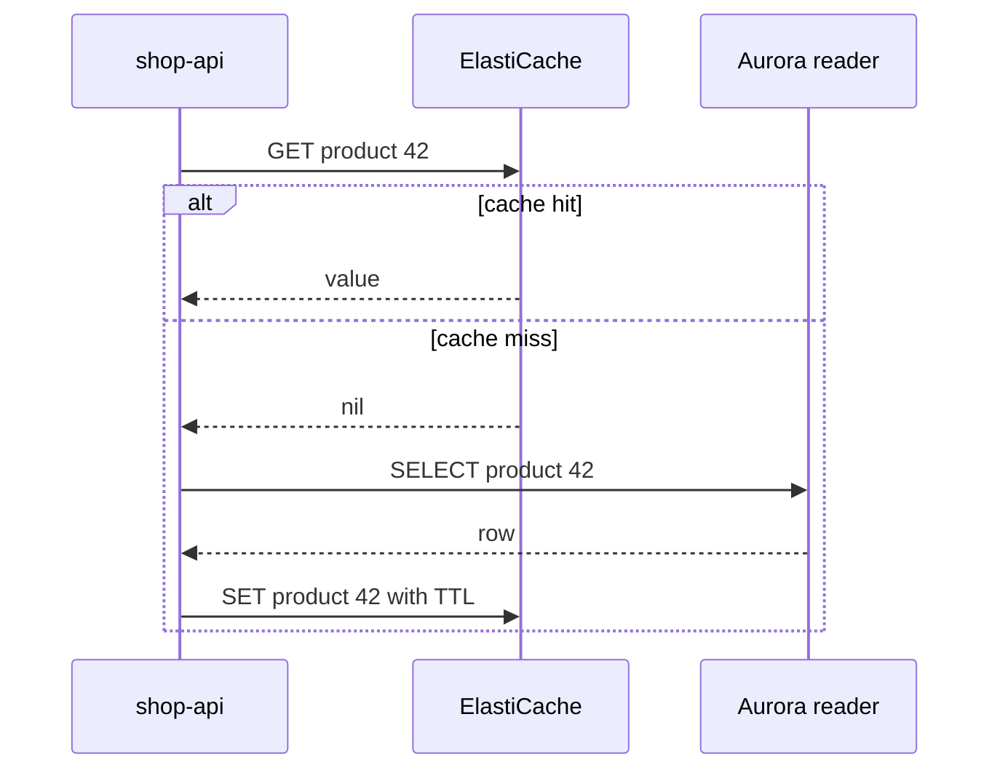
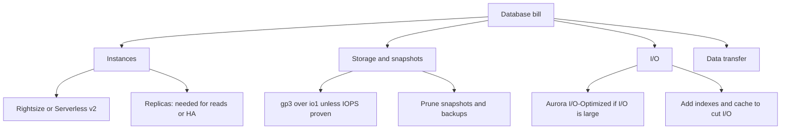

# L20.8 — Database Costs

> **Level 20: Cost Optimization** · Topic 8 of 9 · ⏱ ~5 hours · Difficulty: Advanced

## 1. What it is

Managed databases (Amazon RDS, Aurora, ElastiCache, DynamoDB) are usually the second largest compute-like line on a cloud bill, and they are
the hardest to cut because they hold state and sit on the critical path. Their cost has five parts:

| Part | What drives it |
|------|----------------|
| **Instance** | class and size, count of instances, Multi-AZ standby, read replicas |
| **Storage** | provisioned GB, storage type (gp3, io1/io2), snapshots and backups |
| **I/O and throughput** | provisioned IOPS, Aurora I/O requests (or the I/O-Optimized option) |
| **Data transfer** | cross-AZ replication and reads, cross-Region replicas, egress |
| **Extras** | Performance Insights retention, RDS Proxy, enhanced monitoring, extended support for old engine versions |

The levers are: size the instance to real load, choose the right storage type, count replicas deliberately, let capacity follow load where
that is safe (Aurora Serverless v2), and **reduce the load itself** with caching and better queries so you can run smaller instances.

## 2. Why it matters in DevOps

- A database sized for peak that never comes is the classic idle resource, and the bill repeats every hour.
- The cheapest database query is the one you never run. A cache or an index can remove load that would otherwise need a larger instance
  (see [PostgreSQL Indexes](../level-13-databases-distributed-systems/01-postgresql-indexes.md) and [Redis](../level-13-databases-distributed-systems/07-redis.md)).
- Cutting the wrong thing is dangerous. Removing a Multi-AZ standby or a replica saves money and takes away your availability, so the trade-off
  must be explicit (see [Replication](../level-13-databases-distributed-systems/04-replication.md) and
  [Disaster Recovery](../level-00-what-devops-is/09-disaster-recovery.md)).
- Reserved pricing for databases is a separate commitment decision from compute; see
  [Reserved Instances and Savings Plans](02-reserved-instances-and-savings-plans.md).
- Related: [RDS and Aurora](../level-06-cloud-aws/10-rds-and-aurora.md), [ElastiCache](../level-06-cloud-aws/11-elasticache.md) and
  [Rightsizing](05-rightsizing.md).

## 3. Real-world system example

**Amazon Aurora** is documented with two cluster storage configurations: **Aurora Standard** (you pay for storage plus per-request I/O) and
**Aurora I/O-Optimized** (no per-request I/O charge, with higher instance and storage prices). AWS guidance says I/O-Optimized tends to be the better
choice when I/O charges make up a large share of the Aurora bill (AWS cites roughly 25 percent as the threshold), and you can switch between them
with limits on how often. **Aurora Serverless v2** scales capacity in fine-grained **Aurora Capacity Units (ACUs)** between a configured minimum and maximum,
and AWS documents scaling to zero with automatic pause on supported engine versions. Older "provisioned" Aurora instances, by contrast, are fixed size.

**Amazon ElastiCache** (Redis or Memcached engines, and Valkey) is documented as a cache-aside layer in front of RDS to reduce read load. **RDS Proxy** pools
connections so that many small application instances (Lambda, for example) do not force a bigger database just to handle connection counts. Both patterns
are described in AWS database blogs and the Well-Architected guidance. Costs and thresholds change; check current pricing.

## 4. Diagram

Read path with a cache-aside layer:



Deciding where database money goes:



## 5. How it works

### Instance sizing and replicas

Use the metrics from [Rightsizing](05-rightsizing.md): `CPUUtilization`, `FreeableMemory`, `DatabaseConnections`, read and write IOPS and latency. Databases are
often **memory-bound** (the working set should fit in the buffer cache), so a lower CPU does not mean you can take a smaller class. Each **read replica** is a full
instance with its own cost. Keep replicas that serve real read load or provide failover, and remove idle ones. Multi-AZ doubles the instance cost for a standby;
for production data that is usually correct, for dev and staging it usually is not.

### Storage and IOPS

| Option | Notes |
|--------|-------|
| gp3 | baseline IOPS and throughput are independent of size; usually cheaper than gp2 for the same performance; the default choice |
| io1/io2 (provisioned IOPS) | pay for IOPS you provision; use only when gp3 limits are proven insufficient |
| Storage autoscaling | grows storage on demand; it never shrinks, so set a sensible maximum |
| Snapshots/backups | free up to the size of your provisioned storage within the retention period; manual snapshots and extra retention are billed |

### Aurora Serverless v2

Good fit: spiky, unpredictable or intermittent load (dev environments, internal tools, multi-tenant bursts). Poor fit: a steady high load where provisioned
instances with a commitment are cheaper per unit of capacity. Set `MinCapacity` high enough that buffer cache and connection limits are not starved, and a
`MaxCapacity` that bounds your worst-case bill.

### Reduce the load

Order of attack, cheapest first: fix slow queries and missing indexes; add connection pooling; cache hot reads (cache-aside with a TTL); move analytics to a
replica or warehouse; archive old rows; only then scale the instance down.

## 6. Step-by-step guide

**Prerequisites:** Python 3 for the offline steps; the AWS CLI and a sandbox for the rest. Databases are billed per hour while they exist, so keep the
lab short and **delete everything** in the cleanup step. Set a billing alarm first. Prices are **EXAMPLES**: check current pricing.

1. **Estimate whether a cache pays for itself.** Save as `db_cost.py`:
   ```python
   # db_cost.py - will a cache pay for itself? EXAMPLE prices only.
   db_node_hour = 0.50           # example price of one database replica/instance size
   cache_node_hour = 0.17        # example price of one cache node
   hours = 730
   reads_per_sec = 4000
   one_db_node_can_serve = 1500  # reads/sec per node from load test
   hit_ratio = 0.9

   import math
   nodes_no_cache = math.ceil(reads_per_sec / one_db_node_can_serve)
   db_reads_with_cache = reads_per_sec * (1 - hit_ratio)
   nodes_cache = max(1, math.ceil(db_reads_with_cache / one_db_node_can_serve))
   cache_nodes = 2   # primary + replica
   before = nodes_no_cache * db_node_hour * hours
   after = nodes_cache * db_node_hour * hours + cache_nodes * cache_node_hour * hours
   print(f"no cache : {nodes_no_cache} DB nodes -> ${before:,.2f}/month")
   print(f"cache    : {nodes_cache} DB node(s) + {cache_nodes} cache nodes -> ${after:,.2f}/month at {hit_ratio:.0%} hit ratio")
   print(f"saving   : ${before - after:,.2f}/month")
   print("note: keep at least one DB replica for availability; the saving is smaller if Multi-AZ already needs 2 nodes")
   ```
   ```bash
   python3 db_cost.py
   ```
   Expected output:
   ```text
   no cache : 3 DB nodes -> $1,095.00/month
   cache    : 1 DB node(s) + 2 cache nodes -> $613.20/month at 90% hit ratio
   saving   : $481.80/month
   note: keep at least one DB replica for availability; the saving is smaller if Multi-AZ already needs 2 nodes
   ```
   Change `hit_ratio` to 0.5 and the saving changes sign or disappears. The cache only pays when the hit ratio is high enough to remove whole instances.

2. **See how cache size drives hit ratio.** This deterministic simulation sends 200,000 requests, with popularity skewed so a few keys are hot, through a
   FIFO cache. Save as `cache_sim.py`:
   ```python
   # cache_sim.py - how much database load does a cache-aside cache remove? Pure Python, deterministic.
   import random
   random.seed(42)

   KEYS = 10_000
   REQUESTS = 200_000
   # popularity: a few hot keys get most traffic (Zipf-like weights)
   weights = [1 / (i + 1) ** 1.1 for i in range(KEYS)]

   def run(cache_size):
       cache = {}                       # key -> None; evict the oldest key when full (simple FIFO)
       order = []
       hits = db_reads = 0
       for key in random.choices(range(KEYS), weights=weights, k=REQUESTS):
           if key in cache:
               hits += 1
           else:
               db_reads += 1
               cache[key] = None
               order.append(key)
               if len(order) > cache_size:
                   cache.pop(order.pop(0))
       return hits / REQUESTS, db_reads

   print(f"{'cache entries':>14} {'hit ratio':>10} {'db reads':>10} {'db load vs no cache':>20}")
   for size in (0, 100, 500, 1000, 3000):
       ratio, db = run(size)
       print(f"{size:>14} {ratio:>10.1%} {db:>10} {db / REQUESTS:>20.1%}")
   ```
   ```bash
   python3 cache_sim.py
   ```
   Expected output (identical on any machine with the same Python random implementation, otherwise very similar):
   ```text
    cache entries  hit ratio   db reads  db load vs no cache
                0       0.0%     200000               100.0%
              100      47.5%     105049                52.5%
              500      66.5%      67082                33.5%
             1000      74.3%      51472                25.7%
             3000      85.9%      28170                14.1%
   ```
   Caching just 1 percent of the keys (100 entries) halves the database reads; diminishing returns follow. Your real workload decides the curve, so measure the hit ratio
   (`keyspace_hits` / `keyspace_misses` in Redis `INFO stats`).

3. **List your databases and their size, class and Multi-AZ setting.**
   ```bash
   aws rds describe-db-instances \
     --query 'DBInstances[*].[DBInstanceIdentifier,DBInstanceClass,Engine,MultiAZ,StorageType,AllocatedStorage]' \
     --output table
   ```
   Look for: large classes in non-production, `MultiAZ=True` outside production, `io1` storage without a measured need, and read replicas nobody queries.

4. **Check whether a database is actually busy.**
   ```bash
   aws cloudwatch get-metric-statistics --namespace AWS/RDS --metric-name CPUUtilization \
     --dimensions Name=DBInstanceIdentifier,Value=<DB_INSTANCE_ID> \
     --start-time 2026-09-25T00:00:00Z --end-time 2026-10-09T00:00:00Z \
     --period 3600 --statistics Maximum Average --query 'Datapoints | sort_by(@, &Timestamp)[-5:]'
   ```
   Repeat for `FreeableMemory` and `DatabaseConnections`. Low CPU with low freeable memory means memory-bound: do not shrink without checking the cache hit
   rate (`BufferCacheHitRatio` on Aurora, `pg_stat_database` blks_hit/blks_read on PostgreSQL).

5. **Create an Aurora Serverless v2 cluster for a dev database (billed while running).**
   ```bash
   aws rds create-db-cluster \
     --db-cluster-identifier shop-dev \
     --engine aurora-postgresql \
     --master-username shopadmin --manage-master-user-password \
     --serverless-v2-scaling-configuration MinCapacity=0.5,MaxCapacity=2
   aws rds create-db-instance \
     --db-instance-identifier shop-dev-1 \
     --db-cluster-identifier shop-dev \
     --engine aurora-postgresql \
     --db-instance-class db.serverless
   aws rds wait db-instance-available --db-instance-identifier shop-dev-1
   ```
   The `wait` returns once the instance is available (several minutes). `--manage-master-user-password` stores the password in Secrets Manager (see
   [Secrets Manager](../level-06-cloud-aws/16-secrets-manager.md)). Check the capacity with the `ServerlessDatabaseCapacity` metric. Zero-ACU auto-pause is configured with a
   minimum capacity of 0 and a pause delay on supported engine versions; confirm the current option names in the AWS documentation before using it.

6. **Cap your risk and prune snapshots.**
   ```bash
   aws rds describe-db-snapshots --snapshot-type manual \
     --query 'DBSnapshots[*].[DBSnapshotIdentifier,SnapshotCreateTime,AllocatedStorage]' --output table
   aws rds describe-db-instances --query 'DBInstances[*].[DBInstanceIdentifier,BackupRetentionPeriod]' --output table
   ```
   Manual snapshots never expire; delete the ones past your retention policy with `aws rds delete-db-snapshot`. For automated backups, set
   `BackupRetentionPeriod` to the shortest value your recovery objectives allow (see [RPO](../level-15-disaster-recovery/06-rpo.md)).

7. **Run a local cache-aside exercise (optional, needs Docker).**
   ```bash
   docker run -d --name cache -p 6379:6379 redis:7
   docker exec cache redis-cli SET product:42 '{"name":"Widget"}' EX 60
   docker exec cache redis-cli GET product:42
   docker exec cache redis-cli INFO stats | grep -E 'keyspace_(hits|misses)'
   ```
   `GET` returns the JSON string; the second call to `INFO stats` shows hits and misses growing. Remove it with `docker rm -f cache`.

8. **Clean up.**
   ```bash
   aws rds delete-db-instance --db-instance-identifier shop-dev-1 --skip-final-snapshot
   aws rds delete-db-cluster --db-cluster-identifier shop-dev --skip-final-snapshot
   ```
   Confirm with `aws rds describe-db-clusters --query 'DBClusters[*].DBClusterIdentifier'` that the list is empty or no longer contains the lab cluster.

## 7. Real-world scenario

*(Illustrative.)* The `shop-api` database is a Multi-AZ Aurora cluster with a writer and two readers, sized for a promotional event that happens twice a year. CPU
averages 18 percent. A tempting proposal is to drop to one reader and a smaller class.

Investigation of slow-query logs shows that 70 percent of read traffic is the same product-detail query. The team adds a cache-aside layer with a 60-second TTL, a 91
percent hit rate, and lets Performance Insights confirm the load drop. They then remove one reader, keep Multi-AZ for production, move staging to Aurora Serverless v2 with a
low maximum, and schedule a temporary capacity increase before the next promotion. The saving funds the cache with money to spare, and availability is unchanged.

## 8. Common mistakes and best practices

**Don't**
- Don't downsize a database because CPU is low without checking memory and cache hit ratio.
- Don't run Multi-AZ and large instances in dev and staging by default.
- Don't pay for `io1`/`io2` IOPS you cannot show you use; start with gp3.
- Don't leave manual snapshots, old replicas and unused clusters running.
- Don't add a cache without a plan for invalidation, TTLs and cache-down behaviour.

**Do**
- Do cut load first (indexes, query fixes, caching), then resize.
- Do tag databases with team and environment so idle ones are found.
- Do evaluate Aurora I/O-Optimized when I/O is a large share of the bill.
- Do use Serverless v2 for spiky or non-production workloads and cap `MaxCapacity`.
- Do review reservations for databases separately from compute.

## 9. Tasks

- [ ] **T1 — Price a cache** *(≈20 min, beginner)*
  - **Goal:** know when a cache saves money.
  - **Steps:**
    1. Run `db_cost.py`.
    2. Try hit ratios of 0.5, 0.7 and 0.9.
  - **Done when:** you can state the hit ratio below which the cache does not pay for itself in this model.

- [ ] **T2 — Measure a hit-ratio curve** *(≈30 min, intermediate)*
  - **Goal:** see diminishing returns.
  - **Steps:**
    1. Run `cache_sim.py`.
    2. Change the Zipf exponent from 1.1 to 0.6 (flatter popularity) and re-run.
  - **Done when:** you can explain why a flatter distribution needs a much larger cache for the same hit ratio.

- [ ] **T3 — Audit your databases** *(≈40 min, intermediate; AWS sandbox)*
  - **Goal:** produce a finding list.
  - **Steps:**
    1. Run the `describe-db-instances` query.
    2. Record any Multi-AZ non-production databases, `io1` storage and idle replicas.
  - **Done when:** you have a table of findings with a proposed action and an owner for each.

- [ ] **T4 — Break it: shrink a memory-bound database** *(≈45 min, advanced)*
  - **Goal:** feel the risk safely.
  - **Steps:**
    1. On a local PostgreSQL in Docker, load a dataset larger than `shared_buffers` (for example with `pgbench -i -s 100`).
    2. Run `pgbench` with a small and then a large `shared_buffers` and compare latency.
  - **Done when:** you show that latency worsens with less memory even though CPU stays low, and you explain what that means for downsizing.

- [ ] **T5 — Serverless v2 for a dev database** *(≈60 min, advanced; billed while running)*
  - **Goal:** a dev database that scales with load.
  - **Steps:**
    1. Create the cluster with a low maximum.
    2. Run a load generator briefly and watch `ServerlessDatabaseCapacity` rise.
    3. Delete the cluster.
  - **Done when:** you have a metric graph that shows capacity changing, and the cluster no longer exists.

- [ ] **T6 — Prove it** *(≈45 min, advanced)*
  - **Goal:** a defensible database savings plan.
  - **Steps:**
    1. Without the guide, list five database levers and their risks.
    2. Pick three for `shop-api` and estimate the saving with example numbers.
    3. State what you would not change and why.
  - **Done when:** a reviewer sees an explicit availability trade-off for each change.

## 10. Self-check questions

1. Why does a low CPU not prove a database is oversized?
2. When does Aurora I/O-Optimized make sense?
3. What does a cache-aside cache cost and save?
4. What is the downside of removing a read replica or Multi-AZ standby?
5. Why is gp3 usually the starting point for storage?

<details>
<summary>Answers</summary>

1. Databases are often memory- or I/O-bound; the working set must fit the buffer cache, so memory and cache hit ratio matter as much as CPU.
2. When per-request I/O charges are a large share of the Aurora bill (AWS suggests around a quarter) so removing them outweighs the higher instance and storage price.
3. It adds cache nodes and code complexity, and saves database instance capacity when the hit ratio is high enough to remove whole instances.
4. Less read capacity and lower availability or slower failover; it must be a deliberate trade-off.
5. Its performance baseline is independent of size and it is typically cheaper than provisioned IOPS types unless you need more than its limits.

</details>

## 11. Further reading

- AWS documentation: Amazon RDS User Guide, Amazon Aurora User Guide (Aurora Serverless v2, I/O-Optimized), Amazon ElastiCache User Guide, RDS Proxy.
- PostgreSQL documentation: monitoring statistics (`pg_stat_database`) and `shared_buffers`.
- *Designing Data-Intensive Applications* by Martin Kleppmann.

<!-- nav -->
---
← Previous: [Network Egress Costs](07-network-egress-costs.md) · [Level 20 index](README.md) · Next: [Kubernetes Infrastructure Costs](09-kubernetes-infrastructure-costs.md) →
