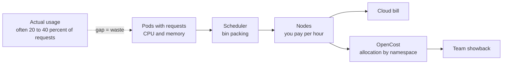
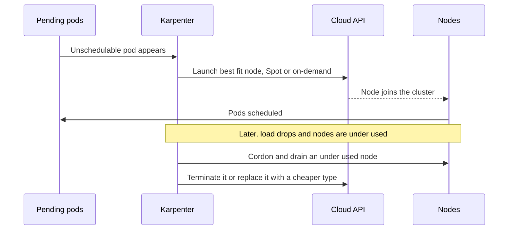

# L20.9 — Kubernetes Infrastructure Costs

> **Level 20: Cost Optimization** · Topic 9 of 9 · ⏱ ~5 hours · Difficulty: Advanced

## 1. What it is

Kubernetes does not have a bill; your cloud account does. The bill is for the **nodes** (virtual machines) the cluster runs on, plus the
load balancers, volumes, NAT traffic and control plane fees around them. Kubernetes cost optimization is the work of making the
cluster **use fewer or cheaper nodes for the same workloads**, and of attributing node cost back to the teams whose pods occupy them.

Three ideas explain most waste:

| Idea | Meaning |
|------|---------|
| **Requests, not usage, reserve capacity** | The scheduler places pods by their resource *requests*. A pod that requests 2 CPUs and uses 100m still blocks 2 CPUs on a node. |
| **Bin packing** | Packing pods tightly onto the fewest nodes. Poor packing leaves fragmented, half-empty nodes you still pay for. |
| **Allocation** | Splitting node cost across namespaces, labels and teams (showback), including idle capacity that nobody uses. |

**Requests inflation** (the gap between what was requested and what is used) is the single biggest source of waste in most clusters.
The fixes combine [Rightsizing](05-rightsizing.md), the autoscaling in [Autoscaling for Cost](04-autoscaling-for-cost.md) and the
purchasing options in [Spot Instances](03-spot-instances.md) and [Savings Plans](02-reserved-instances-and-savings-plans.md).

## 2. Why it matters in DevOps

- Clusters hide cost behind shared nodes. Without allocation, "the cluster costs $40k" is a number nobody owns.
- Inflated requests make the cluster autoscaler add nodes for capacity that is not used, so waste scales with the number of teams.
- Fragmentation, oversized nodes for small pods, and idle node pools quietly accumulate. A policy that bounds requests keeps the problem from
  returning.
- Resource and cost decisions live in YAML (requests, limits, node selectors), so they can be reviewed in pull requests and enforced as code
  (see [Policy as Code](../level-18-platform-engineering/07-policy-as-code.md)).
- Related: [Resource Requests and Limits](../level-08-kubernetes/14-resource-requests-and-limits.md), [Scheduling](../level-08-kubernetes/13-scheduling.md),
  [HPA, VPA and Cluster Autoscaler](../level-16-advanced-kubernetes/07-hpa-vpa-cluster-autoscaler.md) and [FinOps](01-finops.md).

## 3. Real-world system example

**OpenCost** is a CNCF project that implements a vendor-neutral specification for Kubernetes cost allocation. It reads cluster metrics (typically from Prometheus) and
cloud pricing data and exposes cost by namespace, controller, label, pod and other dimensions, including idle cost. **Kubecost** is a commercial product that is built on
OpenCost and adds features such as multi-cluster views, savings recommendations and alerts. Both are documented publicly and install with Helm.

**Karpenter** (open source, a CNCF project) is documented as a node provisioner that looks at pending pods, selects suitable instance types from a wide set, launches them quickly, and
**consolidates** nodes by deleting empty or under-used nodes and replacing them with cheaper ones where possible. The older **Cluster Autoscaler** scales predefined node groups up and
down. **Goldilocks** (Fairwinds) and the Vertical Pod Autoscaler produce request recommendations. Many public engineering write-ups describe the same pattern: reduce requests inflation first, then let node
autoscaling realise the saving.

## 4. Diagram

How requests become node cost:



Karpenter consolidation:



## 5. How it works

### Where the waste comes from

| Source | Symptom | Fix |
|--------|---------|-----|
| Requests inflation | usage is 25-40 percent of requests | rightsize with VPA recommendations, set a policy cap |
| No requests at all | pods are "free" to the scheduler and overcommit nodes, causing noisy neighbours | `LimitRange` defaults, policy requiring requests |
| Oversized nodes for small pods | unallocatable leftover on every node | right node size, more pools, Karpenter picks per workload |
| Fragmentation | free CPU on one node, free memory on another | consolidation, requests that match the instance shape |
| Idle capacity | node pools or environments nobody uses | scale to zero, off-hours schedules, delete |
| Always on-demand | stateless pods on the most expensive purchase option | Spot node pools with tolerations, see [Spot Instances](03-spot-instances.md) |
| Hidden costs | NAT, cross-AZ, load balancers per Service, unattached volumes | see [Network Egress Costs](07-network-egress-costs.md), one ingress controller |

### Node pools and purchase options

Separate pools by purpose: a small **on-demand pool** for system components and stateful or critical pods, a **Spot pool** for stateless and batch pods (tainted, so only
tolerating pods land there), and special pools for GPU or memory-heavy workloads. Karpenter replaces fixed pools with `NodePool` requirements, but the
principle (match workload to cheapest suitable capacity) is the same.

### Allocation

OpenCost allocates a node's cost to the pods running on it in proportion to the greater of their requests and usage, then adds an **idle** share. Labels such as
`team` and `app` let you aggregate cost by team. Shared costs (control plane fee, ingress, monitoring stack) need an explicit rule; see [FinOps](01-finops.md).

### Guardrails

A `LimitRange` provides default requests, a `ResourceQuota` caps a namespace, and an admission policy can reject outsized requests. The
Kubernetes cost lever you control in code review is the `resources:` block.

## 6. Step-by-step guide

**Prerequisites:** Python 3 and `opa` (or `conftest`) for the offline steps; a Kubernetes cluster (kind or minikube is enough) with `kubectl` and `helm` for the cluster steps.
OpenCost needs Prometheus for full data and shows approximate costs on non-cloud clusters. Karpenter requires AWS (EKS) and incurs real cost, so steps are shown as manifests only.
Prices are **EXAMPLES**: check current pricing. Outputs are similar to what is shown.

1. **Quantify requests inflation.** Save as `k8s_waste.py`:
   ```python
   # k8s_waste.py - requests inflation and node cost. EXAMPLE numbers.
   # Each row: (workload, replicas, cpu_request_m, cpu_p95_used_m, mem_request_mi, mem_p95_used_mi)
   rows = [
       ("shop-api", 6, 1000, 310, 1024, 520),
       ("worker",   4, 2000, 450, 4096, 1500),
       ("nginx",    3,  500,  80,  256,  90),
   ]
   node_cpu_m, node_mem_mi, node_hour = 4000, 16384, 0.17   # example 4 vCPU / 16 GiB node
   hours = 730
   req_cpu = sum(r[1] * r[2] for r in rows)
   use_cpu = sum(r[1] * r[3] for r in rows)
   req_mem = sum(r[1] * r[4] for r in rows)
   use_mem = sum(r[1] * r[5] for r in rows)
   import math
   nodes_now = max(math.ceil(req_cpu / (node_cpu_m * 0.85)), math.ceil(req_mem / (node_mem_mi * 0.85)))
   want_cpu = use_cpu * 1.3      # request = p95 plus 30% headroom
   want_mem = use_mem * 1.3
   nodes_right = max(math.ceil(want_cpu / (node_cpu_m * 0.85)), math.ceil(want_mem / (node_mem_mi * 0.85)))
   print(f"CPU requested {req_cpu}m, used {use_cpu}m -> {use_cpu / req_cpu:.0%} of requests used")
   print(f"MEM requested {req_mem}Mi, used {use_mem}Mi -> {use_mem / req_mem:.0%} of requests used")
   print(f"nodes needed now        : {nodes_now}  (${nodes_now * node_hour * hours:,.2f}/month)")
   print(f"nodes after rightsizing : {nodes_right}  (${nodes_right * node_hour * hours:,.2f}/month)")
   ```
   ```bash
   python3 k8s_waste.py
   ```
   Expected output:
   ```text
   CPU requested 15500m, used 3900m -> 25% of requests used
   MEM requested 23296Mi, used 9390Mi -> 40% of requests used
   nodes needed now        : 5  ($620.50/month)
   nodes after rightsizing : 2  ($248.20/month)
   ```
   (The model uses 85 percent of each node as allocatable after system overhead, and ignores spreading and availability needs, which will keep more nodes in practice.)

2. **Guard requests with policy.** A Rego policy that requires requests and caps them unless an approval annotation exists. Save as `requests.rego`:
   ```rego
   package main

   import rego.v1

   max_cpu_millicores := 1000
   max_memory_mi := 2048

   millicores(q) := n if {
   	endswith(q, "m")
   	n := to_number(trim_suffix(q, "m"))
   }

   millicores(q) := n if {
   	not endswith(q, "m")
   	n := to_number(q) * 1000
   }

   mebibytes(q) := n if {
   	endswith(q, "Gi")
   	n := to_number(trim_suffix(q, "Gi")) * 1024
   }

   mebibytes(q) := n if {
   	endswith(q, "Mi")
   	n := to_number(trim_suffix(q, "Mi"))
   }

   deny contains msg if {
   	input.kind == "Deployment"
   	some c in input.spec.template.spec.containers
   	not c.resources.requests
   	msg := sprintf("%s/%s: container %q has no resource requests", [input.kind, input.metadata.name, c.name])
   }

   deny contains msg if {
   	input.kind == "Deployment"
   	some c in input.spec.template.spec.containers
   	millicores(c.resources.requests.cpu) > max_cpu_millicores
   	not input.metadata.annotations["platform.example.com/large-request-approved"]
   	msg := sprintf("%s/%s: container %q requests %s CPU (max %dm without approval annotation)", [input.kind, input.metadata.name, c.name, c.resources.requests.cpu, max_cpu_millicores])
   }

   deny contains msg if {
   	input.kind == "Deployment"
   	some c in input.spec.template.spec.containers
   	mebibytes(c.resources.requests.memory) > max_memory_mi
   	not input.metadata.annotations["platform.example.com/large-request-approved"]
   	msg := sprintf("%s/%s: container %q requests %s memory (max %dMi without approval annotation)", [input.kind, input.metadata.name, c.name, c.resources.requests.memory, max_memory_mi])
   }
   ```
   And a deliberately oversized `deploy.yaml`:
   ```yaml
   apiVersion: apps/v1
   kind: Deployment
   metadata:
     name: shop-api
   spec:
     replicas: 3
     selector:
       matchLabels: {app: shop-api}
     template:
       metadata:
         labels: {app: shop-api}
       spec:
         containers:
           - name: shop-api
             image: nginx:1.27
             resources:
               requests: {cpu: "2", memory: 4Gi}
   ```
   ```bash
   opa eval -f pretty -d requests.rego -i deploy.yaml 'data.main.deny'
   # or:  conftest test --policy . deploy.yaml
   ```
   Expected output:
   ```text
   [
     "Deployment/shop-api: container \"shop-api\" requests 2 CPU (max 1000m without approval annotation)",
     "Deployment/shop-api: container \"shop-api\" requests 4Gi memory (max 2048Mi without approval annotation)"
   ]
   ```
   Change the requests to `cpu: 250m, memory: 256Mi` and the result is `[]`. Run the same policy in CI (and as a Kyverno or Gatekeeper rule at admission) so inflation cannot sneak back in.

3. **Set namespace defaults and a quota.** Defaults prevent "no request" pods; a quota caps what a team can reserve:
   ```yaml
   apiVersion: v1
   kind: LimitRange
   metadata:
     name: defaults
     namespace: team-shop
   spec:
     limits:
       - type: Container
         defaultRequest: {cpu: 100m, memory: 128Mi}
         default: {cpu: 500m, memory: 512Mi}
   ---
   apiVersion: v1
   kind: ResourceQuota
   metadata:
     name: team-shop-quota
     namespace: team-shop
   spec:
     hard:
       requests.cpu: "8"
       requests.memory: 16Gi
       limits.memory: 32Gi
   ```
   ```bash
   kubectl create namespace team-shop
   kubectl apply -f quota.yaml
   kubectl -n team-shop describe quota team-shop-quota
   ```
   The `Used` column starts at 0 and grows as pods are scheduled; a pod that would exceed `requests.cpu` is rejected at admission.

4. **Install OpenCost and read allocation.** OpenCost reads Prometheus; install a Prometheus first (for example the kube-prometheus-stack chart; see
   [Prometheus and PromQL](../level-10-observability/02-prometheus-and-promql.md)), then:
   ```bash
   helm repo add opencost https://opencost.github.io/opencost-helm-chart
   helm repo update
   helm install opencost opencost/opencost --namespace opencost --create-namespace \
     --set opencost.prometheus.internal.serviceName=<PROMETHEUS_SERVICE> \
     --set opencost.prometheus.internal.namespaceName=<PROMETHEUS_NAMESPACE>
   kubectl -n opencost rollout status deploy/opencost
   kubectl -n opencost port-forward service/opencost 9003 9090
   ```
   Chart values change between releases, so confirm the Prometheus settings against the chart's `values.yaml`. In another terminal, ask the API for cost by namespace over the last 7 days:
   ```bash
   curl -s "http://localhost:9003/allocation/compute?window=7d&aggregate=namespace" | python3 -m json.tool | head -40
   ```
   The response lists namespaces with fields such as `cpuCost`, `ramCost`, `totalCost` and an `__idle__` entry for unallocated capacity. On a local cluster the prices are defaults,
   so use the relative proportions, not the dollar amounts. The UI is on port 9090.

5. **Compare requests with usage in PromQL.** These give the ratio per namespace, the number to bring to a rightsizing meeting:
   ```promql
   # fraction of requested CPU that is actually used, per namespace
   sum by (namespace) (rate(container_cpu_usage_seconds_total{container!=""}[1h]))
   /
   sum by (namespace) (kube_pod_container_resource_requests{resource="cpu"})
   ```
   A value consistently below 0.3 is a rightsizing target.

6. **Define a Karpenter NodePool with consolidation and a Spot-only batch pool (EKS, illustrative manifests).** Karpenter must already be installed with an `EC2NodeClass`
   named `default`:
   ```yaml
   apiVersion: karpenter.sh/v1
   kind: NodePool
   metadata:
     name: general
   spec:
     template:
       spec:
         nodeClassRef:
           group: karpenter.k8s.aws
           kind: EC2NodeClass
           name: default
         requirements:
           - key: karpenter.sh/capacity-type
             operator: In
             values: ["on-demand"]
           - key: karpenter.k8s.aws/instance-category
             operator: In
             values: ["m", "c"]
     limits:
       cpu: "200"
     disruption:
       consolidationPolicy: WhenEmptyOrUnderutilized
       consolidateAfter: 2m
   ---
   apiVersion: karpenter.sh/v1
   kind: NodePool
   metadata:
     name: batch-spot
   spec:
     template:
       spec:
         nodeClassRef:
           group: karpenter.k8s.aws
           kind: EC2NodeClass
           name: default
         taints:
           - key: workload
             value: batch
             effect: NoSchedule
         requirements:
           - key: karpenter.sh/capacity-type
             operator: In
             values: ["spot"]
     limits:
       cpu: "100"
     disruption:
       consolidationPolicy: WhenEmptyOrUnderutilized
       consolidateAfter: 1m
   ```
   Pods tolerate the batch taint to use the Spot pool:
   ```yaml
   tolerations:
     - key: workload
       operator: Equal
       value: batch
       effect: NoSchedule
   ```
   Apply with `kubectl apply -f nodepools.yaml` and watch `kubectl get nodeclaims` and `kubectl get nodes -L karpenter.sh/capacity-type` as workloads change. Karpenter launches real
   instances, so scale workloads back to zero and delete the NodePools afterwards.

7. **Find other hidden Kubernetes costs.**
   ```bash
   kubectl get svc -A --field-selector spec.type=LoadBalancer
   kubectl get pvc -A
   kubectl get pv --no-headers | awk '$5=="Released" || $5=="Available"'
   ```
   Each `LoadBalancer` Service is a billed cloud load balancer (use one ingress controller where you can); released or available PersistentVolumes may still be billed volumes
   (see [Storage Lifecycle Policies](06-storage-lifecycle-policies.md)).

## 7. Real-world scenario

*(Illustrative.)* A 40-node cluster is fully packed according to the scheduler, but average node CPU use is 22 percent. The platform team ranks namespaces by the OpenCost
efficiency numbers (usage divided by requests) and meets the three worst teams. The `worker` team copied `cpu: 2` from a load test; their p95 is 300m. The team halves requests in staged rollouts,
the cluster autoscaler empties nodes, and Karpenter consolidation replaces large half-empty nodes with smaller ones.

Two things go wrong: a team's memory request is cut too far and pods are `OOMKilled` (they roll back, see [Rightsizing](05-rightsizing.md)), and a stateful pod blocks a consolidation until a PodDisruptionBudget is relaxed. The platform
team adds the request cap policy and a monthly efficiency report per namespace. Node count falls by about a third.

## 8. Common mistakes and best practices

**Don't**
- Don't copy requests from examples or load tests without measuring real usage.
- Don't run pods without requests; they overcommit nodes and break scheduling assumptions.
- Don't give every team its own load balancer and node pool by default.
- Don't put critical or stateful pods on Spot pools.
- Don't trust cost dashboards on a local cluster for absolute dollars.

**Do**
- Do measure usage versus requests per namespace and publish the ratio.
- Do enforce defaults and caps with `LimitRange`, `ResourceQuota` and policy.
- Do separate on-demand, Spot and special-purpose node pools, with taints.
- Do let a node autoscaler (Cluster Autoscaler or Karpenter) remove the capacity you free up.
- Do allocate costs by label and report idle cost.

## 9. Tasks

- [ ] **T1 — Measure inflation** *(≈20 min, beginner)*
  - **Goal:** a requests-to-usage ratio.
  - **Steps:**
    1. Run `k8s_waste.py`.
    2. Replace the rows with three of your own workloads (or invented ones).
  - **Done when:** you can state the used-to-requested percentage and the nodes saved.

- [ ] **T2 — Enforce a request cap** *(≈30 min, intermediate)*
  - **Goal:** a failing and then passing policy check.
  - **Steps:**
    1. Run the Rego policy against `deploy.yaml`.
    2. Fix the requests and add the approval annotation to a second file to see the exception.
  - **Done when:** one run prints two messages, one prints `[]`, and the annotated deployment passes.

- [ ] **T3 — Set defaults and quotas** *(≈30 min, intermediate)*
  - **Goal:** pods without requests get defaults; over-quota pods are rejected.
  - **Steps:**
    1. Apply the `LimitRange` and `ResourceQuota`.
    2. Run a pod with no resources and inspect `kubectl get pod -o yaml`.
    3. Scale a Deployment past the quota.
  - **Done when:** the pod shows default requests, and the scale-up reports a `forbidden: exceeded quota` event.

- [ ] **T4 — Break it: starve a node** *(≈40 min, intermediate)*
  - **Goal:** feel fragmentation.
  - **Steps:**
    1. On kind, create pods that each request 60 percent of a node's CPU.
    2. Observe `Pending` pods while nodes show low usage.
    3. Reduce the requests and watch the pods schedule.
  - **Done when:** `kubectl describe pod` shows `Insufficient cpu` before the change and the pods run after it.

- [ ] **T5 — Allocate cost with OpenCost** *(≈60 min, advanced)*
  - **Goal:** cost by namespace.
  - **Steps:**
    1. Install Prometheus and OpenCost.
    2. Create two namespaces with different workloads.
    3. Query the allocation API aggregated by namespace.
  - **Done when:** you have a table of namespaces with relative cost and the idle share, with a note that local prices are approximate.

- [ ] **T6 — Prove it** *(≈60 min, advanced)*
  - **Goal:** a Kubernetes cost plan.
  - **Steps:**
    1. Without the guide, list the causes of waste in a cluster, and the metric that exposes each.
    2. Propose guardrails (policy, quota, node pools) for `shop-api`.
    3. Explain why lowering requests alone does not reduce the bill.
  - **Done when:** you can explain the node autoscaler's role and name one risk per change.

## 10. Self-check questions

1. Why do requests, not usage, determine node count?
2. What is requests inflation and how do you detect it?
3. What does Karpenter consolidation do?
4. Why taint a Spot node pool?
5. What does OpenCost add that the cloud bill does not show?

<details>
<summary>Answers</summary>

1. The scheduler places pods by requested resources, so requested capacity is reserved on nodes whether or not it is used.
2. Requests far above real usage; detect with used-to-requested ratios from Prometheus, VPA recommendations or OpenCost efficiency.
3. It removes empty or under-used nodes and can replace them with cheaper or smaller ones after draining pods safely.
4. So only workloads that tolerate interruption (via tolerations) land there, and critical pods stay on stable nodes.
5. Cost allocated by namespace, workload and label, including the idle share, instead of only per-instance charges.

</details>

## 11. Further reading

- OpenCost documentation (opencost.io) and the CNCF project page.
- Karpenter documentation (karpenter.sh): NodePools and disruption.
- Kubernetes documentation: Resource Management for Pods and Containers, Limit Ranges, Resource Quotas.
- FinOps Foundation: material on container and Kubernetes cost allocation.

<!-- nav -->
---
← Previous: [Database Costs](08-database-costs.md) · [Level 20 index](README.md) · Next: [Level capstone project](99-capstone-project.md) →
