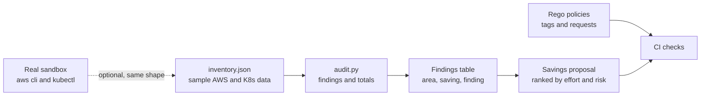
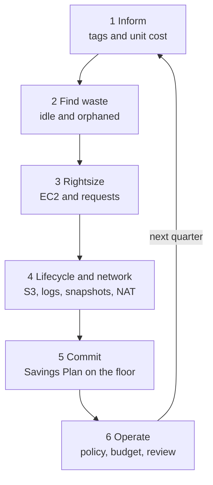

# L20 Capstone — Audit an AWS and Kubernetes Environment

> **Level 20: Cost Optimization** · Capstone · ⏱ ~10 hours

## 1. Goal and outcome

Run a complete cost audit of a sample environment and produce a savings proposal with numbers. You will not need to spend money to do it:
the audit runs on a synthetic inventory of an AWS and Kubernetes environment for `shop-api` (EC2, EBS, RDS, S3, CloudWatch Logs, NAT, Kubernetes
namespaces), and every step also tells you how to repeat it against a real sandbox account. By the end you will have:

- a **tag compliance** report and an enforced tag policy;
- a **waste report** that finds idle instances, unattached volumes, orphaned snapshots, immortal log groups and idle replicas;
- **rightsizing** decisions for EC2 and Kubernetes requests, with the risks written down;
- **lifecycle policies** (S3, logs, snapshots) and a **network** fix (S3 gateway endpoint);
- a **Savings Plan** proposal with coverage, utilization and break-even;
- a short **savings proposal** that totals monthly and yearly savings, ranks them by effort, and states the risk of each.

This exercises every topic: [FinOps](01-finops.md), [Reserved Instances and Savings Plans](02-reserved-instances-and-savings-plans.md),
[Spot Instances](03-spot-instances.md), [Autoscaling for Cost](04-autoscaling-for-cost.md), [Rightsizing](05-rightsizing.md),
[Storage Lifecycle Policies](06-storage-lifecycle-policies.md), [Network Egress Costs](07-network-egress-costs.md),
[Database Costs](08-database-costs.md) and [Kubernetes Infrastructure Costs](09-kubernetes-infrastructure-costs.md).

## 2. Architecture



The audit loop (Inform, Optimize, Operate from [FinOps](01-finops.md)):



## 3. Prerequisites and cost

- Python 3 (standard library only). Optional: `opa` or `conftest` for the policy tasks, `kubectl` and a kind cluster for the Kubernetes task, the AWS CLI and a
  sandbox account for the "repeat on real data" tasks.
- **Cost:** the synthetic audit is free. If you repeat steps against a real AWS sandbox, the commands used here are read-only, except where a task says it creates
  something (a lifecycle policy on a test bucket, a gateway endpoint). Set a billing alarm first and use the teardown section.
- **Do not purchase a Savings Plan or Reserved Instance** while doing this capstone: commitments cannot be cancelled. The commitment step is a proposal only.
- All prices in the scripts are **EXAMPLES** (check current pricing). Output below is from running the scripts on the sample data; with real data your numbers will differ.

## 4. Build it step by step

### Milestone 1 — Create the sample environment (topics 1, 5)

Save as `make_sample_data.py`. It writes `inventory.json`, a fake environment with deliberate problems hidden in it:

```python
# make_sample_data.py - writes inventory.json, a fake AWS/Kubernetes environment for the audit. EXAMPLE data and prices.
import json

inventory = {
    "ec2": [
        {"id": "i-web-1",    "type": "m6i.xlarge",  "price_hr": 0.192, "env": "prod",    "cpu_p95": 38, "mem_p95": 52, "tags": {"team": "shop", "env": "prod", "service": "shop-api", "cost-center": "cc-1042"}},
        {"id": "i-web-2",    "type": "m6i.xlarge",  "price_hr": 0.192, "env": "prod",    "cpu_p95": 41, "mem_p95": 55, "tags": {"team": "shop", "env": "prod", "service": "shop-api", "cost-center": "cc-1042"}},
        {"id": "i-batch-1",  "type": "m6i.2xlarge", "price_hr": 0.384, "env": "prod",    "cpu_p95": 12, "mem_p95": 18, "tags": {"team": "shop", "env": "prod", "service": "reports", "cost-center": "cc-1042"}},
        {"id": "i-dev-1",    "type": "m6i.2xlarge", "price_hr": 0.384, "env": "dev",     "cpu_p95": 9,  "mem_p95": 20, "tags": {"team": "shop", "env": "dev"}},
        {"id": "i-stage-1",  "type": "m6i.xlarge",  "price_hr": 0.192, "env": "staging", "cpu_p95": 15, "mem_p95": 30, "tags": {}},
        {"id": "i-mystery",  "type": "c6i.4xlarge", "price_hr": 0.68,  "env": "unknown", "cpu_p95": 2,  "mem_p95": 8,  "tags": {}},
    ],
    "ebs": [
        {"id": "vol-a", "size_gb": 200, "attached": True,  "type": "gp3"},
        {"id": "vol-b", "size_gb": 500, "attached": False, "type": "gp2"},
        {"id": "vol-c", "size_gb": 1000, "attached": False, "type": "io1"},
        {"id": "vol-d", "size_gb": 100, "attached": True,  "type": "gp2"},
    ],
    "snapshots": [
        {"id": "snap-1", "age_days": 12,  "size_gb": 200, "volume_exists": True},
        {"id": "snap-2", "age_days": 400, "size_gb": 500, "volume_exists": False},
        {"id": "snap-3", "age_days": 700, "size_gb": 1000, "volume_exists": False},
        {"id": "snap-4", "age_days": 365, "size_gb": 100, "volume_exists": True},
    ],
    "log_groups": [
        {"name": "/aws/lambda/shop-api", "stored_gb": 340, "retention_days": None},
        {"name": "/ecs/reports",         "stored_gb": 120, "retention_days": None},
        {"name": "/audit/cloudtrail",    "stored_gb": 900, "retention_days": 365},
    ],
    "s3": [
        {"bucket": "shop-assets",   "size_gb": 4000,  "has_lifecycle": False, "pattern": "unpredictable"},
        {"bucket": "shop-logs",     "size_gb": 12000, "has_lifecycle": False, "pattern": "write-once-read-rarely"},
        {"bucket": "shop-backups",  "size_gb": 3000,  "has_lifecycle": True,  "pattern": "write-once-read-rarely"},
    ],
    "rds": [
        {"id": "shop-prod", "class": "db.r6g.xlarge", "node_price_hr": 0.52, "multi_az": True, "env": "prod", "cpu_p95": 35,
         "read_replicas": [{"id": "shop-prod-r1", "cpu_p95": 3}]},
        {"id": "shop-dev", "class": "db.r6g.xlarge", "node_price_hr": 0.52, "multi_az": True, "env": "dev", "cpu_p95": 6, "read_replicas": []},
    ],
    "network": {"nat_gateways": 3, "nat_gb_month": 9000, "s3_share_of_nat": 0.6, "has_s3_gateway_endpoint": False},
    "k8s_namespaces": [
        {"ns": "team-shop", "cpu_requested_m": 12000, "cpu_used_p95_m": 3000, "mem_requested_mi": 24576, "mem_used_p95_mi": 9000},
        {"ns": "team-pay",  "cpu_requested_m": 8000,  "cpu_used_p95_m": 5200, "mem_requested_mi": 16384, "mem_used_p95_mi": 11000},
        {"ns": "dev",       "cpu_requested_m": 6000,  "cpu_used_p95_m": 400,  "mem_requested_mi": 12288, "mem_used_p95_mi": 1500},
    ],
    "prices": {"ebs_gb": {"gp3": 0.08, "gp2": 0.10, "io1": 0.125}, "snapshot_gb": 0.05, "logs_gb": 0.03,
               "s3_standard_gb": 0.023, "s3_ia_gb": 0.0125, "nat_hour": 0.045, "nat_gb": 0.045, "node_hour_per_vcpu": 0.048},
    "hourly_usage_od_equiv": [round(18 + 10 * max(0, (h % 24 - 7) / 11 if 7 <= h % 24 <= 18 else 0), 2) for h in range(168)],
}
with open("inventory.json", "w") as f:
    json.dump(inventory, f, indent=2)
print("wrote inventory.json with", {k: len(v) for k, v in inventory.items() if isinstance(v, list)})
```

```bash
mkdir cost-audit && cd cost-audit
python3 make_sample_data.py
```

Expected output:

```text
wrote inventory.json with {'ec2': 6, 'ebs': 4, 'snapshots': 4, 'log_groups': 3, 's3': 3, 'rds': 2, 'k8s_namespaces': 3, 'hourly_usage_od_equiv': 168}
```

### Milestone 2 — Run the audit (topics 1, 4, 5, 6, 7, 8, 9)

Save as `audit.py`. Each numbered block is one lever from the level:

```python
# audit.py - find waste in inventory.json and total the monthly saving. EXAMPLE prices; check current pricing.
import json, math

HOURS = 730
inv = json.load(open("inventory.json"))
P = inv["prices"]
REQUIRED = {"team", "env", "service", "cost-center"}
findings = []          # (area, finding, monthly_saving)

# 1. Tag compliance (Inform)
untagged = [i for i in inv["ec2"] if REQUIRED - set(i["tags"])]
cost_untagged = sum(i["price_hr"] * HOURS for i in untagged)
total_ec2 = sum(i["price_hr"] * HOURS for i in inv["ec2"])
print(f"tag compliance: {len(inv['ec2']) - len(untagged)}/{len(inv['ec2'])} EC2 instances fully tagged; "
      f"untagged spend ${cost_untagged:,.0f} of ${total_ec2:,.0f} ({cost_untagged / total_ec2:.0%})")

# 2. Rightsizing (halve the size when p95 CPU and memory both low; terminate near-idle unknowns)
rightsized = set()
for i in inv["ec2"]:
    if i["cpu_p95"] < 5 and i["env"] == "unknown":
        findings.append(("idle", f"{i['id']} {i['type']} CPU p95 {i['cpu_p95']}%, no owner: stop after confirming", i["price_hr"] * HOURS))
    elif i["cpu_p95"] < 20 and i["mem_p95"] < 40:
        rightsized.add(i["id"])
        findings.append(("rightsize", f"{i['id']} {i['type']} CPU p95 {i['cpu_p95']}% mem {i['mem_p95']}%: one size down", i["price_hr"] * HOURS * 0.5))

# 3. Off-hours for non-prod (running 60 of 168 hours); computed on the already-rightsized price to avoid double counting
for i in inv["ec2"]:
    if i["env"] in ("dev", "staging"):
        base = i["price_hr"] * (0.5 if i["id"] in rightsized else 1.0)
        findings.append(("schedule", f"{i['id']} ({i['env']}) off outside 08:00-20:00 weekdays", base * HOURS * (1 - 60 / 168)))

# 4. Storage
for v in inv["ebs"]:
    if not v["attached"]:
        findings.append(("storage", f"{v['id']} unattached {v['type']} {v['size_gb']} GB: snapshot then delete", v["size_gb"] * P["ebs_gb"][v["type"]]))
    elif v["type"] == "gp2":
        findings.append(("storage", f"{v['id']} gp2 {v['size_gb']} GB: migrate to gp3", v["size_gb"] * (P["ebs_gb"]["gp2"] - P["ebs_gb"]["gp3"])))
for s in inv["snapshots"]:
    if s["age_days"] > 180 and not s["volume_exists"]:
        findings.append(("storage", f"{s['id']} {s['age_days']} days old, volume gone: delete after review", s["size_gb"] * P["snapshot_gb"]))
for g in inv["log_groups"]:
    if g["retention_days"] is None:
        findings.append(("logs", f"{g['name']} {g['stored_gb']} GB never expires: keep 30 days (assume 8% retained)", g["stored_gb"] * P["logs_gb"] * 0.92))
for b in inv["s3"]:
    if not b["has_lifecycle"] and b["pattern"] == "write-once-read-rarely":
        findings.append(("s3", f"{b['bucket']} {b['size_gb']} GB: lifecycle to Standard-IA after 30 days", b["size_gb"] * (P["s3_standard_gb"] - P["s3_ia_gb"])))

# 5. Databases: Multi-AZ outside production, idle read replicas
for d in inv["rds"]:
    if d["multi_az"] and d["env"] != "prod":
        findings.append(("database", f"{d['id']} ({d['env']}) Multi-AZ standby not needed: single AZ", d["node_price_hr"] * HOURS))
    for r in d["read_replicas"]:
        if r["cpu_p95"] < 10:
            findings.append(("database", f"{r['id']} read replica CPU p95 {r['cpu_p95']}%: confirm no readers, then remove", d["node_price_hr"] * HOURS))

# 6. Network
n = inv["network"]
if not n["has_s3_gateway_endpoint"]:
    findings.append(("network", f"S3 gateway endpoint: {n['s3_share_of_nat']:.0%} of {n['nat_gb_month']} GB leaves NAT", n["nat_gb_month"] * n["s3_share_of_nat"] * P["nat_gb"]))

# 7. Kubernetes requests (target request = p95 * 1.3)
for ns in inv["k8s_namespaces"]:
    new_cpu = ns["cpu_used_p95_m"] * 1.3
    saved_vcpu = max(0, ns["cpu_requested_m"] - new_cpu) / 1000
    findings.append(("k8s", f"{ns['ns']}: cpu requests {ns['cpu_requested_m']}m vs p95 {ns['cpu_used_p95_m']}m -> {new_cpu:.0f}m", saved_vcpu * P["node_hour_per_vcpu"] * HOURS))

print(f"\n{'area':<10} {'monthly saving':>14}  finding")
for area, text, saving in sorted(findings, key=lambda f: -f[2]):
    print(f"{area:<10} ${saving:>12,.0f}  {text}")
total = sum(f[2] for f in findings)
print(f"\ntotal identified saving: ${total:,.0f}/month (${total * 12:,.0f}/year) before commitments")

# 8. Savings plan on the remaining steady floor (30% example discount)
usage = inv["hourly_usage_od_equiv"]
discount, best = 0.30, None
for commit in range(5, 30):
    cap = commit / (1 - discount)
    cost = sum(commit + max(0, u - cap) for u in usage)
    best = min(best, (cost, commit)) if best else (cost, commit)
od = sum(usage)
print(f"savings plan: commit ${best[1]}/h gives ${od - best[0]:,.0f} saving per week on ${od:,.0f} of on-demand usage ({1 - best[0] / od:.1%})")
```

```bash
python3 audit.py
```

Expected output:

```text
tag compliance: 3/6 EC2 instances fully tagged; untagged spend $917 of $1,478 (62%)

area       monthly saving  finding
idle       $         496  i-mystery c6i.4xlarge CPU p95 2%, no owner: stop after confirming
database   $         380  shop-prod-r1 read replica CPU p95 3%: confirm no readers, then remove
database   $         380  shop-dev (dev) Multi-AZ standby not needed: single AZ
k8s        $         284  team-shop: cpu requests 12000m vs p95 3000m -> 3900m
network    $         243  S3 gateway endpoint: 60% of 9000 GB leaves NAT
k8s        $         192  dev: cpu requests 6000m vs p95 400m -> 520m
rightsize  $         140  i-batch-1 m6i.2xlarge CPU p95 12% mem 18%: one size down
rightsize  $         140  i-dev-1 m6i.2xlarge CPU p95 9% mem 20%: one size down
s3         $         126  shop-logs 12000 GB: lifecycle to Standard-IA after 30 days
storage    $         125  vol-c unattached io1 1000 GB: snapshot then delete
schedule   $          90  i-dev-1 (dev) off outside 08:00-20:00 weekdays
rightsize  $          70  i-stage-1 m6i.xlarge CPU p95 15% mem 30%: one size down
storage    $          50  vol-b unattached gp2 500 GB: snapshot then delete
storage    $          50  snap-3 700 days old, volume gone: delete after review
schedule   $          45  i-stage-1 (staging) off outside 08:00-20:00 weekdays
k8s        $          43  team-pay: cpu requests 8000m vs p95 5200m -> 6760m
storage    $          25  snap-2 400 days old, volume gone: delete after review
logs       $           9  /aws/lambda/shop-api 340 GB never expires: keep 30 days (assume 8% retained)
logs       $           3  /ecs/reports 120 GB never expires: keep 30 days (assume 8% retained)
storage    $           2  vol-d gp2 100 GB: migrate to gp3

total identified saving: $2,894/month ($34,730/year) before commitments
savings plan: commit $13/h gives $884 saving per week on $3,444 of on-demand usage (25.7%)
```

Read it before changing anything. The biggest items are rarely the ones people guess: an unowned instance, an idle replica, a non-production Multi-AZ database and inflated
Kubernetes requests. The savings are **estimates**; several overlap (rightsizing and scheduling the same instance, for example) and the script nets the obvious one. A real audit
confirms each line with its owner before acting.

### Milestone 3 — Enforce the tag policy (topic 1)

The audit reports 3 of 6 instances fully tagged. Fix the cause by checking Terraform plans in CI. Use the `tags.rego` policy from [FinOps](01-finops.md) step 3 and a
fake plan:

```bash
opa eval -f pretty -d tags.rego -i plan.json 'data.main.deny'
```

You should see one message naming each resource missing `cost-center`, `env` or `service`. Add `default_tags` to your Terraform provider block so every resource inherits the schema.

### Milestone 4 — Rightsize EC2 and Kubernetes (topics 4, 5, 9)

For each `rightsize` line, decide with the p95 rule from [Rightsizing](05-rightsizing.md): one size down only if CPU and memory at p95 both fit with headroom. For the Kubernetes lines,
the target request is the p95 plus 30 percent headroom. Add the request cap policy from [Kubernetes Infrastructure Costs](09-kubernetes-infrastructure-costs.md) step 2 so inflation cannot return:

```bash
opa eval -f pretty -d requests.rego -i deploy.yaml 'data.main.deny'
```

For the non-production instances, add the off-hours schedule from [Autoscaling for Cost](04-autoscaling-for-cost.md) (a CronJob pair for Kubernetes or scheduled actions for an Auto Scaling group).

### Milestone 5 — Lifecycle policies and network fix (topics 6, 7)

Write an S3 lifecycle configuration for `shop-logs` (Standard-IA after 30 days, expiry at a retention you justify), the multipart-upload cleanup rule, a retention period for the two immortal log groups,
and an S3 gateway endpoint for the VPC. Use the JSON and commands from [Storage Lifecycle Policies](06-storage-lifecycle-policies.md) and
[Network Egress Costs](07-network-egress-costs.md). Validate the JSON before applying anywhere:

```bash
python3 -c "import json; print(len(json.load(open('lifecycle.json'))['Rules']), 'rules')"
```

### Milestone 6 — Databases and Spot (topics 3, 8)

For `shop-prod-r1` and `shop-dev`, apply the questions from [Database Costs](08-database-costs.md): is the replica serving reads, is Multi-AZ needed here, and could a cache remove the load?
Run `db_cost.py` with your own numbers. Then list the workloads in the inventory that could run on Spot (batch, CI, stateless web with an on-demand base) using the criteria from
[Spot Instances](03-spot-instances.md), and run `spot_breakeven.py`.

### Milestone 7 — Commitment proposal (topic 2)

The last line of the audit sizes a Savings Plan against the sample week of hourly usage: the best commitment is near the always-on floor, not the peak. After the other savings are applied,
usage is lower, so **recompute the commitment on the reduced usage**: committing before you remove waste locks the waste in. Write the proposal: scope (Compute), term, payment option, hourly commitment, expected coverage
and utilization, worst case if usage falls 30 percent, owner and review date.

### Milestone 8 — The savings proposal (all topics)

Write a one-page document `proposal.md` using this outline:

```markdown
# Cost savings proposal: shop-api AWS and Kubernetes
## Summary
Identified monthly saving: $X (Y percent of the example bill). First wave (low risk): $A.
## Findings ranked by value
| # | Area | Finding | Saving/mo | Effort | Risk | Owner |
## Plan
Wave 1 (this week): delete confirmed waste, set log retention, gateway endpoint.
Wave 2 (this month): rightsize, schedules, lifecycle policies.
Wave 3 (next quarter): Savings Plan on the recomputed floor, Spot for batch, database changes.
## Risks and rollback
## Operating model
Tag policy in CI, budget alerts, monthly review, unit cost metric (cost per 1M requests).
```

## 5. Tasks

- [ ] **T1 — Run the audit** *(≈30 min, beginner; Milestones 1-2; topics 1, 5)*
  - **Goal:** produce the findings table.
  - **Steps:**
    1. Create `make_sample_data.py` and `audit.py` and run both.
    2. Copy the findings into a spreadsheet or Markdown table.
  - **Done when:** you have a ranked table and the total monthly saving figure.

- [ ] **T2 — Make tags enforceable** *(≈45 min, intermediate; Milestone 3; topic 1)*
  - **Goal:** untagged resources fail CI.
  - **Steps:**
    1. Write `tags.rego` and a fake plan with one untagged bucket.
    2. Run the policy, then fix the plan.
    3. Add `default_tags` to a Terraform provider block.
  - **Done when:** the policy output goes from one message to `[]` and the tag schema is documented.

- [ ] **T3 — Rightsize with evidence** *(≈60 min, intermediate; Milestone 4; topics 4, 5, 9)*
  - **Goal:** defend each size change.
  - **Steps:**
    1. For each rightsize line, state the p95 CPU and memory and the new size.
    2. Add one instance to `inventory.json` with `cpu_p95` 10 and `mem_p95` 85 (memory-bound) and confirm the audit does not suggest shrinking it.
    3. Write the rollback step for each change.
  - **Done when:** each change has numbers, a risk and a rollback, and the memory-bound instance is kept with a note explaining why.

- [ ] **T4 — Lifecycle and endpoint** *(≈60 min, intermediate; Milestone 5; topics 6, 7)*
  - **Goal:** storage and network savings as code.
  - **Steps:**
    1. Write `lifecycle.json` for `shop-logs` and validate it parses.
    2. Write the Terraform for the S3 gateway endpoint.
    3. Add the `endpoints.rego` check from [Network Egress Costs](07-network-egress-costs.md) and test it on a plan without the endpoint.
  - **Done when:** the JSON validates and the policy flags a VPC with a NAT gateway and no endpoint.

- [ ] **T5 — Database and Spot review** *(≈60 min, advanced; Milestone 6; topics 3, 8)*
  - **Goal:** availability-aware recommendations.
  - **Steps:**
    1. For each database finding, write the availability impact and what evidence you need before acting.
    2. Run `spot_breakeven.py` for the batch workload with your own interruption assumptions.
    3. Decide which instances stay on-demand and why.
  - **Done when:** each change lists impact, evidence and a decision, and at least one tempting saving is rejected with a reason.

- [ ] **T6 — Size a commitment on reduced usage** *(≈45 min, advanced; Milestone 7; topic 2)*
  - **Goal:** a Savings Plan that does not lock in waste.
  - **Steps:**
    1. Take `hourly_usage_od_equiv` from `inventory.json` and subtract the compute savings you will apply (for example 15 percent).
    2. Re-run the sweep from [Reserved Instances and Savings Plans](02-reserved-instances-and-savings-plans.md) and pick a commitment.
    3. Compute the loss if usage falls a further 30 percent.
  - **Done when:** you have a recommendation with coverage, utilization, saving and the downside figure. Do not buy anything.

- [ ] **T7 — Repeat one lever on real data** *(≈60 min, intermediate; Milestones 2-5; topics 1, 6)*
  - **Goal:** connect the sample to reality.
  - **Steps:**
    1. In a sandbox account, list log groups without retention and unattached volumes using the commands from the topics.
    2. Compare against the sample audit's findings.
  - **Done when:** you have a list of real findings (or a statement that the account is clean) and have not deleted anything without review.

- [ ] **T8 — Prove it** *(≈90 min, advanced; all milestones; all topics)*
  - **Goal:** present the proposal.
  - **Steps:**
    1. Without the guide, write `proposal.md` for a different environment (change the inventory numbers) and justify the ranking.
    2. Present it in ten minutes to a peer, covering the unit cost, the three waves, the risks, and the operating model.
    3. Answer: what would you not cut, and why?
  - **Done when:** the peer can restate the three biggest savings, the biggest risk and what keeps the saving from decaying.

## 6. Verification checklist

- [ ] `python3 audit.py` runs and prints a total saving and a Savings Plan line.
- [ ] The findings table is ranked, and each finding has an owner, a risk and an action.
- [ ] The tag policy returns messages on a bad plan and `[]` on a good one.
- [ ] `lifecycle.json` parses and contains the multipart cleanup rule.
- [ ] The request-cap policy rejects an oversized Deployment.
- [ ] The Savings Plan proposal was sized on **reduced** usage and states the downside.
- [ ] `proposal.md` states monthly and yearly savings, three waves and a rollback for risky changes.
- [ ] Nothing was purchased and nothing in a real account was deleted without review.

## 7. Teardown

The synthetic audit creates only local files:

```bash
cd .. && rm -rf cost-audit
```

If you repeated steps against a real sandbox account, remove what you created:

```bash
aws s3 rb "s3://<YOUR_TEST_BUCKET>" --force            # test bucket from the lifecycle task (empty versions first in the console)
aws ec2 delete-vpc-endpoints --vpc-endpoint-ids <ID>    # only if you created a lab endpoint
aws budgets delete-budget --account-id <YOUR_ACCOUNT_ID> --budget-name shop-monthly
kubectl delete namespace team-shop --ignore-not-found
```

Check the Billing console the next day to confirm nothing is still accruing.

## 8. Stretch goals and what to learn next

- Replace the sample inventory with output from `aws ec2 describe-instances`, `aws ec2 describe-volumes`, `aws logs describe-log-groups` and a Prometheus query, and
  keep the audit as a scheduled job that posts a weekly report.
- Add a cost-per-1M-requests dashboard (see [FinOps](01-finops.md)) and an anomaly alert.
- Add a cost estimate to pull requests with a policy gate on large increases (see [Policy as Code](../level-18-platform-engineering/07-policy-as-code.md)).
- Turn the findings into guardrails in the platform templates ([Infrastructure Templates](../level-18-platform-engineering/06-infrastructure-templates.md)).
- Next: [Level 19: Architecture](../level-19-architecture/05-cost-architecture.md) covers cost as a first-class architecture trade-off, and
  [Level 14: SRE](../level-14-sre/09-capacity-planning.md) covers capacity planning that keeps savings from becoming outages.

<!-- nav -->
---
← Previous: [Kubernetes Infrastructure Costs](09-kubernetes-infrastructure-costs.md) · [Level 20 index](README.md) · Next: [Guides — senior mindset](../guides/senior-mindset.md) →
