# Level 20 — Cost Optimization

> **Goal:** Reduce cloud spend without sacrificing reliability by treating cost as an engineering metric.

| | |
|---|---|
| **Recommended time** | 2-3 weeks |
| **Topics** | 9 |
| **Practice / capstone** | Audit a sample AWS/Kubernetes environment: tag costs, find waste, rightsize, add lifecycle policies and propose a savings plan with numbers. |

## Topics

| # | Topic | What you will learn |
|---|-------|---------------------|
| 1 | [FinOps](01-finops.md) | inform/optimize/operate, tagging, showback/chargeback, unit economics, Cost Explorer |
| 2 | [Reserved Instances and Savings Plans](02-reserved-instances-and-savings-plans.md) | commitments, coverage vs utilization, break-even |
| 3 | [Spot Instances](03-spot-instances.md) | interruption handling, diversification, Spot on K8s/ASG, suitable workloads |
| 4 | [Autoscaling for Cost](04-autoscaling-for-cost.md) | scale-in, scheduled scaling, scale-to-zero, off-hours shutdown |
| 5 | [Rightsizing](05-rightsizing.md) | utilization analysis, Compute Optimizer, VPA recommendations, risks |
| 6 | [Storage Lifecycle Policies](06-storage-lifecycle-policies.md) | S3 tiers, Intelligent-Tiering, snapshot cleanup, log retention |
| 7 | [Network Egress Costs](07-network-egress-costs.md) | inter-AZ/region/internet transfer, NAT cost, VPC endpoints, CDN offload |
| 8 | [Database Costs](08-database-costs.md) | instance sizing, storage/IOPS, replicas, Aurora Serverless, caching to reduce load |
| 9 | [Kubernetes Infrastructure Costs](09-kubernetes-infrastructure-costs.md) | bin packing, requests inflation, Kubecost/OpenCost, node pools, Karpenter |
| ★ | [Level capstone project](99-capstone-project.md) | Audit a sample AWS/Kubernetes environment: tag costs, find waste, rightsize, add lifecycle policies and propose a savings plan with numbers. |

## How to work through this level

1. Read each topic in order: *what it is → why it matters → real-world example → diagram → guide*.
2. Do **every task** in the topic's *Tasks* section and tick the box (`- [x]`) in your own fork or notes.
3. Answer the *Self-check questions* without looking, then reveal the answers.
4. Finish with the **capstone project**, which combines all topics of the level.
5. Move on only when you can do the capstone's *Prove it* task without the guide.

## Topic flow

```mermaid
flowchart LR
    T1["1. FinOps"]
    T2["2. Reserved Instances and Savings Plans"]
    T3["3. Spot Instances"]
    T4["4. Autoscaling for Cost"]
    T5["5. Rightsizing"]
    T6["6. Storage Lifecycle Policies"]
    T7["7. Network Egress Costs"]
    T8["8. Database Costs"]
    T9["9. Kubernetes Infrastructure Costs"]
    CAP(["Capstone"])
    T1 --> T2 --> T3 --> T4 --> T5 --> T6 --> T7 --> T8 --> T9 --> CAP
```

---
← [Level 19 — Architecture](../level-19-architecture/README.md) · [Roadmap home](../README.md)
