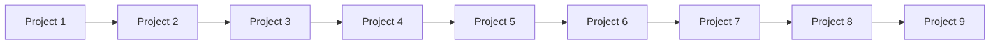

# Practical Project Progression

Keep evolving **one realistic production project** as you learn each technology. This turns individual tools into a coherent DevOps skill set.

| # | Project | What you build | Levels used |
|--:|---------|----------------|-------------|
| 1 | [Project 1 - Basic Server](project-01-basic-server.md) | Ubuntu + Nginx + Node.js + PostgreSQL deployed manually. | Levels 0-2 |
| 2 | [Project 2 - Docker](project-02-docker.md) | Node.js + PostgreSQL + Redis + Nginx containerized with Docker Compose. | Level 4 |
| 3 | [Project 3 - CI/CD](project-03-cicd.md) | GitHub -> GitHub Actions -> tests -> Docker -> registry -> deployment. | Levels 3, 5 |
| 4 | [Project 4 - Terraform](project-04-terraform.md) | Provision AWS VPC, subnets, EC2, ALB and RDS using Terraform. | Levels 6-7 |
| 5 | [Project 5 - Kubernetes](project-05-kubernetes.md) | Move the application to Kubernetes. | Level 8 |
| 6 | [Project 6 - Production Kubernetes](project-06-production-kubernetes.md) | Add Ingress, TLS, HPA, RBAC, Secrets, NetworkPolicies, Helm and Argo CD. | Levels 8, 9, 16, 17 |
| 7 | [Project 7 - Observability](project-07-observability.md) | Add Prometheus, Grafana, Loki, OpenTelemetry and Sentry. | Level 10 |
| 8 | [Project 8 - Disaster Recovery](project-08-disaster-recovery.md) | Simulate infrastructure and database failures and recover from them. | Levels 13-15 |
| 9 | [Project 9 - Senior Architecture](project-09-senior-architecture.md) | Build a complete production-style platform using AWS, Terraform, Docker, Kubernetes, Helm, GitOps and observability. | Levels 6-20 |

[← Roadmap home](../README.md)
