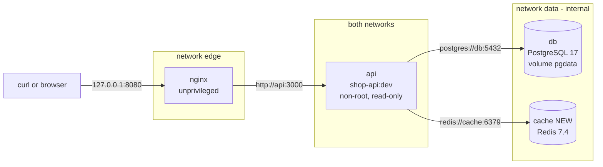
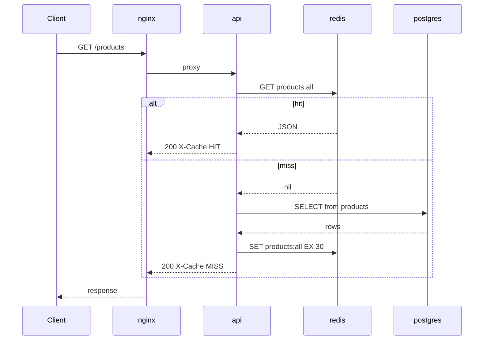

# Project 2 — Docker

> **Project 2 of 9** · Uses levels: Level 4 · ⏱ ~8 hours

## 1. Goal and outcome

Take the `shop-api` you deployed by hand in [Project 1](project-01-basic-server.md) and run the **whole stack in containers** with
Docker Compose: Nginx, the Node.js API, PostgreSQL and a new Redis cache. One command (`docker compose up -d --wait`) replaces an afternoon of `apt install`, systemd units and file edits, and works the same on your laptop, a colleague's laptop and a CI runner.

The full containerization story, including the monitoring stack, lives in the [Level 4 capstone](../level-04-docker/99-capstone-project.md).
This project is the **integration step**: it keeps the exact application contract from Project 1, changes only how it is packaged and wired, and defines what you must be able to prove before moving on to a pipeline.

You finish with:

- a multi-stage, non-root, health-checked image `shop-api:dev`;
- `compose.yaml` bringing up four services in dependency order, gated by health checks;
- PostgreSQL data in a named volume that survives `docker compose down` and image upgrades;
- a private `data` network that has no route to the internet or the host, with only Nginx published on `127.0.0.1:8080`;
- Redis used as a cache-aside layer in front of `/products`, visible in an `X-Cache` response header;
- a `smoke.sh` test that replaces Project 1's `verify.sh` and runs anywhere Docker runs.

## 2. Architecture

What changed from Project 1: the server is gone as the unit of deployment. Processes became containers, `localhost` became service names on private networks, systemd became Compose, and Redis is new (marked NEW).



Request path for `GET /products` after this project (cache-aside):



| Project 1 | Project 2 |
|-----------|-----------|
| `apt install nginx` | `image: nginxinc/nginx-unprivileged:1.28-alpine` |
| systemd unit with `Restart=on-failure` | `restart: unless-stopped` plus a `healthcheck` |
| `/etc/shop-api.env`, mode 640 | `.env` file (git-ignored) interpolated by Compose |
| PostgreSQL on loopback | PostgreSQL on an `internal` network, named volume `pgdata` |
| `ufw` allows 22, 80, 443 | only `127.0.0.1:8080` is published; nothing else is reachable |
| `verify.sh` on the server | `smoke.sh` from your laptop |

## 3. Prerequisites

- Docker Engine 25 or newer (or Docker Desktop) with Compose v2: `docker compose version`. About 2 GB of RAM and 2 GB of disk. Cost: nothing.
- Containers: [Docker internals](../level-04-docker/01-docker-internals.md), [images and layers](../level-04-docker/02-images-and-layers.md), [containers](../level-04-docker/03-containers.md), [volumes](../level-04-docker/05-volumes.md), [networks](../level-04-docker/06-networks.md), [Dockerfile](../level-04-docker/07-dockerfile.md), [Compose](../level-04-docker/08-docker-compose.md).
- Hardening topics used here: [multi-stage builds](../level-04-docker/10-multi-stage-builds.md), [non-root containers](../level-04-docker/11-non-root-containers.md), [health checks](../level-04-docker/12-health-checks.md).
- The Project 1 application source (`server.js`, `package.json`) and the SQL you used to create the `products` table.
- Redis background: [Redis](../level-13-databases-distributed-systems/07-redis.md) (optional now, essential in Project 8).

## 4. Build it step by step

Create a working directory `shop/` containing your app. Files you will add are shown with their path in the first line.

### Milestone 1 — Make the app container-friendly (≈45 min)

Containers need configuration from the environment, to bind to all interfaces, and to log to stdout. Check the contract:

- `HOST` defaults to `127.0.0.1` on a server but must be `0.0.0.0` in a container (Compose sets it).
- `DATABASE_URL` and `REDIS_URL` come from the environment; the app exits with a clear message if `DATABASE_URL` is missing.
- Add Redis caching to `/products` (cache-aside, 30 s TTL) and the `X-Cache` header:

```bash
npm install redis@^4 --save --no-audit --no-fund
```

```js
const { createClient } = require('redis');
const cache = createClient({ url: process.env.REDIS_URL });
cache.on('error', (e) => log('warn', 'redis error', { error: e.message }));   // never crash on cache trouble
cache.connect().catch(() => {});

async function cachedProducts() {
  try {
    const hit = cache.isReady ? await cache.get('products:all') : null;
    if (hit) return { rows: JSON.parse(hit), cache: 'HIT' };
  } catch (_) { /* fall through to the database */ }
  const { rows } = await pool.query('SELECT id, name, price_cents FROM products ORDER BY id');
  try { if (cache.isReady) await cache.set('products:all', JSON.stringify(rows), { EX: 30 }); } catch (_) {}
  return { rows, cache: 'MISS' };
}
// in the /products handler:
//   const { rows, cache: c } = await cachedProducts();
//   res.writeHead(200, { 'Content-Type': 'application/json', 'X-Cache': c });
```

The cache is an optimisation, not a dependency: if Redis is down, `/products` must still answer from PostgreSQL. `/readyz` checks only PostgreSQL.

### Milestone 2 — The image (≈1 h)

`Dockerfile`:

```dockerfile
# syntax=docker/dockerfile:1
FROM node:22-alpine AS deps
WORKDIR /app
COPY package.json package-lock.json ./
RUN npm ci --omit=dev --no-audit --no-fund

FROM node:22-alpine AS runtime
ENV NODE_ENV=production
WORKDIR /app
COPY --from=deps /app/node_modules ./node_modules
COPY package.json server.js ./
USER node
EXPOSE 3000
CMD ["node", "server.js"]
```

`.dockerignore`:

```
node_modules
.git
.env
*.log
```

```bash
docker build -t shop-api:dev .
docker image ls shop-api:dev              # roughly 150-200 MB with Node 22 on Alpine
docker run --rm shop-api:dev id           # uid=1000(node) gid=1000(node)
```

Why this shape: dependencies are installed in their own layer, so editing `server.js` does not reinstall packages ([layer caching](../level-04-docker/09-layer-caching-and-optimization.md)); the final image has no build tools and runs as a non-root user.

### Milestone 3 — Database initialisation and secrets (≈30 min)

`db/init.sql` (runs once, only when the data volume is empty):

```sql
CREATE TABLE IF NOT EXISTS products (
  id          serial PRIMARY KEY,
  name        text    NOT NULL,
  price_cents integer NOT NULL CHECK (price_cents >= 0)
);
INSERT INTO products (name, price_cents) VALUES ('Keyboard', 4999), ('Mouse', 1999), ('Monitor', 17999);
```

`.env` (add to `.gitignore`; Compose reads it automatically):

```bash
echo "DB_PASS=$(openssl rand -hex 16)" > .env
echo ".env" >> .gitignore
```

### Milestone 4 — Compose (≈1 h)

`compose.yaml` (validated with `docker compose config`):

```yaml
name: shop

services:
  nginx:
    image: nginxinc/nginx-unprivileged:1.28-alpine
    ports:
      - "127.0.0.1:8080:8080"
    volumes:
      - ./nginx/default.conf:/etc/nginx/conf.d/default.conf:ro
    depends_on:
      api:
        condition: service_healthy
    networks: [edge]
    restart: unless-stopped

  api:
    build: .
    image: shop-api:dev
    environment:
      PORT: "3000"
      HOST: "0.0.0.0"
      DATABASE_URL: postgres://shop:${DB_PASS:?set DB_PASS in .env}@db:5432/shop
      REDIS_URL: redis://cache:6379
    depends_on:
      db:
        condition: service_healthy
      cache:
        condition: service_healthy
    healthcheck:
      test: ["CMD", "node", "-e", "fetch('http://127.0.0.1:3000/healthz').then(r=>process.exit(r.ok?0:1)).catch(()=>process.exit(1))"]
      interval: 10s
      timeout: 3s
      retries: 3
      start_period: 10s
    read_only: true
    tmpfs: [/tmp]
    cap_drop: [ALL]
    security_opt: ["no-new-privileges:true"]
    networks: [edge, data]
    restart: unless-stopped

  db:
    image: postgres:17-alpine
    environment:
      POSTGRES_USER: shop
      POSTGRES_PASSWORD: ${DB_PASS:?set DB_PASS in .env}
      POSTGRES_DB: shop
    volumes:
      - pgdata:/var/lib/postgresql/data
      - ./db/init.sql:/docker-entrypoint-initdb.d/01-init.sql:ro
    healthcheck:
      test: ["CMD-SHELL", "pg_isready -U shop -d shop"]
      interval: 5s
      timeout: 3s
      retries: 10
    networks: [data]
    restart: unless-stopped

  cache:
    image: redis:7.4-alpine
    command: ["redis-server", "--save", "", "--appendonly", "no", "--maxmemory", "64mb", "--maxmemory-policy", "allkeys-lru"]
    healthcheck:
      test: ["CMD", "redis-cli", "ping"]
      interval: 5s
      timeout: 3s
      retries: 10
    networks: [data]
    restart: unless-stopped

networks:
  edge: {}
  data:
    internal: true          # no route out: db and cache cannot reach the internet

volumes:
  pgdata: {}
```

`nginx/default.conf`:

```nginx
upstream shop_api { server api:3000; keepalive 16; }
server {
    listen 8080;
    server_name _;
    location = /nginx-health { access_log off; return 200 "ok\n"; }
    location = /metrics { return 404; }          # never expose metrics publicly (used in Project 7)
    location / {
        proxy_pass http://shop_api;
        proxy_http_version 1.1;
        proxy_set_header Connection "";
        proxy_set_header Host $host;
        proxy_set_header X-Forwarded-For $proxy_add_x_forwarded_for;
        proxy_set_header X-Forwarded-Proto $scheme;
        proxy_connect_timeout 2s;
        proxy_read_timeout 15s;
    }
}
```

```bash
docker compose config --quiet && echo "compose file valid"
docker compose up -d --build --wait
docker compose ps                         # all four services "healthy" / "running"
curl -si http://127.0.0.1:8080/products | grep -iE 'HTTP/|x-cache'    # X-Cache: MISS
curl -si http://127.0.0.1:8080/products | grep -i x-cache             # X-Cache: HIT
```

### Milestone 5 — Smoke test (≈30 min)

`smoke.sh`:

```bash
#!/usr/bin/env bash
set -euo pipefail
BASE="${BASE:-http://127.0.0.1:8080}"
fail() { echo "FAIL: $*" >&2; exit 1; }
curl -fsS "$BASE/readyz" >/dev/null                         || fail "readyz"
n=$(curl -fsS "$BASE/products" | python3 -c 'import json,sys; print(len(json.load(sys.stdin)))')
[ "$n" -ge 1 ]                                              || fail "no products"
curl -fsS "$BASE/products" -D - -o /dev/null | grep -qi '^x-cache: HIT' || fail "cache not hit on second call"
[ "$(curl -s -o /dev/null -w '%{http_code}' "$BASE/metrics")" = 404 ]   || fail "/metrics must not be public"
echo "SMOKE OK"
```

Run `chmod +x smoke.sh && ./smoke.sh`. Add `docker compose down` followed by `up` and prove the data persisted. `docker compose down -v` is what deletes the volume; know the difference.

## 5. Tasks

- [ ] **T1 — Build and inspect the image** *(≈45 min, beginner)*
  - **Goal:** a small, non-root image whose layers you can explain.
  - **Steps:**
    1. Build `shop-api:dev`, then run `docker history shop-api:dev` and `docker image ls`.
    2. Run `docker run --rm shop-api:dev id` and `docker run --rm shop-api:dev ls -la /app`.
    3. Change one line of `server.js` and rebuild; observe which layers are cached.
  - **Done when:** the container reports a non-root uid, and the rebuild shows `CACHED` for the dependency layer.

- [ ] **T2 — Bring the stack up in one command** *(≈45 min, beginner)*
  - **Goal:** four healthy services and a working request path.
  - **Steps:**
    1. Create `.env`, `db/init.sql`, `nginx/default.conf` and `compose.yaml` as above.
    2. `docker compose up -d --build --wait`, then `docker compose ps`.
    3. `curl -i http://127.0.0.1:8080/products` twice.
  - **Done when:** all services are healthy, and the first response has `X-Cache: MISS` and the second `X-Cache: HIT`.

- [ ] **T3 — Prove data persistence** *(≈20 min, beginner)*
  - **Goal:** distinguish container lifecycle from data lifecycle.
  - **Steps:**
    1. Insert a product with `docker compose exec db psql -U shop -d shop -c "INSERT INTO products (name, price_cents) VALUES ('Webcam', 5999);"`.
    2. `docker compose down` then `docker compose up -d --wait`; query again.
    3. Then run `docker compose down -v`, bring it up again, and query.
  - **Done when:** the Webcam row survives step 2 and is gone after step 3, and you can explain why.

- [ ] **T4 — Prove the network boundaries** *(≈30 min, intermediate)*
  - **Goal:** show that `db` and `cache` are unreachable from the host and the internet.
  - **Steps:**
    1. `nc -vz -w 2 127.0.0.1 5432` and `6379` from your host must fail (nothing is published).
    2. `docker compose exec db sh -c 'wget -T 3 -qO- http://example.com || echo no-route'`.
    3. `docker compose exec nginx sh -c 'getent hosts db || echo nginx-cannot-resolve-db'`.
  - **Done when:** the host cannot connect, `db` has no outbound route, and `nginx` cannot resolve `db` (it is not on the `data` network).

- [ ] **T5 — Cache behavior and failure** *(≈30 min, intermediate)*
  - **Goal:** confirm the cache is optional.
  - **Steps:**
    1. Watch hits and misses with `docker compose exec cache redis-cli monitor` in another terminal.
    2. `docker compose stop cache`, then `curl -i http://127.0.0.1:8080/products`.
    3. Start it again and wait for the 30 s TTL to expire to see a MISS followed by a HIT.
  - **Done when:** `/products` returns 200 with `X-Cache: MISS` while Redis is stopped, and the app log shows a warning but no crash.

- [ ] **T6 — Change the version without losing data** *(≈30 min, intermediate)*
  - **Goal:** upgrade the API image while the database stays up.
  - **Steps:**
    1. Add an `APP_VERSION` build argument or env var returned by `/readyz`.
    2. `docker compose up -d --build api` and watch `docker compose ps`.
    3. Run `docker compose logs --tail 20 api` and confirm graceful stop of the old container (exit code 0).
  - **Done when:** `/readyz` shows the new version, the database container was not recreated (`docker compose ps` uptime), and no request returned an error during the roll in a `while true; do curl -s -o /dev/null -w '%{http_code}\n' ...; done` loop (a brief failure is acceptable, and you can explain it).

- [ ] **T7 — Scan and slim the image** *(≈45 min, advanced)*
  - **Goal:** find and reduce known vulnerabilities.
  - **Steps:**
    1. Scan with Trivy or Docker Scout (`docker scout quickview shop-api:dev` or `trivy image shop-api:dev`).
    2. Compare against `node:22-slim` and a distroless runtime stage; read [minimal base images](../level-04-docker/13-minimal-base-images.md) and [image scanning](../level-04-docker/14-image-scanning-and-container-security.md).
    3. Record image sizes and critical or high findings for each variant in a table.
  - **Done when:** you have a table of size and findings for at least two variants and can justify which one you would ship.

- [ ] **T8 — Prove it: from clean clone to green smoke test** *(≈1 h, advanced)*
  - **Goal:** a new teammate can run the stack with two commands.
  - **Steps:**
    1. Commit everything except `.env`; write a 10-line `README` (prerequisites, `cp .env.example .env`, `docker compose up -d --build --wait`, `./smoke.sh`).
    2. Delete all local images and volumes (`docker compose down -v --rmi local`) and follow only your README on a clean directory.
    3. Explain aloud how a request flows through the networks and which container could be compromised without exposing the database to the internet.
  - **Done when:** `./smoke.sh` prints `SMOKE OK` from a clean clone, and your README needed no extra steps.

## 6. Definition of done

- [ ] `docker compose up -d --build --wait` finishes with four healthy services.
- [ ] `./smoke.sh` prints `SMOKE OK`, including a cache HIT and `/metrics` returning 404 through Nginx.
- [ ] The API image runs as a non-root user, has a read-only root file system and drops all capabilities.
- [ ] Only `127.0.0.1:8080` is published; `db` and `cache` live on an `internal` network.
- [ ] Data survives `docker compose down`; you can explain exactly what `-v` removes.
- [ ] No secret is in the image, in `compose.yaml` or in Git; `.env` is ignored and `.env.example` documents the keys.
- [ ] Stopping Redis does not break `/products`; stopping PostgreSQL turns `/readyz` into 503 within a few seconds.

## 7. Break it on purpose

1. **Remove the health check ordering.** Delete the `condition: service_healthy` lines and run `docker compose down -v && docker compose up -d`. The API may start before PostgreSQL accepts connections. Watch `docker compose logs api` and see why health-gated `depends_on` matters. Restore it.
2. **Change the password after first start.** Edit `DB_PASS` in `.env` and `docker compose up -d`. The API fails to authenticate because PostgreSQL only reads `POSTGRES_PASSWORD` when it initialises an empty volume. Fix it with `ALTER ROLE shop PASSWORD '...'` (or by recreating the volume in a throwaway lab).
3. **Run as root with a writable file system.** Remove `USER node`, `read_only` and `cap_drop`, then `docker compose exec api sh -c 'touch /app/x && id'`. Compare with the hardened version and write down what an attacker with code execution could do in each.
4. **Exhaust the cache memory.** Lower the limit at runtime with `docker compose exec cache redis-cli config set maxmemory 1mb`, load many keys with `docker compose exec cache sh -c 'for i in $(seq 1 20000); do redis-cli set k$i xxxxxxxxxxxxxxxxxxxxxxxx >/dev/null; done'`, and read `redis-cli info stats | grep evicted_keys`. Explain why `allkeys-lru` is right for a cache and wrong for a primary store.

## 8. How this evolves into the next project

You now have a reproducible artifact (the image) and a reproducible environment (Compose). But a human still builds and starts it, and nothing
checks a change before it reaches the stack. [Project 3 — CI/CD](project-03-cicd.md) puts the repository on GitHub and lets GitHub Actions lint, test, build, scan and push
this exact image to a registry on every merge, then deploy it to a server using the same `compose.yaml`. Keep `smoke.sh`: it becomes the post-deploy gate in the pipeline.
