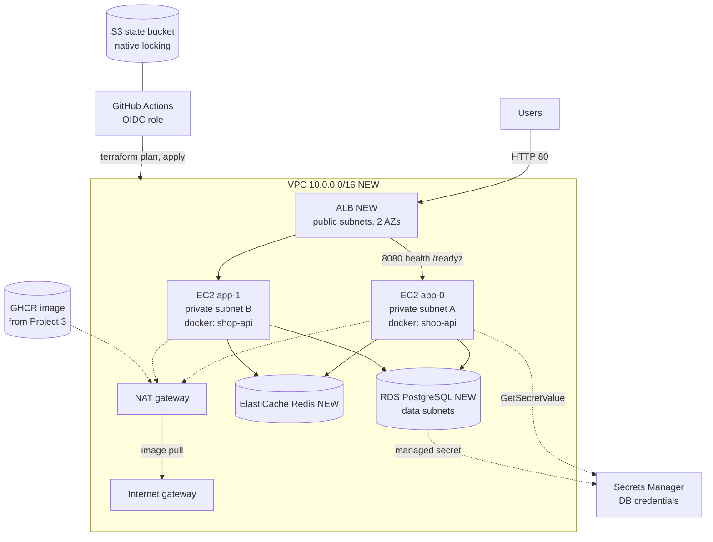
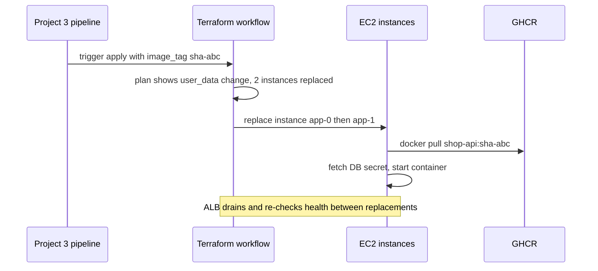

# Project 4 — Terraform

> **Project 4 of 9** · Uses levels: Levels 6-7 · ⏱ ~14 hours

## 1. Goal and outcome

Replace the hand-made server with **infrastructure defined as code**: a VPC with public, private and data subnets, two EC2 instances behind an
Application Load Balancer (ALB), PostgreSQL on RDS and Redis on ElastiCache, all created by `terraform apply` and removed by `terraform destroy`. The instances run the
**same container image** your [Project 3](project-03-cicd.md) pipeline publishes, so the application, its health endpoints and its smoke test do not change at all.

The AWS building blocks are taught in the [Level 6 capstone](../level-06-cloud-aws/99-capstone-project.md) (built by hand in the console) and the Terraform module structure,
remote state and pipeline in the [Level 7 capstone](../level-07-terraform-iac/99-capstone-project.md). This project is the integration: **take the Level 7
modules, run the real `shop-api` image on them, and let a pipeline plan and apply every change**.

You finish with:

- a repository `shop-api-infra` with `modules/` (network, data, app) and thin `envs/dev` and `envs/prod` roots, using remote state with native S3 locking;
- `curl http://<alb-dns-name>/products` returning rows from RDS through the ALB, with `X-Cache` flipping from MISS to HIT via ElastiCache;
- instances that fetch the database password from Secrets Manager at boot (no password in code, state outputs, user data or the image);
- a pull-request workflow that runs `fmt`, `validate`, a security scan and `plan`, and applies on merge using GitHub OIDC (no stored AWS keys);
- a cost estimate you wrote down **before** applying, a billing alarm, and a verified `destroy`.

## 2. Architecture

What changed from Project 3: the Docker host is no longer a hand-built VM. Networking, firewalling, compute, load balancing and the database are resources in code (NEW boxes), the database and cache are
managed services instead of containers, and the ALB replaces Nginx as the public front door.



How a deployment of a new image tag works in this project (and why it is not good enough yet):



| Project 3 | Project 4 |
|-----------|-----------|
| One VM you built by hand | Two EC2 instances from a launch definition in code |
| Nginx container in front | ALB with a target group and `/readyz` health check |
| PostgreSQL and Redis containers | RDS PostgreSQL (Secrets Manager password) and ElastiCache Redis |
| `.env` file on disk | IAM instance profile plus Secrets Manager |
| `deploy.sh` over SSH | change `image_tag`, plan in a PR, apply on merge |
| Firewall: `ufw` | Security groups that reference each other |

## 3. Prerequisites

- An **AWS sandbox account** (never production), MFA on the root user, a **billing alarm** and a budget before you create anything ([CloudWatch](../level-06-cloud-aws/18-cloudwatch.md)). Terraform 1.11+ (OpenTofu works), AWS CLI v2, a GitHub repository.
- **Cost warning:** the NAT gateway, ALB, RDS, ElastiCache and two instances bill per hour, typically a few US dollars per day for a small dev stack (check current regional pricing; free-tier eligibility varies). Apply, test, and destroy the same day. Region: `us-east-1`.
- AWS: [EC2](../level-06-cloud-aws/01-ec2.md), [VPC and subnets](../level-06-cloud-aws/04-vpc-and-subnets.md), [route tables, IGW and NAT](../level-06-cloud-aws/05-route-tables-igw-nat.md), [security groups](../level-06-cloud-aws/06-security-groups-and-nacls.md), [IAM](../level-06-cloud-aws/07-iam.md), [RDS](../level-06-cloud-aws/10-rds-and-aurora.md), [ElastiCache](../level-06-cloud-aws/11-elasticache.md), [ALB](../level-06-cloud-aws/14-alb.md), [Secrets Manager](../level-06-cloud-aws/16-secrets-manager.md).
- Terraform: [providers and resources](../level-07-terraform-iac/01-providers-and-resources.md), [variables and outputs](../level-07-terraform-iac/02-variables-and-outputs.md), [modules](../level-07-terraform-iac/03-modules.md), [state and backends](../level-07-terraform-iac/04-state-and-remote-backends.md), [reusable environments](../level-07-terraform-iac/06-reusable-environments.md), [Terraform CI/CD](../level-07-terraform-iac/07-terraform-ci-cd.md), [state locking](../level-07-terraform-iac/08-state-locking.md).
- A **public** GHCR package for `shop-api` (set the package visibility in GitHub) so instances can pull it anonymously in this lab. In real use you would push to ECR and grant the instance role pull access.

## 4. Build it step by step

### Milestone 1 — Stand up the Level 7 stack as the baseline (≈4 h)

Follow Milestones 0 to 4 of the [Level 7 capstone](../level-07-terraform-iac/99-capstone-project.md): bootstrap state (remote, locked, versioned), then the `network`, `data` and `app` modules and `envs/dev`. That version runs a tiny Python stand-in on port 8080. Confirm the baseline:

```bash
cd envs/dev && terraform init && terraform apply
curl -s "http://$(terraform output -raw alb_dns_name)/"      # JSON from the stand-in server
```

Write the cost estimate now (ALB hours, NAT gateway hours plus data, RDS, ElastiCache, two instances, EBS) in `COST.md` and compare it with the AWS Billing console tomorrow.

### Milestone 2 — Teach the application about TLS to RDS (≈30 min)

RDS for PostgreSQL 15 and later requires TLS by default (`rds.force_ssl` defaults to on), so a plain connection that worked against the Compose database is rejected. Add a switch to the pool in `server.js`:

```js
const ssl = process.env.PGSSL === '1' ? { rejectUnauthorized: false } : false;   // lab shortcut
const pool = new Pool({ connectionString: process.env.DATABASE_URL, max: 10, ssl });
```

`rejectUnauthorized: false` encrypts the connection but does not verify the server. Treat it as a lab shortcut and replace it with the RDS CA bundle (`ssl: { ca: fs.readFileSync(...) }`) once the stack works ([TLS](../level-12-advanced-networking/04-tls.md)). Commit, let Project 3's pipeline publish the new image, and note its `sha-...` tag.

### Milestone 3 — Run the real image on the instances (≈2 h)

In `modules/app`, add variables `image` (full reference including tag), `db_endpoint`, `db_secret_arn`, `redis_endpoint`, and grant the instance role access to exactly one secret:

```hcl
data "aws_iam_policy_document" "read_db_secret" {
  statement {
    actions   = ["secretsmanager:GetSecretValue"]
    resources = [var.db_secret_arn]
  }
}

resource "aws_iam_role_policy" "read_db_secret" {
  name   = "read-db-secret"
  role   = aws_iam_role.app.id
  policy = data.aws_iam_policy_document.read_db_secret.json
}
```

Replace the inline Python server with a template file `modules/app/userdata.sh.tftpl`:

```bash
#!/bin/bash
set -euo pipefail
dnf install -y docker jq
systemctl enable --now docker

SECRET="$(aws secretsmanager get-secret-value --region ${region} --secret-id ${db_secret_arn} \
  --query SecretString --output text)"
DB_USER="$(echo "$SECRET" | jq -r .username)"
DB_PASS="$(echo "$SECRET" | jq -rj .password | jq -sRr @uri)"   # URL-encode special characters

docker network create shop || true
docker run -d --name api --restart unless-stopped --network shop -p 8080:3000 \
  -e PORT=3000 -e HOST=0.0.0.0 -e PGSSL=1 \
  -e DATABASE_URL="postgres://$DB_USER:$DB_PASS@${db_endpoint}:5432/shop" \
  -e REDIS_URL="redis://${redis_endpoint}:6379" \
  ${image}
```

and render it in the instance resource:

```hcl
resource "aws_instance" "app" {
  # ... as in the Level 7 capstone ...
  user_data_replace_on_change = true
  user_data = templatefile("${path.module}/userdata.sh.tftpl", {
    region         = data.aws_region.current.name
    db_secret_arn  = var.db_secret_arn
    db_endpoint    = var.db_endpoint
    redis_endpoint = var.redis_endpoint
    image          = var.image
  })
}
```

Wire the data module outputs into the app module in `envs/dev/main.tf`:

```hcl
module "app" {
  source         = "../../modules/app"
  # ... network and security group inputs ...
  db_endpoint    = module.data.db_address          # aws_db_instance.this.address
  db_secret_arn  = module.data.db_secret_arn       # aws_db_instance.this.master_user_secret[0].secret_arn
  redis_endpoint = module.data.redis_endpoint
  image          = "ghcr.io/you/shop-api:${var.image_tag}"
}

variable "image_tag" { type = string }
```

Point the ALB target group health check at `/readyz` (matcher `200`, interval 15 s, healthy threshold 2), keep the target port at 8080 as in Level 7, and mark the database secret output `sensitive` or output only its ARN (an ARN is not a secret).

```bash
terraform plan  -var image_tag=sha-<full sha>
terraform apply -var image_tag=sha-<full sha>
ALB="$(terraform output -raw alb_dns_name)"
until curl -fs "http://$ALB/readyz"; do sleep 10; done          # instances take a few minutes to bootstrap
curl -si "http://$ALB/products" | grep -iE 'HTTP/|x-cache'
```

If the target group shows `unhealthy`, SSH is not needed: use Session Manager (`aws ssm start-session --target <instance-id>`) and `sudo cat /var/log/cloud-init-output.log`, `docker logs api`.

### Milestone 4 — Seed the schema (≈30 min)

The managed database starts empty. Do it as a one-off from an instance (the only place that can reach the private database), not by opening the database to the internet:

```bash
aws ssm start-session --target <instance-id>
# inside the session: read the secret as the user data does, then run psql from a throwaway container
SECRET="$(aws secretsmanager get-secret-value --region us-east-1 --secret-id <db-secret-arn> --query SecretString --output text)"
sudo docker run --rm -i -e PGSSLMODE=require \
  -e PGPASSWORD="$(echo "$SECRET" | jq -rj .password)" postgres:17-alpine \
  psql -h <rds-endpoint> -U "$(echo "$SECRET" | jq -r .username)" -d shop <<'SQL'
CREATE TABLE IF NOT EXISTS products (id serial PRIMARY KEY, name text NOT NULL, price_cents integer NOT NULL CHECK (price_cents >= 0));
INSERT INTO products (name, price_cents) VALUES ('Keyboard', 4999), ('Mouse', 1999), ('Monitor', 17999);
SQL
```

Better: run it as a one-shot container with the SQL baked into a migration image or a CI-controlled job ([database migrations](../level-05-cicd/09-database-migrations.md)). You will formalise this in Project 5.

### Milestone 5 — The pipeline (≈2 h)

Create the GitHub OIDC provider, a read-only `plan` role and an `apply` role limited to the `main` branch, as in [Terraform CI/CD](../level-07-terraform-iac/07-terraform-ci-cd.md). The workflow (abbreviated):

```yaml
name: terraform
on:
  pull_request: { paths: ["envs/**", "modules/**"] }
  push: { branches: [main], paths: ["envs/**", "modules/**"] }
  workflow_dispatch:
    inputs:
      image_tag: { description: "Image tag to deploy", required: true }
permissions: { id-token: write, contents: read, pull-requests: write }
jobs:
  plan:
    runs-on: ubuntu-24.04
    steps:
      - uses: actions/checkout@v4
      - uses: hashicorp/setup-terraform@v3
      - uses: aws-actions/configure-aws-credentials@v4
        with: { role-to-assume: "${{ vars.PLAN_ROLE_ARN }}", aws-region: us-east-1 }
      - run: terraform -chdir=envs/dev fmt -check -recursive
      - run: terraform -chdir=envs/dev init -input=false
      - run: terraform -chdir=envs/dev validate
      - run: terraform -chdir=envs/dev plan -input=false -var image_tag=${{ inputs.image_tag || vars.IMAGE_TAG }} -out=tfplan
```

An `apply` job (with `environment: dev` and the apply role) runs only on `main`. Keep the image tag in a repository variable (or a tracked `dev.auto.tfvars`) so that a deploy is a reviewed change.

### Milestone 6 — Operate and destroy (≈1 h)

```bash
terraform plan -detailed-exitcode        # 0 = clean, 2 = drift, after you change a tag by hand in the console
terraform destroy -var image_tag=sha-<sha>
aws elbv2 describe-load-balancers --query 'LoadBalancers[].LoadBalancerArn'   # empty
aws ec2 describe-nat-gateways --filter Name=state,Values=available --query 'NatGateways[].NatGatewayId'   # empty
```

Then check the Billing console and Cost Explorer for the next day, not just the Terraform output.

## 5. Tasks

- [ ] **T1 — Estimate before you apply** *(≈45 min, beginner)*
  - **Goal:** know the bill before creating anything.
  - **Steps:**
    1. List each billable resource in `COST.md` with its hourly or monthly price from the AWS pricing pages.
    2. Create a budget and a billing alarm at an amount you can afford.
    3. After the lab, compare your estimate with the actual cost in Cost Explorer.
  - **Done when:** `COST.md` exists with a total, an alarm exists, and you recorded the estimate-versus-actual difference.

- [ ] **T2 — Bootstrap remote, locked state** *(≈1 h, intermediate)*
  - **Goal:** state in S3 with native locking, never on your laptop.
  - **Steps:**
    1. Create the state bucket (versioned, encrypted, public access blocked) as in the Level 7 capstone.
    2. Configure `backend "s3"` with `use_lockfile = true` and run `terraform init`.
    3. Start a long `plan` in one terminal and a second `plan` in another.
  - **Done when:** the second run fails with a lock error and `terraform state list` works from a fresh clone.

- [ ] **T3 — Build the network and prove the boundaries** *(≈2 h, intermediate)*
  - **Goal:** only the ALB is public.
  - **Steps:**
    1. Apply the `network` module and security groups; read `terraform plan` before applying.
    2. From your laptop try to reach an instance's private IP and the RDS endpoint (both must fail).
    3. Draw the security group references (`alb`, `app`, `db`, `redis`).
  - **Done when:** nothing but the ALB answers from the internet, and your drawing matches the rules `aws ec2 describe-security-groups` shows.

- [ ] **T4 — Run the real image behind the ALB** *(≈2 h, intermediate)*
  - **Goal:** `/products` served from RDS through the ALB.
  - **Steps:**
    1. Implement Milestones 2 to 4.
    2. Wait for both targets to become healthy in the target group.
    3. Curl `/products` twice and confirm `X-Cache: MISS` then `HIT`.
  - **Done when:** `aws elbv2 describe-target-health` lists two healthy targets and the cache header changes as expected.

- [ ] **T5 — Prove no secret is exposed** *(≈45 min, intermediate)*
  - **Goal:** the database password lives only in Secrets Manager and in process memory.
  - **Steps:**
    1. `grep -ri password . --include='*.tf' --include='*.tftpl' --include='*.tfvars'` and read `terraform output`.
    2. Inspect the state: `terraform state pull | grep -i '"password"'` (note what *is* in state and why state needs protection).
    3. Check `aws ec2 describe-instance-attribute --attribute userData` does not contain the password.
  - **Done when:** no password appears in code, outputs or user data, and you wrote down what the state file contains and who can read it.

- [ ] **T6 — Ship a new image by changing one variable** *(≈1 h, intermediate)*
  - **Goal:** a deployment is a reviewed Terraform change.
  - **Steps:**
    1. Merge an application change so Project 3 publishes a new tag.
    2. Open a PR changing `image_tag`; read the plan (instances replaced).
    3. Merge to apply, while running a `curl` loop against the ALB to record any failed requests.
  - **Done when:** the new version answers on the ALB, and you counted the errors during the replacement and can explain them.

- [ ] **T7 — Detect and repair drift** *(≈45 min, advanced)*
  - **Goal:** find out-of-band changes.
  - **Steps:**
    1. In the console, change a tag and add a security group ingress rule on the app group.
    2. Run `terraform plan -detailed-exitcode` and read the diff.
    3. Decide for each change: revert with apply or adopt into code, and do so. Add the scheduled `drift.yml` from [drift detection](../level-07-terraform-iac/09-drift-detection.md).
  - **Done when:** `plan` exits 0 again, and a scheduled workflow would have reported the drift.

- [ ] **T8 — Prove it: create, verify and destroy from scratch** *(≈2 h, advanced)*
  - **Goal:** the whole environment is reproducible and removable.
  - **Steps:**
    1. Destroy everything, then create it again with only `terraform apply -var image_tag=...` and one documented manual step (the schema seed).
    2. Run Project 2's `smoke.sh` with `BASE=http://<alb-dns-name>`.
    3. Destroy again and verify with the CLI that no ALB, NAT gateway, RDS instance or ElastiCache cluster remains.
  - **Done when:** `smoke.sh` prints `SMOKE OK` against the ALB, and the post-destroy CLI checks return empty lists.

## 6. Definition of done

- [ ] `terraform apply` builds the whole environment from an empty account (apart from the bootstrap state bucket and the OIDC role).
- [ ] `smoke.sh` passes against `http://<alb-dns-name>`; both targets are healthy; `/readyz` is the health check.
- [ ] State is remote, encrypted, versioned and locked; no state file or `.terraform/` directory is committed.
- [ ] No secret in code, outputs, user data, logs or CI variables; the pipeline uses OIDC and a plan-only role for pull requests.
- [ ] The database and cache are reachable only from the app security group.
- [ ] `fmt`, `validate` and a security scanner (for example Checkov or Trivy config) run in CI, and a PR shows the plan before merge.
- [ ] A cost estimate exists, and `terraform destroy` plus the CLI checks prove nothing is left billing.

## 7. Break it on purpose

1. **Manual console change.** Delete a route in a route table by hand. Watch the ALB lose its targets or the instances lose outbound access (image pulls fail), then repair it with `terraform apply`. *(Lesson: drift is real, and plans are the repair tool.)*
2. **Wrong secret ARN.** Point `db_secret_arn` at a non-existent secret, replace the instances, and read `/var/log/cloud-init-output.log` through Session Manager. Targets stay unhealthy and the ALB serves 503. *(Lesson: health checks turn a bad deploy into a visible failure instead of a bad response.)*
3. **Crash during apply.** Interrupt `terraform apply` with Ctrl+C partway through, then run `terraform plan`. See what the state believes, and recover (import or re-apply). Release a stale lock with `terraform force-unlock` only after proving no run is active. *(Lesson: state is the source of truth for what Terraform owns.)*
4. **Delete the NAT gateway.** Instances can no longer pull `ghcr.io` images or reach AWS APIs through the internet. Observe a new instance failing to bootstrap. Compare the cost and failure trade-off of a NAT gateway with VPC endpoints for Secrets Manager. *(Lesson: private subnets need an egress plan.)*

## 8. How this evolves into the next project

Replacing instances to ship a version is slow and blunt: two VMs, a cloud-init script, and a replace-both change that can drop requests. The cluster of
EC2 instances is also sized for the peak rather than the load. [Project 5 — Kubernetes](project-05-kubernetes.md) moves the same image onto a cluster that does rolling updates,
self-healing and autoscaling natively. You keep the VPC, the managed data tier and the pipeline discipline; the application tier becomes Kubernetes objects
(Deployment, Service, Ingress, ConfigMap, Secret) and later (Project 6) is managed through Helm and Argo CD.
