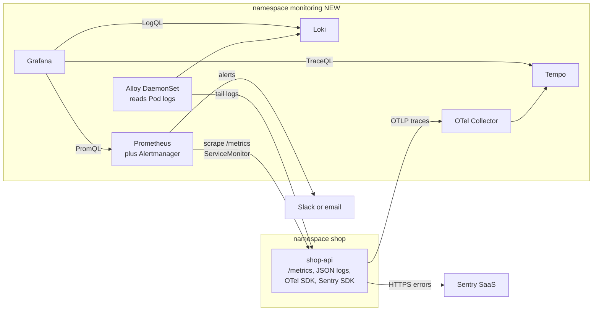
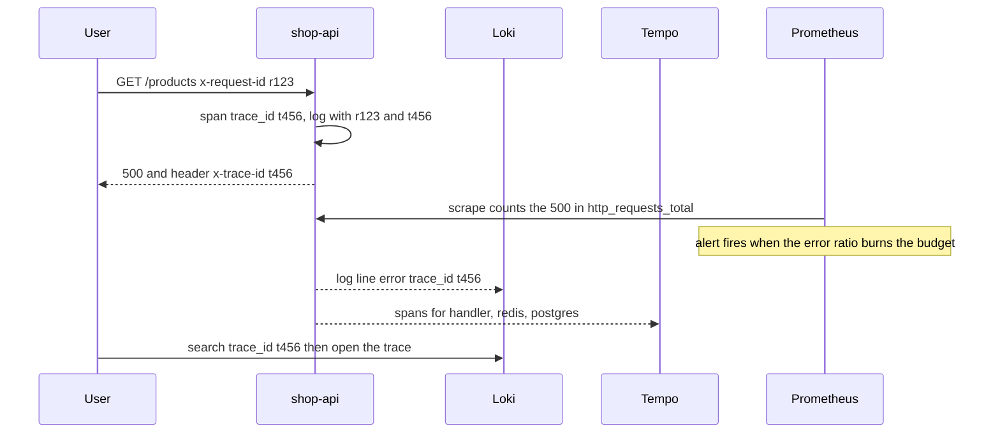

# Project 7 — Observability

> **Project 7 of 9** · Uses levels: Level 10 · ⏱ ~14 hours

## 1. Goal and outcome

Make the platform from [Project 6](project-06-production-kubernetes.md) **explain itself**. You add the three pillars plus error tracking to the same GitOps repository: **metrics** (Prometheus and Grafana), **logs** (Loki), **traces** (OpenTelemetry into Tempo) and
**errors** (Sentry). The goal is not pretty dashboards; it is that when something breaks you can go from an alert to the failing request to the line of code in a few minutes, using evidence.

The tools and concepts are taught in Level 10: [three pillars](../level-10-observability/01-three-pillars.md), [Prometheus and PromQL](../level-10-observability/02-prometheus-and-promql.md),
[Grafana dashboards](../level-10-observability/03-grafana-dashboards.md), [Loki](../level-10-observability/06-loki-log-aggregation.md),
[OpenTelemetry](../level-10-observability/09-opentelemetry.md) and [Sentry](../level-10-observability/10-sentry.md). This project wires them into **one running system** and ties them to a reliability target.

You finish with:

- the API exposing `/metrics` (request rate, errors, latency histogram, cache hit ratio) and writing structured JSON logs that carry a request ID and trace ID;
- a Prometheus scraping the API through a `ServiceMonitor`, Grafana with a "shop-api" dashboard (the four golden signals), and alert rules that page on SLO burn rather than on CPU;
- logs searchable in Grafana by `app`, `level` and `trace_id`, and a click from a log line to its trace;
- distributed traces showing one request across Nginx (Ingress), the API, Redis and PostgreSQL;
- unhandled exceptions arriving in Sentry with a release tag and a stack trace;
- an SLO document: "99.5 percent of `/products` requests succeed over 30 days, and 95 percent complete in under 300 ms".

## 2. Architecture

What changed from Project 6: a `monitoring` namespace with the telemetry backends (NEW), instrumentation in the API (NEW), new NetworkPolicies to allow telemetry, and all of it installed by Argo CD from Git.



One request, three kinds of evidence, joined by a trace ID:



| Question during an incident | Pillar | Where |
|-----------------------------|--------|-------|
| Is it broken, how badly, since when? | metrics | Grafana dashboard, alerts |
| Which request and which error message? | logs | Loki, query by `trace_id` |
| Where did the time go across services? | traces | Tempo |
| Which code path threw, in which release? | errors | Sentry |

## 3. Prerequisites

- The Project 6 cluster with Argo CD, and the `shop-gitops` repository. Resources: roughly 12 GB RAM free for a kind cluster with the full stack, or run on a small cloud cluster (cost applies; destroy it afterwards). Tools: `kubectl`, `helm`, `curl`, a free Sentry account (SaaS free tier) for the DSN.
- Level 10: [metric types](../level-10-observability/04-metric-types.md), [structured logging](../level-10-observability/05-structured-logging.md), [correlation IDs](../level-10-observability/07-correlation-ids.md), [distributed tracing](../level-10-observability/08-distributed-tracing.md), [what to monitor](../level-10-observability/11-what-to-monitor.md).
- Reliability targets: [SLIs](../level-14-sre/01-slis.md) and [SLOs](../level-14-sre/02-slos.md) (read these; this project defines one SLO) and [alert fatigue](../level-14-sre/08-alert-fatigue-reduction.md).
- Secrets: the Sentry DSN is not highly sensitive but should still travel as a [sealed secret](../level-11-security-devsecops/04-secrets-management-and-encryption.md).

## 4. Build it step by step

### Milestone 1 — Instrument the application (≈3 h)

```bash
npm install prom-client @sentry/node @opentelemetry/api @opentelemetry/auto-instrumentations-node @opentelemetry/sdk-node --no-audit --no-fund
```

**Metrics.** Use **route templates**, never raw URLs, as labels, or the label cardinality will explode ([metric types](../level-10-observability/04-metric-types.md)):

```js
const client = require('prom-client');
client.collectDefaultMetrics();
const httpTotal = new client.Counter({ name: 'http_requests_total', help: 'Requests',
  labelNames: ['method', 'route', 'status'] });
const httpDuration = new client.Histogram({ name: 'http_request_duration_seconds', help: 'Latency',
  labelNames: ['method', 'route'], buckets: [0.01, 0.05, 0.1, 0.3, 0.5, 1, 2.5] });
const cacheTotal = new client.Counter({ name: 'cache_requests_total', help: 'Cache lookups', labelNames: ['result'] });
// in the response 'finish' handler:  route = '/products' or '/products/:id' or 'unmatched'
//   httpTotal.inc({ method, route, status: res.statusCode }); end({ method, route }) for the timer
// in cachedProducts():                cacheTotal.inc({ result: 'hit' | 'miss' })
// GET /metrics:                       res.end(await client.register.metrics())
```

**Logs.** One JSON object per line, with `request_id` (from `x-request-id` or generated) and `trace_id` (from the active OpenTelemetry span via `trace.getActiveSpan()?.spanContext().traceId`). Return the request ID in a response header. Never log request bodies, tokens or passwords.

**Traces.** Start the SDK before the app loads, with environment variables only (no code change in handlers):

```bash
# in the container command (Deployment args)
node --require @opentelemetry/auto-instrumentations-node/register server.js
# environment (chart values)
OTEL_SERVICE_NAME=shop-api
OTEL_EXPORTER_OTLP_ENDPOINT=http://otel-collector.monitoring.svc:4318
OTEL_TRACES_SAMPLER=parentbased_traceidratio
OTEL_TRACES_SAMPLER_ARG=0.2
```

The auto-instrumentation covers HTTP, `pg` and Redis clients, so a request produces spans for the handler and both data stores. Sampling 20 percent keeps cost down; raise it for debugging.

**Errors.** Initialise Sentry as the first thing the process does and attach the release:

```js
const Sentry = require('@sentry/node');
Sentry.init({ dsn: process.env.SENTRY_DSN, release: process.env.APP_VERSION, environment: process.env.APP_ENV,
  tracesSampleRate: 0 });            // traces go through OpenTelemetry; Sentry captures errors only
```

Set `APP_VERSION=sha-<commit>` in the chart from `image.tag`, so each Sentry issue names the release that introduced it ([Sentry](../level-10-observability/10-sentry.md)). Rebuild with the Project 3 pipeline and verify locally:

```bash
curl -s localhost:3000/metrics | grep -E '^(http_requests_total|http_request_duration_seconds_count|cache_requests_total)'
```

### Milestone 2 — Install the backends through GitOps (≈3 h)

Add one Argo CD `Application` per component to `shop-gitops/apps/`, each pointing to a community Helm chart with **pinned chart versions** (find them with `helm search repo <chart> --versions` and pin in `targetRevision`; never track `latest`).

| Component | Chart (repo) | Role |
|-----------|--------------|------|
| kube-prometheus-stack | `prometheus-community` | Prometheus Operator, Prometheus, Alertmanager, Grafana, node and kube-state exporters |
| loki | `grafana` | log storage (single binary mode, filesystem, lab only) |
| alloy | `grafana` | DaemonSet that reads Pod logs and pushes them to Loki |
| tempo | `grafana` | trace storage (single binary, lab only) |
| opentelemetry-collector | `open-telemetry` | gateway: receives OTLP, forwards to Tempo |

Example for the metrics stack (the pattern is the same for the others; keep the values in your repo):

```yaml
apiVersion: argoproj.io/v1alpha1
kind: Application
metadata: { name: kube-prometheus-stack, namespace: argocd }
spec:
  project: default
  sources:
    - repoURL: https://prometheus-community.github.io/helm-charts
      chart: kube-prometheus-stack
      targetRevision: <PINNED_CHART_VERSION>
      helm: { valueFiles: [$values/monitoring/kube-prometheus-stack.values.yaml] }
    - repoURL: https://github.com/you/shop-gitops.git
      targetRevision: main
      ref: values
  destination: { server: https://kubernetes.default.svc, namespace: monitoring }
  syncPolicy:
    automated: { prune: true, selfHeal: true }
    syncOptions: [CreateNamespace=true, ServerSideApply=true]
```

In the stack values, enable discovery of ServiceMonitors from all namespaces (`serviceMonitorSelectorNilUsesHelmValues: false`), add Loki and Tempo as Grafana data sources, and give Grafana an admin password from a sealed secret. The OTel Collector configuration (receivers, a batch processor, one exporter):

```yaml
receivers:
  otlp:
    protocols:
      http: { endpoint: 0.0.0.0:4318 }
processors:
  batch: {}
exporters:
  otlp/tempo:
    endpoint: tempo.monitoring.svc:4317
    tls: { insecure: true }          # lab only, in-cluster
service:
  pipelines:
    traces: { receivers: [otlp], processors: [batch], exporters: [otlp/tempo] }
```

### Milestone 3 — Scrape, dashboard and alert (≈3 h)

Add to the chart a `ServiceMonitor` (the API Service needs a named port `http`):

```yaml
apiVersion: monitoring.coreos.com/v1
kind: ServiceMonitor
metadata: { name: shop-api, namespace: shop, labels: { release: kube-prometheus-stack } }
spec:
  selector: { matchLabels: { app: shop-api } }
  endpoints: [{ port: http, path: /metrics, interval: 15s }]
```

Because Project 6 denies all traffic by default, scraping needs a new NetworkPolicy allowing the `monitoring` namespace to reach port 3000, and the API needs egress to the OTel Collector (4318) and to Sentry on 443 (an `ipBlock` for `0.0.0.0/0` that excludes the private ranges). Do this deliberately: a silent, empty target in Prometheus is the classic symptom of a missing allow.

Dashboard panels (PromQL). Put them in a ConfigMap labelled `grafana_dashboard: "1"` so the Grafana sidecar loads them from Git:

```promql
# traffic
sum(rate(http_requests_total{job="shop-api"}[5m])) by (route)
# errors (ratio)
sum(rate(http_requests_total{job="shop-api",status=~"5.."}[5m])) / sum(rate(http_requests_total{job="shop-api"}[5m]))
# latency p95
histogram_quantile(0.95, sum(rate(http_request_duration_seconds_bucket{job="shop-api"}[5m])) by (le, route))
# cache hit ratio
sum(rate(cache_requests_total{result="hit"}[5m])) / sum(rate(cache_requests_total[5m]))
# saturation
sum(rate(container_cpu_usage_seconds_total{namespace="shop"}[5m])) by (pod)
```

Alerts on the SLO (99.5 percent availability, so the error budget is 0.5 percent), using a fast multi-window burn rate that pages when the budget is being consumed about 14 times faster than allowed:

```yaml
apiVersion: monitoring.coreos.com/v1
kind: PrometheusRule
metadata: { name: shop-api-slo, namespace: shop, labels: { release: kube-prometheus-stack } }
spec:
  groups:
    - name: shop-api-slo
      rules:
        - record: shop:http_error_ratio:rate5m
          expr: sum(rate(http_requests_total{job="shop-api",status=~"5.."}[5m])) / sum(rate(http_requests_total{job="shop-api"}[5m]))
        - record: shop:http_error_ratio:rate1h
          expr: sum(rate(http_requests_total{job="shop-api",status=~"5.."}[1h])) / sum(rate(http_requests_total{job="shop-api"}[1h]))
        - alert: ShopApiErrorBudgetBurnFast
          expr: shop:http_error_ratio:rate5m > (14.4 * 0.005) and shop:http_error_ratio:rate1h > (14.4 * 0.005)
          for: 2m
          labels: { severity: page }
          annotations:
            summary: "shop-api is burning its 30 day error budget about 14 times too fast"
            runbook: "docs/runbooks/shop-api-5xx.md"
```

Write the runbook the alert points to: first checks, which dashboards, which rollback.

### Milestone 4 — Prove the pipeline from alert to root cause (≈2 h)

Create the failure, then investigate using only the tools you built:

```bash
kubectl -n shop scale statefulset/postgres --replicas=0            # break the dependency
for i in $(seq 1 300); do curl -sk -o /dev/null --resolve shop.example.com:8443:127.0.0.1 https://shop.example.com:8443/products; done
kubectl -n shop scale statefulset/postgres --replicas=1            # restore
```

Follow this sequence and write it down: alert fires, dashboard shows 5xx and `readyz` failing, Loki query `{namespace="shop", app="shop-api"} | json | level="error"` shows `database unavailable` with a `trace_id`, Tempo trace shows the `pg` span failing, and Sentry holds the exception with the release. This is the output to keep for the Prove-it task.

## 5. Tasks

- [ ] **T1 — Instrument and verify locally** *(≈2 h, intermediate)*
  - **Goal:** metrics, logs and traces come out of the API before the cluster is involved.
  - **Steps:**
    1. Add the counters, histogram and `/metrics` endpoint; run the stack with Compose from Project 2.
    2. Make 20 requests and read `/metrics` for `http_requests_total` and `http_request_duration_seconds_bucket`.
    3. Confirm one log line per request with `request_id` and `trace_id`.
  - **Done when:** `/metrics` shows route-labelled counters (no raw URLs with IDs) and a log line contains both IDs.

- [ ] **T2 — Install the monitoring stack with Argo CD** *(≈2 h, intermediate)*
  - **Goal:** the whole stack is declared in Git.
  - **Steps:**
    1. Create the Applications for the five components with pinned chart versions.
    2. Wait for `Synced` and `Healthy`; port-forward Grafana and Prometheus.
    3. In Prometheus, open Status, Targets.
  - **Done when:** `kubectl -n monitoring get pods` shows everything running, and the Kubernetes targets are `UP`.

- [ ] **T3 — Get the API scraped** *(≈1 h, intermediate)*
  - **Goal:** `shop-api` appears as an `UP` target.
  - **Steps:**
    1. Add the ServiceMonitor and the NetworkPolicy that lets the `monitoring` namespace scrape port 3000.
    2. First apply only the ServiceMonitor and look at the target error; then add the policy.
    3. Run `up{job="shop-api"}` in Prometheus.
  - **Done when:** `up{job="shop-api"}` returns 1 for each replica, and you saw the target fail before the policy.

- [ ] **T4 — Build the golden-signals dashboard** *(≈1.5 h, intermediate)*
  - **Goal:** traffic, errors, latency and saturation for the API on one screen, as code.
  - **Steps:**
    1. Create the panels from the PromQL above in Grafana.
    2. Export the dashboard JSON into a labelled ConfigMap in the GitOps repo.
    3. Delete the dashboard in the UI and let Argo CD and the sidecar restore it.
  - **Done when:** the dashboard comes back from Git after deletion, and each panel moves when you run a load loop.

- [ ] **T5 — Centralise and correlate logs** *(≈1.5 h, intermediate)*
  - **Goal:** find any request's logs from its trace ID.
  - **Steps:**
    1. Install Loki and Alloy; confirm `{namespace="shop"}` returns lines in Grafana Explore.
    2. Add a derived field on the Loki data source linking `trace_id` to Tempo.
    3. Pick a slow request and jump from its log line to its trace.
  - **Done when:** clicking a `trace_id` in a log line opens the trace in Tempo showing the handler, Redis and PostgreSQL spans.

- [ ] **T6 — Write and test an SLO alert** *(≈1.5 h, advanced)*
  - **Goal:** page on user impact, not on a hunch.
  - **Steps:**
    1. Write the SLO sentence and the `PrometheusRule`; load it with Argo CD.
    2. Inject errors by scaling PostgreSQL to 0 (or add a `?fail=1` test route).
    3. Watch the alert go `Pending` then `Firing` in Prometheus and Alertmanager, then restore the service and watch it resolve.
  - **Done when:** the alert fires within a few minutes of the outage and clears after recovery, and the rule is in Git.

- [ ] **T7 — Capture errors with release context** *(≈1 h, intermediate)*
  - **Goal:** an exception with a stack trace and the commit that shipped it.
  - **Steps:**
    1. Create a free Sentry project, seal the DSN into the cluster, and set `APP_VERSION`.
    2. Add a `/boom` route that throws (behind a feature flag; remove it afterwards).
    3. Trigger it and open the issue in Sentry.
  - **Done when:** the Sentry issue shows the release `sha-...`, the environment, and the stack trace; no PII appears in the event.

- [ ] **T8 — Prove it: diagnose an unknown fault from telemetry alone** *(≈1.5 h, advanced)*
  - **Goal:** show the telemetry is good enough to debug blind.
  - **Steps:**
    1. Ask a friend (or your future self, using a random pick from the drills in section 7) to break something without telling you what.
    2. Using only Grafana (metrics, Loki, Tempo) and Sentry, find the failing component, the first bad deploy or change time, and the user-visible effect.
    3. Write a five-line incident summary: impact, detection, cause, fix, follow-up.
  - **Done when:** your diagnosis matches the injected fault, and you can say which signal found it first and what additional instrumentation would have found it sooner.

## 6. Definition of done

- [ ] Prometheus, Grafana, Loki, Alloy, Tempo and the OTel Collector are installed by Argo CD from pinned chart versions.
- [ ] `up{job="shop-api"} == 1` for every replica; the dashboard shows the four golden signals and is restored from Git if deleted.
- [ ] A log line, a trace and a metric can be tied together for one request by `trace_id`.
- [ ] An SLO is written down, and an alert on its burn rate fires in a drill and links to a runbook.
- [ ] Sentry receives an unhandled exception tagged with the release; no secrets or PII are logged or sent.
- [ ] NetworkPolicies still default-deny, with explicit allows for scraping, tracing and Sentry.
- [ ] Label cardinality is bounded (no user IDs, raw paths or request IDs as metric labels).

## 7. Break it on purpose

1. **Cardinality explosion.** Change the metrics middleware to use `req.url` as the route label and send 5,000 requests to distinct URLs. Watch Prometheus memory and `prometheus_tsdb_head_series` climb, then fix it with route templates. *(Lesson: labels multiply series.)*
2. **Silent gap.** Remove the scrape allow from the NetworkPolicy. The dashboard shows "No data", the alert does not fire, and `up` is 0. Add an alert on `absent(up{job="shop-api"})` so a missing target is itself an alert. *(Lesson: monitor the monitoring.)*
3. **Alert on the cause instead of the symptom.** Add an alert on CPU above 70 percent. Generate load and see it fire while users are fine; then break the database while CPU is low and see it stay silent. Compare with the burn-rate alert. *(Lesson: alert fatigue comes from cause-based paging.)*
4. **Lose the trail.** Stop propagating the trace context (disable the Redis or `pg` instrumentation, or send a request with a malformed `traceparent`) and observe broken or orphaned traces. Restore it. *(Lesson: tracing works only if every hop propagates context.)*

## 8. How this evolves into the next project

You can now see failures, but seeing is not the same as surviving. The database is still a single Pod on one volume, backups do not exist beyond the Project 1 `pg_dump` habit, and nobody has measured how long recovery takes.
[Project 8 — Disaster Recovery](project-08-disaster-recovery.md) uses the telemetry you just built to run controlled failure drills (a destroyed node, a deleted namespace, a corrupted table, a lost region's worth of infrastructure),
measure real recovery time and data loss, and turn the results into RPO and RTO numbers, runbooks and automated restores.
