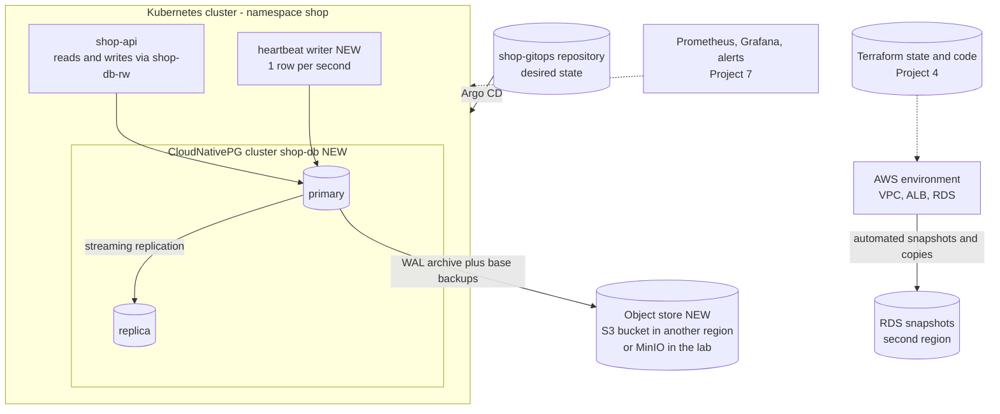
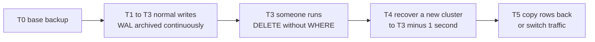

# Project 8 — Disaster Recovery

> **Project 8 of 9** · Uses levels: Levels 13-15 · ⏱ ~14 hours

## 1. Goal and outcome

Prove that the platform you built in Projects 4 to 7 can **survive and recover from real failures**, and replace "we have backups" with measured numbers. You break the system on purpose (a database Pod, a bad `DELETE`, a deleted namespace, a lost cluster, a destroyed cloud environment), recover it with written runbooks, and record the **actual RPO** (how much data you lost) and **actual RTO** (how long it took) for each scenario.

The concepts come from [Level 13](../level-13-databases-distributed-systems/99-capstone-project.md) (replication, WAL archiving and point-in-time recovery),
[Level 14](../level-14-sre/99-capstone-project.md) (incidents, postmortems, SLOs) and [Level 15](../level-15-disaster-recovery/01-backups.md) (backups, restores, failover, drills).
This project is the integration: one real stack, scripted failure drills, and measured results. A backup that has never been restored is a hope, not a backup.

You finish with:

- a PostgreSQL cluster managed by the CloudNativePG operator: one primary plus one replica, continuous WAL archiving and scheduled base backups to an **object store outside the cluster**;
- a **data-class table** with RPO and RTO targets, chosen before you test;
- four rehearsed drills: instance failure (automatic failover), human error (point-in-time recovery), cluster loss (rebuild from Git plus restore), and a cloud-environment rebuild with Terraform and a database snapshot;
- a `heartbeat` writer and a `drill.sh` timer that turn each drill into numbers;
- runbooks and a blameless postmortem for each drill, and one "game day" where someone else injects the failure.

## 2. Architecture

What changed from Project 7: the single PostgreSQL StatefulSet is replaced by a replicated, operator-managed cluster (NEW), backups leave the cluster (NEW), and the observability stack from Project 7 becomes the way you **detect** each failure and **verify** each recovery.



The point-in-time recovery timeline for the "bad DELETE" drill:



| Failure | Blast radius | Recovery path | You measure |
|---------|--------------|---------------|-------------|
| Primary Pod or node dies | one instance | operator promotes the replica | failover time, lost transactions (RPO near 0) |
| Bad `DELETE` or deploy corrupts data | all data, replicated instantly | PITR from base backup plus WAL | data-loss window, restore time |
| Cluster or namespace deleted | everything in Kubernetes | rebuild cluster, Argo CD syncs Git, restore database | end-to-end RTO |
| AWS environment destroyed | everything on AWS | `terraform apply`, restore database from snapshot | RTO, snapshot age (RPO) |

## 3. Prerequisites

- The Project 7 cluster (or just Project 6 if you skip telemetry), `kubectl`, `helm`, `git`, and for the cloud drill the Project 4 Terraform code and an AWS sandbox account. Cost: the Kubernetes part is free on kind; an S3 bucket in a second region costs cents; the AWS drill costs the same as Project 4 for the hours it runs. **Destroy everything at the end.**
- Databases: [PostgreSQL replication](../level-13-databases-distributed-systems/04-replication.md), [backups and PITR](../level-13-databases-distributed-systems/05-backups-and-pitr.md).
- Disaster recovery: [backups](../level-15-disaster-recovery/01-backups.md), [replication](../level-15-disaster-recovery/02-replication.md), [snapshots](../level-15-disaster-recovery/03-snapshots.md), [restore procedures](../level-15-disaster-recovery/04-restore-procedures.md), [failover](../level-15-disaster-recovery/05-failover.md), [RPO](../level-15-disaster-recovery/06-rpo.md), [RTO](../level-15-disaster-recovery/07-rto.md), [offsite backups](../level-15-disaster-recovery/08-offsite-backups.md), [testing backup restoration](../level-15-disaster-recovery/09-testing-backup-restoration.md), [failure scenario drills](../level-15-disaster-recovery/10-failure-scenario-drills.md).
- SRE practice: [incident management](../level-14-sre/05-incident-management.md) and [postmortems](../level-14-sre/07-postmortems.md). Operators: [operators](../level-16-advanced-kubernetes/04-operators.md) and [stateful workloads](../level-16-advanced-kubernetes/08-stateful-workloads.md).

## 4. Build it step by step

### Milestone 1 — Decide objectives before you test (≈1 h)

Write `docs/dr/objectives.md`. The numbers are yours to choose; the discipline is choosing them first, because otherwise any result looks acceptable.

| Data class | Example | RPO target | RTO target | Protection |
|------------|---------|------------|------------|------------|
| Orders and customers | PostgreSQL | 5 minutes | 30 minutes | replica, WAL archiving, offsite backup |
| Product catalog | PostgreSQL | 1 hour | 1 hour | same database |
| Cache | Redis | not applicable | 5 minutes | rebuilt on demand, never backed up |
| Infrastructure and config | Git, Terraform state | 0 (every commit) | 1 hour | Git remote plus mirrored copy, versioned state bucket |

### Milestone 2 — A replicated, backed-up PostgreSQL (≈3 h)

Install the operator ([operators](../level-16-advanced-kubernetes/04-operators.md)) and create an object store the cluster does not live in:

```bash
helm repo add cnpg https://cloudnative-pg.github.io/charts && helm repo update
helm upgrade --install cnpg cnpg/cloudnative-pg -n cnpg-system --create-namespace
kubectl -n cnpg-system rollout status deploy -l app.kubernetes.io/name=cloudnative-pg
```

Backup target: for a real exercise use an S3 bucket in a different region from your cluster, with an IAM user limited to that bucket (versioning on, no public access). In a pure lab use MinIO with a Deployment and PVC in a separate namespace `backup` (use the current MinIO image tag from its documentation) and a bucket `shop-backups`. Store the access keys as a sealed secret `backup-creds` with keys `ACCESS_KEY_ID` and `ACCESS_SECRET_KEY`.

`shop-db.yaml` (commit it to `shop-gitops`; the backup section of CloudNativePG is moving from the built-in `barmanObjectStore` to the Barman Cloud plugin, so check the current CloudNativePG documentation for the exact fields in your operator version):

```yaml
apiVersion: postgresql.cnpg.io/v1
kind: Cluster
metadata: { name: shop-db, namespace: shop }
spec:
  instances: 2
  storage: { size: 2Gi }
  bootstrap:
    initdb: { database: shop, owner: shop }
  backup:
    retentionPolicy: "7d"
    barmanObjectStore:
      destinationPath: s3://shop-backups/shop-db
      endpointURL: http://minio.backup.svc:9000        # omit for AWS S3
      s3Credentials:
        accessKeyId:     { name: backup-creds, key: ACCESS_KEY_ID }
        secretAccessKey: { name: backup-creds, key: ACCESS_SECRET_KEY }
      wal: { compression: gzip }
---
apiVersion: postgresql.cnpg.io/v1
kind: ScheduledBackup
metadata: { name: shop-db-nightly, namespace: shop }
spec:
  schedule: "0 0 2 * * *"            # six fields: seconds first
  cluster: { name: shop-db }
  backupOwnerReference: self
```

The operator creates the Services `shop-db-rw` (primary) and `shop-db-ro` (replicas) and a generated application Secret `shop-db-app` containing a ready-to-use `uri`. Point the API at it by changing `DATABASE_URL` to read from that secret key (`secretKeyRef: {name: shop-db-app, key: uri}`) and update the NetworkPolicy for the new Pod labels (`cnpg.io/cluster: shop-db`). Seed the schema with the Project 5 Job, then take an on-demand backup and check it:

```bash
kubectl -n shop get cluster shop-db                      # Cluster in healthy state, 2 ready instances
kubectl cnpg status shop-db -n shop 2>/dev/null || kubectl -n shop get pods -l cnpg.io/cluster=shop-db
cat <<'EOF' | kubectl apply -f -
apiVersion: postgresql.cnpg.io/v1
kind: Backup
metadata: { name: first-backup, namespace: shop }
spec: { cluster: { name: shop-db } }
EOF
kubectl -n shop get backup first-backup -w               # phase: completed
```

### Milestone 3 — The measuring tools (≈1 h)

A heartbeat writer that records one row per second gives you an objective way to measure data loss. Run it as a Pod using the `postgres` image against `shop-db-rw`:

```bash
kubectl -n shop exec -it shop-db-1 -- psql -U postgres -d shop -c \
  "CREATE TABLE IF NOT EXISTS heartbeat (n bigserial PRIMARY KEY, ts timestamptz NOT NULL DEFAULT now());
   GRANT INSERT, SELECT ON heartbeat TO shop; GRANT USAGE ON SEQUENCE heartbeat_n_seq TO shop;"
kubectl -n shop run heartbeat --image=postgres:17-alpine --restart=Never --env "PGHOST=shop-db-rw" \
  --env "PGUSER=shop" --env "PGDATABASE=shop" --env "PGPASSWORD=$(kubectl -n shop get secret shop-db-app -o jsonpath='{.data.password}' | base64 -d)" \
  --command -- sh -c 'while true; do psql -qc "INSERT INTO heartbeat DEFAULT VALUES" || true; sleep 1; done'
```

`drill.sh` stamps the stages of a drill so RTO is a subtraction, not a memory:

```bash
#!/usr/bin/env bash
# usage: ./drill.sh <name>   then press Enter at each stage
name="${1:?drill name}"; log="docs/dr/drills/$(date -u +%F)-$name.log"; mkdir -p "$(dirname "$log")"
stamp() { printf '%s  %s\n' "$(date -u +%FT%TZ)" "$1" | tee -a "$log"; }
stamp "START $name"
read -rp "Press Enter when the failure is injected... " ; stamp "FAILURE_INJECTED"
read -rp "Press Enter when you (or an alert) DETECTED it... " ; stamp "DETECTED"
read -rp "Press Enter when service is RESTORED for users... " ; stamp "SERVICE_RESTORED"
read -rp "Press Enter when data is VERIFIED... " ; stamp "DATA_VERIFIED"
echo "Record RTO = SERVICE_RESTORED - FAILURE_INJECTED; RPO = failure time - newest heartbeat row" | tee -a "$log"
```

### Milestone 4 — Drill A: lose the primary (≈1 h)

```bash
./drill.sh primary-loss
kubectl -n shop delete pod -l cnpg.io/instanceRole=primary --wait=false     # inject
kubectl -n shop get cluster shop-db -w                                      # watch promotion
curl -sk --resolve shop.example.com:8443:127.0.0.1 https://shop.example.com:8443/readyz
kubectl -n shop exec "$(kubectl -n shop get pod -l cnpg.io/instanceRole=primary -o name | head -1)" -- psql -U postgres -d shop -tAc "SELECT max(ts), count(*) FROM heartbeat"
```

Expected outcome: the operator promotes the replica within seconds to a minute (your measurement decides), the API's `/readyz` flaps and recovers, and the heartbeat shows a gap of seconds, not minutes.

### Milestone 5 — Drill B: human error, then point-in-time recovery (≈2 h)

```bash
./drill.sh bad-delete
date -u +%FT%TZ                                                # note GOOD_TIME, just before the mistake
kubectl -n shop exec -it shop-db-1 -- psql -U postgres -d shop -c "DELETE FROM products;"   # the mistake
```

Replication copies the mistake to the replica instantly, which is why replicas are **not** backups. Recover into a **new** cluster at a time just before the delete, leaving the damaged one untouched until you have verified:

```yaml
apiVersion: postgresql.cnpg.io/v1
kind: Cluster
metadata: { name: shop-db-restore, namespace: shop }
spec:
  instances: 1
  storage: { size: 2Gi }
  bootstrap:
    recovery:
      source: shop-db
      database: shop
      owner: shop
      recoveryTarget: { targetTime: "2026-10-09 12:34:56+00" }      # GOOD_TIME, with a small safety margin
  externalClusters:
    - name: shop-db
      barmanObjectStore:
        destinationPath: s3://shop-backups/shop-db
        endpointURL: http://minio.backup.svc:9000
        s3Credentials:
          accessKeyId:     { name: backup-creds, key: ACCESS_KEY_ID }
          secretAccessKey: { name: backup-creds, key: ACCESS_SECRET_KEY }
```

```bash
kubectl -n shop wait cluster/shop-db-restore --for=condition=Ready --timeout=15m
kubectl -n shop exec shop-db-restore-1 -- psql -U postgres -d shop -tAc "SELECT count(*) FROM products"   # 3, not 0
```

Then either dump the missing rows from the restored cluster and insert them into production (`pg_dump --data-only --table=products ... | psql`), or repoint the application at `shop-db-restore-rw` through a Git change. Prefer the first for a small mistake and the second for broad corruption.

### Milestone 6 — Drill C: lose the whole cluster (≈2 h)

The claim of GitOps is that the cluster is cattle. Test it:

```bash
./drill.sh cluster-loss
kind delete cluster --name shop                                  # inject
# recover: new cluster, then bootstrap from Git
kind create cluster --name shop --config kind-shop.yaml
kubectl create namespace argocd && kubectl apply -n argocd --server-side --force-conflicts -f <argocd install manifest>
kubectl apply -f shop-gitops/apps/root.yaml                      # the app-of-apps from Git
```

You will find three things that Git alone does not restore: the **Sealed Secrets private key** (restore it from your backup first, or every SealedSecret in Git is garbage), the **database data** (set the new `shop-db` Cluster to `bootstrap.recovery` from the object store instead of `initdb`), and any manual step you forgot to write down. Each one goes into the runbook.

### Milestone 7 — Drill D: rebuild the AWS environment (≈3 h, optional but recommended)

With the Project 4 stack running and RDS snapshots enabled (and a copy in a second region):

```bash
./drill.sh aws-rebuild
cd envs/dev && terraform destroy -var image_tag=sha-<sha>       # inject: environment gone
terraform apply -var image_tag=sha-<sha>                         # rebuild: network, ALB, instances, empty RDS
# Replace the empty RDS by restoring the latest snapshot: set snapshot_identifier on aws_db_instance, plan, apply
aws rds describe-db-snapshots --query 'DBSnapshots[].[DBSnapshotIdentifier,SnapshotCreateTime]' --output table
```

Pay attention to: how old the newest snapshot is (that is your RPO), whether `deletion_protection` and a final snapshot would have prevented the loss, and which secrets (the managed master password) change after a restore. Run Project 2's `smoke.sh` against the new ALB. Destroy everything afterwards.

### Milestone 8 — Runbooks, postmortems and a game day (≈2 h)

For each drill write `docs/dr/runbooks/<scenario>.md` (detection, decision, exact commands, verification, rollback) and a short blameless postmortem following [postmortems](../level-14-sre/07-postmortems.md): impact, timeline from `drill.sh`, what worked, what surprised you, action items with owners. Then ask a colleague or friend to pick a scenario and inject it without telling you, while you follow only the runbooks.

## 5. Tasks

- [ ] **T1 — Write RPO and RTO targets first** *(≈45 min, beginner)*
  - **Goal:** objectives defined before testing.
  - **Steps:**
    1. List every data store and configuration source in the platform.
    2. Assign an RPO and RTO to each, and the protection that should meet them.
    3. Commit `docs/dr/objectives.md`.
  - **Done when:** the file exists in Git before the first drill, and every row has numbers and a mechanism.

- [ ] **T2 — Stand up the replicated, backed-up database** *(≈2 h, advanced)*
  - **Goal:** two instances, WAL archiving and a completed base backup in the object store.
  - **Steps:**
    1. Install the operator, create the object store and credentials, apply `shop-db.yaml`.
    2. Take an on-demand `Backup` and wait for `completed`.
    3. List the bucket and find `base` and `wals` prefixes.
  - **Done when:** `kubectl get backup` shows `completed`, the bucket contains both base backup and WAL files, and the API serves `/products` from the new cluster.

- [ ] **T3 — Fail over the primary and measure** *(≈1 h, intermediate)*
  - **Goal:** a measured failover time and data-loss figure.
  - **Steps:**
    1. Start the heartbeat writer and `./drill.sh primary-loss`.
    2. Delete the primary Pod and note detection and restoration times.
    3. Query the heartbeat for gaps (`SELECT max(gap) FROM (SELECT ts - lag(ts) OVER (ORDER BY ts) AS gap FROM heartbeat) g`).
  - **Done when:** your log has RTO and a measured gap, and you compare both with your Milestone 1 targets.

- [ ] **T4 — Recover from a destructive `DELETE` with PITR** *(≈2 h, advanced)*
  - **Goal:** a restored copy of the table as of before the mistake.
  - **Steps:**
    1. Run the `bad-delete` drill and record `GOOD_TIME`.
    2. Create `shop-db-restore` with `recoveryTarget.targetTime`.
    3. Copy the rows back into the live cluster and re-run the smoke test.
  - **Done when:** `/products` returns the original rows, and your log gives the restore duration and the number of seconds of data lost.

- [ ] **T5 — Rebuild the cluster from Git and a backup** *(≈2.5 h, advanced)*
  - **Goal:** the cluster is disposable; the data is not.
  - **Steps:**
    1. Back up the Sealed Secrets key and confirm it is **not** in the same cluster you will destroy.
    2. Delete the cluster, recreate it, bootstrap Argo CD, and restore the database from the object store.
    3. Record each manual step you needed and fold it into the runbook.
  - **Done when:** `smoke.sh` passes against the rebuilt cluster, the database contains data from before the deletion, and the runbook now lists every manual step.

- [ ] **T6 — Restore an AWS environment from a snapshot** *(≈3 h, advanced; costs money)*
  - **Goal:** cloud rebuild with a measured RPO from snapshot age.
  - **Steps:**
    1. Enable automated RDS backups and copy a snapshot to a second region.
    2. Destroy and recreate the Project 4 environment; restore the database from the snapshot via Terraform.
    3. Run the smoke test and destroy everything again.
  - **Done when:** the restored database contains the pre-destruction rows, the log has RTO and snapshot age, and the CLI shows no resources remaining afterwards.

- [ ] **T7 — Write runbooks and postmortems** *(≈2 h, intermediate)*
  - **Goal:** another person could recover without you.
  - **Steps:**
    1. Write one runbook per scenario with exact commands and verification.
    2. Write a blameless postmortem for the worst drill.
    3. Give the runbooks to a friend and watch (silently) where they get stuck.
  - **Done when:** the friend completed one recovery from the runbook alone, and every point where they hesitated has been fixed in the text.

- [ ] **T8 — Prove it: run a game day** *(≈2 h, advanced)*
  - **Goal:** recovery works under mild pressure with an unknown failure.
  - **Steps:**
    1. Have someone inject one of the four failures without telling you which.
    2. Detect it with the Project 7 alerts and dashboards, then recover using only the runbooks.
    3. Fill in the final table of targets versus measured RPO and RTO, and state which targets you missed and what change would meet them.
  - **Done when:** service and data are restored, the table is committed, and each missed target has an action item with a cost estimate.

## 6. Definition of done

- [ ] Objectives (RPO and RTO per data class) are written and committed before the drills.
- [ ] PostgreSQL has a replica, continuous WAL archiving and scheduled base backups to a store **outside** the cluster; retention is configured.
- [ ] A restore from backup has been performed within the last week and timed; PITR to a chosen timestamp succeeded.
- [ ] Losing the primary causes automatic failover; the measured downtime and data loss are recorded.
- [ ] The whole cluster can be rebuilt from Git plus the object store plus the backed-up sealing key.
- [ ] Every drill has a log from `drill.sh`, a runbook and a postmortem; the targets-versus-measured table exists.
- [ ] Backup credentials are least privilege (write-only for the writer where possible), and the offsite copy cannot be deleted by the same credentials that produce it.

## 7. Break it on purpose

1. **Corrupt the backups, not the database.** Delete the newest WAL segments from the object store and try a PITR to a time after them. See what the restore can and cannot reach. Fix your monitoring so a gap in the archive alerts. *(Lesson: backups need monitoring too.)*
2. **Lose the key.** Restore the cluster without the Sealed Secrets key and watch every SealedSecret fail. Restore the key and re-sync. *(Lesson: recovery dependencies need their own backup.)*
3. **Fill the archive volume.** Make the object store unreachable for a while (scale MinIO to 0). WAL accumulates on the primary's disk. Watch the volume fill, learn the alert you need, and recover before the database stops. *(Lesson: a failed backup target can become an outage.)*
4. **Restore into production by mistake.** Point a restore at the live cluster name in a throwaway lab and see why you always restore to a **new** name and switch over after verification. *(Lesson: restores need a blast-radius plan too.)*

## 8. How this evolves into the next project

You now have each piece: infrastructure as code, containers, Kubernetes, GitOps, observability and recovery. They were built one at a time, and each had its own repository, its own decisions and its own trade-offs.
[Project 9 — Senior Architecture](project-09-senior-architecture.md) asks the senior-level question: put it together as one production-style platform on AWS, justify every decision in writing,
review it against a production-readiness checklist (security, observability, scale, availability, deployability, recoverability, cost), and be able to defend the trade-offs to someone who disagrees.
