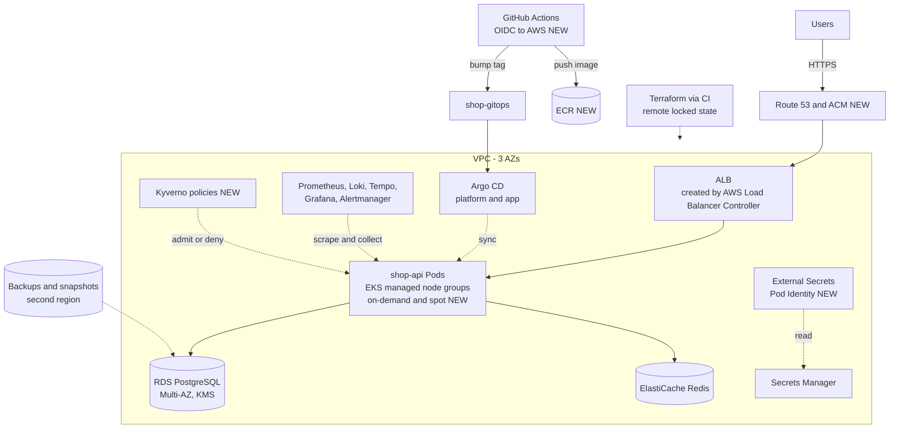
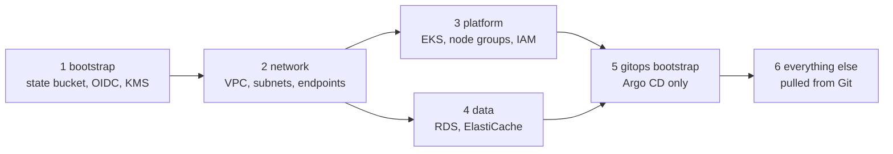

# Project 9 — Senior Architecture

> **Project 9 of 9** · Uses levels: Levels 6-20 · ⏱ ~40 hours

## 1. Goal and outcome

Build one complete, production-style platform for `shop-api` on **AWS** with **Terraform**, **Docker**, **Kubernetes (EKS)**, **Helm**, **GitOps** and **observability**, and then review it the way a senior engineer
would: against seven qualities (secure, observable, scalable, highly available, automatically deployable, recoverable, cost-efficient), with every significant decision written down and defended.

This is not a new tool. Everything here you have built before in a smaller form: the network and database from [Project 4](project-04-terraform.md), the cluster and delivery from
[Project 5](project-05-kubernetes.md) and [Project 6](project-06-production-kubernetes.md), the telemetry from [Project 7](project-07-observability.md), the recovery drills from [Project 8](project-08-disaster-recovery.md).
The senior-level skill is integrating them under constraints (money, time, risk) and explaining the trade-offs. Read the [Senior-Level Mindset](../guides/senior-mindset.md) guide alongside it.

You finish with:

- a Git repository set (`shop-api`, `shop-infra`, `shop-gitops`) from which an empty AWS account becomes the platform with a documented, scripted bootstrap;
- EKS across three Availability Zones, managed node groups (with a spot group for stateless work), RDS PostgreSQL Multi-AZ, ElastiCache, ECR, an ALB, and encryption with KMS;
- no long-lived credentials anywhere: GitHub OIDC for CI, EKS Pod Identity for workloads, External Secrets reading AWS Secrets Manager;
- Argo CD managing platform add-ons and the application; policy-as-code (Kyverno or ValidatingAdmissionPolicy) blocking unsafe workloads;
- SLOs, burn-rate alerts, dashboards, a load test and a chaos test with recorded results;
- a **production-readiness review**, a cost model with a measured bill, and **five architecture decision records**;
- a clean teardown, verified by CLI.

## 2. Architecture

What changed from Project 8: the Kubernetes cluster is no longer a kind lab; it runs on EKS inside the Terraform-managed VPC (the Project 4 network grows a third AZ and EKS-aware subnet tags), the database is managed by AWS in Multi-AZ mode with encryption, identities are federated instead of stored, and policy and cost controls are added (all NEW unless noted).



The Terraform and GitOps layers, applied in order, so that a failure in one does not take the others with it:



| Project | What it added | Where it lives now |
|---------|---------------|--------------------|
| 1 Basic server | the application contract, hardening habits | Dockerfile, health endpoints, SSH-less access (Session Manager) |
| 2 Docker | image, Compose, non-root | the production image and local dev loop |
| 3 CI/CD | tests, scan, registry, rollback by tag | GitHub Actions to ECR, tags by commit |
| 4 Terraform | VPC, ALB, RDS, state | `shop-infra` layers |
| 5 Kubernetes | Deployments, probes, Ingress | Helm chart |
| 6 Production Kubernetes | TLS, HPA, RBAC, policies, Argo CD | platform add-ons in Git |
| 7 Observability | metrics, logs, traces, SLO alerts | `monitoring` namespace |
| 8 Disaster recovery | measured RPO and RTO | runbooks and drills, now on RDS and EKS |

## 3. Prerequisites

- Projects 1 to 8 done, or at least read; a dedicated **AWS sandbox account** with MFA, a **budget and billing alarm**, and no other workloads in it. A domain you own is needed for real HTTPS with ACM and Route 53; without one, use the ALB's DNS name over HTTP for the lab and record the gap as a known risk.
- **Cost warning, read before you start:** EKS control plane, NAT gateways, an ALB, Multi-AZ RDS, ElastiCache and several nodes all bill per hour. Plan on several to a few tens of US dollars per day; compute the number with the AWS Pricing Calculator before you apply, write it into your cost model (milestone 8), and **tear down every session** you can.
- Cloud: [VPC](../level-06-cloud-aws/04-vpc-and-subnets.md), [IAM](../level-06-cloud-aws/07-iam.md), [RDS](../level-06-cloud-aws/10-rds-and-aurora.md), [ALB](../level-06-cloud-aws/14-alb.md), [KMS](../level-06-cloud-aws/15-kms.md), [Secrets Manager](../level-06-cloud-aws/16-secrets-manager.md), [CloudTrail](../level-06-cloud-aws/17-cloudtrail.md), [CloudWatch](../level-06-cloud-aws/18-cloudwatch.md).
- IaC and delivery: [Terraform modules](../level-07-terraform-iac/03-modules.md), [Terraform CI/CD](../level-07-terraform-iac/07-terraform-ci-cd.md), [Helm packaging](../level-09-helm/06-packaging-applications.md), [GitOps CI flow](../level-17-gitops/07-ci-to-gitops-flow.md), [canary deployments](../level-05-cicd/12-canary-deployments.md).
- Security and reliability: [least-privilege IAM](../level-11-security-devsecops/02-least-privilege-iam.md), [secrets management](../level-11-security-devsecops/04-secrets-management-and-encryption.md), [Pod security](../level-16-advanced-kubernetes/03-pod-security.md), [admission control](../level-16-advanced-kubernetes/06-admission-controllers-and-webhooks.md), [SLOs](../level-14-sre/02-slos.md), [error budgets](../level-14-sre/04-error-budgets.md), [capacity planning](../level-14-sre/09-capacity-planning.md).
- Platform and architecture: [golden paths](../level-18-platform-engineering/04-golden-paths.md), [policy as code](../level-18-platform-engineering/07-policy-as-code.md), [reference architecture walkthrough](../level-19-architecture/10-reference-architecture-walkthrough.md), [architecture decision records](../level-19-architecture/11-architecture-decision-records.md), [FinOps](../level-20-cost-optimization/01-finops.md), [Kubernetes infrastructure costs](../level-20-cost-optimization/09-kubernetes-infrastructure-costs.md).

## 4. Build it step by step

Each milestone ends with evidence you will cite in the final review. Keep a `docs/evidence/` folder (command output, screenshots, links).

### Milestone 1 — Requirements, SLOs and decisions before code (≈3 h)

Write `docs/architecture.md` with the questions a senior engineer asks first: who are the users, what is the peak load, what does an hour of downtime cost, what data is sensitive, what is the team's size and on-call capacity? Then write the targets, for example:

| Quality | Target for `shop-api` |
|---------|-----------------------|
| Availability | 99.9 percent of `/products` requests succeed over 30 days (error budget about 43 minutes) |
| Latency | 95 percent of requests under 300 ms |
| Recoverability | RPO 5 minutes, RTO 1 hour for the database; RTO 4 hours for the whole region's loss (documented, not automated) |
| Security | no public data stores, no static credentials, all data encrypted at rest and in transit |
| Cost | stays below an agreed monthly figure; every resource tagged `project`, `env`, `owner` |

Create `docs/adr/` and write the first five records now (template in section 5, T1): ADR-1 EKS versus ECS or plain EC2 (be honest about operational complexity and team size), ADR-2 managed RDS versus a database on Kubernetes, ADR-3 GitOps pull model versus CI push, ADR-4 managed node groups versus Karpenter, ADR-5 single region with cross-region backups versus active-active. See [operational complexity](../level-19-architecture/06-operational-complexity.md).

### Milestone 2 — Bootstrap and network (≈4 h)

Layer 1 (`bootstrap/`): a versioned, encrypted S3 state bucket with native locking, the GitHub OIDC provider, separate `plan` (read-only) and `apply` (main branch only) roles, a KMS key for state and secrets, and a budget. Layer 2 (`network/`): reuse the Project 4 network module with three AZs, public, private and data subnets, and the tags EKS and the load balancer controller need:

```hcl
# subnet tags consumed by the AWS Load Balancer Controller and the cluster
public_subnet_tags  = { "kubernetes.io/role/elb" = "1" }
private_subnet_tags = { "kubernetes.io/role/internal-elb" = "1" }
```

Add VPC endpoints for S3 (gateway) and, to cut NAT traffic and exposure, for ECR, Secrets Manager and STS (interface endpoints cost per hour, so decide per your cost model, [network egress costs](../level-20-cost-optimization/07-network-egress-costs.md)). Evidence: `terraform plan` output, and a diagram that shows no database route to the internet gateway.

### Milestone 3 — Platform layer: EKS (≈5 h)

Build the cluster with Terraform, using the well-maintained community module or your own, pinned to an exact version (**argument names change between major versions, so follow the README of the version you pin**). The design choices to make and record:

```hcl
module "eks" {
  source  = "terraform-aws-modules/eks/aws"
  version = "<PINNED_MAJOR_MINOR>"                  # pin; read its upgrade notes
  # name / cluster_name, Kubernetes version (n or n-1 of the newest supported), VPC and private subnets
  endpoint_public_access  = false                   # or restrict to your CIDR; prefer private + SSM or VPN
  encryption_config       = { resources = ["secrets"], provider_key_arn = var.kms_key_arn }
  enabled_log_types       = ["api", "audit", "authenticator"]
  eks_managed_node_groups = {
    ondemand = { instance_types = ["m6i.large"], min_size = 2, max_size = 4, desired_size = 2 }
    spot     = { instance_types = ["m6i.large", "m5.large", "m6a.large"], capacity_type = "SPOT", min_size = 0, max_size = 4, labels = { workload = "stateless" } }
  }
}
```

Install the add-ons that EKS expects (VPC CNI with NetworkPolicy support enabled or Cilium, CoreDNS, kube-proxy, EBS CSI driver, metrics-server) and use **EKS Pod Identity** or IRSA for every controller that talks to AWS, each with its own least-privilege role. Never attach broad policies to the node role. Evidence: `aws eks describe-cluster` with logging and encryption shown, `kubectl get nodes -L topology.kubernetes.io/zone` showing three zones.

### Milestone 4 — Data layer (≈3 h)

RDS PostgreSQL Multi-AZ with `storage_encrypted`, KMS key, `manage_master_user_password = true`, automated backups with PITR, a cross-region snapshot copy, deletion protection on, and parameter groups for connection logging. ElastiCache Redis (replication group with automatic failover in non-dev). Security groups reference each other and allow only the node or pod security group. Because RDS requires TLS, ship the RDS CA bundle in the image and enable certificate verification in the pool settings rather than the lab shortcut from Project 4 ([TLS](../level-12-advanced-networking/04-tls.md)). Consider a connection pooler (RDS Proxy or PgBouncer) once replica counts grow ([connection pooling](../level-13-databases-distributed-systems/06-db-connection-pooling.md)).

### Milestone 5 — GitOps bootstrap and platform add-ons (≈5 h)

Terraform installs **only** Argo CD (a Helm release) and one root Application; everything else comes from `shop-gitops`. The app-of-apps lists, each with pinned chart versions and sync waves:

| Wave | Component | Why this order |
|------|-----------|----------------|
| 0 | namespaces, Pod Security labels, Kyverno (or ValidatingAdmissionPolicy) | policy before workloads |
| 1 | AWS Load Balancer Controller, External Secrets Operator, cert-manager or ACM integration, external-dns | needed by apps |
| 2 | kube-prometheus-stack, Loki, Alloy, Tempo, OTel Collector | observability before traffic |
| 3 | `shop-api` chart (dev, then prod) | the application |

External Secrets maps an AWS Secrets Manager secret to a Kubernetes Secret:

```yaml
apiVersion: external-secrets.io/v1          # v1beta1 in older operator releases
kind: ExternalSecret
metadata: { name: shop-db, namespace: shop }
spec:
  refreshInterval: 1h
  secretStoreRef: { kind: ClusterSecretStore, name: aws-secrets-manager }
  target: { name: shop-db }
  dataFrom: [{ extract: { key: shop/prod/db } }]
```

The Ingress uses the ALB controller (`ingressClassName: alb`, annotations `alb.ingress.kubernetes.io/scheme: internet-facing`, `target-type: ip`, `healthcheck-path: /readyz`, and `certificate-arn` for ACM). Add policies that deny `:latest` images, require resource limits, non-root and read-only root file systems, and allow images only from your ECR registry ([policy as code](../level-18-platform-engineering/07-policy-as-code.md)). Evidence: Argo CD showing all applications `Synced` and `Healthy`, and a rejected `kubectl run --image=nginx:latest`.

### Milestone 6 — Delivery pipeline (≈4 h)

Extend the Project 3 pipeline: test, build, scan (Trivy), push to **ECR using OIDC** (no stored keys), sign or attest the image if you want supply-chain evidence, then commit the new tag to `shop-gitops/envs/dev`. Promotion to `prod` is a reviewed pull request. Add Terraform pipelines per layer (`fmt`, `validate`, `tflint`, a security scanner, `plan` on PR, `apply` on merge to `main` by the `apply` role in a protected environment). Add a progressive delivery step for prod (Argo Rollouts canary with an analysis on the Project 7 error-rate metric) or at least a rolling update with `maxUnavailable: 0` and a PodDisruptionBudget ([canary deployments](../level-05-cicd/12-canary-deployments.md)). Evidence: a pipeline run from commit to production with timings; a rollback by `git revert`.

### Milestone 7 — Reliability: observe, load, break (≈5 h)

Reuse the Project 7 dashboards and the SLO burn-rate alerts, and tie alerts to a runbook. Then test claims instead of assuming them:

```bash
# load test (k6 in a container), ramp to 3x expected peak, watch HPA, p95 latency and error ratio
docker run --rm -i grafana/k6 run - <<'EOF'
import http from 'k6/http'; import { check } from 'k6';
export const options = { stages: [{ duration: '2m', target: 50 }, { duration: '5m', target: 150 }, { duration: '1m', target: 0 }],
  thresholds: { http_req_failed: ['rate<0.01'], http_req_duration: ['p(95)<300'] } };
export default function () { check(http.get(`${__ENV.BASE}/products`), { ok: (r) => r.status === 200 }); }
EOF
# chaos: lose a node, then lose an AZ's capacity (cordon and drain every node in one zone)
kubectl drain <node-in-az-a> --ignore-daemonsets --delete-emptydir-data
aws rds reboot-db-instance --db-instance-identifier shop-prod --force-failover       # Multi-AZ failover
```

Use topology spread constraints and PodDisruptionBudgets so zone loss does not drop below capacity ([availability](../level-19-architecture/02-availability.md)). Re-run two Project 8 drills against this stack: an RDS point-in-time restore to a new instance, and rebuilding the cluster from Terraform plus Git. Record RPO and RTO against the milestone 1 targets.

### Milestone 8 — Cost model and optimisation (≈3 h)

Create `docs/cost.md`: a table of each resource, unit price (from the pricing page), quantity, hours and monthly cost, plus a "what scales with traffic" column. After a day, compare it with Cost Explorer, grouped by the `project` tag. Then try three optimisations and record the saving and the risk: right-size requests from Prometheus data ([rightsizing](../level-20-cost-optimization/05-rightsizing.md)), move stateless Pods to the spot group with PDBs and graceful shutdown ([spot instances](../level-20-cost-optimization/03-spot-instances.md)), and add S3 lifecycle rules plus log retention limits ([storage lifecycle](../level-20-cost-optimization/06-storage-lifecycle-policies.md)). Shut down or scale to zero non-production resources out of hours.

### Milestone 9 — The production-readiness review and teardown (≈4 h)

Complete the review below with **evidence links** in every row. Where the answer is "no", write the risk, the owner and the date, rather than hiding it. Then destroy in reverse layer order (Argo CD applications first so load balancers are removed; then Terraform layers), and verify with the CLI that no ALB, NAT gateway, EKS cluster, RDS instance, ElastiCache cluster or unattached volume remains.

| Quality | Question | Evidence (link) | Status |
|---------|----------|-----------------|--------|
| Secure | Any static credentials? Public data stores? Unencrypted data? Policies enforced? | IAM Access Analyzer, `kubectl` policy denial, scan reports | |
| Observable | Can you go from an alert to a trace and the failing release in minutes? | Project 7 runbook drill | |
| Scalable | What is the first bottleneck at 3x load? | k6 report, HPA events | |
| Highly available | What happens when one node, one AZ, one database instance fails? | chaos results | |
| Automatically deployable | Commit to production without a human running a command? Rollback time? | pipeline runs | |
| Recoverable | Measured RPO and RTO versus targets? When was the last restore? | drill logs | |
| Cost-efficient | Bill versus model? Largest line item and why? | `docs/cost.md` | |

## 5. Tasks

- [ ] **T1 — Write requirements, SLOs and five ADRs** *(≈3 h, intermediate)*
  - **Goal:** decisions recorded before they are built.
  - **Steps:**
    1. Write `docs/architecture.md` with users, load, data sensitivity, SLOs and a budget.
    2. For each of the five decisions, create an ADR with Context, Options considered, Decision, Consequences (what gets harder) and a review trigger.
    3. Ask someone to challenge the weakest ADR and amend it.
  - **Done when:** five ADRs are committed, each lists at least two alternatives and one negative consequence, and one was revised after the challenge.

- [ ] **T2 — Bootstrap the account and network with Terraform** *(≈4 h, advanced; costs money)*
  - **Goal:** repeatable foundations with no static credentials.
  - **Steps:**
    1. Apply the bootstrap layer (state, OIDC, KMS, budget) and the network layer.
    2. Run `plan` in CI on a PR through OIDC; merge to apply.
    3. Prove the data subnets have no route to an internet gateway.
  - **Done when:** a PR plan appears as a comment, apply runs from CI, and `aws ec2 describe-route-tables` shows no `igw-` route for data subnets.

- [ ] **T3 — Provision EKS and verify the controls** *(≈5 h, advanced; costs money)*
  - **Goal:** a private, encrypted, three-zone cluster.
  - **Steps:**
    1. Apply the platform layer with pinned module versions.
    2. Verify envelope encryption, audit logs, node zones and that no workload uses the node role for AWS access.
    3. Open the control plane only via the private path you chose.
  - **Done when:** `kubectl get nodes -L topology.kubernetes.io/zone` shows three zones and `aws eks describe-cluster` shows encryption and logging enabled.

- [ ] **T4 — Stand up the data tier and prove the boundaries** *(≈3 h, advanced; costs money)*
  - **Goal:** encrypted, Multi-AZ data stores reachable only from the application.
  - **Steps:**
    1. Apply the data layer; read the plan for every security-group rule.
    2. From a debug Pod without the app label, try to connect to RDS and Redis.
    3. Trigger `reboot-db-instance --force-failover` and measure application impact.
  - **Done when:** the unlabelled Pod cannot connect, the app reconnects after failover, and you recorded the downtime.

- [ ] **T5 — Bootstrap GitOps and enforce policy** *(≈5 h, advanced)*
  - **Goal:** the cluster configures itself from Git, and unsafe workloads are denied.
  - **Steps:**
    1. Install Argo CD with Terraform and the root app; let sync waves install the platform add-ons.
    2. Deploy `shop-api` with External Secrets; confirm no secret value exists in Git.
    3. Try to deploy a Pod with `:latest`, as root, and from a foreign registry.
  - **Done when:** all Applications are `Synced` and `Healthy`, and all three bad Pods are rejected with policy messages.

- [ ] **T6 — Ship a change through the whole pipeline** *(≈3 h, advanced)*
  - **Goal:** commit to production without manual commands.
  - **Steps:**
    1. Make a visible change in `shop-api`; open a PR; observe tests, scan and plan checks.
    2. Merge; follow the image to ECR, the tag bump in `shop-gitops`, and the Argo CD sync.
    3. Promote to prod by PR; then `git revert` it and time the rollback.
  - **Done when:** the change is live in prod, the rollback restored the old behavior, and both timings are in `docs/evidence/`.

- [ ] **T7 — Load test and chaos test against the SLO** *(≈4 h, advanced)*
  - **Goal:** evidence that the platform meets its targets, or a list of why not.
  - **Steps:**
    1. Run the k6 profile and watch the dashboard, HPA and error ratio.
    2. Drain every node in one AZ and force an RDS failover; keep the load running.
    3. Calculate how much error budget the experiment consumed.
  - **Done when:** you have a report with p95 latency, error rate, scaling behavior and budget consumed, and an action item for the first bottleneck.

- [ ] **T8 — Cost model, one optimisation and teardown** *(≈3 h, intermediate; saves money)*
  - **Goal:** know the bill, reduce it safely, and prove cleanup.
  - **Steps:**
    1. Compare `docs/cost.md` against Cost Explorer by tag after a day.
    2. Implement one optimisation (spot for stateless Pods, right-sized requests, or scheduled dev shutdown) and measure.
    3. Tear down in reverse layer order; run the CLI checks for leftover billable resources.
  - **Done when:** the model and actuals differ by an explained amount, the optimisation has a before-and-after number, and the checks return empty lists.

- [ ] **T9 — Prove it: defend the design in a review** *(≈2 h, advanced)*
  - **Goal:** demonstrate senior-level reasoning, not just a working system.
  - **Steps:**
    1. Present the architecture, the readiness table and the ADRs to a reviewer (a peer, a mentor, or a recorded 20-minute walkthrough).
    2. For every "no" or "partial" in the table, state the risk, who is exposed, and what you would do with another week and another month.
    3. Answer: what would you remove if the budget were cut by half, what would break first at 10x traffic, and what is the most likely cause of your next incident?
  - **Done when:** the reviewer signs off or lists concrete objections, you recorded them, and your answers to the three questions are written in `docs/review.md`.

## 6. Definition of done

- [ ] An empty sandbox account becomes the platform by following the documented bootstrap; teardown leaves nothing billing.
- [ ] No static credentials: CI uses OIDC, workloads use Pod Identity or IRSA, secrets come from Secrets Manager via External Secrets; Git holds no secret values.
- [ ] Three-AZ EKS, Multi-AZ RDS, encrypted storage, private data tier, restricted control-plane access, audit logging enabled.
- [ ] Every deploy (infrastructure and application) is a reviewed Git change applied by automation; rollback is a revert.
- [ ] Policies block `latest`, root, missing limits and untrusted registries; NetworkPolicies default-deny.
- [ ] SLOs defined, burn-rate alerts firing in a drill, load and chaos results recorded, and RPO and RTO measured against targets.
- [ ] A cost model compared with actuals; resources tagged; at least one optimisation validated.
- [ ] The production-readiness table is complete with evidence, and five ADRs exist with consequences and review triggers.

## 7. Break it on purpose

1. **Delete the NAT gateway while a rollout runs.** New nodes and Pods cannot pull images or reach AWS APIs. Observe how the readiness gates, PDBs and the previous ReplicaSet protect users, then decide whether VPC endpoints or one NAT per AZ is justified. *(Lesson: shared dependencies hide in the network.)*
2. **Revoke the External Secrets role.** Remove the policy and wait for the refresh interval. Existing Pods keep running, but a rotated secret would not arrive. Add an alert on `ExternalSecret` sync failures. *(Lesson: control-plane dependencies fail quietly.)*
3. **Roll a bad cluster upgrade.** In a throwaway copy, upgrade the control plane one minor version and then the nodes, with a deprecated API still in your manifests. Find the failure with the upgrade checks and fix the manifests first. *(Lesson: upgrades are planned, tested events.)*
4. **Tag drift and the surprise bill.** Create an untagged large instance by hand and see it appear in Cost Explorer as "no tag". Add a policy or Terraform check that fails untagged resources. *(Lesson: cost allocation depends on enforcement.)*

## 8. How this evolves into the next project

There is no Project 10, by design. The next step is not another tool but another system: take an application you did not write, run the production-readiness review from section 4 on it in a day,
rank the gaps by risk, and close the most important ones. Repeat that on a team, with real users and an on-call rota, for a year or two, and the judgment this project rehearses becomes
experience. Keep the platform as your reference implementation, and keep extending it: add a developer portal and golden paths ([Level 18](../level-18-platform-engineering/README.md)), multi-region failover,
a service mesh ([Level 16](../level-16-advanced-kubernetes/README.md)), or a deeper cost program ([Level 20](../level-20-cost-optimization/README.md)). Revisit the [learning order](../guides/learning-order.md) and the
[timeline](../guides/timeline.md) to decide what to deepen next.
